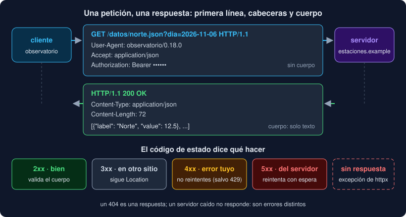

# 01 · HTTP: peticiones y respuestas

⏱️ 45 min

## 🎯 Objetivos

- Explicar qué viaja en una petición y en una respuesta HTTP.
- Leer una URL por partes: esquema, servidor, puerto, ruta y consulta.
- Elegir el método y entender qué significa que una petición sea idempotente.
- Interpretar los códigos de estado por familias y decidir qué hacer con cada una.
- Saber qué aporta HTTPS y por qué una API pide un token.

---

## 1. Un diálogo de texto

Hasta ahora, tus medidas llegaban de un archivo. En la vida real, casi siempre viven en otra máquina: un portal de datos abiertos, la API de una estación, el servidor de un compañero. La forma de pedírselas es **HTTP**, el mismo protocolo que usa tu navegador.

HTTP es un diálogo muy simple. El **cliente** (tu programa) abre una conexión con el **servidor** y le manda una **petición**; el servidor contesta con una **respuesta** y, normalmente, la conexión queda abierta para la siguiente.



Las dos partes tienen la misma forma: una primera línea, unas **cabeceras** (`Nombre: valor`, una por línea) y, si hace falta, un **cuerpo**. Una petición de verdad, tal como viaja:

```
GET /datos/norte.json?dia=2026-11-06 HTTP/1.1
Host: estaciones.example
User-Agent: observatorio/0.18.0
Accept: application/json
Authorization: Bearer abc123
```

Y su respuesta:

```
HTTP/1.1 200 OK
Content-Type: application/json
Content-Length: 72

[{"label": "Norte", "value": 12.5}, {"label": "Norte", "value": "13,1"}]
```

No tienes que escribir este texto a mano: lo hace httpx (teoría 02). Pero saber qué viaja te explica todo lo demás: dónde va el token, por qué una cabecera de más no rompe nada y por qué el cuerpo es solo texto que **tú** tienes que validar.

## 2. La URL, por partes

```
https://estaciones.example:8443/datos/norte.json?dia=2026-11-06&unidad=c
└─┬─┘   └───────┬────────┘ └┬─┘└───────┬───────┘ └──────────┬──────────┘
esquema      servidor    puerto     ruta                 consulta
```

| Parte | Qué es | Si falta |
|---|---|---|
| Esquema | `http` o `https` | httpx no sabe qué hacer: `UnsupportedProtocol` |
| Servidor | Un nombre, que el DNS convierte en una dirección IP, o la IP directamente | |
| Puerto | La "puerta" del servidor | 80 con `http`, 443 con `https` |
| Ruta | Qué recurso pides | `/` |
| Consulta | Pares `clave=valor` separados por `&` | Sin consulta |

Los caracteres raros de la consulta (espacios, tildes, `&`) se escriben **codificados**: un espacio es `%20`, una `ñ` es `%C3%B1`. Por eso nunca construyes la consulta pegando textos: le pasas un diccionario a httpx (`params={"dia": "2026-11-06"}`) y él la codifica.

`127.0.0.1` (o `localhost`) es **tu propia máquina**. Esta semana lo usarás mucho: levantas un servidor en tu equipo y le pides datos sin salir a Internet.

## 3. Métodos e idempotencia

El método dice qué quieres hacer con el recurso:

| Método | Para qué | ¿Idempotente? |
|---|---|---|
| `GET` | Leer. No debe cambiar nada en el servidor | Sí |
| `HEAD` | Como `GET`, pero sin cuerpo: solo las cabeceras | Sí |
| `POST` | Crear algo o pedir una acción | **No** |
| `PUT` | Sustituir un recurso entero | Sí |
| `PATCH` | Cambiar una parte | No necesariamente |
| `DELETE` | Borrar | Sí |

Una petición es **idempotente** si repetirla deja el servidor igual que hacerla una vez. Leer dos veces la misma estación no cambia nada; borrar dos veces el mismo recurso, tampoco (la segunda vez ya no está). Pero dos `POST` de "añade esta medida" pueden crear **dos** medidas.

Esto importa muchísimo en la teoría 03: si una petición falla a medias, solo puedes **repetirla tranquilo** si es idempotente. Tu Observatorio solo hace `GET`, y por eso puede reintentar sin miedo.

## 4. Los códigos de estado

La primera línea de la respuesta lleva un número de tres cifras. La primera cifra dice la familia:

| Familia | Significa | Ejemplos | ¿Reintentar? |
|---|---|---|---|
| `2xx` | Bien | `200 OK`, `201 Created`, `204 No Content` | No hace falta |
| `3xx` | Está en otro sitio | `301 Moved Permanently`, `304 Not Modified` | Seguir la cabecera `Location` |
| `4xx` | El error es **tuyo** | `400 Bad Request`, `401 Unauthorized`, `403 Forbidden`, `404 Not Found` | **No**: la misma petición dará lo mismo |
| `4xx` especial | Vas demasiado rápido | `429 Too Many Requests` | Sí, más despacio |
| `5xx` | El error es **del servidor** | `500 Internal Server Error`, `502 Bad Gateway`, `503 Service Unavailable`, `504 Gateway Timeout` | Sí, puede ser pasajero |

Fíjate en la diferencia entre `401` y `403`: con `401`, el servidor no sabe quién eres (falta el token o no vale); con `403`, sabe quién eres y no te deja. Y en que un `404` **no es un fallo de red**: el servidor contestó perfectamente, solo que el recurso no existe.

Hay un tercer caso, que no es ningún código: **no hay respuesta**. El servidor no existe, no acepta la conexión o tarda más de lo que estás dispuesto a esperar. En httpx eso es una excepción, no una respuesta (teoría 02).

## 5. Cabeceras que vas a usar

| Cabecera | Va en | Para qué |
|---|---|---|
| `User-Agent` | Petición | Quién pide. Un buen cliente se identifica: `observatorio/0.18.0` |
| `Accept` | Petición | Qué formato prefieres: `application/json` |
| `Authorization` | Petición | Quién eres: `Bearer <token>` |
| `Content-Type` | Las dos | Qué formato tiene el cuerpo |
| `Location` | Respuesta | Adónde se movió el recurso (con `3xx`) |
| `Retry-After` | Respuesta | Cuántos segundos esperar antes de volver (con `429` o `503`) |

Los nombres de las cabeceras no distinguen mayúsculas: `content-type` y `Content-Type` son la misma.

## 6. JSON: el cuerpo es solo texto

Casi todas las API devuelven **JSON**. Pero el cuerpo de una respuesta es solo texto (en realidad, bytes): que la cabecera diga `application/json` no garantiza nada. Un servidor en mantenimiento puede devolver `200` con una página HTML, o una lista con un campo de menos.

Por eso, en tu Observatorio, lo que llega por la red pasa por **el mismo filtro** que lo que llega de un archivo: `MeasurementIn` y Pydantic, de la semana 13. Si no valida, es un error del archivo descargado, y no se guarda nada.

## 7. HTTPS y tokens

Con `http://`, todo viaja en claro: cualquiera en tu misma red wifi puede leer la petición, **token incluido**. Con `https://`, la conexión va cifrada con TLS, y además el cliente comprueba el **certificado** del servidor: que de verdad es `estaciones.example` y no un impostor. httpx lo comprueba por defecto, con los certificados del paquete `certifi`.

Regla: un token solo viaja por `https://`. `http://` solo para `127.0.0.1` y pruebas.

Muchas API públicas no piden nada. Otras piden un **token** (o *API key*): un texto largo que te identifica, normalmente en la cabecera `Authorization: Bearer <token>`. Quien tiene tu token **es tú** para esa API: puede gastar tu cuota o leer tus datos. Es un **secreto**, y la teoría 04 explica dónde guardarlo.

---

## ⚠️ Errores comunes

| Error | Causa | Solución |
|---|---|---|
| Reintentar un `404` | Un `4xx` es un error de la petición: repetirla da lo mismo | Reintenta solo `429`, `5xx` y los fallos de red |
| Reintentar un `POST` a ciegas | No es idempotente: puedes crear el recurso dos veces | Solo `GET` y compañía, o una clave de idempotencia si la API la ofrece |
| Montar la consulta con `f"...?dia={dia}"` | Los caracteres especiales no se codifican | `params={"dia": dia}` |
| Fiarte de un `200` | El cuerpo puede no ser lo que esperas | Valida el cuerpo con Pydantic |
| Mandar un token por `http://` | Viaja en claro | `https://` siempre que haya un secreto |

---

## ✅ Qué debes saber al terminar

- [ ] Qué partes tienen una petición y una respuesta HTTP.
- [ ] Las cinco partes de una URL y por qué la consulta se codifica.
- [ ] Qué significa idempotente y por qué decide qué se puede reintentar.
- [ ] Qué significa cada familia de códigos y cuáles se reintentan.
- [ ] Por qué el cuerpo de una respuesta se valida siempre.
- [ ] Qué protege HTTPS y por qué un token es un secreto.

---

## 🔗 Navegación

| Anterior | Actual | Siguiente |
| -------- | ------ | --------- |
| [Semana 18](../README.md) | **01 · HTTP: peticiones y respuestas** | [02 · httpx: clientes, plazos y errores](02-httpx-clientes-plazos-y-errores.md) |
