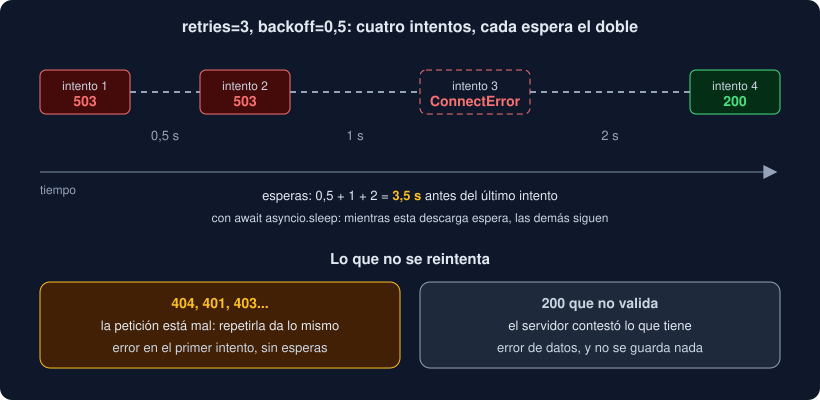

# 03 · Reintentos y espera exponencial

⏱️ 45 min

## 🎯 Objetivos

- Decidir qué fallos merece la pena reintentar y cuáles no.
- Escribir un bucle de reintentos con espera exponencial.
- Explicar para qué sirven la variación aleatoria (*jitter*) y la cabecera `Retry-After`.
- Poner un tope a los reintentos y al tiempo total.
- Saber qué ofrecen httpx y las bibliotecas de reintentos, y cuándo usarlas.

---

## 1. La red falla a ratos

Una conexión que se corta, un servidor que se reinicia, un balanceador saturado durante dos segundos: son fallos **pasajeros**. Si repites la petición un momento después, lo más probable es que salga bien. Rendirse al primer fallo hace frágil a tu programa; reintentar sin cabeza lo hace peor.

Antes de reintentar, tres preguntas:

1. **¿Puede salir bien la próxima vez?** Un `503` sí; un `404`, no.
2. **¿Es seguro repetirla?** Un `GET` sí; un `POST`, quizá no (teoría 01: idempotencia).
3. **¿Cuánto estoy dispuesto a esperar?** Cada reintento suma tiempo.

## 2. Qué se reintenta

| Situación | ¿Reintentar? | Por qué |
|---|---|---|
| `httpx.ConnectError`, `ReadTimeout`, `RemoteProtocolError`... (`TransportError`) | Sí | No hubo respuesta: puede ser un corte pasajero |
| `429 Too Many Requests` | Sí, despacio | El servidor te pide que bajes el ritmo |
| `500`, `502`, `503`, `504` | Sí | Fallo del servidor o de lo que hay delante |
| `400`, `401`, `403`, `404`, `422` | **No** | La petición está mal: repetirla da lo mismo |
| La respuesta es `200` pero no valida | **No** | El servidor contestó lo que tiene; preguntar otra vez no lo arregla |
| `UnsupportedProtocol` (URL sin `http://`) | **No** | Es un error tuyo; compruébalo antes de pedir |

Tu Observatorio guarda los códigos que se reintentan en una constante:

```python
RETRY_STATUSES = frozenset({429, 500, 502, 503, 504})
```

## 3. El bucle más simple

```python
for attempt in range(retries + 1):
    try:
        response = await client.get(url)
    except httpx.TransportError:
        continue                     # no hubo respuesta: otra vez
    if response.status_code not in RETRY_STATUSES:
        return response
raise FetchError(...)
```

`retries + 1` porque el primer intento no es un reintento: con `retries=3`, hay **cuatro** intentos. Funciona, pero tiene un problema grave: reintenta **inmediatamente**. Si el servidor está saturado, le mandas cuatro peticiones en un milisegundo y lo saturas más.

## 4. Espera exponencial

La solución clásica es esperar entre intentos, y esperar **cada vez más**: `backoff`, después el doble, después el doble otra vez.



```python
for attempt in range(retries + 1):
    if attempt > 0:
        await asyncio.sleep(backoff * 2 ** (attempt - 1))   # 0.5, 1, 2, 4...
    ...
```

Con `backoff=0.5` y `retries=3`, las esperas son 0,5 + 1 + 2 = **3,5 s** antes de rendirse. Es la cuenta que harás en el proyecto, con un cronómetro.

¿Por qué exponencial y no fija? Un fallo de medio segundo se resuelve con el primer reintento; uno de diez segundos, con el tercero o el cuarto. La espera crece rápido y le da al servidor tiempo para recuperarse sin que tú esperes de más en los fallos cortos.

Fíjate en que la espera es `asyncio.sleep`, no `time.sleep`: mientras una descarga espera su reintento, las demás siguen (semana 17).

## 5. Variación aleatoria (*jitter*)

Imagina que cien clientes pierden la conexión a la vez porque el servidor se reinició. Con espera exponencial pura, los cien reintentan a los 0,5 s exactos, otra vez a la vez, y lo tumban de nuevo. Es una **estampida**.

La solución es añadir un poco de azar a cada espera:

```python
delay = backoff * 2 ** (attempt - 1)
await asyncio.sleep(random.uniform(0, delay))     # "full jitter": entre 0 y delay
```

Así, los cien reintentos se reparten en el tiempo. Lo practicarás en el ejercicio 03. Tu Observatorio **no** lo usa: es un solo cliente que descarga unas pocas URLs, y una espera exacta es más fácil de medir y de probar. Si un día lo ejecutan cien máquinas a la vez contra el mismo servidor, es la primera línea que cambiarías.

## 6. `Retry-After`

Con `429` o `503`, el servidor puede decirte exactamente cuánto esperar:

```
HTTP/1.1 503 Service Unavailable
Retry-After: 30
```

Un cliente educado lo respeta: espera esos segundos en lugar de su propio cálculo, con un máximo razonable para no quedarse colgado si el servidor pide una hora. `Retry-After` también puede traer una fecha en lugar de segundos; el ejercicio 03 solo trata el caso de los segundos.

## 7. Topes: intentos y tiempo total

Un bucle de reintentos necesita **dos** límites:

- **Intentos**: `retries`. Sin tope, un servidor caído deja tu programa reintentando para siempre. Tu Observatorio acepta entre 0 y 10 (`OBSERVATORIO_RETRIES`).
- **Tiempo total**: cada intento puede tardar hasta el plazo de httpx (10 s), más las esperas. Cuatro intentos que agotan el plazo son 40 s + 3,5 s. Si eso es demasiado, envuelve toda la operación en un `asyncio.timeout`, como hacía `vigilar --tiempo`.

Y cuando se agotan, el error tiene que decir **qué pasó la última vez** y **cuántas veces se intentó**:

```
error: http://127.0.0.1:9/a.json respondió 503 tras 4 intentos
error: sin respuesta de http://127.0.0.1:9/a.json (ConnectError) tras 4 intentos
```

Mientras tanto, cada intento fallido queda en el registro (`logger.debug`), y lo ves con `observatorio -v`.

## 8. ¿Y no hay nada hecho?

| Opción | Qué hace | Por qué no aquí |
|---|---|---|
| `httpx.AsyncHTTPTransport(retries=3)` | Reintenta **solo** los fallos al conectar (`ConnectError`, `ConnectTimeout`), con espera exponencial | No reintenta un `503` ni un `ReadTimeout`: la conexión se abrió bien |
| `tenacity` | Decoradores de reintento muy configurables | Una dependencia más para diez líneas que entiendes |
| `stamina` | Reintentos con buenos valores por defecto (exponencial con *jitter*), sobre tenacity | Lo mismo; buena opción en un proyecto grande |

Tu bucle son diez líneas, sin dependencias, y lo pruebas entero (teoría 05). Cuando necesites reintentos en muchos sitios distintos, con políticas distintas, una biblioteca como `stamina` merece la pena.

Un paso más allá, para servicios que llaman a otros servicios todo el día, está el **cortacircuitos** (*circuit breaker*): después de muchos fallos seguidos, deja de llamar durante un rato y falla al momento. No lo necesitas para una herramienta de línea de comandos.

---

## ⚠️ Errores comunes

| Error | Causa | Solución |
|---|---|---|
| Un `404` tarda segundos en dar error | Lo reintentas | Reintenta solo `RETRY_STATUSES` y `TransportError` |
| Con `retries=3`, solo hay 3 intentos | `range(retries)` | `range(retries + 1)`: el primero no es un reintento |
| Espera antes del primer intento | Falta el `if attempt > 0` | Espera solo antes de los reintentos |
| Todas las descargas se paran durante el reintento | `time.sleep` | `await asyncio.sleep` |
| El error final no dice qué pasó | Guardas solo "falló" | Guarda el último fallo y súmale el número de intentos |
| El programa no termina con el servidor caído | Sin tope de intentos, o un `retries` enorme | Valida el número (`le=10`) y pon un tiempo total |

---

## ✅ Qué debes saber al terminar

- [ ] Las tres preguntas antes de reintentar.
- [ ] Qué fallos se reintentan y cuáles no, y por qué.
- [ ] Cuánto suman las esperas con `backoff=0.5` y `retries=3`.
- [ ] Para qué sirven el *jitter* y `Retry-After`.
- [ ] Los dos topes de un bucle de reintentos.
- [ ] Qué reintenta `AsyncHTTPTransport(retries=...)` y qué no.

---

## 🔗 Navegación

| Anterior | Actual | Siguiente |
| -------- | ------ | --------- |
| [02 · httpx: clientes, plazos y errores](02-httpx-clientes-plazos-y-errores.md) | **03 · Reintentos y espera exponencial** | [04 · Secretos y configuración con `.env`](04-secretos-y-configuracion-con-env.md) |
