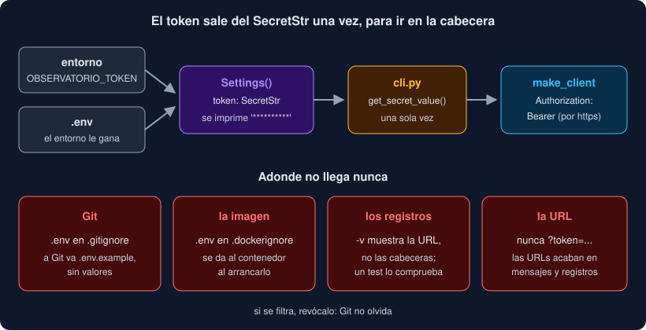

# 04 · Secretos y configuración con `.env`

⏱️ 50 min

## 🎯 Objetivos

- Separar el código de la configuración que cambia de una máquina a otra.
- Leer variables de entorno con `os.environ` y con un archivo `.env`.
- Validar la configuración con `pydantic-settings` y esconder los secretos con `SecretStr`.
- Mantener los secretos fuera de Git, de las imágenes Docker y de los registros.
- Saber qué hacer si un secreto se filtra.

---

## 1. Lo que no va en el código

Tu programa tiene dos clases de valores:

- los que forman parte de **qué hace**: los umbrales `LOW` y `HIGH`, los códigos que se reintentan, el formato de la tabla. Van en el código y se revisan en un *pull request*;
- los que dependen de **dónde se ejecuta**: el token de la API, el plazo en una red lenta, la dirección de la base de datos de la semana 19. Cambian entre tu portátil, el de tu compañero, Docker y el servidor.

Los segundos son **configuración**, y van **fuera** del código. Es una de las reglas de [The Twelve-Factor App](https://12factor.net/es/config): la configuración vive en **variables de entorno**. Una prueba rápida: ¿podrías publicar tu repositorio ahora mismo sin enseñar ninguna credencial? Si no, tienes configuración dentro del código.

## 2. Variables de entorno

Cada proceso recibe de quien lo arranca un diccionario de textos: su **entorno**. En la terminal:

```bash
export OBSERVATORIO_TOKEN=abc123      # para esta terminal y lo que arranque
OBSERVATORIO_RETRIES=0 uv run observatorio descargar ...   # solo para esta orden
```

En Python, `os.environ` es ese diccionario:

```python
import os

os.environ["OBSERVATORIO_TOKEN"]          # 'abc123', o KeyError: 'OBSERVATORIO_TOKEN'
os.environ.get("OBSERVATORIO_TOKEN")      # 'abc123', o None
os.environ.get("OBSERVATORIO_RETRIES", "3")   # con un valor por defecto
```

Dos problemas que ya habrás notado: **todo es texto** (`"3"`, no `3`; `"0"` no es falso) y **nadie lo valida**. `OBSERVATORIO_TIMEOUT=rápido` llega a tu código tal cual, y falla lejos de donde se configuró.

## 3. El archivo `.env`

Escribir `export` cada vez que abres una terminal cansa. La costumbre es guardar las variables de tu máquina en un archivo **`.env`**, en la raíz del proyecto:

```bash
# .env: la configuración de TU máquina. Nunca va a Git.
OBSERVATORIO_TOKEN=abc123
OBSERVATORIO_TIMEOUT=10
```

Hay dos formas de cargarlo:

- **uv**: `uv run --env-file .env observatorio ...` mete las variables en el entorno antes de arrancar. Si el archivo no existe: `error: No environment file found at: .env`;
- **pydantic-settings**, que lo lee por su cuenta desde el programa (sección 4). Es lo que usa tu Observatorio: funciona igual con `uv run`, en Docker o en la semana 20 con FastAPI.

Y junto a él, un **`.env.example`** que **sí** va a Git: las mismas claves, sin valores de verdad. Quien clona el repositorio lo copia (`cp .env.example .env`) y rellena lo suyo.

```bash
# .env.example: copia este archivo a .env y pon tus valores.
OBSERVATORIO_TOKEN=
OBSERVATORIO_TIMEOUT=10
OBSERVATORIO_RETRIES=3
```

## 4. `pydantic-settings`

`pydantic-settings` es una extensión de Pydantic (semana 13): un modelo cuyos campos se rellenan **solos** desde el entorno y desde `.env`, convertidos y validados.

```bash
uv add pydantic-settings==2.16.1
```

```python
from typing import Annotated

from pydantic import Field, SecretStr
from pydantic_settings import BaseSettings, SettingsConfigDict


class Settings(BaseSettings):
    model_config = SettingsConfigDict(
        env_prefix="OBSERVATORIO_",
        env_file=".env",
        env_ignore_empty=True,
        extra="ignore",
        frozen=True,
    )

    token: SecretStr | None = None
    timeout: Annotated[float, Field(gt=0)] = 10.0
    retries: Annotated[int, Field(ge=0, le=10)] = 3
```

| Opción | Qué hace |
|---|---|
| `env_prefix="OBSERVATORIO_"` | `timeout` se lee de `OBSERVATORIO_TIMEOUT`. Sin prefijo, leería `TIMEOUT`, que puede ser de cualquier otro programa |
| `env_file=".env"` | Lee también `.env`, si existe, en la carpeta **desde la que ejecutas** el programa |
| `env_ignore_empty=True` | `OBSERVATORIO_TOKEN=`, vacío como en `.env.example`, cuenta como "no está": el token queda en `None`, no en `""` |
| `extra="ignore"` | Una variable de `.env` que no es tuya no es un error |
| `frozen=True` | La configuración no cambia mientras el programa corre |

`Settings()` lee y valida en el momento de crearlo. Si algo no vale, `ValidationError` dice qué campo y por qué:

```
1 validation error for Settings
timeout
  Input should be a valid number, unable to parse string as a number [type=float_parsing, input_value='rápido', input_type=str]
```

¿Quién gana si una variable está en los dos sitios? El **entorno** gana a `.env`. Así puedes tener tu `.env` de siempre y cambiar un valor solo para una orden: `OBSERVATORIO_RETRIES=0 uv run observatorio descargar ...`.

## 5. `SecretStr`: que no se vea al imprimirlo

Un secreto se filtra casi siempre **por accidente**: un `print(settings)` para depurar, un log con la configuración, una traza de error que muestra las variables locales. `SecretStr` lo evita:

```python
>>> settings
Settings(token=SecretStr('**********'), timeout=10.0, retries=3)
>>> print(settings.token)
**********
>>> settings.token.get_secret_value()
'abc123'
```

El valor de verdad solo sale con `get_secret_value()`, que es fácil de buscar en el código. En tu Observatorio aparece **una vez**, en la CLI, justo antes de crear el cliente HTTP. `core` nunca ve `Settings`: recibe el token como un argumento más.



## 6. Dónde **no** puede acabar un secreto

| Sitio | Cómo se evita |
|---|---|
| **Git** | `.env` en `.gitignore`, **antes** del primer `git add`. Compruébalo con `git check-ignore -v .env` |
| **La imagen Docker** | `.env` en `.dockerignore`. Si no, `COPY . .` lo mete dentro, y cualquiera con la imagen lo lee. En tiempo de ejecución, se lo das al contenedor: `env_file: .env` en `compose.yaml`, o `docker run --env-file .env ...` |
| **Los registros** | No registres cabeceras ni la configuración entera. httpx registra la URL de cada petición (`HTTP Request: GET ...`), **no** las cabeceras |
| **La URL** | Algunas API aceptan el token en la consulta (`?api_key=...`). Evítalo si puedes: las URLs acaban en registros, en el historial y en los mensajes de error. La cabecera `Authorization` no |
| **Los tests** | Tokens falsos (`"abc123"`), nunca el tuyo. Y un test que compruebe que no aparece en la salida |
| **El *pull request*** | Revisa la salida que pegas: un `env` o un `-v` pueden llevar más de lo que crees |

GitHub ayuda: su **escaneo de secretos** (*secret scanning*, con *push protection*) rechaza un `git push` que contiene un token con formato conocido. Es una red de seguridad, no un plan: un token inventado por una API pequeña no lo reconoce nadie.

## 7. Si se filtra

**Git no olvida.** Un `git rm .env` y un commit nuevo no borran el secreto: sigue en el historial, y cualquiera con una copia del repositorio lo encuentra con `git log -p`. Reescribir el historial ayuda poco: puede que ya esté en el ordenador de otra persona o en una caché de GitHub.

Lo único que funciona:

1. **Revoca** el token en la web de la API, ya. Desde ese momento no vale para nada.
2. Crea uno nuevo y ponlo en tu `.env`.
3. Después, si quieres, limpia el historial y añade `.env` al `.gitignore` para que no vuelva a pasar.

Por eso los tokens buenos se pueden revocar, tienen permisos mínimos (solo lectura, si solo lees) y caducan.

---

## ⚠️ Errores comunes

| Error | Causa | Solución |
|---|---|---|
| `KeyError: 'OBSERVATORIO_TOKEN'` | `os.environ[...]` de una variable que no existe | `os.environ.get(...)`, o un campo con valor por defecto en `Settings` |
| `.env` no se lee | Ejecutas el programa desde otra carpeta: `env_file` es relativo a la carpeta actual | Ejecútalo desde la raíz del proyecto |
| Un valor de `.env` no se aplica | La misma variable está exportada en tu terminal, y el entorno gana | `unset OBSERVATORIO_...` o `env \| grep OBSERVATORIO` para ver qué hay |
| `.env` aparece en `git status` | No está en `.gitignore` | Añádelo **antes** de hacer `git add .` |
| El token sale en un `print` | Es un `str`, no un `SecretStr` | Anota `token` como `SecretStr` en `Settings` |
| Subiste el token a GitHub | | Revócalo primero; borrar el commit no basta |

---

## ✅ Qué debes saber al terminar

- [ ] Qué valores son configuración y por qué van fuera del código.
- [ ] Cómo se leen las variables de entorno y sus dos problemas.
- [ ] Para qué sirven `.env` y `.env.example`, y cuál va a Git.
- [ ] Qué hace cada opción de `SettingsConfigDict` en tu `Settings`.
- [ ] Qué gana, el entorno o `.env`.
- [ ] Qué protege `SecretStr` y qué no.
- [ ] Los sitios donde no puede acabar un secreto, y qué hacer si acaba.

---

## 🔗 Navegación

| Anterior | Actual | Siguiente |
| -------- | ------ | --------- |
| [03 · Reintentos y espera exponencial](03-reintentos-y-espera-exponencial.md) | **04 · Secretos y configuración con `.env`** | [05 · Probar clientes HTTP y validar lo que llega](05-probar-clientes-http-y-validar-lo-que-llega.md) |
