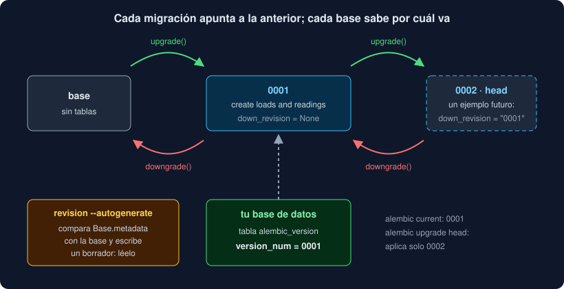

# 04 · Alembic: migraciones del esquema

⏱️ 45 min

## 🎯 Objetivos

- Explicar por qué las tablas se cambian con migraciones y no con `create_all`.
- Preparar Alembic en un proyecto: `alembic.ini`, `env.py` y `versions/`.
- Generar una migración con `--autogenerate`, leerla y aplicarla.
- Moverte por la cadena de migraciones: `upgrade`, `downgrade`, `current`, `history`.
- Reconocer lo que `--autogenerate` no sabe hacer, y arreglarlo a mano.
- Comprobar que modelos y migraciones están de acuerdo con `alembic check`.

---

## 1. El problema

Tus modelos describen cómo deben ser las tablas. Pero la base de datos ya existe, en tu máquina, en la de cada compañero y en el servidor, y tiene **datos**. `Base.metadata.create_all(engine)` crea las tablas que faltan, y nada más: si añades una columna a un modelo, no la añade a una tabla que ya existe.

Una **migración** es un pequeño programa que lleva la base de un estado al siguiente: "añade la columna `region`", "renombra `altitude` a `elevation`". Las migraciones van a Git, en orden, y cada base aplica las que le faltan. **Alembic** es la herramienta de migraciones de SQLAlchemy.

## 2. La cadena



Cada migración tiene un identificador (`revision`) y apunta a la anterior (`down_revision`): forman una **cadena**. `base` es "sin migraciones"; `head`, la última. Alembic guarda en cada base, en la tabla `alembic_version`, por qué revisión va, y así sabe cuáles le faltan.

```python
revision: str = "0001"
down_revision: str | Sequence[str] | None = None


def upgrade() -> None:
    op.create_table("loads", ...)


def downgrade() -> None:
    op.drop_table("loads")
```

`upgrade` va hacia delante; `downgrade` deshace exactamente eso. Las operaciones de `op` (`create_table`, `add_column`, `alter_column`, `create_index`, `execute`...) se traducen al SQL de PostgreSQL.

## 3. Preparar Alembic

```bash
uv add alembic==1.20.1
uv run alembic init migrations
```

| Archivo | Para qué |
|---|---|
| `alembic.ini` | La configuración: dónde están las migraciones, cómo se llaman los archivos, el registro |
| `migrations/env.py` | El programa que Alembic ejecuta en cada orden: con qué base conectar y con qué modelos comparar |
| `migrations/script.py.mako` | La plantilla de cada migración nueva |
| `migrations/versions/` | Las migraciones, una por archivo |

En `env.py`, dos cosas: `target_metadata = Base.metadata`, para que `--autogenerate` sepa cómo **deberían** ser las tablas, y la URL de la base. En tu proyecto la URL sale de `Settings` (`OBSERVATORIO_DATABASE_URL`) y **no** de `alembic.ini`, que va a Git: la URL lleva una contraseña. Es la misma regla que el token de la semana 18.

Tres ajustes de `alembic.ini` que usa tu proyecto:

```ini
# Nombres como 0001_create_loads_and_readings.py.
file_template = %%(rev)s_%%(slug)s

# Cada migración nueva sale ya corregida y formateada por ruff.
hooks = ruff_check, ruff_format
ruff_check.type = module
ruff_check.module = ruff
ruff_check.options = check --fix REVISION_SCRIPT_FILENAME
```

Los `%%` son `%` escapados: `alembic.ini` es un archivo de `configparser`, y un `%` solo tiene otro significado.

## 4. `--autogenerate`

```bash
uv run alembic revision --autogenerate --rev-id 0001 -m "create loads and readings"
```

Alembic se conecta, mira las tablas que hay, las compara con `Base.metadata` y escribe en una migración las diferencias. `--rev-id 0001` pone un identificador legible en lugar de uno al azar (`9397e8d640fc`); `-m` es la descripción, que también va al nombre del archivo.

**Es un borrador.** La plantilla lo dice (`please adjust!`) y va en serio. Lo que `--autogenerate` detecta bien:

- tablas y columnas nuevas o que sobran;
- cambios de `NULL`, de tipo (casi siempre), índices, restricciones únicas y claves foráneas.

Lo que **no** sabe:

- **renombrados**: ve una columna que falta y otra que sobra, y propone borrar y crear. Con los datos dentro (ejercicio 04, paso 6);
- columnas nuevas `NOT NULL` en tablas con filas: hay que dar un `server_default` o rellenarlas antes (ejercicio 04, paso 5);
- cambios en los **datos**: pasar un texto a mayúsculas, repartir una columna en dos. Esos se escriben con `op.execute(...)`.

Así que cada migración se **lee** antes de aplicarla, y se revisa en el *pull request* como cualquier código.

## 5. Nombres de restricciones

Sin indicarle nada, PostgreSQL inventa los nombres de las restricciones (`readings_load_id_fkey`). Funciona, hasta que una migración futura necesita borrar una y no sabe cómo se llama en cada base. Por eso tu `Base` fija una convención:

```python
class Base(DeclarativeBase):
    metadata = MetaData(
        naming_convention={
            "ix": "ix_%(column_0_label)s",
            "uq": "uq_%(table_name)s_%(column_0_N_name)s",
            "ck": "ck_%(table_name)s_%(constraint_name)s",
            "fk": "fk_%(table_name)s_%(column_0_name)s_%(referred_table_name)s",
            "pk": "pk_%(table_name)s",
        }
    )
```

Con ella, la clave foránea de `readings` se llama `fk_readings_load_id_loads` en todas las bases. Se pone **antes** de la primera migración: cambiarla después obliga a renombrar todo.

## 6. Moverse por la cadena

| Orden | Qué hace |
|---|---|
| `alembic upgrade head` | Aplica todas las que faltan |
| `alembic upgrade +1` / `downgrade -1` | Una hacia delante o hacia atrás |
| `alembic downgrade base` | Las deshace todas (y con la última, `DROP TABLE`: los datos se van) |
| `alembic current` | La revisión de la base |
| `alembic history` | La cadena entera |
| `alembic upgrade head --sql` | Escribe el SQL sin conectarse: para revisarlo o dárselo a quien administra la base |
| `alembic check` | Falla si los modelos tienen cambios sin migración |

En PostgreSQL, cada migración se aplica **dentro de una transacción**: si falla a mitad, no queda nada a medias, y `alembic_version` sigue donde estaba. No todas las bases pueden hacerlo; PostgreSQL sí.

## 7. Migraciones en equipo

- **Una migración aplicada no se edita.** Si ya está en `main`, o en la base de alguien, se corrige con una migración nueva. Editarla deja bases que creen estar al día y no lo están.
- **Una sola cabeza.** Si dos ramas crean una migración sobre la misma, hay dos `head`, y `upgrade head` falla con `Multiple head revisions are present`. Se arregla con `alembic merge`, o rehaciendo la tuya sobre la última. El test `test_there_is_one_head_and_it_is_0001` de tu proyecto lo vigila.
- **El código y su migración, en el mismo *pull request*.** Y un test que compare los dos, como `alembic check`: `test_the_migrations_match_the_models` falla si cambias un modelo y te olvidas de la migración.

## 8. ¿Y `create_all`?

`create_all` sirve para un ejercicio o para un prototipo de una tarde. En cuanto la base tiene datos que importan o la usa más de una persona, las tablas las crean **solo** las migraciones. En tu proyecto, ni siquiera los tests usan `create_all`: la fixture `engine` aplica las migraciones a una base vacía, así que cada `uv run pytest` comprueba también que la cadena funciona desde cero.

---

## ⚠️ Errores comunes

| Error | Causa | Solución |
|---|---|---|
| La migración sale vacía | `target_metadata` no tiene tus modelos, o no se importaron | `target_metadata = Base.metadata`, importando el módulo de los modelos |
| `Can't load plugin: sqlalchemy.dialects:driver` | `env.py` usa la URL de mentira de `alembic.ini` | Pon la URL en `env.py`, desde la configuración |
| `Target database is not up to date.` | Pides `--autogenerate` con migraciones sin aplicar | `alembic upgrade head` primero |
| `column "x" of relation "y" contains null values` | Columna `NOT NULL` nueva en una tabla con filas | `server_default`, o añádela con `NULL`, rellena y después `NOT NULL` |
| Una columna renombrada perdió sus datos | Aplicaste el `drop_column` + `add_column` de `--autogenerate` | `op.alter_column(..., new_column_name=...)` |
| `Can't locate revision identified by '0001'` | La base va por una revisión que no está en tu `versions/` | Otra rama, u otro proyecto en la misma base: vuelve a la rama, o empieza con una base vacía |
| `Multiple head revisions are present` | Dos migraciones con la misma `down_revision` | `alembic merge heads`, o rehaz la tuya sobre la última |

---

## ✅ Qué debes saber al terminar

- [ ] Por qué `create_all` no basta cuando la base tiene datos.
- [ ] Qué son `revision`, `down_revision`, `base`, `head` y `alembic_version`.
- [ ] Qué hay en `env.py` y por qué la URL no va en `alembic.ini`.
- [ ] Tres cosas que `--autogenerate` no sabe hacer.
- [ ] Para qué sirve la `naming_convention`, y cuándo se pone.
- [ ] Las tres reglas de las migraciones en equipo.

---

## 🔗 Navegación

| Anterior | Actual | Siguiente |
| -------- | ------ | --------- |
| [03 · SQLAlchemy 2: motor, Core y ORM](03-sqlalchemy-2-motor-core-y-orm.md) | **04 · Alembic: migraciones del esquema** | [05 · Probar con una base de datos de verdad](05-probar-con-una-base-de-datos-de-verdad.md) |
