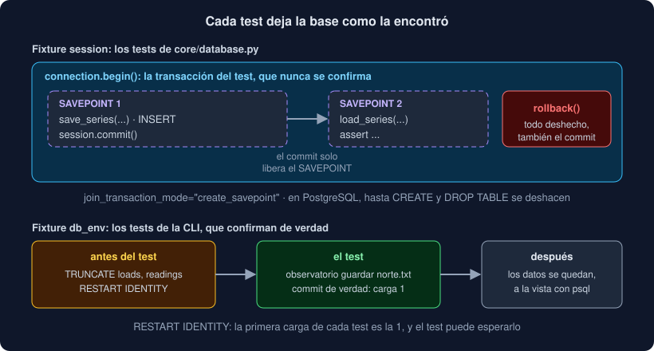

# 05 · Probar con una base de datos de verdad

⏱️ 50 min

## 🎯 Objetivos

- Explicar por qué los tests usan PostgreSQL y no una base "parecida".
- Separar la base de pruebas de la de desarrollo.
- Preparar la base de pruebas una vez por sesión, con las migraciones.
- Aislar cada test en una transacción que se deshace al terminar.
- Probar la CLI, que confirma de verdad, sin que un test ensucie al siguiente.
- Contar consultas, probar restricciones y comprobar que un error no enseña la contraseña.

---

## 1. Con la base de verdad

Hay una tentación: probar con SQLite en memoria, que no necesita servidor. El problema es que **no es PostgreSQL**. No comprueba igual las longitudes de `varchar(100)`, sus tipos son otros, y sus errores y sus transacciones tampoco se parecen. Un test que pasa con SQLite no dice nada de tu programa con PostgreSQL, y en este bootcamp la base es siempre PostgreSQL.

Así que los tests de `test_database.py` hablan con el PostgreSQL de `compose.yaml`. Antes de `uv run pytest`:

```bash
docker compose up -d --wait db
```

Si se te olvida, la fixture `engine` falla con un mensaje claro, sin traza:

```
no hay PostgreSQL en 127.0.0.1:5432: arráncalo con `docker compose up -d --wait db`
```

## 2. Dos bases en el mismo servidor

Tus pruebas **no** usan la base `observatorio`, la de tu `.env`, donde guardas tus cargas. Usan otra, `observatorio_test`, en el mismo servidor:

| Variable | Base | La usa |
|---|---|---|
| `OBSERVATORIO_DATABASE_URL` | `observatorio` | La CLI y `alembic` |
| `OBSERVATORIO_TEST_DATABASE_URL` | `observatorio_test` | Los tests (`db_fixtures.py`) |

Sin la variable de pruebas, `db_fixtures.py` usa `127.0.0.1:5432/observatorio_test`; en Docker, `compose.yaml` la cambia por `db:5432/observatorio_test`, porque dentro de la red de compose PostgreSQL se llama `db`.

## 3. Preparar la base una vez

La fixture `engine` tiene `scope="session"`: se ejecuta **una** vez por cada `uv run pytest`.

```python
@pytest.fixture(scope="session")
def engine() -> Iterator[Engine]:
    url = make_url(TEST_URL)
    admin = create_engine(url.set(database="postgres"), isolation_level="AUTOCOMMIT")
    with admin.connect() as connection:
        connection.execute(text(f'DROP DATABASE IF EXISTS "{url.database}" WITH (FORCE)'))
        connection.execute(text(f'CREATE DATABASE "{url.database}"'))
    admin.dispose()
    engine = make_engine(TEST_URL)
    with engine.begin() as connection:
        command.upgrade(alembic_config(connection), "head")
    yield engine
    engine.dispose()
```

- `CREATE DATABASE` no puede ir dentro de una transacción: por eso `AUTOCOMMIT`, contra la base `postgres`, que siempre existe.
- La base se **borra y se crea** en cada ejecución: lo que dejara una ejecución anterior a medias no cuenta. `WITH (FORCE)` cierra las conexiones que quedaran abiertas.
- Las tablas las crean **las migraciones**, no `create_all`. Cada `uv run pytest` comprueba, de paso, que tu cadena de Alembic funciona desde cero.
- `alembic_config(connection)` pasa la conexión ya abierta en `config.attributes["connection"]`, y tu `env.py` la usa en lugar de leer `OBSERVATORIO_DATABASE_URL`.

El nombre de la base va entre comillas dentro de una f-string: un nombre no puede ser un parámetro (teoría 02), y este sale de tu configuración, no de un usuario.

## 4. Una transacción por test



Crear la base es lento; vaciarla después de cada test, también. El truco: cada test trabaja **dentro de una transacción que nunca se confirma**.

```python
@pytest.fixture
def session(engine: Engine) -> Iterator[Session]:
    with engine.connect() as connection:
        transaction = connection.begin()
        session = Session(bind=connection, join_transaction_mode="create_savepoint")
        yield session
        session.close()
        transaction.rollback()
```

El test inserta, consulta y borra con normalidad; al terminar, `rollback` y la base queda como estaba. Y si el código que pruebas hace `session.commit()`, `join_transaction_mode="create_savepoint"` hace que ese commit confirme solo un **SAVEPOINT** dentro de la transacción de fuera, que el `rollback` final deshace igual.

Funciona con todo porque en PostgreSQL todo es transaccional, también `DROP TABLE`: `test_downgrade_and_upgrade_again` deshace todas las migraciones y las rehace dentro de una transacción, y los demás tests no se enteran.

## 5. Los tests de la CLI

La CLI abre su propio motor con `OBSERVATORIO_DATABASE_URL` y confirma de verdad: no hay transacción de fuera que deshacer. La fixture `db_env` hace otra cosa:

```python
monkeypatch.setenv("OBSERVATORIO_DATABASE_URL", TEST_URL)
with engine.begin() as connection:
    connection.execute(text("TRUNCATE loads, readings RESTART IDENTITY"))
```

Apunta la CLI a la base de pruebas y vacía las tablas **antes** de cada test. `RESTART IDENTITY` reinicia los números, así que la primera carga es siempre la 1, y un test puede esperar `carga 1: norte.txt, 3 medidas`. Vaciar antes, y no después, deja los datos del último test a la vista si quieres mirarlos con `psql`.

También deja la carpeta de trabajo vacía y sin `.env` (`monkeypatch.chdir(tmp_path)`), como `clean_env` en la semana 18: así no se cuela tu configuración.

## 6. Compartir las fixtures

Las fixtures de PostgreSQL viven en `tests/db_fixtures.py`, que **no** empieza por `test_`: pytest no lo recoge como tests. Para que lleguen a `test_database.py` **y** a tus tests, tu `conftest.py` las importa:

```python
from db_fixtures import db_env, engine, session

__all__ = ["db_env", "engine", "session"]
```

Una fixture importada en `conftest.py` está disponible en todos los archivos de su carpeta. El `__all__` le dice a ruff que el import es a propósito.

## 7. Qué probar

**Ida y vuelta.** Lo que guardas, vuelve igual: `load_series(session, save_series(...).id) == series`.

**Cuántas consultas.** Un *listener* del evento `before_cursor_execute` apunta cada SQL que se envía:

```python
statements: list[str] = []
event.listen(session.connection(), "before_cursor_execute", lambda *args: statements.append(str(args[2])))
list_loads(session)
assert len(statements) == 1
```

Así un N+1 (teoría 03) es un test en rojo, y no un programa lento que nadie sabe por qué.

**Las restricciones.** Que PostgreSQL rechace lo que debe, mirando el error de psycopg que hay dentro del de SQLAlchemy:

```python
with pytest.raises(IntegrityError) as caught:
    session.flush()
assert isinstance(caught.value.orig, errors.UniqueViolation)
```

**Modelos y migraciones de acuerdo.** `compare_metadata(MigrationContext.configure(connection), Base.metadata) == []` es `alembic check` dentro de un test.

**Los fallos de la CLI.** Sin URL, con una URL que no es una URL, con el servidor apagado (el puerto 1, donde nunca hay nadie) y sin tablas (la base `postgres`, que no las tiene). En cada caso, el código de salida, el mensaje, y que la **contraseña no aparece**:

```python
assert url.password not in result.output
```

## 8. En Docker

```bash
docker compose run --build --rm app
```

`app` arranca **después** de que `db` esté sano (`depends_on` con `condition: service_healthy`), con las dos variables apuntando a `db`. Es la misma prueba que en tu máquina, sin depender de nada de tu máquina. Para trabajar con la base de desarrollo desde el contenedor:

```bash
docker compose run --rm app alembic upgrade head
docker compose run --rm app observatorio guardar medidas.txt
```

Hay bibliotecas que arrancan un PostgreSQL en un contenedor desde el propio test (*testcontainers*). Con compose ya tienes lo mismo, más visible y sin otra dependencia.

---

## ⚠️ Errores comunes

| Error | Causa | Solución |
|---|---|---|
| `no hay PostgreSQL en 127.0.0.1:5432` | No arrancaste la base | `docker compose up -d --wait db` |
| `fixture 'session' not found` en tus tests | Tu `conftest.py` no importa las fixtures | `from db_fixtures import db_env, engine, session` |
| Un test ve los datos de otro | Usa `Session(engine)` en lugar de la fixture `session` | Pide `session` como parámetro |
| Los tests de la CLI esperan `carga 1` y sale `carga 3` | Falta `RESTART IDENTITY` al vaciar | Usa la fixture `db_env` |
| Los tests borran tus cargas de desarrollo | `OBSERVATORIO_TEST_DATABASE_URL` apunta a `observatorio` | Las pruebas, siempre en una base aparte |
| `database "observatorio_test" is being accessed by other users` | Un `psql` abierto en la base de pruebas, sin `WITH (FORCE)` | Ciérralo; la fixture ya usa `FORCE` |

---

## ✅ Qué debes saber al terminar

- [ ] Por qué no se prueba con una base "parecida".
- [ ] Qué base usa cada variable, en tu máquina y en Docker.
- [ ] Qué hace la fixture `engine`, y por qué con las migraciones.
- [ ] Cómo una transacción por test deja la base limpia, aunque el código haga commit.
- [ ] Qué hace `db_env` y por qué la CLI necesita algo distinto.
- [ ] Cómo se cuenta el SQL de una función y cómo se prueba una restricción.

---

## 🔗 Navegación

| Anterior | Actual | Siguiente |
| -------- | ------ | --------- |
| [04 · Alembic: migraciones del esquema](04-alembic-migraciones-del-esquema.md) | **05 · Probar con una base de datos de verdad** | [Ejercicio 01 · Consultas con psycopg](../2-practicas/ejercicio-01-consultas-con-psycopg/README.md) |
