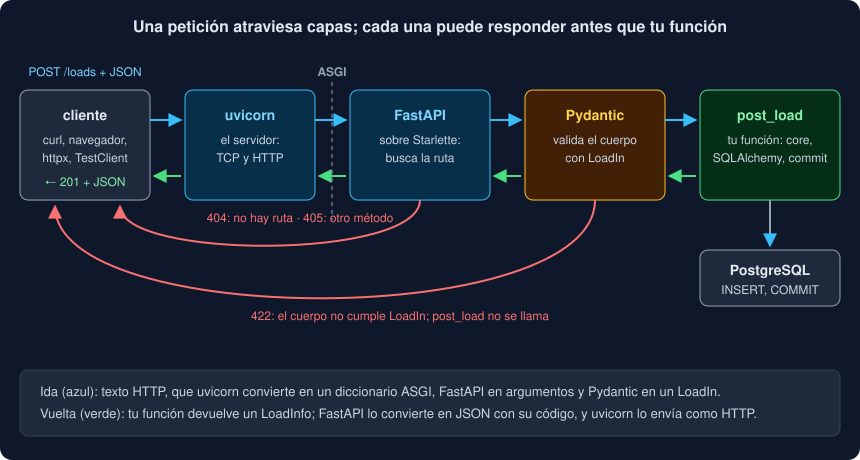

# 01 · De la CLI a la web: HTTP, ASGI y FastAPI

⏱️ 45 min

## 🎯 Objetivos

- Explicar qué gana tu Observatorio al servir sus datos por HTTP, y qué cambia respecto de ser cliente (semana 18).
- Leer una petición y una respuesta desde el lado del servidor: método, ruta, consulta, cuerpo, código.
- Distinguir el **servidor** (uvicorn) de la **aplicación** (FastAPI), y situar **ASGI** entre los dos.
- Escribir una aplicación FastAPI mínima y leer su documentación OpenAPI.
- Saber qué deja fuera esta semana y dónde seguir: [bc-fastapi](https://github.com/ergrato-dev/bc-fastapi).

---

## 1. Por qué una API

Tus medidas viven en PostgreSQL desde la semana 19. Para consultarlas hay que tener el Observatorio instalado, una terminal y la URL de la base, con su contraseña. Eso sirve para ti, pero no para:

- un **panel** web que dibuje las medias por etiqueta;
- un **cuaderno** de análisis (fase 4) que quiera las medidas de la carga 7;
- un **sensor** o un móvil que quiera enviar medidas nuevas;
- otro **programa** en otro lenguaje.

Todos saben hablar **HTTP**. Una **API HTTP** es una puerta: unas pocas direcciones (`/loads`, `/stats`) que aceptan peticiones y responden JSON. Quien llama no sabe que hay PostgreSQL detrás, ni tiene su contraseña. Solo conoce el contrato: qué rutas hay, qué esperan y qué devuelven.

En la semana 18 tu programa era **cliente**: hacía peticiones a una API ajena con `httpx`. Esta semana es **servidor**: espera peticiones y las responde. Las piezas son las mismas, vistas desde el otro lado.

---

## 2. Petición y respuesta, desde el servidor

```
POST /loads?dry=false HTTP/1.1                ← método, ruta y consulta
Host: 127.0.0.1:8000
Content-Type: application/json                ← cabeceras
                                              
{"source": "sensor-3", "measurements": [...]} ← cuerpo
```

```
HTTP/1.1 201 Created                          ← código
content-type: application/json
location: /loads/7                            ← cabeceras

{"id": 7, "source": "sensor-3", ...}          ← cuerpo
```

Tu trabajo como servidor: leer las cuatro partes de la petición, decidir qué hacer y escribir las tres de la respuesta. El **método** dice la intención; la **ruta** nombra un **recurso**:

| Método | Sobre `/loads` | Sobre `/loads/7` |
|---|---|---|
| `GET` | la lista de cargas | la carga 7 (sin cambiar nada) |
| `POST` | crea una carga nueva | — |
| `DELETE` | — | borra la carga 7 |
| `PUT` / `PATCH` | — | la sustituye / la cambia en parte (no los usarás esta semana) |

Las rutas son **sustantivos** (`/loads`), no verbos (`/borrarCarga`): el verbo ya lo pone el método. El **código** resume lo que pasó, y quien llama decide con él antes de leer el cuerpo:

| Código | Significa | En tu API |
|---|---|---|
| 200 OK | aquí tienes | `GET` |
| 201 Created | creado; `Location` dice dónde | `POST /loads` |
| 204 No Content | hecho, nada que contar (sin cuerpo) | `DELETE` |
| 404 Not Found | ese recurso no existe | `/loads/999` |
| 405 Method Not Allowed | la ruta existe, el método no | `PUT /loads` |
| 422 Unprocessable Content | entiendo la petición, pero los datos no valen | un cuerpo sin `source` |
| 500 Internal Server Error | fallo tuyo, del servidor | un error que nadie atrapó |
| 503 Service Unavailable | ahora no puedo; inténtalo luego | PostgreSQL no contesta |

Los 4xx son culpa de **quien llama**: repetir la misma petición dará lo mismo. Los 5xx son del **servidor**: quizá dentro de un rato funcione. Es la regla que usaba tu `get_text` de la semana 18 para decidir si reintentar.

---

## 3. Dos piezas: el servidor y la aplicación



Servir HTTP tiene dos trabajos muy distintos:

- **El servidor** abre un puerto, acepta conexiones TCP, lee bytes, los interpreta como HTTP (con sus casos raros: cabeceras partidas, conexiones que se cortan, *keep-alive*) y escribe bytes de vuelta. Es **uvicorn**.
- **La aplicación** decide qué responder a cada petición. Es **FastAPI** con tus rutas.

Entre los dos hay un contrato, **ASGI** (*Asynchronous Server Gateway Interface*): el servidor llama a la aplicación con un diccionario que describe la petición (`scope`) y dos funciones para leer el cuerpo (`receive`) y enviar la respuesta (`send`). Una aplicación ASGI escrita a mano es una corrutina:

```python
async def app(scope, receive, send):
    """Una aplicación ASGI sin FastAPI: responde lo mismo a todo."""
    await send({"type": "http.response.start", "status": 200,
                "headers": [(b"content-type", b"text/plain")]})
    await send({"type": "http.response.body", "body": b"hola"})
```

Funciona con `uvicorn modulo:app`, pero no sabe de rutas, ni de JSON, ni de validar nada. Eso es lo que pone FastAPI. Gracias a ASGI, cualquier servidor sirve cualquier aplicación: uvicorn, Hypercorn o Granian con FastAPI, Starlette o Django. Y `TestClient` puede llamar a la aplicación **sin servidor**: construye el `scope` y llama a la corrutina, como lo haría uvicorn.

---

## 4. FastAPI en una página

```python
from fastapi import FastAPI, HTTPException

app = FastAPI(title="Observatorio")

STATIONS = {1: "Norte", 2: "Sur"}


@app.get("/stations/{station_id}")
def get_station(station_id: int, upper: bool = False) -> dict[str, object]:
    """La estación de un número; ?upper=true la escribe en mayúsculas."""
    if station_id not in STATIONS:
        raise HTTPException(status_code=404, detail=f"no existe la estación {station_id}")
    name = STATIONS[station_id]
    return {"id": station_id, "name": name.upper() if upper else name}
```

Fíjate en lo que **no** escribes:

- `@app.get(...)` registra la función para ese método y esa ruta. `{station_id}` es un hueco de la ruta;
- **las anotaciones son el contrato**: `station_id: int` hace que FastAPI convierta `"2"` en `2`, y que responda 422 si llega `"dos"`, sin llamar a tu función. `upper: bool = False` es un parámetro de la consulta, opcional;
- devuelves un diccionario (o un modelo, o una *dataclass*) y FastAPI lo convierte en JSON con el código 200;
- `HTTPException` corta la función y responde con su código.

FastAPI está construido sobre dos bibliotecas: **Starlette**, que pone las rutas, las peticiones y las respuestas ASGI, y **Pydantic** (semana 13), que valida y convierte. FastAPI lee tus anotaciones y las une.

---

## 5. La documentación que se escribe sola

Con las rutas y sus anotaciones, FastAPI construye la descripción **OpenAPI** de tu API: un JSON estándar con cada ruta, sus parámetros, el cuerpo que espera y lo que devuelve. Está en `/openapi.json`, y dos páginas la leen:

- **`/docs`** (Swagger UI): la lista de rutas, con un botón **Try it out** para probarlas desde el navegador;
- **`/redoc`**: la misma información, para leer.

No la mantienes tú: cambia cuando cambia el código, así que no se queda vieja. Y otros programas la leen para generar clientes en otros lenguajes. Por eso merece la pena escribir bien las anotaciones y los *docstrings*: el *docstring* de cada ruta sale en `/docs` como su descripción.

---

## 6. uvicorn

```bash
uv run uvicorn main:app --reload               # desarrollo: reinicia al guardar
uv run uvicorn main:app --host 0.0.0.0 --port 8000
```

`main:app` es "el objeto `app` del módulo `main`". Las opciones que importan:

| Opción | Qué hace |
|---|---|
| `--host 127.0.0.1` (por defecto) | Solo te oyen desde tu máquina |
| `--host 0.0.0.0` | Te oyen desde cualquier interfaz: necesario **dentro** de un contenedor, peligroso en tu portátil en una red pública |
| `--port 8000` | El puerto (8000 por defecto) |
| `--reload` | Vigila tus archivos y reinicia: solo en desarrollo |
| `--workers 4` | Cuatro procesos, cada uno con su aplicación (teoría 04) |

uvicorn también se usa desde Python: `uvicorn.run(app, host=..., port=...)` recibe el objeto, no el texto `"main:app"`. Es lo que hará el comando `observatorio servir` de tu proyecto, que crea la aplicación con la URL de `Settings` y se la pasa.

---

## 7. Lo justo, y dónde seguir

Esta semana aprendes lo necesario para servir tu proyecto bien: rutas, validación, dependencias, sesiones, errores, tests y Docker. Quedan fuera, a propósito:

| Tema | Por qué importa | Dónde |
|---|---|---|
| Autenticación (tokens, OAuth2) | Tu API no comprueba quién llama: cualquiera con acceso al puerto puede borrar | [bc-fastapi · semana 11](https://github.com/ergrato-dev/bc-fastapi/tree/main/bootcamp/week-11-autenticacion_jwt_y_oauth2) |
| Límites de peticiones, CORS, registro | Protegen un servicio público | [bc-fastapi · semana 14](https://github.com/ergrato-dev/bc-fastapi/tree/main/bootcamp/week-14-rate_limiting_seguridad_logging) |
| Arquitectura por capas | Cuando la API crece más allá de un archivo | [bc-fastapi · semana 8](https://github.com/ergrato-dev/bc-fastapi/tree/main/bootcamp/week-08-arquitectura_en_capas_completa) |
| WebSockets y *server-sent events* | Enviar medidas en vivo, como `vigilar` | [bc-fastapi · semana 13](https://github.com/ergrato-dev/bc-fastapi/tree/main/bootcamp/week-13-websockets_y_server_sent_events) |
| Despliegue y CI | Llevarla a un servidor de verdad | [bc-fastapi · semana 15](https://github.com/ergrato-dev/bc-fastapi/tree/main/bootcamp/week-15-docker_cicd_produccion) y la semana 21 de este bootcamp |

Por eso tu API solo escucha en `127.0.0.1`, también la de Docker: sin autenticación, no debe estar al alcance de la red.

---

## ⚠️ Errores comunes

| Error | Causa | Solución |
|---|---|---|
| `Error loading ASGI app. Could not import module "main"` | Ejecutas uvicorn desde otra carpeta | Ejecútalo donde está `main.py`, o escribe el módulo con su paquete (`paquete.modulo:app`) |
| `Attribute "app" not found in module "main"` | El objeto se llama distinto | `modulo:nombre_del_objeto` |
| La API funciona en el contenedor pero no desde tu máquina | uvicorn escucha en `127.0.0.1` **dentro** del contenedor | `--host 0.0.0.0` dentro del contenedor, y el puerto publicado en `127.0.0.1` |
| `[Errno 98] address already in use` | Otro proceso usa el puerto | Ciérralo, o `--port 8001` |
| La ruta responde 422 y tu función no se llama | Un parámetro no tiene el tipo anotado | Lee `detail`: `loc` dice cuál |
| Rutas con verbos: `/getLoads`, `/deleteLoad?id=7` | Pensar en funciones, no en recursos | `GET /loads`, `DELETE /loads/7` |

---

## ✅ Qué debes saber al terminar

- [ ] Para qué sirve una API HTTP y qué cambia de ser cliente a ser servidor.
- [ ] Las partes de una petición y de una respuesta, y qué significan 200, 201, 204, 404, 405, 422, 500 y 503.
- [ ] Qué hace uvicorn, qué hace FastAPI y qué es ASGI.
- [ ] Cómo convierten las anotaciones de una ruta un texto de la URL en un `int`, y cuándo dan 422.
- [ ] Dónde está la documentación OpenAPI y por qué no se queda vieja.
- [ ] Por qué `0.0.0.0` dentro de un contenedor, y por qué tu API no debe estar abierta a la red.

---

## 🔗 Navegación

| Anterior | Actual | Siguiente |
| -------- | ------ | --------- |
| [Semana 20 · README](../README.md) | **01 · De la CLI a la web: HTTP, ASGI y FastAPI** | [02 · Rutas, parámetros y modelos](02-rutas-parametros-y-modelos.md) |
