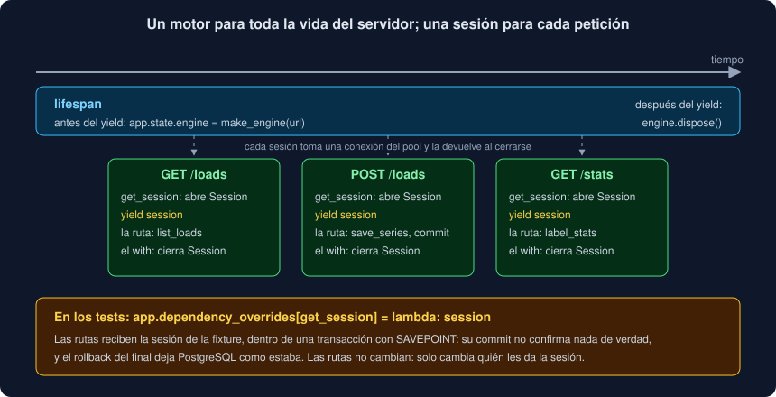

# 03 · Dependencias, sesiones y ciclo de vida

⏱️ 45 min

## 🎯 Objetivos

- Explicar qué es una dependencia (`Depends`) y qué problema resuelve.
- Abrir y cerrar una sesión de SQLAlchemy por petición con una dependencia con `yield`.
- Decidir dónde va el `commit` en una API.
- Crear el motor una sola vez con el **lifespan**, dentro de una función `create_app(url)`.
- Convertir un error de la base en un 503 con un manejador de excepciones.
- Sustituir una dependencia en los tests con `dependency_overrides`.

---

## 1. Dependencias

Casi todas las rutas de tu API necesitan una sesión de base de datos. Podrías abrirla en cada una:

```python
@router.get("/loads")
def get_loads(request: Request) -> list[LoadInfo]:
    with Session(request.app.state.engine) as session:
        return list_loads(session)
```

Funciona, pero se repite en cinco rutas, y los tests no tienen forma de darles otra sesión. Una **dependencia** saca eso de la ruta:

```python
def get_session(request: Request) -> Iterator[Session]:
    """Una sesión por petición, con el motor de la aplicación; se cierra al responder."""
    with Session(request.app.state.engine) as session:
        yield session


SessionDep = Annotated[Session, Depends(get_session)]


@router.get("/loads")
def get_loads(session: SessionDep) -> list[LoadInfo]:
    return list_loads(session)
```

`Depends(get_session)` le dice a FastAPI: antes de llamar a la ruta, llama a `get_session` y pásale el resultado. La ruta **declara** lo que necesita y no sabe cómo se consigue. El alias `SessionDep` evita repetir `Annotated[Session, Depends(get_session)]` en cada ruta.

Una dependencia es una función normal: recibe sus propios parámetros como una ruta (de la consulta, de la petición, de otras dependencias), y FastAPI los resuelve igual.

---

## 2. Dependencias con `yield`



Con `yield`, la dependencia tiene dos mitades:

1. lo de **antes** del `yield` se ejecuta antes de la ruta: abre la sesión;
2. lo que entrega el `yield` es lo que recibe la ruta;
3. lo de **después** (aquí, la salida del `with`) se ejecuta cuando la ruta ha terminado: cierra la sesión y devuelve la conexión al pool.

Es un `with` repartido entre "antes" y "después" de la ruta. Y como es un `with`, la sesión se cierra también si la ruta lanza una excepción: un 404, un 422 o un error de la base. Una sesión cerrada sin `commit` deshace lo que no se confirmó.

**Una sesión por petición**, nunca una para toda la aplicación: varias peticiones se atienden a la vez en hilos distintos (teoría 04), y una `Session` no se puede compartir entre hilos. Además, el mapa de identidad de una sesión compartida acumularía objetos de todas las peticiones para siempre.

---

## 3. Una vez por petición

Si una ruta pide `SessionDep` y además usa otra dependencia que también la pide, FastAPI llama a `get_session` **una sola vez** en esa petición y les da a las dos la misma sesión (ejercicio 03, paso 3). Así, lo que una escribe lo ve la otra, en la misma transacción. En la petición siguiente, sesión nueva.

---

## 4. ¿Dónde va el `commit`?

Las funciones de `database.py` no hacen commit (semana 19): lo decide quien abre la sesión. En la CLI era el comando. En la API, la **ruta que escribe**:

```python
@router.post("/loads", status_code=status.HTTP_201_CREATED)
def post_load(body: LoadIn, session: SessionDep, response: Response) -> LoadInfo:
    series = Series([reading.to_measurement() for reading in body.measurements])
    load = save_series(session, body.source, series)
    session.commit()
    ...
```

¿Por qué no en `get_session`, después del `yield`? Porque así la ruta sabe que el `commit` funcionó **antes** de responder 201. Si el commit fallara después de que la ruta devolviera su resultado, quien llama podría haber recibido un "creado" de algo que no existe. Explícito y en la ruta: el 201 solo sale si los datos están confirmados.

Las rutas que solo leen no hacen commit: la sesión se cierra sin confirmar nada, y no había nada que confirmar.

---

## 5. El lifespan y `create_app(url)`

El motor de SQLAlchemy, con su pool de conexiones, se crea **una vez** y vive lo que viva el servidor. Su sitio es el **lifespan**, un gestor de contexto asíncrono que FastAPI ejecuta al arrancar y al parar:

```python
def create_app(url: str) -> FastAPI:
    """La aplicación de la API, con su motor para `url`, abierto al arrancar y cerrado al parar."""

    @asynccontextmanager
    async def lifespan(app: FastAPI) -> AsyncIterator[None]:
        app.state.engine = make_engine(url)
        yield
        app.state.engine.dispose()

    app = FastAPI(title="Observatorio", version=__version__, lifespan=lifespan)
    app.include_router(router)
    app.add_exception_handler(OperationalError, database_unavailable)
    return app
```

- Lo que guardas en **`app.state`** lo leen las rutas y las dependencias con `request.app.state`.
- `dispose()` al parar cierra las conexiones del pool: PostgreSQL no se queda con conexiones abiertas de un proceso que ya no existe.
- Las rutas viven en un **`APIRouter`** a nivel de módulo, y `include_router` las añade a cada aplicación que se crea.

¿Por qué una **función** que crea la aplicación, y no un `app = FastAPI()` a nivel de módulo? Porque la aplicación necesita la URL de la base, y:

- si `api.py` leyera `Settings()` al importarse, importar el módulo dependería del entorno, y fallaría sin `OBSERVATORIO_DATABASE_URL`;
- con `create_app(url)`, la URL llega como **argumento**, como en `make_engine` y `make_client`. La CLI la lee de `Settings` y los tests pasan la de la base de pruebas. `api.py` no lee el entorno, igual que `core`.

---

## 6. Errores de la base: un manejador

Si PostgreSQL no contesta, la sesión lanza `OperationalError` en la primera consulta. Sin hacer nada, FastAPI respondería **500** con la traza en el registro. Pero no es un fallo de tu código: es un servicio del que dependes que no está. El código correcto es **503**, y el mensaje no debe copiar el texto del error, que puede llevar el usuario y el servidor de la base:

```python
def database_unavailable(request: Request, problem: Exception) -> JSONResponse:
    """503 sin el texto del error, que podría llevar el usuario o el servidor."""
    return JSONResponse(
        {"detail": "no se pudo conectar con PostgreSQL"},
        status_code=status.HTTP_503_SERVICE_UNAVAILABLE,
    )
```

`app.add_exception_handler(OperationalError, database_unavailable)` lo aplica a todas las rutas a la vez, en lugar de un `try` en cada una. Se registra al **crear** la aplicación: una vez que ha atendido su primera petición, un manejador añadido después ya no se aplica (ejercicio 04).

---

## 7. `dependency_overrides`

```python
app = api.create_app(TEST_URL)
app.dependency_overrides[api.get_session] = lambda: session
```

`dependency_overrides` es un diccionario: "donde se pida esta dependencia, usa esta otra". Las rutas no cambian. En tus tests, la otra es la sesión de la fixture `session` de `db_fixtures.py`, dentro de una transacción con SAVEPOINT (semana 19): el `commit` de `post_load` solo confirma el SAVEPOINT, y el `rollback` del final deja la base limpia. La clave es la **función** original, `get_session`, no el alias `SessionDep`.

---

## ⚠️ Errores comunes

| Error | Causa | Solución |
|---|---|---|
| `AttributeError: 'State' object has no attribute 'engine'` | El lifespan no se ejecutó | Con `TestClient`, úsalo dentro de un `with` |
| La API responde 201 y la carga no está | Falta `session.commit()` en la ruta | El commit, en la ruta que escribe, antes de responder |
| PostgreSQL acumula conexiones abiertas | Una sesión que nunca se cierra, o un motor por petición | La sesión en un `with` dentro de `get_session`; el motor, en el lifespan |
| Errores raros con varias peticiones a la vez | Una sola `Session` para toda la aplicación | Una sesión por petición |
| Importar `api` falla sin `.env` | `Settings()` a nivel de módulo | La URL como argumento de `create_app` |
| El override no se aplica | La clave es `SessionDep` o una función distinta | La función original: `app.dependency_overrides[get_session]` |
| El manejador del 503 no se aplica | Se registró después de la primera petición | Regístralo dentro de `create_app` |

---

## ✅ Qué debes saber al terminar

- [ ] Qué hace `Depends`, y por qué la ruta no sabe cómo se consigue la sesión.
- [ ] El orden de una dependencia con `yield`, y qué pasa con la sesión si la ruta falla.
- [ ] Por qué una sesión por petición y un motor por aplicación.
- [ ] Por qué el `commit` va en la ruta que escribe, antes de responder.
- [ ] Qué hacen el lifespan y `app.state`, y por qué `create_app(url)` recibe la URL.
- [ ] Por qué un error de conexión es 503, y por qué su mensaje no copia el del error.
- [ ] Cómo sustituye `dependency_overrides` la sesión en los tests.

---

## 🔗 Navegación

| Anterior | Actual | Siguiente |
| -------- | ------ | --------- |
| [02 · Rutas, parámetros y modelos](02-rutas-parametros-y-modelos.md) | **03 · Dependencias, sesiones y ciclo de vida** | [04 · def o async def: concurrencia en el servidor](04-def-o-async-def-concurrencia-en-el-servidor.md) |
