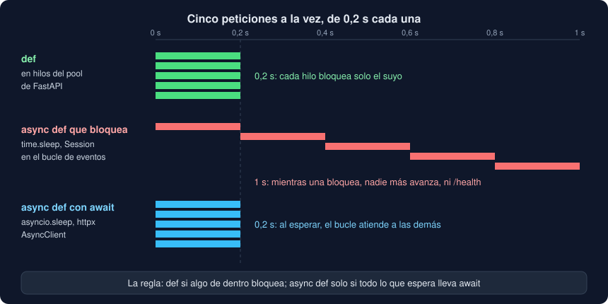

# 04 · `def` o `async def`: concurrencia en el servidor

⏱️ 40 min

## 🎯 Objetivos

- Explicar cómo atiende uvicorn muchas peticiones a la vez con un solo bucle de eventos (semana 17).
- Saber dónde ejecuta FastAPI una ruta `def` y dónde una `async def`.
- Reconocer el código que **bloquea**, y por qué no debe estar en una `async def`.
- Decidir `def` o `async def` para cada ruta, y justificar las de tu proyecto.
- Calcular cuántas conexiones a PostgreSQL puede abrir tu API, con uno o con varios procesos.

---

## 1. Muchas peticiones a la vez

Un servidor no atiende a una persona: mientras responde a un `GET /stats`, llegan un `POST /loads` y tres `GET /health`. uvicorn las atiende con un **bucle de eventos** de asyncio (semana 17): un solo hilo que salta de una petición a otra cada vez que una **espera** (a que llegue el resto del cuerpo, a que el cliente lea la respuesta). Mientras nadie bloquee el bucle, miles de conexiones avanzan a la vez.

La pregunta es qué pasa con **tu** código, el de las rutas.

---

## 2. Dónde se ejecuta cada ruta



FastAPI mira cómo está definida la ruta:

- **`async def`**: es una corrutina, y se ejecuta **en el bucle de eventos**, como el propio servidor. Cada `await` devuelve el control al bucle, que atiende a las demás.
- **`def`**: es una función normal, que puede bloquear. FastAPI la ejecuta en un **hilo** de su pool (el de AnyIO, con 40 hilos por defecto) y el bucle espera el resultado sin bloquearse.

Lo mismo vale para las dependencias: `get_session`, que es un generador normal (`def` con `yield`), también se ejecuta en un hilo.

El ejercicio 03 lo mide, con cinco peticiones a la vez de 0,2 s cada una:

| Ruta | Dónde | Tiempo |
|---|---|---|
| `def` con `time.sleep(0.2)` | un hilo para cada una | 0,2 s |
| `async def` con `time.sleep(0.2)` | el bucle, bloqueado | **1 s** |
| `async def` con `await asyncio.sleep(0.2)` | el bucle, sin bloquearse | 0,2 s |

La segunda fila es el error más caro de una API: mientras una ruta bloquea el bucle, **nada más avanza**, tampoco `/health`. Con diez peticiones lentas, el servidor parece caído.

---

## 3. Qué bloquea

Bloquea todo lo que espera **sin `await`**:

- `time.sleep`;
- la `Session` de SQLAlchemy y psycopg en modo normal: cada consulta espera la respuesta de PostgreSQL;
- `httpx.Client` (el síncrono) y cualquier cliente HTTP sin `async`;
- leer y escribir archivos con `open`;
- un cálculo largo: ordenar un millón de medidas no espera a nadie, pero ocupa el hilo (y el GIL, semana 16).

No bloquea lo que espera con `await`: `asyncio.sleep`, `httpx.AsyncClient`, los *drivers* asíncronos.

---

## 4. La regla, y tu proyecto

> **`async def` solo si todo lo que hace por dentro espera con `await`. Si algo bloquea, `def`.**

Las rutas de tu proyecto llaman a las funciones de `database.py`, que usan una `Session` síncrona: todas son **`def`**. FastAPI las reparte en hilos, y varias consultas avanzan a la vez, cada una con su sesión y su conexión.

Equivocarse en la otra dirección es barato: una ruta `def` que no bloquea solo cuesta pasar por un hilo. Equivocarse en esta es caro. Ante la duda, `def`.

¿Y si quisieras todo asíncrono? SQLAlchemy tiene `AsyncSession` y psycopg tiene su modo `async`: rutas `async def` con `await session.execute(...)`. Es otra forma de escribir **todo** `database.py`, la CLI y los tests, y solo compensa con muchísimas conexiones a la vez. Para tu Observatorio, no. Lo trata [bc-fastapi](https://github.com/ergrato-dev/bc-fastapi).

---

## 5. ¿Cuántas a la vez, de verdad?

Que haya 40 hilos no significa 40 consultas a la vez. El pool del motor (semana 19) presta, por defecto, **5 conexiones**, y 10 más si hacen falta (`max_overflow`): **15**. La petición número 16 espera a que otra devuelva la suya, hasta 30 s (`pool_timeout`); después, error. Con consultas de milisegundos, 15 conexiones atienden cientos de peticiones por segundo: tu medida del paso 12 del proyecto lo enseña.

PostgreSQL tiene su propio límite, `max_connections`, 100 por defecto. Ese límite es para **todos** los programas que se conectan: la CLI, los tests, la API y tú con `psql`.

---

## 6. Varios procesos: `--workers`

Un proceso de Python ejecuta Python en un núcleo a la vez (el GIL de la semana 16; Python 3.14 sin GIL no es aún lo normal). Para usar varios núcleos, uvicorn arranca varios **procesos** completos:

```bash
uv run uvicorn main:app --workers 4
```

Cada uno con su aplicación, su lifespan, su motor y **su pool**: 4 procesos × 15 conexiones = hasta **60** conexiones a PostgreSQL. Por eso el número de *workers* y el tamaño del pool se deciden juntos, mirando `max_connections`.

Tu API no lo necesita: sus rutas pasan casi todo el tiempo esperando a PostgreSQL, no calculando. Un proceso con su pool de hilos basta. En un despliegue de verdad, los procesos suele ponerlos el orquestador (varios contenedores), no `--workers`.

---

## ⚠️ Errores comunes

| Error | Causa | Solución |
|---|---|---|
| Todo va lento cuando llegan varias peticiones, incluido `/health` | Una `async def` que bloquea: `Session`, `time.sleep`, `httpx.Client` | `def`, o la versión asíncrona de verdad con `await` |
| `async def` "para que vaya más rápido" | Creer que `async` acelera el código | `async` solo ayuda si hay `await` dentro; si no, empeora |
| `QueuePool limit of size 5 overflow 10 reached` | Más peticiones a la vez que conexiones, o sesiones que no se cierran | Cierra cada sesión (`with`); revisa consultas lentas; ajusta `pool_size` |
| `FATAL: sorry, too many clients already` | Demasiados procesos × pool para `max_connections` | Menos *workers*, o pools más pequeños |
| Un cálculo largo en una ruta frena a las demás | El GIL: los hilos no calculan a la vez | Llévalo a un proceso aparte (semana 16), o fuera de la petición |

---

## ✅ Qué debes saber al terminar

- [ ] Cómo atiende uvicorn muchas peticiones con un solo bucle de eventos.
- [ ] Dónde ejecuta FastAPI una ruta `def` y dónde una `async def`.
- [ ] Qué código bloquea, y por qué en una `async def` frena a todas las demás.
- [ ] Por qué las rutas de tu proyecto son `def`.
- [ ] Cuántas conexiones abre tu API: pool por defecto, `max_overflow` y `--workers`.

---

## 🔗 Navegación

| Anterior | Actual | Siguiente |
| -------- | ------ | --------- |
| [03 · Dependencias, sesiones y ciclo de vida](03-dependencias-sesiones-y-ciclo-de-vida.md) | **04 · def o async def: concurrencia en el servidor** | [05 · Probar y servir una API](05-probar-y-servir-una-api.md) |
