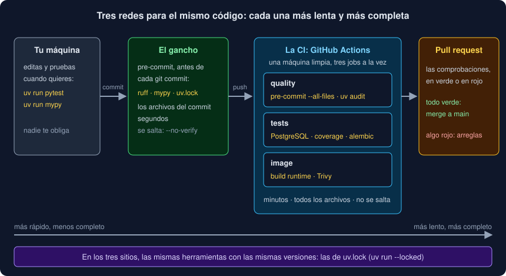

# 01 · De tu máquina a main: calidad automática

⏱️ 45 min

## 🎯 Objetivos

- Reunir las comprobaciones que ya usas y decir qué protege cada una.
- Explicar por qué una comprobación que depende de acordarse acaba por no hacerse.
- Distinguir las tres redes (tu terminal, el gancho de Git y la CI) y decidir qué va en cada una.
- Mantener las mismas versiones de las herramientas en los tres sitios.
- Reproducir en tu máquina un fallo que solo pasa en la CI.
- Probar la configuración de la entrega con tests, como el resto del código.

---

## 1. Lo que ya compruebas

En veinte semanas has ido sumando comprobaciones al Observatorio. Juntas:

| Orden | Qué protege | Desde |
|---|---|---|
| `uv run ruff check` | Errores probables: imports sin usar, variables sin definir, patrones peligrosos | Semana 08 |
| `uv run ruff format --check` | Un formato único: los *diffs* muestran cambios de verdad, no espacios | Semana 08 |
| `uv run mypy` | Tipos: que una función que promete `str` no devuelva `float` | Semana 13 |
| `uv run pytest` | Comportamiento: que el programa hace lo que dicen sus tests | Semana 04 |
| `uv run coverage report` | Que los tests ejecutan al menos el 95 % del código, con sus ramas | Semana 14 |
| `uv run alembic check` | Que los modelos y las migraciones dicen lo mismo | Semana 19 |

Esta semana añades cuatro:

| Orden | Qué protege |
|---|---|
| `uv lock --check` | Que `uv.lock` corresponde a `pyproject.toml` |
| `uv audit` | Que ninguna dependencia tiene una vulnerabilidad conocida (teoría 04) |
| Trivy | Que la imagen de Docker no lleva paquetes vulnerables (teoría 05) |
| `pytest tests/test_delivery.py` | Que la configuración de la entrega sigue sus reglas (sección 7) |

Diez órdenes. Cada una tarda poco, y cada una detecta algo que las demás no ven.

---

## 2. El problema: acordarse

Si las comprobaciones dependen de que alguien se acuerde de ejecutarlas, un día no se ejecutan: hay prisa, el cambio "solo era un comentario", o la persona que se acordaba se fue del equipo. Y el día que no se ejecutan es el día que el error llega a `main`.

La solución no es acordarse mejor, sino **que no haga falta acordarse**: que las comprobaciones se ejecuten **solas**, en momentos fijos, y que su resultado se vea. Eso es la **calidad automática**. Esta semana la construyes en dos sitios nuevos:

- un **gancho de Git** (*hook*): un programa que Git ejecuta antes de cada commit (teoría 02);
- la **integración continua** (*CI*): una máquina que ejecuta todo en cada *push* y en cada *pull request* (teoría 03).

---

## 3. Tres redes



| | Tu terminal | El gancho | La CI |
|---|---|---|---|
| Cuándo | Cuando quieres | En cada `git commit` | En cada `git push` y *pull request* |
| Dónde | Tu máquina, con lo que tengas | Tu máquina | Una máquina limpia de GitHub |
| Qué archivos | Los que elijas | Los del commit | Todos |
| Cuánto tarda | Lo que elijas | Segundos | Minutos |
| ¿Se puede saltar? | Sí, no ejecutándolo | Sí: `git commit --no-verify` | No: el resultado sale en el *pull request* |

Cada red es más lenta y más completa que la anterior, y atrapa lo que se escapa de la otra. El gancho te avisa en segundos, antes de que el error salga de tu máquina; la CI es la **garantía**, porque nadie puede saltársela sin que se vea.

---

## 4. Rápido delante, completo detrás

Un gancho que tarda un minuto acaba saltado con `--no-verify`. Por eso, en el gancho va lo **rápido** y lo que mira **archivos sueltos**:

- formato y espacios (y los arregla solo);
- ruff y mypy;
- `uv.lock` al día;
- que no se cuele una clave privada o un archivo enorme.

Y en la CI, **todo**, también lo lento y lo que necesita servicios:

- lo mismo que el gancho, sobre **todos** los archivos;
- los tests, con un PostgreSQL de verdad, y la cobertura;
- `alembic check`;
- la auditoría de dependencias;
- construir la imagen y escanearla.

`pytest` no va en el gancho del Observatorio: tarda unos 20 segundos y necesita PostgreSQL arrancado. Lo ejecutas tú mientras trabajas, y la CI antes de fusionar.

---

## 5. Las mismas versiones en todas partes

Si tu ruff es la 0.17.3 y el de la CI es la 0.18.0, una regla nueva puede fallar en la CI con un código que en tu máquina pasa. La regla: **una sola fuente de versiones**, `uv.lock`, y todas las herramientas se ejecutan desde ahí:

- en tu terminal: `uv run ruff check`;
- en el gancho: `entry: uv run --locked ruff check --fix` (teoría 02);
- en la CI: `uv run ruff check`, con `UV_LOCKED=1` (teoría 03).

`--locked` (o `UV_LOCKED=1`) hace que uv **falle** si `uv.lock` no corresponde a `pyproject.toml`, en lugar de actualizarlo en silencio. Así, la CI prueba exactamente lo que fijaste.

Lo que no está en `uv.lock` (uv, las imágenes de Docker, las acciones de GitHub) se fija a mano, en un solo sitio cuando se puede. Cuando no se puede, un test comprueba que coinciden: el uv de la CI tiene que ser el del `Dockerfile`, y el PostgreSQL de la CI el de `compose.yaml`.

---

## 6. "Funciona en mi máquina"

La CI no es tu máquina. Cambia el sistema, las variables de entorno, la zona horaria, que no hay terminal, que solo existen los archivos de Git (tu `.env`, no)... Un ejemplo real del Observatorio: el primer *push* a GitHub dio esto, con todos los tests en verde en local:

```
FAILED tests/test_cli.py::test_help_lists_the_options - AssertionError: assert '--verbose' in '\x1b[1m ...
FAILED tests/test_cli.py::test_informe_help - AssertionError: assert '--archivo' in '\x1b[1m ...
...
======================== 5 failed, 699 passed in 15.24s ========================
```

`\x1b[1m` es un código **ANSI**: la orden a una terminal de poner negrita. En tu máquina, los tests de la CLI (semana 15) no ven colores, porque no hay terminal. En GitHub Actions, la variable `GITHUB_ACTIONS=true` existe en todos los pasos, y Typer, al verla, le dice a Rich que **sí** hay terminal, para que los registros salgan con color. La ayuda llega troceada en códigos de color, y `'--verbose' in result.stdout` deja de ser cierto.

El método para estos fallos:

1. **Lee** el registro de la CI: aquí, los `\x1b[` delatan colores;
2. **Reprodúcelo** en tu máquina con lo que cambia en la CI:

   ```bash
   GITHUB_ACTIONS=true uv run pytest -q
   ```

   ```
   5 failed, 699 passed in 16.29s
   ```

3. **Arréglalo** donde está la diferencia. Aquí, en el job de tests, `TERM: dumb` le dice a Rich que la terminal no entiende colores:

   ```yaml
   env:
     TERM: dumb
   ```

   ```bash
   GITHUB_ACTIONS=true TERM=dumb uv run pytest -q
   ```

   ```
   704 passed in 16.13s
   ```

Una vez reproducido en local, el arreglo se prueba en segundos, no en un *push* y cinco minutos de espera.

---

## 7. Probar la configuración

`.pre-commit-config.yaml`, el workflow, el `Dockerfile` y `compose.yaml` también son código: deciden qué se comprueba y qué se despliega. Si alguien cambia `contents: read` por `contents: write`, o borra el `USER` del `Dockerfile`, nada se rompe a la vista: todo sigue funcionando, pero menos seguro. Por eso tu proyecto tiene `tests/test_delivery.py`: **tests sobre la configuración**, que la leen y comprueban sus reglas.

```python
def test_token_can_only_read_the_repository() -> None:
    assert workflow()["permissions"] == {"contents": "read"}


def test_runtime_runs_as_an_unprivileged_numeric_user() -> None:
    users = stage("runtime").lines("USER")
    assert len(users) == 1
    assert unprivileged(users[0]), users[0]
```

Leen YAML con PyYAML. Una trampa que conviene conocer: en YAML 1.1, la palabra `on` sin comillas es el **booleano `True`**, y PyYAML la lee así. La clave `on:` del workflow llega como `True`:

```python
>>> yaml.safe_load("on:\n  push:\n")
{True: {'push': None}}
```

GitHub la entiende bien (no usa PyYAML), pero tus tests tienen que buscar `True`. Por eso `test_delivery.py` hace `data.get("on", data.get(True))`.

¿Y cómo sabes que esos tests detectan algo? Como en las semanas anteriores: con **mutantes**. Cambias `contents: read` por `write`, ejecutas, y algún test tiene que fallar. Lo harás en el paso 14 del proyecto.

---

## 8. La puerta: comprobaciones obligatorias

La CI dice si un *pull request* está en verde, pero no impide fusionarlo en rojo. Eso lo hace una **regla de rama** en GitHub: *Settings → Rules → Rulesets*, sobre `main`, con:

- **Require a pull request before merging**: nadie empuja a `main` directamente;
- **Require status checks to pass**: los jobs `quality`, `tests` e `image` tienen que estar en verde.

Las reglas de rama son gratis en repositorios **públicos**; en uno privado de una cuenta gratuita, GitHub no las aplica. Si tu repositorio es privado, la regla eres tú: no fusionas nada en rojo.

---

## ⚠️ Errores comunes

| Error | Por qué está mal | Qué hacer |
|---|---|---|
| Meter los tests lentos en el gancho | Un gancho lento se salta con `--no-verify` y deja de proteger | Lo rápido en el gancho; todo en la CI |
| Instalar las herramientas de la CI con otra versión | Lo que pasa en local falla en la CI, o al revés | `uv run` con `--locked`, desde `uv.lock` |
| Arreglar un fallo de la CI a base de *pushes* | Cinco minutos por intento, y el historial lleno de "fix ci" | Reprodúcelo en local con las variables de la CI |
| Fusionar con la CI en rojo "porque es un test raro" | El test raro era el único que veía el fallo | Un fallo en rojo se entiende antes de fusionar |
| Configuración sin tests | Un cambio que relaja la seguridad no rompe nada visible | Tests sobre la configuración, y mutantes para probarlos |

---

## ✅ Qué debes saber al terminar

- [ ] Qué protege cada una de las diez comprobaciones del Observatorio.
- [ ] Las tres redes, y qué comprobación va en el gancho y cuál solo en la CI.
- [ ] Por qué todas las herramientas salen de `uv.lock`, y qué hace `--locked`.
- [ ] Cómo reproducir en local un fallo que solo pasa en la CI.
- [ ] Por qué la configuración de la entrega también tiene tests, y la trampa de `on` en YAML.

---

## 🔗 Navegación

| Anterior | Actual | Siguiente |
| -------- | ------ | --------- |
| [Semana 21](../README.md) | **01 · De tu máquina a main: calidad automática** | [02 · Ganchos de Git con pre-commit](02-ganchos-de-git-con-pre-commit.md) |
