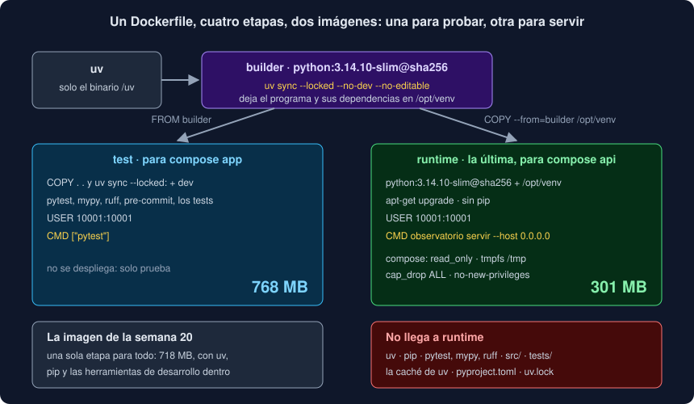

# 05 · Una imagen Docker segura

⏱️ 45 min

## 🎯 Objetivos

- Explicar qué es la superficie de ataque de una imagen y cómo se reduce.
- Separar construir, probar y ejecutar con un `Dockerfile` *multi-stage*.
- Fijar la imagen base por su digest sin quedarte con sus fallos.
- Ejecutar sin root, en solo lectura, sin capacidades y sin poder ganar privilegios.
- Mantener los secretos fuera de la imagen.
- Escanear una imagen con Trivy y leer el resultado.

---

## 1. Lo que hay dentro se puede usar

Una imagen no es solo tu programa: es un sistema entero. Si alguien consigue ejecutar código dentro del contenedor (por un fallo en tu programa, en FastAPI o en cualquier dependencia), puede usar **todo** lo que haya: un compilador, `git`, `pip` para bajarse herramientas, permisos de root para cambiar tu programa. Ese conjunto es la **superficie de ataque**, y la regla para reducirla es simple: **en la imagen final, solo lo necesario para ejecutar**.

La imagen de tu proyecto en la semana 20 tenía de todo: uv, pip, pytest, mypy, ruff, los tests, el código fuente. Servía para probar y para servir, y por eso no era buena para servir.

---

## 2. Varias etapas: construir, probar, ejecutar

Un `Dockerfile` *multi-stage* tiene varios `FROM`. Cada uno empieza una **etapa** desde cero; `COPY --from=<etapa>` trae de otra solo lo que eliges. Lo que no copias no llega.



```dockerfile
FROM python:3.14.10-slim-trixie@sha256:9aaa... AS builder
COPY --from=uv /uv /bin/
...
RUN uv sync --locked --no-dev --no-install-project
COPY src ./src
RUN uv sync --locked --no-dev --no-editable

FROM builder AS test
COPY . .
RUN uv sync --locked
...
CMD ["pytest"]

FROM python:3.14.10-slim-trixie@sha256:9aaa... AS runtime
COPY --from=builder /opt/venv /opt/venv
...
CMD ["observatorio", "servir", "--host", "0.0.0.0"]
```

- **`builder`** instala el programa y sus dependencias **sin las de desarrollo** (`--no-dev`) en `/opt/venv`. `--no-editable` copia tu paquete **dentro** del entorno, en lugar de apuntar a `src/`: así `/opt/venv` funciona solo, sin la carpeta del código;
- **`test`** parte de `builder`, añade el proyecto entero y las dependencias de desarrollo, y ejecuta los tests. Es la imagen de `compose run app`. No se despliega;
- **`runtime`** parte otra vez de la imagen de Python y copia **solo** `/opt/venv`. Ni uv, ni pytest, ni `src/`, ni `tests/`.

`runtime` va la **última**: `docker build .` sin `--target` construye la última etapa, y lo que se construye sin pensar debe ser lo seguro. En compose, cada servicio elige la suya:

```yaml
  app:
    build:
      context: .
      target: test
  api:
    build:
      context: .
      target: runtime
```

El resultado, en tu proyecto: la imagen de la semana 20 ocupaba 718 MB; `test` ocupa 768 MB y `runtime`, 301 MB.

---

## 3. La imagen base: pequeña y fijada

`python:3.14.10-trixie` trae Debian con compilador, `git` y cabeceras de desarrollo: 1,69 GB en el ejercicio 04. `python:3.14.10-slim-trixie` trae lo justo para ejecutar Python: menos de 200 MB. Para ejecutar, `slim`.

La etiqueta `3.14.10-slim-trixie` se puede **volver a publicar** con otro contenido: Docker la reconstruye cuando Debian saca parches. El **digest** (`@sha256:...`) es el contenido mismo: no cambia nunca.

```bash
docker buildx imagetools inspect python:3.14.10-slim-trixie
```

```
Name:      docker.io/library/python:3.14.10-slim-trixie
MediaType: application/vnd.oci.image.index.v1+json
Digest:    sha256:9aaa474097d094040649f2162a627c0049b408f52138d980916788d80f04802f
...
```

```dockerfile
FROM python:3.14.10-slim-trixie@sha256:9aaa474097d094040649f2162a627c0049b408f52138d980916788d80f04802f AS runtime
```

Con los dos, la etiqueta es para las personas y el digest para Docker, que usa el digest. Es la misma idea que el SHA de una acción (teoría 03).

Pero fijar la base también **congela sus fallos**. El día que fijaste el digest, Debian no había publicado aún el parche de `zlib1g`; con el digest, tu imagen no lo tendrá nunca. Dos remedios, y tu proyecto usa los dos:

- **`apt-get upgrade`** en `runtime`: al construir, aplica los parches de seguridad publicados después de la base. A cambio, dos construcciones en días distintos pueden diferir en algún paquete de Debian;
- **Dependabot** (teoría 04) propone un *pull request* cuando hay un digest nuevo de la misma etiqueta.

---

## 4. Fuera pip

La imagen de Python trae pip, y en producción nadie instala nada. Además, pip lleva **dentro** sus propias dependencias (`urllib3`, `msgpack`...), copiadas en su carpeta (*vendored*), y tienen sus propios avisos. Trivy los encontró en la imagen de tu proyecto:

```
│ msgpack    │ CVE-2026-114613     │ HIGH     │ fixed  │ 1.1.2             │ 1.2.3         │
│ setuptools │ CVE-2025-47273      │          │        │ 70.3.0            │ 78.1.1        │
│ urllib3    │ CVE-2026-97687      │          │        │ 2.7.0             │ 2.8.0         │
```

Ninguno es tuyo: tu `uv.lock` tiene otras versiones, o no los tiene. Son de pip. La solución no es actualizarlos, es **quitar pip**:

```dockerfile
RUN apt-get update \
    && apt-get upgrade --yes \
    && rm -rf /var/lib/apt/lists/* \
        /usr/local/bin/pip* \
        /usr/local/lib/python3.14/site-packages/pip \
        /usr/local/lib/python3.14/site-packages/pip-*.dist-info \
    && useradd --no-create-home --shell /usr/sbin/nologin --uid 10001 app
```

Todo en un solo `RUN`: cada instrucción crea una **capa**, y lo que una capa borra sigue ocupando en la anterior. `rm -rf /var/lib/apt/lists/*` borra el índice de paquetes que bajó `apt-get update`, que ya no sirve.

---

## 5. Sin root

Por defecto, un contenedor se ejecuta como **root** (uid 0). Root dentro del contenedor no es root de tu máquina, pero se le parece demasiado: tiene **capacidades** de Linux (cambiar el dueño de archivos, usar puertos por debajo de 1024, saltarse permisos...), y un fallo del aislamiento de Docker le da más de lo que le daría a un usuario normal.

```dockerfile
RUN useradd --no-create-home --shell /usr/sbin/nologin --uid 10001 app
USER 10001:10001
```

- **un número alto** (10001): no coincide con ningún usuario de tu máquina;
- **sin *home* ni *shell***: nadie va a iniciar sesión;
- **`USER` por número**, no por nombre: quien ejecuta la imagen (Docker, Kubernetes) puede comprobar que no es 0 sin leer `/etc/passwd` de dentro.

Lo que cambia, según la sonda del ejercicio 04:

```
usuario              app (uid 10001)
escribir en /app     no (Permission denied)
capacidades          0000000000000000
```

Por eso el puerto de la API es el 8000 y no el 80: un usuario normal no puede abrir puertos por debajo de 1024.

---

## 6. En ejecución: no poder cambiar nada

El `Dockerfile` decide qué hay en la imagen; `compose.yaml` decide **cómo se ejecuta**:

```yaml
  api:
    read_only: true
    tmpfs:
      - /tmp
    cap_drop:
      - ALL
    security_opt:
      - no-new-privileges:true
```

| Opción | Qué hace |
|---|---|
| `read_only: true` | Todo el sistema de archivos del contenedor, en solo lectura: nadie puede cambiar tu programa ni dejar nada |
| `tmpfs: [/tmp]` | `/tmp` en memoria, escribible, que desaparece al parar: algunas bibliotecas lo necesitan |
| `cap_drop: [ALL]` | Ninguna capacidad, ni siquiera si alguien ejecuta como root |
| `no-new-privileges:true` | Ningún proceso puede ganar privilegios, aunque haya un programa *setuid* |

Parecen redundantes con `USER`: un usuario normal ya no tiene capacidades. Pero si alguien cambia la configuración y ejecuta como root (`--user 0`), con compose sigue sin tenerlas:

```
usuario              root (uid 0)
capacidades          0000000000000000
NoNewPrivs           1
```

Cada capa protege aunque falle otra: **defensa en profundidad**.

Con `read_only`, Python no puede escribir los `.pyc` (el código compilado que acelera el arranque). Por eso `builder` los compila al instalar, con `UV_COMPILE_BYTECODE=1`: en `runtime`, ya están hechos.

---

## 7. Los secretos, fuera

Un secreto que entra en una imagen se queda en ella: en una capa, en el historial, en cada copia que se descargue.

- **`.dockerignore`** con `.env`: `COPY . .` no lo copia nunca. Tu proyecto lo tiene desde la semana 18;
- **nunca `ENV` ni `ARG` con secretos**: `docker history` los enseña;
- **en ejecución**, por variables de entorno (`environment` en compose) o secretos del orquestador;
- si **construir** necesita un secreto (un índice privado de paquetes), `RUN --mount=type=secret`: lo ve ese `RUN` y no queda en ninguna capa.

La API del Observatorio recibe la URL de la base por `OBSERVATORIO_DATABASE_URL`, en ejecución. La imagen no sabe ninguna contraseña.

---

## 8. Escanear con Trivy

**Trivy** busca, en los paquetes de una imagen (los de Debian y los de Python, por sus metadatos), versiones con vulnerabilidades conocidas. Ejecútalo con Docker, por digest:

```bash
docker run --rm -v /var/run/docker.sock:/var/run/docker.sock -v trivycache:/root/.cache \
  aquasec/trivy:0.76.1@sha256:790fd66d1697395d8693d1acaa1ea702406a20f109b6fc7bac8db623eca6c06c \
  image --exit-code 1 --severity HIGH,CRITICAL --ignore-unfixed local/observatorio:week-21
```

- `-v /var/run/docker.sock:...`: Trivy le pide la imagen a tu Docker;
- `--severity HIGH,CRITICAL`: solo lo grave;
- `--ignore-unfixed`: solo lo que **tiene arreglo**. Lo que no lo tiene no lo puedes arreglar hoy, y no debe tumbar tu CI;
- `--exit-code 1`: termina con error si encuentra algo. En la CI, el job falla.

Sin filtros, Trivy cuenta todo. En tu proyecto:

| Imagen | Tamaño | Vulnerabilidades | HIGH con arreglo |
|---|---|---|---|
| Semana 20 | 718 MB | 197 | 7 |
| `runtime`, semana 21 | 301 MB | 186 | 0 |

Las 186 que quedan son de Debian, y **ninguna tiene arreglo** publicado todavía: son el suelo de `slim`. Bajar de ahí pide una base aún más pequeña, como las imágenes *distroless*, sin *shell* ni gestor de paquetes. Lo que importa es que **lo que tiene arreglo, esté arreglado**, y que la CI te avise el día que eso deje de ser cierto.

¿Por qué `docker run` y no la acción `aquasecurity/trivy-action`? Es la acción cuyas etiquetas se movieron en marzo de 2026 (teoría 03). Con la imagen por digest, ejecutas exactamente el Trivy que elegiste.

---

## ⚠️ Errores comunes

| Error | Por qué está mal | Qué hacer |
|---|---|---|
| Una sola etapa para probar y para servir | Producción lleva uv, pip, pytest y el código fuente | `test` y `runtime`, con `runtime` la última |
| `uv sync` sin `--no-dev` en `builder` | Las herramientas de desarrollo llegan a producción | `--no-dev --no-editable` |
| `FROM python:3.14` sin digest | Mañana puede ser otra imagen | Etiqueta y `@sha256:` |
| Digest y nada más | La imagen se queda con los fallos de ese día | `apt-get upgrade` y Dependabot |
| `USER app` por nombre, o sin `USER` | Root por defecto, o no se puede comprobar | `USER 10001:10001` |
| `read_only` sin `tmpfs` | Lo que necesite escribir en `/tmp` falla | `tmpfs: [/tmp]` |
| `ENV DATABASE_URL=...` con la contraseña | Queda en la imagen para siempre | En ejecución, con `environment` |
| Trivy sin `--ignore-unfixed` en la CI | Falla por cosas que no puedes arreglar, y se acaba ignorando | Solo lo que tiene arreglo |

---

## ✅ Qué debes saber al terminar

- [ ] Qué es la superficie de ataque y por qué la imagen final solo lleva lo necesario.
- [ ] Las cuatro etapas del Observatorio, qué hace `--no-editable` y por qué `runtime` va la última.
- [ ] Qué fija el digest, qué congela, y cómo lo compensan `apt-get upgrade` y Dependabot.
- [ ] Por qué se quita pip, y por qué todo va en un solo `RUN`.
- [ ] `USER` por número, `read_only`, `tmpfs`, `cap_drop` y `no-new-privileges`, y qué es defensa en profundidad.
- [ ] Cómo escanear con Trivy, qué hace cada opción y cómo leer el resultado.

---

## 🔗 Navegación

| Anterior | Actual | Siguiente |
| -------- | ------ | --------- |
| [04 · La cadena de suministro: auditar y actualizar dependencias](04-cadena-de-suministro-auditar-y-actualizar-dependencias.md) | **05 · Una imagen Docker segura** | [Ejercicio 01 · Ganchos de Git con pre-commit](../2-practicas/ejercicio-01-ganchos-con-pre-commit/README.md) |
