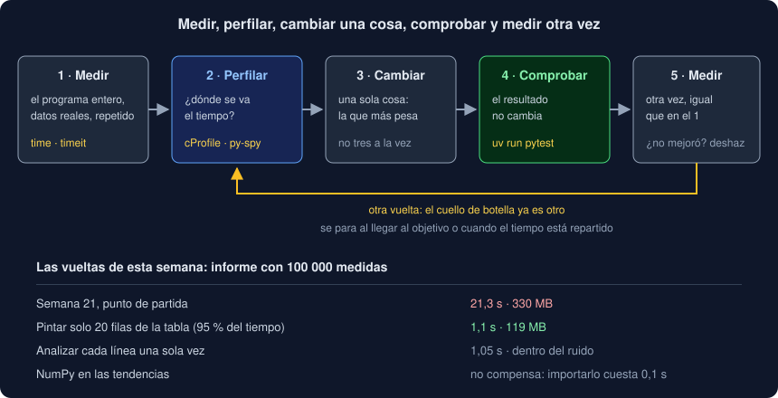

# 01 · Medir antes de optimizar

⏱️ 45 min

## 🎯 Objetivos

- Decidir cuándo merece la pena optimizar y cuándo no.
- Medir una duración con `perf_counter` y `timeit` sin dejarte engañar por el ruido.
- Distinguir el tiempo de reloj del tiempo de CPU, y lo que te dice cada uno.
- Estimar con la ley de Amdahl cuánto puede ganar un arreglo antes de hacerlo.
- Seguir el ciclo medir, perfilar, cambiar una cosa, comprobar y medir otra vez.

---

## 1. Tu Observatorio con 100 000 medidas

Hasta ahora has probado `informe` con archivos de diez líneas. Con un archivo de verdad, de 100 000 medidas (1 MB):

```bash
time uv run observatorio informe -f perfil/grande.txt > /dev/null
```

```
real	0m21.335s
user	0m18.314s
sys	0m0.531s
```

Más de 20 segundos, y 330 MB de memoria, para un archivo de 1 MB. Al final de esta semana, el mismo informe tarda alrededor de **1 segundo**, con el mismo resumen. Para llegar ahí no hace falta intuición ni trucos: hace falta **medir**.

La tentación es mirar el código y "ver" lo lento: la mediana ordena, así que será la mediana. En el proyecto comprobarás que la mediana tarda 10 ms de esos 21 s. El 95 % del tiempo se va en algo que nadie sospecha leyendo el código.

---

## 2. Cuándo optimizar

Donald Knuth lo dejó escrito en 1974: "la optimización prematura es la raíz de todos los males". La frase entera es más útil: en el 97 % del código la eficiencia no importa, y hay que **encontrar** el 3 % que sí.

Optimiza cuando:

- hay un **problema que alguien nota**: un informe que tarda 21 s, una API que responde en 2 s, un proceso nocturno que no acaba antes de la mañana;
- tienes un **objetivo** medible: "menos de 2 s con 100 000 medidas";
- tienes **tests** que te avisan si el cambio rompe algo.

No optimices:

- código que se ejecuta una vez al día y tarda un segundo;
- "por si acaso", sin un número que mejorar;
- a costa de la claridad, si nadie va a notar la diferencia.

Un código más rápido pero más difícil de leer tiene un coste que pagas cada vez que alguien lo lee. Solo compensa si el tiempo ganado importa.

---

## 3. El reloj adecuado

Python tiene varios relojes en `time`. Para medir duraciones:

```python
import time

start = time.perf_counter()
result = report(records)
print(f"{time.perf_counter() - start:.3f} s")
```

`perf_counter()` devuelve segundos desde un punto arbitrario: solo sirve la **resta** de dos lecturas. Es el reloj de más resolución y no salta si cambia la hora del sistema. `time.time()` sí salta (el sistema puede ajustar la hora en mitad de tu medida), y no está pensado para medir.

Hay dos tiempos distintos:

| Reloj | Qué mide | Cuándo |
|---|---|---|
| `time.perf_counter()` | Tiempo **de reloj** (*wall time*): todo lo que pasa, también las esperas | Lo que nota quien espera |
| `time.process_time()` | Tiempo **de CPU** de tu proceso: solo lo que la CPU trabajó para ti | Cuánto calcula tu programa |

La orden `time` de la terminal da los dos: `real` es el reloj; `user` y `sys`, la CPU.

```
real	0m21.335s
user	0m18.314s
sys	0m0.531s
```

Aquí `user + sys` es 18,8 s de 21,3: casi todo es cálculo (el resto, escribir 5 MB de tabla y esperas del sistema). Si `real` y `user + sys` son parecidos, tu programa **calcula**: un perfil te dirá dónde. Si `real` es mucho mayor, tu programa **espera** (red, disco, una base de datos, un `sleep`): optimizar el cálculo no lo acelerará, y la solución es la de las semanas 16 y 17, esperar varias cosas a la vez.

---

## 4. El ruido

Mide tres veces lo mismo y tendrás tres números distintos:

```
intento 1: 0.0450 s
intento 2: 0.0477 s
intento 3: 0.0444 s
```

Mientras tu programa corre, el sistema atiende otros procesos, la CPU cambia de frecuencia para ahorrar energía o por temperatura, y las cachés de memoria están más o menos llenas de lo que necesitas. Todo eso es **ruido**, y siempre **suma** tiempo: nada hace que tu código vaya más rápido de lo que puede.

Por eso:

- **repite** la medida varias veces;
- quédate con el **mínimo** para comparar dos versiones del código: es lo más cerca de lo que cuesta de verdad;
- mira la **mediana** para saber qué es lo normal, y el máximo para saber cuánto ruido hay;
- compara versiones **en la misma máquina, el mismo rato**, alternando: A, B, A, B. Medir A el lunes y B el martes compara también los dos días.

En este bootcamp, un `informe` dio 1,07 s, 1,08 s y 4,58 s seguidos: la tercera vez, otro proceso ocupó la CPU. Con una sola medida habrías creído que tu arreglo no servía.

---

## 5. `timeit`

`timeit` hace las repeticiones por ti:

```python
import timeit

times = timeit.repeat(lambda: count_known(wanted, labels), number=5, repeat=7)
best = min(times) / 5
```

`number=5` ejecuta la función 5 veces seguidas y mide el total; `repeat=7` lo hace 7 veces. Divides el mínimo por `number` para tener una llamada. Para algo que dura microsegundos, sube `number` hasta que cada total pase de unas décimas de segundo, o deja que lo decida `Timer.autorange()`.

Desde la terminal:

```bash
uv run python -m timeit -s "labels = {str(n) for n in range(10_000)}" "'9999' in labels"
```

```
20000000 loops, best of 5: 13.6 nsec per loop
```

`-s` prepara (no cuenta) y el último argumento es lo que se mide. `timeit` además apaga el recolector de basura mientras mide, para que una recogida no caiga en mitad de una vuelta.

`timeit` sirve para trozos pequeños: una expresión, una función. Para un programa entero, `time` en la terminal, repetido.

---

## 6. Cómo crece

Un tiempo suelto dice poco: 0,03 s puede ser mucho o poco. Lo que dice más es cómo **crece** al aumentar los datos:

```
n= 10000 · list.insert(0) 0.0071 s
n= 20000 · list.insert(0) 0.0299 s
n= 40000 · list.insert(0) 0.1125 s
```

Al doblar n, el tiempo se multiplica por 4: **O(n²)**, la complejidad de la semana 6. Con 400 000 elementos no serían 0,1 s × 10, sino × 100: 11 segundos. Medir con dos o tres tamaños te dice si un código aguantará el archivo del año que viene.

| Al doblar n, el tiempo... | Complejidad |
|---|---|
| no cambia | O(1) |
| sube un poco | O(log n) |
| se dobla | O(n) |
| algo más que se dobla | O(n log n), como ordenar |
| se multiplica por 4 | O(n²) |

---

## 7. La ley de Amdahl

Antes de optimizar una parte, pregúntate cuánto puede ganar **como mucho**. Si una función ocupa una fracción `p` del tiempo total y la haces infinitamente rápida, el programa sigue tardando `1 - p`:

```
tiempo nuevo = (1 - p) + p / s
```

donde `s` es cuántas veces más rápida haces esa parte. Es la **ley de Amdahl**, de 1967.

En el `informe` del Observatorio:

| Si aceleras... | que ocupa | aunque la dejes en 0 s, el informe tarda |
|---|---|---|
| La mediana | 0,1 % | el 99,9 % |
| El análisis de las líneas | 3 % | el 97 % |
| La tabla de Rich | 95 % | el 5 % |

Un arreglo que hace la mediana 100 veces más rápida no se nota; uno que quita la tabla gigante lo divide por más de 15. Para saber qué fracción ocupa cada parte necesitas un **perfil** (teoría 02): eso es lo que no se adivina leyendo el código.

Amdahl también dice cuándo parar: cuando el tiempo está repartido en muchas partes pequeñas, ninguna merece el esfuerzo.

---

## 8. El ciclo



1. **Medir** el programa entero, con datos realistas y repitiendo: el punto de partida.
2. **Perfilar**: dónde se va el tiempo (teorías 02 y 03).
3. **Cambiar una sola cosa**, la que más pesa. Si cambias tres a la vez, no sabes cuál ayudó y cuál estorbó.
4. **Comprobar** con los tests que el resultado no ha cambiado. Una optimización que da otro resultado es un error.
5. **Medir otra vez**, igual que en el paso 1. Si no mejoró, deshaces el cambio.
6. **Perfilar otra vez**: el cuello de botella ya es otro. Vuelves al paso 3 o, si llegaste al objetivo o el tiempo está repartido, paras.

Apunta cada vuelta en una tabla: qué cambiaste, cuánto tardaba antes y después. En el *pull request* de esta semana va esa tabla.

---

## 9. Medir el trabajo, no los segundos, en los tests

Un test que dice "`informe` tarda menos de 2 s" falla en un portátil lento, en la CI con la máquina cargada o con la batería en ahorro. Un test que falla a veces sin que el código cambie (*flaky*) acaba ignorado.

Lo que sí puedes probar es el **trabajo**, que no depende de la máquina:

- cuántas filas pinta la tabla;
- cuántas veces se analiza cada línea;
- cuántas consultas hace una ruta a la base de datos.

Si alguien vuelve a pintar 100 000 filas, el número sube y el test falla, en cualquier máquina. En el proyecto cuentas las llamadas con cProfile desde los tests. Los segundos van a la tabla del *pull request*, medidos a mano.

---

## 10. Errores frecuentes

| Error | Por qué está mal | Qué hacer |
|---|---|---|
| Optimizar lo que "se ve" lento | Casi nunca es lo que pesa: la mediana eran 10 ms de 21 s | Perfila antes de cambiar nada |
| Fiarte de una medida | El ruido cambia el resultado en un 10 % o más | Repite y compara mínimos |
| Medir con `time.time()` | Puede saltar si el sistema ajusta la hora | `time.perf_counter()` |
| Comparar medidas de días distintos | Comparas también la carga de la máquina | Mide las dos versiones seguidas, alternando |
| Medir con diez líneas de datos | Con pocos datos todo es rápido y el perfil engaña | Datos del tamaño real, o mayores |
| Cambiar varias cosas a la vez | No sabes cuál ayudó | Un cambio por vuelta, medido |
| Un test con un límite de segundos | Falla en máquinas lentas sin que el código cambie | Cuenta el trabajo; los segundos, a mano |
| Optimizar el cálculo de un programa que espera | El tiempo se va en la red o el disco | Compara `real` con `user + sys` antes |

---

## ✅ Qué debes saber al terminar

- [ ] Cuándo optimizar y cuándo no, y por qué hace falta un objetivo y tests.
- [ ] La diferencia entre `perf_counter` y `process_time`, y entre `real` y `user + sys`.
- [ ] Por qué se repite y se compara el mínimo.
- [ ] Cómo ver la complejidad midiendo con dos o tres tamaños.
- [ ] La ley de Amdahl y cuánto puede ganar como mucho un arreglo.
- [ ] El ciclo medir, perfilar, cambiar, comprobar y medir otra vez.
- [ ] Por qué los tests cuentan trabajo y no segundos.

---

## 🔗 Navegación

| Anterior | Actual | Siguiente |
| -------- | ------ | --------- |
| [Semana 22](../README.md) | **01 · Medir antes de optimizar** | [02 · Perfilar con cProfile](02-perfilar-con-cprofile.md) |
