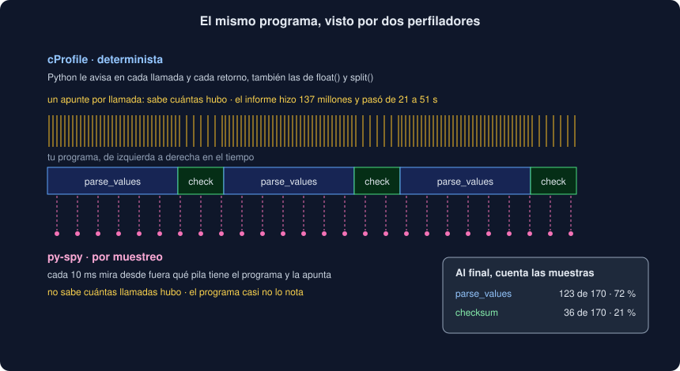

# 03 · Muestrear con py-spy

⏱️ 50 min

## 🎯 Objetivos

- Explicar en qué se diferencia un perfilador por **muestreo** de uno determinista.
- Grabar un perfil con `py-spy record` y leer un gráfico de llamas.
- Ver un programa en vivo con `py-spy top` y preguntarle qué hace con `py-spy dump`.
- Elegir entre el modo normal y `--nonblocking`, y saber cuándo hace falta `--idle`.
- Resolver los permisos: `sudo` en tu máquina y `SYS_PTRACE` en Docker.

---

## 1. Dos formas de perfilar



cProfile (teoría 02) es **determinista**: anota **cada** llamada. Lo sabe todo, pero cuesta en cada llamada, y el `informe` de la semana 21 pasó de 21 a 51 s.

Un perfilador por **muestreo** no anota llamadas: cada cierto tiempo (por defecto, 100 veces por segundo) mira **qué está ejecutando** el programa en ese instante, su pila de llamadas, y la apunta. Al final cuenta: si `parse_values` estaba en la pila en 123 de 170 muestras, se llevó en torno al 72 % del tiempo.

| | cProfile | py-spy |
|---|---|---|
| Tipo | Determinista | Por muestreo |
| Qué sabe | Cada llamada: cuántas y cuánto | Qué parte del tiempo pasa en cada función y **línea** |
| Coste | En cada llamada; puede doblar el tiempo | Casi ninguno con `--nonblocking`, sea cual sea el programa |
| Funciones muy cortas y muy llamadas | Salen infladas | Salen en su proporción real |
| `ncalls` | Sí | No: no ve las llamadas, solo las pilas |
| Cambiar el programa | Hay que ejecutarlo a través de cProfile | No: se engancha a un proceso que ya corre |
| Instalación | Viene con Python | Un paquete aparte: `py-spy==0.4.2` |

Se complementan: py-spy para saber **dónde** se va el tiempo de verdad, también en producción; cProfile cuando necesitas **cuántas veces** se llama algo.

---

## 2. Cómo mira py-spy

py-spy es un programa escrito en Rust que se distribuye como un paquete de Python: `uv add --dev py-spy==0.4.2` lo deja en `.venv/bin/py-spy`. **No se importa** ni corre dentro de tu programa: es otro proceso que **lee la memoria** del tuyo, encuentra las estructuras con las que el intérprete guarda la pila de cada hilo y las interpreta.

Por eso:

- no hace falta cambiar ni reiniciar el programa: le das su `pid` y mira;
- funciona igual con una CLI, con la API servida por uvicorn o con un proceso colgado;
- necesita **permiso** para leer la memoria de otro proceso (sección 7);
- tiene que conocer cómo guarda cada versión de Python su pila: py-spy 0.4.2 es la primera que entiende Python 3.14.

---

## 3. `record`: grabar un perfil

```bash
uv run py-spy record -o perfil/antes.svg -- python -m observatorio informe -f perfil/grande.txt
```

Todo lo que va después de `--` es la orden que py-spy **arranca** y observa hasta que termina. Al final escribe un gráfico de llamas en SVG:

```
py-spy> Sampling process 100 times a second. Press Control-C to exit.
py-spy> Stopped sampling because process exited
py-spy> Wrote flamegraph data to 'perfil/despues.svg'. Samples: 84 Errors: 0
```

Opciones útiles:

| Opción | Para qué |
|---|---|
| `-o archivo` | Dónde escribir el resultado |
| `--pid N` | Engancharse a un proceso que ya corre, en vez de arrancarlo |
| `-d 30` | Grabar solo 30 segundos (con `--pid`, en un programa que no termina) |
| `-r 200` | 200 muestras por segundo en vez de 100: más detalle en programas cortos |
| `--nonblocking` | No pausar el programa en cada muestra (sección 5) |
| `--idle` | Contar también las muestras en que el programa espera (sección 6) |
| `-s` | Seguir también a los subprocesos (un `ProcessPoolExecutor`, semana 16) |
| `-f speedscope` | Guardar en el formato de [speedscope.app](https://www.speedscope.app/), un visor web interactivo |

---

## 4. Leer un gráfico de llamas

Un **gráfico de llamas** (*flame graph*) junta todas las muestras en un dibujo. En el de py-spy:

- cada rectángulo es una **función, en una línea concreta** (`parse_values (main.py:17)`);
- el de **encima** es quien la llamó: py-spy dibuja la raíz (`all`, el 100 % de las muestras) arriba, y las llamadas bajan;
- el **ancho** es la parte de las muestras en que esa función estaba en la pila: cuanto más ancho, más tiempo, ella o lo que llama;
- el eje horizontal **no es el tiempo**: las funciones de un mismo nivel van en orden alfabético, y los colores no significan nada.

Qué buscar:

1. Los rectángulos **anchos** cerca del fondo, sin nada debajo: ahí se trabaja (el `tottime` de cProfile).
2. Los rectángulos anchos de **tu código**, aunque debajo haya una biblioteca: ahí decides llamarla.

En el `informe` de la semana 21, `informe (observatorio/cli.py:182)` ocupa el 99,4 % de las muestras, y debajo tiene `print (rich/console.py:1731)` con el 99,0 %: la línea 182 es `out.print(table_of(series, scale))`. Debajo, `print` se abre en decenas de funciones de Rich. Ninguna es ancha por sí sola: lo ancho es haber llamado a `print` con 100 000 filas.

El SVG es interactivo en el navegador: el ratón encima muestra el nombre y las muestras; un clic amplía un rectángulo; `Ctrl+F` resalta una función en todo el gráfico.

---

## 5. Parar o no parar

Leer la pila de otro proceso mientras se mueve tiene un riesgo: que cambie a mitad de lectura. Por eso, por defecto, py-spy **pausa** el programa un instante en cada muestra, lee una pila coherente y lo deja seguir.

Normalmente esa pausa no se nota. Con pilas muy profundas sí: en WSL2, el `informe` de la semana 21 con 50 000 medidas, en el que Rich se llama a sí mismo muchos niveles, tardó 55 s con py-spy en modo normal frente a 8 s con `--nonblocking`.

Con `--nonblocking` py-spy lee sin pausar: el programa no nota nada y alguna muestra sale rota, que py-spy cuenta en `Errors`. Para un perfil, unas pocas muestras rotas no cambian las proporciones. Regla práctica: si con py-spy tu programa tarda claramente más que sin él, usa `--nonblocking`; y en producción, siempre.

---

## 6. Calcular o esperar

py-spy distingue si cada hilo estaba **activo** (ejecutando código) o **parado** (en `sleep`, esperando la red, el disco o un `Lock`). Por defecto **solo cuenta los activos**: el gráfico muestra dónde se **calcula**.

Si tu programa tarda por esperas, el gráfico sale casi vacío y las muestras son pocas para lo que tardó. Con `--idle` cuentan también las paradas:

| Grabación del ejercicio 03 (2 s de cálculo y 2 s de `sleep`) | Muestras |
|---|---|
| `py-spy record` | 170 |
| `py-spy record --idle` | 352: el `sleep` sale con el 46 % |

Es el `user + sys` frente al `real` de la teoría 01, pero función por función.

---

## 7. `top` y `dump`

`top` muestra el perfil **en vivo**, como la orden `top` de Unix con los procesos:

```bash
uv run py-spy top -- python main.py
```

```
Total Samples 500
GIL: 100.00%, Active: 100.00%, Threads: 1
  %Own   %Total  OwnTime  TotalTime  Function (filename)
 73.00%  73.00%    3.75s     3.75s   parse_values (main.py)
 23.00%  23.00%    1.10s     1.10s   checksum (main.py)
  4.00% 100.00%   0.130s     4.98s   work (main.py)
  0.00% 100.00%   0.020s     5.00s   <module> (main.py)
```

`%Own` es el tiempo propio (el `tottime` de cProfile) y `%Total`, con lo que llama (el `cumtime`). La tabla se actualiza cada segundo; `Ctrl+C` sale. Sirve para mirar un servidor mientras le llegan peticiones.

`dump` escribe la pila de **cada hilo** en este instante y termina:

```
Thread 23 (idle)
    wait_for (main.py:63)
    <module> (main.py:67)
```

Se lee de dentro afuera: el hilo está en la línea 63 de `wait_for`, llamada desde la 67. Es lo primero que haces ante un programa **colgado**: sin pararlo, sin reiniciarlo, sin haber añadido nada antes. Con `--locals` escribe además las variables locales de cada función.

---

## 8. Permisos

Leer la memoria de otro proceso es delicado: el mismo mecanismo serviría para robar contraseñas de la memoria de tu navegador. Cada sistema lo limita:

| Dónde | Qué pasa | Qué hacer |
|---|---|---|
| Linux y WSL2, arrancando el programa (`-- python ...`) | py-spy es el padre del programa y puede leerlo | Nada |
| Linux y WSL2, con `--pid` | Ubuntu y Debian solo dejan leer a un proceso **padre**; py-spy dice `Permission Denied` | `sudo .venv/bin/py-spy dump --pid N` |
| macOS | Siempre hace falta | `sudo` en todos los casos |
| Docker | El contenedor no tiene la capacidad `SYS_PTRACE`, ni siquiera como root: `Permission denied (os error 13)` | `docker run --cap-add SYS_PTRACE ...` |

En Linux, la regla del padre la fija `/proc/sys/kernel/yama/ptrace_scope`: `1` (lo normal en Ubuntu) es "solo los padres"; `0`, cualquiera de tu usuario.

Con `sudo` usa la ruta de `.venv/bin/py-spy`: `sudo uv run ...` ejecutaría uv como root y podría dejar archivos de root en tu `.venv`.

En Docker, **no** añadas `SYS_PTRACE` al servicio `api` de `compose.yaml`: la semana 21 lo dejó con `cap_drop: [ALL]` a propósito. Para depurar, arrancas un contenedor aparte con la capacidad, lo usas y lo borras.

---

## 9. Errores frecuentes

| Error | Por qué está mal | Qué hacer |
|---|---|---|
| Leer el eje horizontal como tiempo | Las funciones van en orden alfabético | Solo cuenta el ancho |
| Buscar la función lenta en el rectángulo más alto | Arriba está la raíz; abajo, lo que trabaja | Anchos y sin nada debajo |
| Grabar un programa que espera y ver el gráfico vacío | Sin `--idle`, las esperas no cuentan | `--idle`, y compara `real` con CPU |
| `sudo uv run py-spy ...` | uv como root puede dejar archivos de root en `.venv` | `sudo .venv/bin/py-spy ...` |
| Añadir `SYS_PTRACE` al compose de producción | Deshaces el `cap_drop: [ALL]` de la semana 21 | Un contenedor de depuración aparte |
| Medir la mejora con py-spy encima | El modo normal puede frenar el programa | Mide sin perfilador; py-spy dice dónde, no cuánto |
| Pocas muestras en un programa corto | Con 0,5 s salen 50 muestras: proporciones poco fiables | Datos más grandes o `-r 500` |

---

## ✅ Qué debes saber al terminar

- [ ] La diferencia entre un perfilador determinista y uno por muestreo, y cuándo usar cada uno.
- [ ] Cómo grabar con `py-spy record` y leer un gráfico de llamas: ancho, quién llama a quién, y que el eje no es el tiempo.
- [ ] Para qué sirven `--nonblocking` e `--idle`.
- [ ] Qué hacen `py-spy top` y `py-spy dump`, y cuándo usarías cada uno.
- [ ] Por qué hace falta `sudo` con `--pid`, y `SYS_PTRACE` en Docker.

---

## 🔗 Navegación

| Anterior | Actual | Siguiente |
| -------- | ------ | --------- |
| [02 · Perfilar con cProfile](02-perfilar-con-cprofile.md) | **03 · Muestrear con py-spy** | [04 · Optimizar en Python puro](04-optimizar-python-puro.md) |
