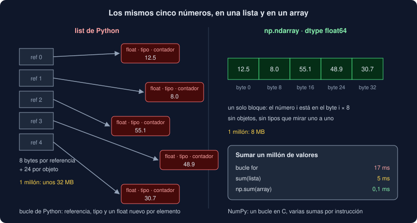

# 05 · Vectorizar con NumPy

⏱️ 50 min

## 🎯 Objetivos

- Explicar por qué un bucle de Python es lento con muchos números y un array de NumPy no.
- Escribir operaciones sobre un array entero en lugar de un bucle: aritmética, máscaras y sumas acumuladas.
- Tener en cuenta lo que cuesta convertir entre listas y arrays.
- Decidir con números cuándo NumPy compensa y cuándo no, también en tu Observatorio.

---

## 1. Lo que hace un bucle de Python

Sumar un millón de números en un bucle:

```python
total = 0.0
for value in values:
    total += value
```

En cada vuelta, el intérprete: saca el siguiente objeto de la lista, mira su **tipo** para saber cómo se suma, suma, crea un objeto `float` nuevo para el resultado, lo guarda en `total` y libera el anterior. Un millón de veces. Cada `float` de Python es un objeto completo de 24 bytes (su tipo, un contador de referencias y el número), y la lista guarda una **referencia** de 8 bytes a cada uno, repartidos por la memoria.

Ese trabajo extra por elemento es el precio de que en una lista quepa cualquier cosa. Con un millón de números del mismo tipo, sobra.

---

## 2. Un array



Un **array** de NumPy es un bloque de memoria con los números **seguidos**, todos del mismo tipo:

```python
import numpy as np

array = np.array(values)
array.dtype    # dtype('float64')
array.shape    # (1000000,)
array.nbytes   # 8000000: 8 MB, frente a unos 32 MB de la lista
```

- `dtype` es el tipo de **todos** los elementos: `float64`, el mismo número de 8 bytes que un `float` de Python, pero sin el objeto alrededor;
- `shape` es la forma: un millón de elementos en una dimensión;
- no hay referencias ni objetos sueltos: el número `i` está en la posición `i × 8` del bloque.

Como el tipo es uno y se sabe de antemano, NumPy recorre el bloque con un bucle **en C**, sin mirar tipos ni crear objetos, y la CPU puede sumar varios números en una sola instrucción.

---

## 3. Vectorizar

**Vectorizar** es escribir la operación sobre el array **entero**, sin bucle en Python:

| Bucle | Vectorizado |
|---|---|
| `sum(v for v in values)` | `array.sum()` o `np.sum(array)` |
| `[(v - m) / s for v in values]` | `(array - array.mean()) / array.std()` |
| `sum(v > 50 for v in values)` | `np.count_nonzero(array > 50)` |
| `[v for v in values if v > 50]` | `array[array > 50]` |
| `[b - a for a, b in pairwise(values)]` | `np.diff(array)` |

`array - 3.0` resta 3 a **cada** elemento y da un array nuevo del mismo tamaño. `array > 50` compara cada elemento y da un array de `bool`: una **máscara**. Indexar con una máscara, `array[array > 50]`, se queda con los elementos donde es `True`. Las tres ideas (aritmética elemento a elemento, máscaras y funciones que resumen el array) son la base de NumPy y de pandas.

Con un millón de valores, medido en el ejercicio 04:

| Operación | Bucle o comprensión | NumPy |
|---|---|---|
| Sumar | 17 ms (bucle) · 5 ms (`sum()`) | 0,1 ms |
| Puntuación z de cada valor | 60 ms | 2,2 ms |
| Contar los mayores de 50 | 32 ms | 0,1 ms |
| Media móvil de 3 | 127 ms | 3,5 ms |

Entre 25 y más de 100 veces más rápido.

---

## 4. Pensar en arrays: la media móvil

No todos los cálculos se traducen palabra por palabra. La media móvil de tu Observatorio suma el valor que entra en la ventana y resta el que sale, en un bucle. En arrays se piensa de otra forma: con las **sumas acumuladas**.

```python
def moving_average_np(values: np.ndarray, window: int) -> np.ndarray:
    sums = np.cumsum(np.concatenate(([0.0], values)))
    return (sums[window:] - sums[:-window]) / window
```

`np.cumsum` da en cada posición la suma de todos los anteriores. Con `values = [10, 20, 30, 40]`, `concatenate` le pone un 0 delante y `sums` es `[0, 10, 30, 60, 100]`. La suma de un tramo es la resta de dos sumas acumuladas: los valores 2 a 4 suman `sums[4] - sums[1]`. Restar el array `sums` desplazado `window` posiciones calcula **todos** los tramos de una vez:

```
sums[3:]  = [60, 100]
sums[:-3] = [0, 10]
resta / 3 = [20.0, 30.0]
```

Las mismas medias que el bucle, 36 veces más rápido. Para comprobarlo, `np.allclose(a, b)`: los dos métodos suman en orden distinto y pueden diferir en el último decimal, así que se comparan con tolerancia, nunca con `==`.

---

## 5. El precio de entrar y salir

Los datos del Observatorio llegan como líneas de texto y se convierten en listas de `float`. Pasar a NumPy cuesta:

| Operación, con un millón de valores | Tiempo |
|---|---|
| `np.array(lista)` | 16 ms: lee un millón de objetos |
| `array.tolist()` | 34 ms: crea un millón de objetos |
| `sum(lista)` | 5 ms |
| `np.sum(np.array(lista))` | 17 ms |

Convertir para hacer **una** operación pierde: `sum()` sobre la lista gana. NumPy compensa cuando:

- los datos **nacen** en arrays (pandas y Polars leen un CSV directamente a arrays, semanas 24 a 26);
- haces **muchas** operaciones sobre los mismos datos: conviertes una vez y lo demás va en C.

Y hay un coste fijo por llamada: con **10** valores, `np.sum` tarda 1 µs y `sum()`, 0,1 µs. Por debajo de unos cientos de elementos, Python gana.

---

## 6. ¿Y en tu Observatorio?

Después de los arreglos del proyecto, `informe` con 100 000 medidas tarda alrededor de 1 segundo. Las funciones numéricas de `trends.py` (mediana, media móvil, mayor salto) suman unos **30 ms**. Con NumPy bajarían a unos 6 ms, contando la conversión. Pero:

```bash
uv run --with numpy==2.5.4 python -X importtime -c "import numpy" 2>&1 | tail -1
```

importar NumPy cuesta alrededor de **0,1 s** (más la primera vez, mientras Python guarda los `.pyc`). Por Amdahl (teoría 01): ganarías menos de 30 ms y pagarías 100. El `informe` iría **más lento**, y todos los comandos que importan `cli.py` también.

Por eso el Observatorio no usa NumPy esta semana. Lo que domina su tiempo es analizar texto línea a línea, y eso NumPy no lo vectoriza. En la fase 4, cuando los datos lleguen como tablas de pandas y los cálculos sean muchos y sobre millones de filas, la cuenta será otra. Medir y decidir que **no** es una conclusión tan válida como un arreglo, y va en tu *pull request*.

---

## 7. Errores frecuentes

| Error | Por qué está mal | Qué hacer |
|---|---|---|
| Recorrer un array con `for` | Pierdes todo lo que gana NumPy: cada elemento vuelve a ser un objeto | Operaciones sobre el array entero |
| `if array > 50:` | Una máscara no es un `bool`: `ValueError: The truth value of an array ... is ambiguous` | `.any()`, `.all()` o `np.count_nonzero` |
| Comparar resultados `float` con `==` | Sumar en otro orden cambia el último decimal | `np.allclose` |
| Convertir a array para una sola operación | La conversión cuesta más que lo que ganas | Convierte una vez y haz todo en arrays |
| NumPy con 10 elementos | El coste fijo de cada llamada es mayor que el trabajo | Python para pocos datos |
| Añadir NumPy a una CLI sin medir | Su importación puede costar más que lo que ahorra | `python -X importtime` y Amdahl |
| Un array de `object` (`np.array(["a", 1])`) | Vuelven los objetos de Python y la lentitud | Arrays de un solo tipo numérico |

---

## ✅ Qué debes saber al terminar

- [ ] Qué hace el intérprete en cada vuelta de un bucle, y qué ahorra un array.
- [ ] Qué son `dtype`, `shape` y una máscara, y cómo se escribe una operación sin bucle.
- [ ] Cómo calcular una media móvil con sumas acumuladas.
- [ ] Lo que cuesta convertir entre listas y arrays, y el coste fijo de cada llamada.
- [ ] Por qué el Observatorio no usa NumPy esta semana, con números.

---

## 🔗 Navegación

| Anterior | Actual | Siguiente |
| -------- | ------ | --------- |
| [04 · Optimizar en Python puro](04-optimizar-python-puro.md) | **05 · Vectorizar con NumPy** | [Ejercicio 01 · Medir](../2-practicas/ejercicio-01-medir-con-timeit/README.md) |
