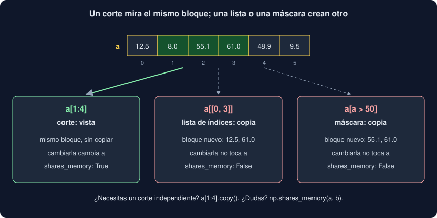

# 02 · Índices, vistas y máscaras

⏱️ 50 min

## 🎯 Objetivos

- Elegir elementos, filas, columnas y bloques de un array de una y de dos dimensiones.
- Saber qué operaciones dan una **vista** del mismo bloque y cuáles una **copia**, y evitar los cambios que se cuelan en el original.
- Filtrar con máscaras, combinarlas con `&`, `|` y `~`, y cambiar solo los elementos que cumplen una condición.
- Encontrar posiciones con `np.flatnonzero`, `argmax` y `argsort`, y usarlas para elegir en otro array.

---

## 1. Índices y cortes

Con una dimensión, todo lo que sabes de las listas (semana 5) funciona igual:

```python
day = np.array([12.5, 8.0, 55.1, 61.0])
day[0], day[-1]   # 12.5, 61.0
day[1:3]          # [ 8.  55.1]
day[::2]          # [12.5 55.1]
```

Con dos, un índice **por eje**, separados por comas dentro de los mismos corchetes:

```python
WEEK = np.array([
    [12.5, 8.0, 55.1, 61.0],   # día 0
    [48.9, 9.5, 40.2, 33.3],   # día 1
    [20.0, 71.4, 5.5, 18.8],   # día 2
])  # columnas: Norte, Sur, Este, Oeste

WEEK[1, 2]     # 40.2: día 1, Este
WEEK[0]        # la fila del día 0: [12.5  8.  55.1 61. ]
WEEK[:, 1]     # la columna Sur: [ 8.   9.5 71.4]
WEEK[1:, :2]   # días 1 y 2, Norte y Sur
```

`WEEK[1, 2]` y `WEEK[1][2]` dan lo mismo, pero el segundo crea primero la fila y luego elige en ella: dos pasos en lugar de uno. `:` sola significa "todo este eje": `WEEK[:, 1]` es "todas las filas, columna 1".

---

## 2. Un corte es una vista



Un corte de una lista crea una lista nueva. Un corte de un array **no**: da una vista del mismo bloque, con otra `shape` y otros `strides` (teoría 01, sección 6). Es lo que lo hace gratis con un millón de elementos, y también lo que lo hace peligroso:

```python
week = WEEK.copy()
north = week[:, 0]
north[:] = 0
week
```

```
[[ 0.   8.  55.1 61. ]
 [ 0.   9.5 40.2 33.3]
 [ 0.  71.4  5.5 18.8]]
```

Has puesto a cero la columna Norte de `week`, aunque solo tocaste `north`. Si `north` lo devuelve una función y otra parte del programa lo modifica, el cambio aparece lejos, en un array que nadie tocó. Cuando quieres un trozo independiente, pídelo:

```python
safe = WEEK[:, 0].copy()
```

`north[:] = 0` asigna **dentro** de la vista. `north = 0` solo haría que el nombre `north` apunte a otro objeto, el 0, sin tocar ningún array (semana 5: los nombres son etiquetas).

---

## 3. Índices con una lista: una copia

En lugar de un número o un corte, puedes pasar una **lista de posiciones**. Se llama *fancy indexing*:

```python
WEEK[0, [3, 0, 0]]         # [61.  12.5 12.5]: en el orden pedido, y repetidos
WEEK[[2, 0]]               # las filas 2 y 0
WEEK[[0, 1, 2], [3, 0, 1]] # un elemento por pareja: (0, 3), (1, 0), (2, 1) → [61.  48.9 71.4]
```

Esto no puede ser una vista: los elementos elegidos no están a saltos regulares en el bloque, y pueden repetirse. NumPy los **copia** a un bloque nuevo. Cambiar el resultado no toca `WEEK`.

| Operación | Resultado | ¿Comparte memoria? |
|---|---|---|
| `a[2]`, `a[1, 2]` | Un número | No es un array |
| `a[1:3]`, `a[:, 0]`, `a[::2]` | Vista | Sí |
| `a.reshape(...)`, `a.T` | Vista (casi siempre) | Sí |
| `a[[0, 3]]` | Copia | No |
| `a[a > 50]` | Copia | No |
| `a.copy()` | Copia | No |

Si dudas, `np.shares_memory(a, b)` lo dice.

---

## 4. Máscaras

Una comparación con un array da un array de `bool` de la misma forma, la **máscara** (semana 22):

```python
high = WEEK > 50
```

```
[[False False  True  True]
 [False False False False]
 [False  True False False]]
```

Indexar con ella se queda con los elementos donde es `True`, en orden de lectura, en un array de una dimensión:

```python
WEEK[high]               # [55.1 61.  71.4]
np.count_nonzero(high)   # 3
```

Las condiciones se combinan con `&` (y), `|` (o) y `~` (no), **con paréntesis**:

```python
middle = (WEEK >= 10) & (WEEK <= 50)
WEEK[middle]             # [12.5 48.9 40.2 33.3 20.  18.8]
WEEK[~(high | middle)]   # [8.  9.5 5.5]: los bajos
```

Los paréntesis hacen falta porque `&` se evalúa antes que `>=`: sin ellos, `WEEK >= 10 & WEEK <= 50` intenta calcular `10 & WEEK` primero. Y `and`, `or` y `not` de Python no sirven, porque piden **un** `bool` y una máscara tiene muchos:

```
ValueError: The truth value of an array with more than one element is ambiguous. Use a.any() or a.all()
```

`.any()` pregunta "¿alguno es `True`?" y `.all()`, "¿todos?". Con `axis`, por filas o por columnas:

```python
(WEEK > 50).any(axis=1)   # [ True False  True]: ¿qué días tuvieron algún alto?
```

---

## 5. Cambiar lo que cumple una condición

Asignar a través de una máscara cambia **en el sitio** solo esos elementos:

```python
capped = WEEK.copy()
capped[capped > 60] = 60   # tope de 60: el 61.0 y el 71.4 pasan a 60
```

Aquí `capped[...] = ...` escribe en `capped`, aunque `capped[capped > 60]` a la derecha de un `=` daría una copia. Leer con una máscara copia; escribir con ella modifica el original.

Para crear un array nuevo eligiendo entre dos valores según una condición, `np.where`, el `if` sin bucle:

```python
np.where(WEEK[0] > 50, "alto", "no alto")   # ['no alto' 'no alto' 'alto' 'alto']
```

Y para saber **dónde** se cumple, `np.flatnonzero`, que da las posiciones de los `True`:

```python
np.flatnonzero(WEEK[0] > 50)   # [2 3]
```

Es lo que usa tu Observatorio para encontrar las medidas atípicas (teoría 04): una máscara de "lejos de la media" y sus posiciones, para escribir después qué etiqueta tenía cada una.

---

## 6. Ordenar y elegir los mayores

```python
day = WEEK[1]                  # [48.9  9.5 40.2 33.3]
np.sort(day)                   # [ 9.5 33.3 40.2 48.9]
np.argsort(day)                # [1 3 2 0]: las posiciones, de menor a mayor
```

`np.sort` da los valores ordenados; `np.argsort`, **las posiciones** en el orden en que habría que leerlos. Con las posiciones puedes ordenar **otro** array igual, y así no pierdes qué estación tenía cada valor:

```python
STATIONS = np.array(["Norte", "Sur", "Este", "Oeste"])
order = np.argsort(day)[::-1]   # de mayor a menor
STATIONS[order]                 # ['Norte' 'Este' 'Oeste' 'Sur']
day[order]                      # [48.9 40.2 33.3  9.5]
```

`argmax` y `argmin` dan la posición del mayor y del menor, también por eje:

```python
STATIONS[WEEK.argmax(axis=1)]   # ['Oeste' 'Norte' 'Sur']: la más alta de cada día
```

Sin `axis`, `WEEK.argmax()` da la posición en el bloque aplanado (9); `np.unravel_index(9, WEEK.shape)` la convierte en fila y columna: `(2, 1)`.

---

## 7. Errores frecuentes

| Error | Por qué está mal | Qué hacer |
|---|---|---|
| Modificar un corte creyendo que es una copia | Es una vista: cambias el original | `.copy()` cuando quieras un trozo independiente |
| `and`, `or`, `not` con máscaras | Piden un solo `bool`: `ValueError: The truth value of an array ... is ambiguous` | `&`, `|`, `~` |
| `a > 10 & a < 50` sin paréntesis | `&` va antes que `>`: calcula `10 & a` | `(a > 10) & (a < 50)` |
| `if a > 50:` | Una máscara no es un `bool` | `.any()`, `.all()` o `np.count_nonzero` |
| `WEEK[1][2] = 0` en bucles grandes | Funciona, pero crea una vista intermedia en cada vuelta | `WEEK[1, 2] = 0` |
| Ordenar los valores y perder las etiquetas | `np.sort` no dice de dónde venía cada valor | `np.argsort` y elegir con las posiciones en los dos arrays |
| Esperar que `a[a > 50]` conserve la forma | Da un array de una dimensión con los elegidos | `np.where(a > 50, a, np.nan)` si necesitas la forma |

---

## ✅ Qué debes saber al terminar

- [ ] Elegir con índices y cortes en una y dos dimensiones, con `:` para "todo el eje".
- [ ] Qué da una vista (cortes, `reshape`, `.T`) y qué una copia (listas de índices, máscaras, `.copy()`).
- [ ] Filtrar con máscaras y combinarlas con `&`, `|` y `~`, con paréntesis.
- [ ] Cambiar en el sitio con `a[máscara] = valor`, y crear con `np.where`.
- [ ] Usar `argsort`, `argmax` y `flatnonzero` para elegir en otro array por posición.

---

## 🔗 Navegación

| Anterior | Actual | Siguiente |
| -------- | ------ | --------- |
| [01 · Arrays: forma, tipo y memoria](01-arrays-forma-tipo-y-memoria.md) | **02 · Índices, vistas y máscaras** | [03 · Operaciones, ejes y broadcasting](03-operaciones-ejes-y-broadcasting.md) |
