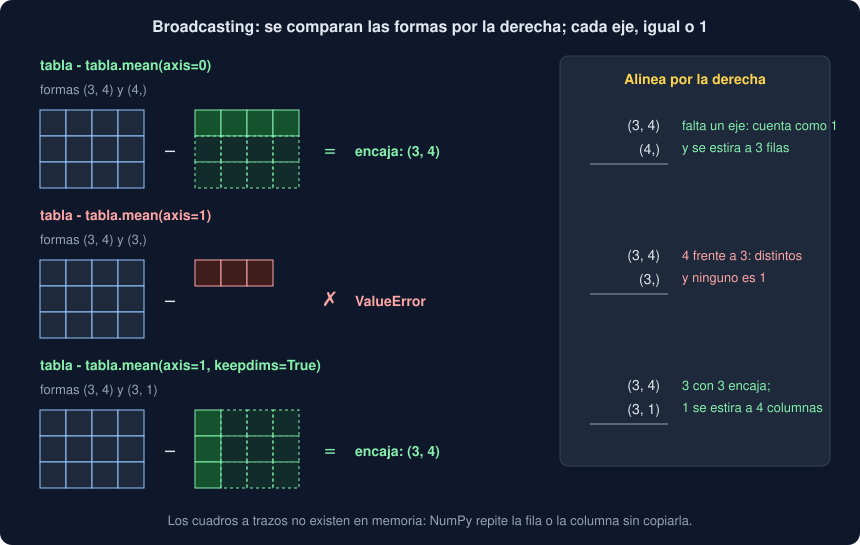

# 03 · Operaciones, ejes y broadcasting

⏱️ 50 min

## 🎯 Objetivos

- Operar elemento a elemento con operadores y funciones universales (*ufuncs*).
- Resumir una tabla entera, por filas o por columnas, con el argumento `axis`, y conservar la forma con `keepdims`.
- Aplicar la regla del **broadcasting** para operar arrays de formas distintas, y leer su error cuando no encajan.
- Normalizar cada columna de una tabla y construir tablas de dos ejes sin un solo bucle.

---

## 1. Elemento a elemento

Las operaciones de los ejercicios de esta teoría usan una semana de medidas: 7 días (filas) por 4 estaciones (columnas), generada con semilla fija (teoría 04):

```python
rng = np.random.default_rng(23)
WEEK = rng.normal(40, 10, size=(7, 4)).round(1)
```

```
[[45.5 42.2 39.4 16.8]
 [44.3 18.7 49.1 46.1]
 [48.3 48.3 43.  34.6]
 [36.9 55.1 34.2 37.7]
 [32.8 34.8 36.9 42.6]
 [37.1 36.5 33.8 40.9]
 [26.6 40.5 53.1 32.3]]
```

Los operadores `+`, `-`, `*`, `/`, `**`, `>`, `==`... entre dos arrays de la misma forma operan **posición a posición**, y entre un array y un número, con cada elemento:

```python
WEEK[1] - WEEK[0]            # [ -1.2 -23.5   9.7  29.3]
(WEEK[0] * 10).astype(int)   # [455 422 394 168]
```

Las funciones matemáticas de NumPy hacen lo mismo. Se llaman **funciones universales** (*ufuncs*): reciben arrays, operan cada elemento en C y devuelven un array de la misma forma.

```python
np.sqrt(WEEK[0]).round(2)          # [6.75 6.5  6.28 4.1 ]
np.maximum(WEEK[0], WEEK[1])       # [45.5 42.2 49.1 46.1]: el mayor de cada pareja
```

| Función | Qué hace con cada elemento |
|---|---|
| `np.abs`, `np.sqrt`, `np.exp`, `np.log` | Valor absoluto, raíz, exponencial, logaritmo |
| `np.round(a, n)` | Redondea a `n` decimales (también `a.round(n)`) |
| `np.maximum(a, b)`, `np.minimum(a, b)` | El mayor (o menor) de cada pareja, no el del array |
| `np.clip(a, bajo, alto)` | Recorta cada valor al intervalo: el tope de la teoría 02, sin máscara |
| `np.isnan(a)` | `True` donde hay NaN (teoría 04) |

No confundas `np.maximum(a, b)` (elemento a elemento, dos arrays) con `np.max(a)` (el mayor de todo el array).

---

## 2. Resumir por ejes

Las funciones que resumen (`sum`, `mean`, `std`, `min`, `max`, `argmax`...) reducen todo el array a un número, salvo que les digas **por qué eje**:

```python
WEEK.mean()          # 38.86: la media de los 28 valores
WEEK.mean(axis=0)    # [38.79 39.44 41.36 35.86]: shape (4,), una por estación
WEEK.mean(axis=1)    # [35.98 39.55 43.55 40.98 36.78 37.07 38.12]: shape (7,), una por día
```

La forma de recordarlo: `axis=0` **desaparece** el eje 0. La tabla `(7, 4)` pasa a `(4,)`: se recorren las 7 filas hacia abajo y queda un resultado por columna. Con `axis=1` desaparece el eje de las columnas y queda uno por fila.

| Pregunta | Código |
|---|---|
| ¿Cuál es la media de cada estación? | `WEEK.mean(axis=0)` |
| ¿Cuánto midieron en total cada día? | `WEEK.sum(axis=1)` |
| ¿Qué estación tiene la media más alta? | `STATIONS[WEEK.mean(axis=0).argmax()]` → `'Este'` |
| ¿Cuántos valores pasan de 50 en cada estación? | `(WEEK > 50).sum(axis=0)` |

El último funciona porque `True` suma 1 y `False`, 0: sumar una máscara es contarla.

---

## 3. Broadcasting



Restar a cada valor la media de su estación es restar un array `(4,)` a una tabla `(7, 4)`. Las formas son distintas, y aun así funciona:

```python
(WEEK - WEEK.mean(axis=0))[0]   # [  6.71   2.76  -1.96 -19.06]
```

NumPy **estira** el array pequeño para que encaje con el grande, sin copiarlo: repite la fila de medias en cada uno de los 7 días. Se llama **broadcasting**, y su regla es corta:

1. Se comparan las formas **por la derecha**, eje a eje.
2. Si a un array le faltan ejes, se le añaden por la izquierda con tamaño 1.
3. Dos ejes encajan si son **iguales** o si **uno de ellos es 1**. El 1 se estira hasta el tamaño del otro.

```
WEEK               (7, 4)
WEEK.mean(axis=0)     (4,)  → (1, 4) → se estira a (7, 4)   ✓
```

Ahora resta a cada valor la media de **su día**, que tiene forma `(7,)`:

```python
WEEK - WEEK.mean(axis=1)
# ValueError: operands could not be broadcast together with shapes (7,4) (7,)
```

```
WEEK               (7, 4)
WEEK.mean(axis=1)     (7,)  → 4 frente a 7: ni iguales ni 1   ✗
```

Por la derecha, el 7 de las medias queda frente al 4 de las columnas. Lo que quieres es que las 7 medias formen una **columna**, `(7, 1)`, y que se estire a lo ancho. Dos formas de pedirlo:

```python
WEEK.mean(axis=1, keepdims=True).shape   # (7, 1): conserva el eje reducido con tamaño 1
WEEK.mean(axis=1)[:, None].shape         # (7, 1): añade un eje de tamaño 1
(WEEK - WEEK.mean(axis=1, keepdims=True))[0]   # [  9.52   6.23   3.42 -19.18]
```

`keepdims=True` es la forma más clara: el resultado tiene los mismos ejes que la tabla, y encaja siempre con ella. `None` en un índice (también se escribe `np.newaxis`) añade un eje de tamaño 1 en esa posición.

Cuando un error de broadcasting te sorprenda, imprime las dos `shape` y alinéalas por la derecha. Casi siempre falta un `keepdims=True` o un `[:, None]`.

---

## 4. Normalizar cada columna

Las puntuaciones z de la semana 22, ahora **por estación**: cada valor menos la media de su columna, dividido por la desviación de su columna. Dos broadcastings en una línea:

```python
z = (WEEK - WEEK.mean(axis=0)) / WEEK.std(axis=0)
z.mean(axis=0).round(10)   # [0. 0. 0. 0.]
z.std(axis=0).round(10)    # [1. 1. 1. 1.]
z.argmax(axis=0)           # [2 3 6 1]: el día más alto de cada estación, respecto a su media
```

Cada columna queda con media 0 y desviación 1: valores de estaciones con escalas distintas se pueden comparar. Es lo que hace `StandardScaler` de scikit-learn antes de entrenar muchos modelos (semana 32), y lo que hace tu Observatorio con una sola columna para encontrar las medidas atípicas (proyecto).

Con 100 000 filas, en el ejercicio 03:

| Normalizar 100 000 × 4 | Tiempo |
|---|---|
| Bucles de Python | 83 ms |
| Broadcasting | 8,6 ms |

Diez veces más rápido, y una línea en lugar de seis.

---

## 5. Tablas de dos ejes

El broadcasting también **crea** tablas a partir de dos arrays de una dimensión, poniendo uno en columna y otro en fila:

```python
np.arange(1, 4)[:, None] * np.arange(1, 6)
```

```
[[ 1  2  3  4  5]
 [ 2  4  6  8 10]
 [ 3  6  9 12 15]]
```

`(3, 1)` por `(5,)`: el primero se estira a 5 columnas, el segundo a 3 filas, y sale `(3, 5)`, todas las parejas. Con tres ejes, la misma idea responde preguntas como "¿cuántos días pasa cada estación de 30, de 40 y de 50?" en una sola expresión:

```python
thresholds = np.array([30, 40, 50])
above = WEEK[:, :, None] > thresholds   # (7, 4, 1) frente a (3,): sale (7, 4, 3)
above.sum(axis=0)                       # (4, 3): una fila por estación, una columna por umbral
```

```
[[6 3 0]
 [6 4 1]
 [7 3 1]
 [6 3 0]]
```

Cuidado con el tamaño: el resultado tiene un elemento por cada combinación. Con un millón de valores y mil umbrales serían mil millones de `bool`, un gigabyte. El broadcasting no copia los arrays de entrada, pero el resultado sí ocupa su memoria.

---

## 6. Errores frecuentes

| Error | Por qué está mal | Qué hacer |
|---|---|---|
| `axis=0` creyendo que da un resultado por fila | `axis=0` hace desaparecer las filas: queda uno por columna | Piensa "qué eje desaparece" |
| `operands could not be broadcast together with shapes (7,4) (7,)` | Por la derecha, 4 frente a 7 | `keepdims=True` o `[:, None]` |
| Un broadcasting que "funciona" con el eje equivocado | Con una tabla cuadrada, `(4, 4)` menos `(4,)` siempre encaja, aunque quisieras restar por filas | Usa `keepdims=True` y comprueba con un valor a mano |
| `np.max(a, b)` para el mayor de cada pareja | El segundo argumento de `np.max` es el eje | `np.maximum(a, b)` |
| Crear una tabla gigante sin querer | `(n, 1)` por `(m,)` da `n × m` elementos | Calcula `n × m × itemsize` antes |
| Bucles sobre las filas de un array | Pierdes lo que gana NumPy | Operaciones con `axis` y broadcasting |

---

## ✅ Qué debes saber al terminar

- [ ] Operar elemento a elemento con operadores y *ufuncs*, y distinguir `np.maximum` de `np.max`.
- [ ] Resumir por filas o por columnas con `axis`, sabiendo qué eje desaparece.
- [ ] La regla del broadcasting: por la derecha, iguales o 1.
- [ ] Arreglar un error de broadcasting con `keepdims=True` o `[:, None]`.
- [ ] Normalizar cada columna de una tabla, y construir una tabla de dos ejes con dos arrays.

---

## 🔗 Navegación

| Anterior | Actual | Siguiente |
| -------- | ------ | --------- |
| [02 · Índices, vistas y máscaras](02-indices-vistas-y-mascaras.md) | **03 · Operaciones, ejes y broadcasting** | [04 · Datos que faltan, estadística y azar](04-datos-que-faltan-estadistica-y-azar.md) |
