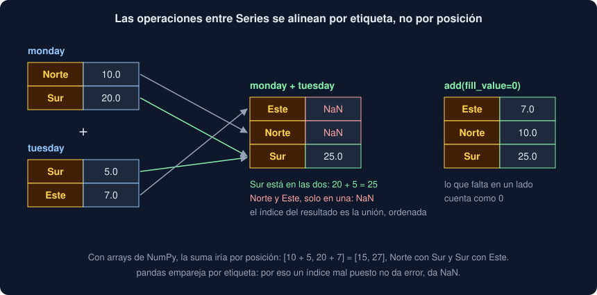

# 01 · Series: índice, tipos y alineación

⏱️ 45 min

## 🎯 Objetivos

- Explicar qué añade pandas a NumPy: etiquetas en las filas, columnas con nombre y tipos distintos en cada una.
- Crear una `Series` y leer sus valores, su índice, su nombre y su tipo.
- Saber qué tipo sale con enteros, decimales, texto y datos que faltan, y cuándo usar `Int64`.
- Elegir por etiqueta o por posición sin confundirlas, también con un índice de enteros.
- Prever qué pasa al operar dos `Series` con índices distintos.
- Tratar los datos que faltan y el texto con los métodos de pandas.

---

## 1. De NumPy a pandas

En la semana 23 trabajaste con arrays: un bloque de números del mismo tipo, sin nombres. Para saber de qué estación era la medida 7, guardabas las etiquetas en **otro** array y cuidabas de que los dos tuvieran el mismo orden.

pandas resuelve justo eso. Usa los arrays de NumPy por debajo y les añade:

- **etiquetas** en las filas (el índice), para elegir la fila `"Sur"` o la fila `7` sin depender de la posición;
- **columnas con nombre**, cada una de su tipo, en una tabla (`DataFrame`, teoría 02);
- **lectura y escritura** de CSV, Excel, Parquet o SQL en una línea;
- **métodos** que tienen en cuenta los datos que faltan.

Es la herramienta de análisis de datos más usada en Python. Esta semana usas pandas **3.1.0**. La versión 3 trajo dos cambios que verás muy a menudo y que muchos tutoriales antiguos no cuentan:

- el texto tiene su propio tipo, `str` (antes era `object`);
- *copy-on-write*: una selección se comporta siempre como una copia (teoría 04).

```bash
uv add pandas==3.1.0
```

```python
import pandas as pd   # el alias que usa todo el mundo
```

---

## 2. Una Series: valores con etiquetas

Una `Series` es una columna: un array de valores y, al lado, un **índice** con una etiqueta para cada uno.

```python
readings = pd.Series([12.5, 8.0, 48.9])
print(readings)
```

```
0    12.5
1     8.0
2    48.9
dtype: float64
```

A la izquierda está el índice. Si no le das uno, pandas usa `0, 1, 2...`, un `RangeIndex`, que ni siquiera guarda los números: solo el inicio, el final y el paso. A la derecha están los valores, y debajo, su tipo.

```python
readings.index         # RangeIndex(start=0, stop=3, step=1)
readings.to_numpy()    # array([12.5,  8. , 48.9]): el array de NumPy de dentro
```

Con un índice propio, las etiquetas dicen qué es cada valor:

```python
stations = pd.Series([12.5, 8.0, 48.9], index=["Norte", "Sur", "Este"], name="valor")
stations["Sur"]                          # 8.0
pd.Series({"A": 1, "B": 2})              # de un dict: las claves forman el índice
```

```
Norte    12.5
Sur       8.0
Este     48.9
Name: valor, dtype: float64
```

El `name` parece un detalle, pero cuando la `Series` sea una columna de una tabla, `name` será el nombre de esa columna.

---

## 3. Un tipo por Series

Como un array, una `Series` tiene un solo tipo. pandas lo deduce de los valores:

| Valores | `dtype` | Qué pasa |
|---|---|---|
| `[1, 2, 3]` | `int64` | Enteros de NumPy |
| `[1, None, 3]` | `float64` | `None` pasa a NaN, y NaN solo existe en `float64`: `[1.0, nan, 3.0]` |
| `["Norte", "Sur"]` | `str` | El tipo de texto de pandas 3 |
| `["A", None]` | `str` | El que falta se guarda como `nan` |
| `[1, "Norte"]` | `object` | Mezcla: referencias a objetos de Python, como en NumPy. Lento |
| `[1, None, 3]` con `dtype="Int64"` | `Int64` | Enteros que admiten un dato que falta: `[1, <NA>, 3]` |

La segunda fila es la que más sorprende. Una columna de conteos con **un** dato que falta deja de ser de enteros: `3` pasa a ser `3.0`. Si los enteros te importan, pide `Int64` (con mayúscula): un tipo de pandas que guarda aparte qué posiciones faltan, y las marca con `pd.NA`.

Tu Observatorio no lo necesita: sus valores ya son `float | None`, y `float64` con NaN es lo mismo que usaste en la semana 23.

Para convertir, `astype`:

```python
pd.Series(["1", "2,5"]).str.replace(",", ".").astype("float64")   # [1.0, 2.5]
```

---

## 4. Por etiqueta o por posición

Hay dos formas de elegir, y conviene decir siempre cuál quieres:

```python
stations.loc["Sur"]    # por etiqueta: 8.0
stations.iloc[1]       # por posición: 8.0, la segunda
```

Con etiquetas de texto no hay duda. El problema llega con un índice de **enteros** que no empieza en 0:

```python
codes = pd.Series(["a", "b", "c"], index=[10, 20, 30])
codes.loc[10]     # 'a': la etiqueta 10
codes.iloc[0]     # 'a': la posición 0
codes[10]         # 'a': con corchetes, un entero es una ETIQUETA
codes[0]          # KeyError: 0
```

`codes[0]` no da el primero: busca la etiqueta `0`, que no existe. Por eso, en código que vas a mantener, usa `.loc` o `.iloc`, nunca los corchetes solos para elegir filas.

Con cortes, la diferencia es el **final**:

```python
codes.loc[10:20]    # ['a', 'b']: por etiqueta, el final se incluye
codes.iloc[0:2]     # ['a', 'b']: por posición, el final se excluye, como en Python
```

La teoría 03 lo amplía a tablas.

---

## 5. Las operaciones se alinean por el índice

Con arrays, `a + b` suma el primero con el primero, el segundo con el segundo. Con `Series`, pandas suma **las mismas etiquetas**, estén donde estén:



```python
monday = pd.Series([10.0, 20.0], index=["Norte", "Sur"])
tuesday = pd.Series([5.0, 7.0], index=["Sur", "Este"])
monday + tuesday
```

```
Este      NaN
Norte     NaN
Sur      25.0
dtype: float64
```

- `Sur` está en las dos: `20 + 5`.
- `Norte` y `Este` están solo en una: no hay con qué sumar, y el resultado es NaN.
- El índice del resultado es la **unión** de los dos índices, ordenada.

Si lo que falta debe contar como 0, usa el método en lugar del operador:

```python
monday.add(tuesday, fill_value=0)   # Este 7.0, Norte 10.0, Sur 25.0
```

La alineación es lo que hace a pandas cómodo: dos columnas que vienen de sitios distintos se combinan por su etiqueta, sin ordenarlas antes. También es una trampa: si los índices no son los que crees, no hay error, hay NaN.

---

## 6. Los datos que faltan

En NumPy, un NaN contagiaba la media y tenías que usar `np.nanmean`. Los métodos de pandas **saltan** los NaN por defecto (`skipna=True`):

```python
values = pd.Series([12.5, np.nan, 8.0])
values.mean()                # 10.25
values.to_numpy().mean()     # nan: el mismo array, sin pandas
values.count()               # 2: cuántos tienen valor
values.size                  # 3: cuántos hay
values.sum()                 # 20.5
```

Y para tratarlos:

```python
values.isna()       # [False, True, False]
values.fillna(0)    # [12.5, 0.0, 8.0]
values.dropna()     # quita el que falta; las etiquetas 0 y 2 siguen ahí
```

Ojo con la desviación: pandas calcula la de la **muestra** (`ddof=1`, divide entre `n − 1`) y NumPy la de la **población** (`ddof=0`). Con estos dos valores, `values.std()` da 3.182 y `np.nanstd(...)`, 2.250. Ninguna está mal; di siempre cuál usas. Tu `stats_of` de la semana 23 usa `ddof=0`.

---

## 7. Texto y conteos

Una `Series` de texto tiene sus métodos de cadena en `.str`, aplicados a todos los valores a la vez:

```python
labels = pd.Series(["Norte", "sur", "Norte", "Este", "Sur ", "Norte"])
clean = labels.str.strip().str.capitalize()
clean.tolist()                  # ['Norte', 'Sur', 'Norte', 'Este', 'Sur', 'Norte']
clean.str.startswith("N")       # una Series de bool
clean.value_counts()
```

```
Norte    3
Sur      2
Este     1
Name: count, dtype: int64
```

`value_counts` cuenta cada valor, de más a menos: es tu `Series.most_common` de la semana 9. `unique()` da los distintos en el orden en que aparecen, y `nunique()`, cuántos son.

Limpiar antes de contar importa: sin `strip` y `capitalize`, `"sur"`, `"Sur "` y `"Sur"` serían tres estaciones.

---

## 8. Errores frecuentes

| Error | Por qué está mal | Qué hacer |
|---|---|---|
| `s[0]` para el primero | Con un índice de enteros, `0` es una etiqueta: `KeyError` o, peor, otra fila | `s.iloc[0]` |
| Sumar dos `Series` con índices distintos y esperar números | Se alinean por etiqueta: lo que no coincide da NaN | Revisa los índices, o `add(..., fill_value=0)` |
| Sorprenderse de que unos enteros salgan como `3.0` | Un dato que falta convierte la columna a `float64` | `dtype="Int64"` si los enteros importan |
| Comparar la `std()` de pandas con la de NumPy | `ddof=1` frente a `ddof=0` | `std(ddof=0)` en pandas, o dilo |
| Contar etiquetas sin limpiarlas | `"Sur"` y `"Sur "` son valores distintos | `.str.strip()` y una sola forma de mayúsculas |
| Seguir un tutorial de pandas 1 o 2 | El texto salía como `object` y las selecciones a veces eran vistas | Comprueba la versión de lo que lees: aquí, pandas 3 |

---

## ✅ Qué debes saber al terminar

- [ ] Qué añade pandas a NumPy, y qué son los valores, el índice y el `name` de una `Series`.
- [ ] Qué `dtype` sale con enteros, con decimales, con texto, con mezclas y con datos que faltan.
- [ ] La diferencia entre `.loc` y `.iloc`, y por qué `s[0]` es peligroso.
- [ ] Qué da sumar dos `Series` con índices distintos, y cómo evitar el NaN.
- [ ] Que los métodos de pandas saltan los NaN, y la diferencia de `ddof` con NumPy.
- [ ] Limpiar y contar texto con `.str` y `value_counts`.

---

## 🔗 Navegación

| Anterior | Actual | Siguiente |
| -------- | ------ | --------- |
| [Semana 24](../README.md) | **01 · Series: índice, tipos y alineación** | [02 · DataFrames: crear, leer y mirar](02-dataframes-crear-leer-y-mirar.md) |
