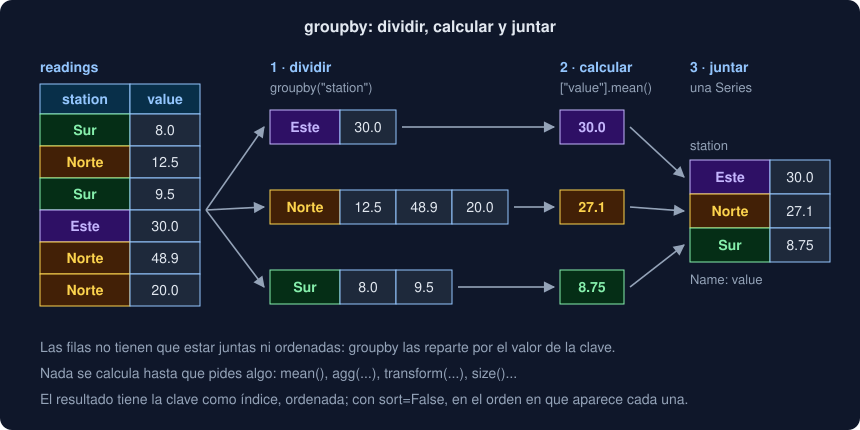

# 01 · groupby: dividir, calcular y juntar

⏱️ 45 min

## 🎯 Objetivos

- Explicar las tres fases de un `groupby`: dividir la tabla, calcular en cada grupo y juntar los resultados.
- Calcular una o varias funciones por grupo con `agg`, y elegir el nombre de cada columna.
- Distinguir `count` de `size`, y saber qué pasa con las filas cuya clave falta.
- Agrupar por varias columnas y leer el índice de dos niveles que sale.
- Usar `transform` para devolver un valor por fila y `filter` para quitar grupos.
- Reconocer cuándo un `groupby` sustituye a un diccionario de listas, y cuándo `apply` es la última opción.

---

## 1. Dividir, calcular y juntar

En la semana 06 calculaste la media de cada etiqueta con un diccionario de listas: recorrías las medidas, ibas metiendo cada valor en la lista de su etiqueta, y al final hacías una media por lista. Es un patrón tan común que tiene nombre, *split-apply-combine*, y en pandas se escribe en una línea:

```python
readings.groupby("station")["value"].mean()
```



Las tres fases:

1. **Dividir**: `groupby("station")` reparte las filas en grupos, uno por estación. Todavía no calcula nada.
2. **Calcular**: `["value"].mean()` calcula la media de la columna `value` en cada grupo.
3. **Juntar**: pandas reúne los resultados en una `Series` cuyo índice son las estaciones.

En esta teoría, `readings` es la tabla del ejercicio 01: ocho medidas de tres estaciones en dos días, una sin valor y otra sin estación.

```python
readings = pd.DataFrame(
    {
        "station": pd.Series(["Sur", "Norte", "Sur", "Este", "Norte", "Sur", "Norte", None], dtype="str"),
        "day": [1, 1, 1, 1, 2, 2, 2, 2],
        "value": [8.0, 12.5, 9.5, 30.0, 48.9, None, 20.0, 5.0],
    }
)
```

---

## 2. Un grupo, una función

```python
groups = readings.groupby("station")["value"]
print(groups.mean())
```

```
station
Este     30.000000
Norte    27.133333
Sur       8.750000
Name: value, dtype: float64
```

- El índice del resultado son las claves, **ordenadas**. Con `sort=False`, en el orden en que aparece cada una: Sur, Norte, Este. Tu Observatorio usa `sort=False` para que el resumen siga el orden del archivo, como hacía `Series.means`.
- La media del Sur es 8,75: la medida sin valor no cuenta, como en todos los métodos de pandas (teoría 01 de la semana 24).
- Cualquier método de una `Series` que reduzca a un número sirve: `sum`, `min`, `max`, `median`, `std`, `count`, `nunique`, `first`, `last`...

Un `groupby` se puede recorrer: cada vuelta da la clave y la tabla de su grupo. Útil para mirar, no para calcular.

```python
for station, group in readings.groupby("station"):
    print(station, group["value"].tolist())
```

```
Este [30.0]
Norte [12.5, 48.9, 20.0]
Sur [8.0, 9.5, nan]
```

`groups.ngroups` dice cuántos grupos hay, y `groups.get_group("Norte")`, las filas de uno.

---

## 3. Varias funciones con agg

Con una lista, una columna por función:

```python
print(groups.agg(["count", "size", "mean", "max"]))
```

```
         count  size       mean   max
station                              
Este         1     1  30.000000  30.0
Norte        3     3  27.133333  48.9
Sur          2     3   8.750000   9.5
```

`count` cuenta los **valores** y `size` las **filas**. El Sur tiene tres filas y dos valores: la resta, `size - count`, son los datos que faltan en cada grupo. Es la columna `missing` del resumen de tu proyecto.

La forma más clara es la **agregación con nombre**: cada columna nueva dice de qué columna sale y qué función usa.

```python
summary = readings.groupby("station").agg(
    medidas=("value", "count"), media=("value", "mean"), primer_dia=("day", "min")
)
```

```
         medidas      media  primer_dia
station                                
Este           1  30.000000           1
Norte          3  27.133333           1
Sur            2   8.750000           1
```

- Los nombres los eliges tú: no tienes que renombrar después.
- Cada una puede salir de una columna distinta: `primer_dia` sale de `day`.
- Se llama sobre `readings.groupby("station")`, **sin** elegir columna antes: la columna va en cada tupla.

Con un diccionario, `{"value": ["mean", "max"], "day": "nunique"}`, también funciona, pero las columnas salen con dos niveles (`("value", "mean")`), más incómodos de usar. Prefiere la forma con nombre.

---

## 4. Las claves que faltan

La última fila no tiene estación. ¿En qué grupo está?

```python
readings.groupby("station").size().sum()          # 7, de 8 filas
readings.groupby("station", dropna=False)["value"].count().to_dict()
# {'Este': 1, 'Norte': 3, 'Sur': 2, nan: 1}
```

En ninguno: `groupby` **quita** las filas cuya clave es NaN, sin avisar. Con `dropna=False` aparecen en un grupo propio. Si una clave puede faltar, decide qué quieres y compruébalo contando filas antes y después.

En tu Observatorio no pasa: `Measurement` exige una etiqueta, y una línea sin ella es un error de lectura.

---

## 5. Varias claves

```python
by_day = readings.groupby(["station", "day"])["value"].mean()
```

```
station  day
Este     1      30.00
Norte    1      12.50
         2      34.45
Sur      1       8.75
         2        NaN
Name: value, dtype: float64
```

- Un grupo por **combinación** que aparece: Este no midió el día 2 y no hay grupo `("Este", 2)`.
- El índice tiene dos niveles, un `MultiIndex`. Se elige con una tupla: `by_day.loc[("Norte", 2)]` da 34,45.
- El grupo `("Sur", 2)` existe, pero su único valor faltaba: NaN.

Dos formas de dejarlo más cómodo:

```python
by_day.unstack("day")      # el nivel day pasa a columnas (teoría 03)
readings.groupby(["station", "day"], as_index=False)["value"].mean()   # claves como columnas
```

```
day          1      2
station              
Este     30.00    NaN
Norte    12.50  34.45
Sur       8.75    NaN
```

`as_index=False` (o `reset_index()` después) deja `station` y `day` como columnas normales, lo que quieres para escribir un CSV.

---

## 6. transform, filter y apply

`agg` da **una fila por grupo**. A veces quieres el resultado del grupo **en cada fila**: cuánto se aparta cada medida de la media de su estación.

```python
station_mean = readings.groupby("station")["value"].transform("mean")
readings["value"] - station_mean
```

`transform` devuelve una `Series` con el mismo índice que `readings`: cada fila recibe la media de su grupo, y la resta se alinea fila a fila. Con `"sum"`, la parte de cada medida en el total de su estación:

```python
(readings["value"] / readings.groupby("station")["value"].transform("sum")).round(2).tolist()
# [0.46, 0.15, 0.54, 1.0, 0.6, nan, 0.25, nan]
```

Otros métodos dan también un valor por fila: `rank`, `cumsum`, `shift` y `diff` (teoría 04) se calculan **dentro** de cada grupo.

`filter` se queda con los grupos que cumplen una condición, con todas sus filas:

```python
readings.groupby("station").filter(lambda group: len(group) >= 3)   # Sur y Norte: 6 filas
```

`apply` acepta cualquier función que reciba el grupo:

```python
readings.groupby("station")["value"].apply(lambda v: v.max() - v.min())
# Este 0.0 · Norte 36.4 · Sur 1.5
```

Funciona, pero llama a tu función de Python una vez por grupo, como un bucle. Antes de usarlo, busca si `agg`, `transform` o una resta de dos `agg` (`max` y `min`) lo hacen: suelen ser mucho más rápidos y más fáciles de leer.

---

## 7. groupby frente a un diccionario de listas

| Diccionario (semana 06) | pandas |
|---|---|
| `values[label].append(value)` en un bucle | `groupby("label")` |
| `{k: sum(v) / len(v) for k, v in values.items()}` | `["value"].mean()` |
| `len(values[label])` | `size()` |
| Saltar los `None` a mano | Los NaN no cuentan, solo |
| Una pasada por estadística | `agg` con todas a la vez |

¿Es más rápido? En el ejercicio 01, con 100 000 filas, `groupby` tarda 4,3 ms y el diccionario 5,3 ms: casi lo mismo. Un `groupby` ordena o reparte las claves, y eso cuesta. La ventaja está en el resto: los NaN, varias funciones en una pasada, el índice y lo que puedes hacer con él después.

Las columnas `category` (teoría 04 de la semana 24) son claves rápidas. En pandas 3, `groupby` con una clave `category` solo saca las categorías que **aparecen** (`observed=True`); con `observed=False` saca también las vacías, con cuenta 0.

---

## 8. Errores frecuentes

| Error | Por qué está mal | Qué hacer |
|---|---|---|
| Esperar todas las filas en los grupos | Las filas con la clave NaN desaparecen | `dropna=False`, o cuenta antes y después |
| Usar `count` para contar filas | `count` no cuenta los NaN | `size` para filas, `count` para valores |
| `agg(media="mean")` sobre la tabla | En la forma con nombre cada valor es una tupla | `agg(media=("value", "mean"))` |
| Recorrer los grupos con `for` para calcular | Es un bucle de Python, lento y largo | `agg` o `transform` |
| `apply` para todo | Llama a tu función una vez por grupo | `agg`, `transform` o una resta de `agg` |
| Elegir con `loc["Norte", 2]` y no entender el resultado | En un `MultiIndex`, la tupla es más clara | `loc[("Norte", 2)]` |

---

## ✅ Qué debes saber al terminar

- [ ] Las tres fases de un `groupby` y en qué momento calcula.
- [ ] Qué orden tienen los grupos, y para qué sirve `sort=False`.
- [ ] La diferencia entre `count` y `size`, y cómo sacar los que faltan.
- [ ] Escribir una agregación con nombre.
- [ ] Qué pasa con una fila cuya clave es NaN.
- [ ] Leer y elegir en un índice de dos niveles, y pasarlo a columnas.
- [ ] Cuándo usar `agg`, `transform`, `filter` y `apply`.

---

## 🔗 Navegación

| Anterior | Actual | Siguiente |
| -------- | ------ | --------- |
| [Semana 25](../README.md) | **01 · groupby: dividir, calcular y juntar** | [02 · Combinar tablas: concat, merge y join](02-combinar-tablas-concat-merge-y-join.md) |
