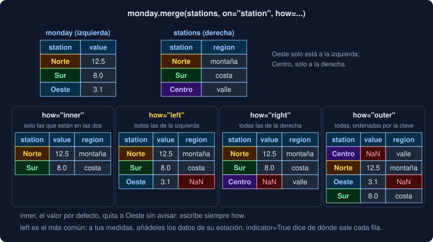

# 02 · Combinar tablas: concat, merge y join

⏱️ 50 min

## 🎯 Objetivos

- Elegir entre apilar tablas (`concat`) y cruzarlas por una clave (`merge`, `join`).
- Apilar sin perder de dónde viene cada fila ni repetir índices.
- Predecir qué filas salen con cada `how` de `merge`: `inner`, `left`, `right` y `outer`.
- Detectar una clave repetida antes de que multiplique filas, con `validate`.
- Resolver columnas con el mismo nombre, claves con nombre distinto y claves de varias columnas.
- Cruzar por el índice, como hace `compare` en tu Observatorio.

---

## 1. Apilar o cruzar

Los datos casi nunca llegan en una sola tabla. Dos situaciones distintas:

- **Apilar**: varias tablas con las **mismas columnas** y filas distintas. Las medidas del lunes y las del martes; un CSV por estación. Una tabla debajo de otra: `concat`.
- **Cruzar**: tablas con **columnas distintas** que comparten una clave. Las medidas tienen la estación; otra tabla dice la región y la altitud de cada estación. Cada medida busca su estación en la otra tabla: `merge` (o `join`, si la clave es el índice).

En esta teoría, las tablas del ejercicio 02:

```python
monday = pd.DataFrame({"station": ["Norte", "Sur", "Oeste"], "value": [12.5, 8.0, 3.1]})
tuesday = pd.DataFrame({"station": ["Norte", "Sur"], "value": [48.9, 9.5]})
stations = pd.DataFrame(
    {
        "station": ["Norte", "Sur", "Centro"],
        "region": ["montaña", "costa", "valle"],
        "altitude": [2600, 5, 1500],
    }
)
```

Oeste midió pero no está en `stations`; Centro está en `stations` pero no midió.

---

## 2. concat: una tabla debajo de otra

```python
pd.concat([monday, tuesday])
```

```
  station  value
0   Norte   12.5
1     Sur    8.0
2   Oeste    3.1
0   Norte   48.9
1     Sur    9.5
```

`concat` conserva los índices: hay dos filas `0` y dos `1`. Un `loc[0]` daría dos filas. Dos remedios:

- `ignore_index=True` numera de nuevo, de 0 a 4. Úsalo cuando el índice no significa nada.
- Un diccionario en lugar de una lista: cada clave pasa a ser el primer nivel del índice, y no pierdes de qué tabla vino cada fila.

```python
pd.concat({"lunes": monday, "martes": tuesday}).reset_index(level=0, names="day")
```

```
      day station  value
0   lunes   Norte   12.5
1   lunes     Sur    8.0
2   lunes   Oeste    3.1
0  martes   Norte   48.9
...
```

Si las tablas no tienen las mismas columnas, `concat` no falla: junta todas y rellena con NaN donde falta (ejercicio 02, paso 2). Comprueba las columnas antes de apilar, o un error de nombre (`valor` en una, `value` en otra) te dará dos columnas medio vacías.

Con `axis=1`, las tablas van **lado a lado**, alineadas por el índice. Si el índice es la estación, perfecto; si es `0, 1, 2`, estás juntando por posición, y eso casi nunca es lo que quieres. Para cruzar por una columna, `merge`.

Un consejo de rendimiento: si lees cien archivos, guarda las cien tablas en una lista y haz **un** `concat` al final. Un `concat` dentro del bucle copia toda la tabla en cada vuelta.

---

## 3. merge: cruzar por una clave

```python
monday.merge(stations, on="station", how="left")
```

```
  station  value   region  altitude
0   Norte   12.5  montaña    2600.0
1     Sur    8.0    costa       5.0
2   Oeste    3.1      NaN       NaN
```

Cada fila de `monday` busca en `stations` la fila con la misma `station` y se queda con sus columnas. `how` decide qué pasa con las que no encuentran pareja:



| `how` | Qué filas salen | Cuándo |
|---|---|---|
| `inner` (por defecto) | Solo las claves que están en las dos | Cuando lo que no cruza sobra |
| `left` | Todas las de la izquierda | "A mis medidas, añade los datos de su estación" |
| `right` | Todas las de la derecha | El mismo `left`, con las tablas al revés |
| `outer` | Todas las de las dos, ordenadas por la clave | Comparar dos tablas: qué hay en una, en otra y en las dos |

Cuidado con el valor por defecto: con `inner`, Oeste **desaparece sin aviso**. Escribe siempre `how`, aunque sea `inner`: quien lea tu código sabrá que lo decidiste.

`indicator=True` añade una columna `_merge` con `both`, `left_only` o `right_only`: la forma más rápida de encontrar las claves que no cruzaron.

Fíjate en `altitude`: era `int64` y ahora es `float64`. Oeste no tiene altitud, y un NaN solo cabe en una columna `float64` (teoría 01 de la semana 24). Un `left` o un `outer` pueden cambiar el tipo de las columnas de la otra tabla.

---

## 4. Claves repetidas y validate

¿Qué pasa si Norte está dos veces en `stations`? Cada medida de Norte se cruza con **las dos** filas. Dos medidas de Norte × dos filas de Norte = cuatro filas, y la tabla crece sin avisar:

```python
both = pd.concat([monday, tuesday], ignore_index=True)              # 5 medidas
dirty = pd.concat([stations, stations.iloc[[0]]], ignore_index=True)  # Norte, dos veces
len(both.merge(dirty, on="station", how="left"))                     # 7 filas
```

En general, una clave que está `m` veces a la izquierda y `n` a la derecha da `m × n` filas. Tres por dos son seis. Con tablas grandes, un `merge` así puede llenar la memoria.

`validate` dice qué relación esperas, y `merge` lanza `MergeError` si no se cumple:

| `validate` | Qué exige |
|---|---|
| `"one_to_one"` | La clave no se repite en ninguna de las dos |
| `"one_to_many"` | No se repite a la izquierda |
| `"many_to_one"` | No se repite a la derecha: muchas medidas, una fila por estación |
| `"many_to_many"` | Nada: solo deja escrito que lo sabes |

```python
both.merge(dirty, on="station", how="left", validate="many_to_one")
# MergeError: Merge keys are not unique in right dataset; not a many-to-one merge
```

Ponlo **siempre** que sepas qué relación hay. Cuesta una palabra y convierte un error silencioso en uno que se ve. En tu proyecto, `compare` usa `validate="one_to_one"`: cada resumen tiene una fila por etiqueta.

Las claves tienen que ser del mismo tipo. Una columna `int64` con otra `str` no cruza:

```
ValueError: You are trying to merge on int64 and str columns for key 'code'. If you wish to proceed you should use pd.concat
```

Y una rareza: en `merge`, una clave NaN **sí** cruza con otra clave NaN. Si las dos tablas tienen filas sin clave, se emparejan entre ellas. Quítalas antes si no es lo que quieres.

---

## 5. Nombres repetidos, nombres distintos y varias claves

Si las dos tablas tienen una columna con el mismo nombre que no es la clave, `merge` las distingue con un sufijo. Por defecto `_x` y `_y`; mejor elegirlos:

```python
monday.merge(tuesday, on="station", suffixes=("_lunes", "_martes"))
```

```
  station  value_lunes  value_martes
0   Norte         12.5          48.9
1     Sur          8.0           9.5
```

Si la clave se llama distinto en cada tabla, `left_on` y `right_on`. Salen las dos columnas; quita una con `drop` si sobra.

```python
monday.merge(stations.rename(columns={"station": "name"}), left_on="station", right_on="name")
```

Si una fila se identifica con **varias** columnas, `on` recibe una lista: la medida de Norte del día 2 cruza con la fila de Norte del día 2, no con cualquier Norte.

```python
d1.merge(d2, on=["station", "day"], how="left")
```

---

## 6. join, map y merge por el índice

Cuando la clave es el **índice**, hay atajos.

`join` cruza por el índice, con `how="left"` por defecto. Es lo natural después de un `groupby`, que deja la clave en el índice:

```python
stations.set_index("station").join(both.groupby("station")["value"].mean().rename("mean"))
```

```
          region  altitude   mean
station                          
Norte    montaña      2600  30.70
Sur        costa         5   8.75
Centro     valle      1500    NaN
```

Si las dos tablas tienen una columna con el mismo nombre, `join` lanza `ValueError: columns overlap but no suffix specified`: renombra antes o pasa `lsuffix` y `rsuffix`.

`map` añade **una** columna buscando cada valor en el índice de una `Series`:

```python
monday["station"].map(stations.set_index("station")["region"])   # montaña, costa, NaN
```

`merge` también acepta el **nombre de un índice** en `on`. Es lo que hace `compare` en tu Observatorio: dos `Series` de medias, cada una con la etiqueta como índice `label`.

```python
before = pd.Series([30.7, 8.75], index=pd.Index(["Norte", "Sur"], name="label"), name="before")
after = pd.Series([14.0, 9.0, 3.0], index=pd.Index(["Norte", "Sur", "Este"], name="label"), name="after")
pd.merge(before, after, on="label", how="outer", validate="one_to_one")
```

```
       before  after
label               
Este      NaN    3.0
Norte   30.70   14.0
Sur      8.75    9.0
```

- Cada `Series` aporta una columna, con su `name`. Por eso `compare` renombra las dos columnas `mean` a `before` y `after`: así no hacen falta sufijos.
- El índice del resultado sigue siendo `label`.
- Con `outer`, las claves salen **ordenadas**, aunque pases `sort=False`. Con `left`, en el orden de la izquierda.

---

## 7. Errores frecuentes

| Error | Por qué está mal | Qué hacer |
|---|---|---|
| No escribir `how` | El valor por defecto, `inner`, quita filas sin avisar | Escribe `how` siempre |
| Cruzar con una clave repetida sin saberlo | Las filas se multiplican: `m × n` por clave | `validate` |
| `concat` dentro de un bucle | Copia la tabla entera en cada vuelta | Una lista de tablas y un `concat` al final |
| `concat(axis=1)` para cruzar por estación | Alinea por el índice, que puede ser la posición | `merge` por la columna, o pon la estación como índice |
| Buscar `value` después del `merge` | Ahora se llama `value_x` o `value_y` | `suffixes` |
| Sorprenderse de que un entero salga como `2600.0` | Una fila sin pareja puso NaN en la columna | Es normal; `Int64` si los enteros importan |
| Claves de tipos distintos | `int64` y `str` no cruzan | `astype` antes, en una de las dos |

---

## ✅ Qué debes saber al terminar

- [ ] Cuándo apilar con `concat` y cuándo cruzar con `merge`.
- [ ] Qué pasa con el índice al apilar, y dos formas de arreglarlo.
- [ ] Qué filas salen con `inner`, `left`, `right` y `outer`, y cuál es el valor por defecto.
- [ ] Por qué una clave repetida multiplica filas, y cómo lo detecta `validate`.
- [ ] Usar `suffixes`, `left_on`/`right_on` y una lista de claves.
- [ ] Cruzar por el índice con `join`, `map` y `merge(..., on=<nombre del índice>)`.

---

## 🔗 Navegación

| Anterior | Actual | Siguiente |
| -------- | ------ | --------- |
| [01 · groupby: dividir, calcular y juntar](01-groupby-dividir-calcular-y-juntar.md) | **02 · Combinar tablas: concat, merge y join** | [03 · Dar forma: pivot, melt y crosstab](03-dar-forma-pivot-melt-y-crosstab.md) |
