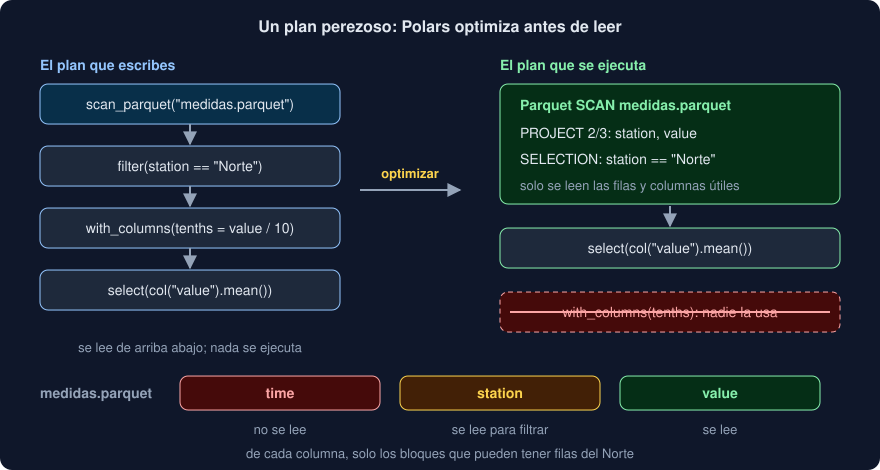

# 02 · Evaluación perezosa

⏱️ 45 min

## 🎯 Objetivos

- Explicar la diferencia entre ejecutar cada paso en cuanto se escribe y planear la consulta entera antes.
- Crear un `LazyFrame` desde una tabla o desde un archivo, y ejecutarlo con `collect`.
- Leer un plan con `explain`, y reconocer el *pushdown* de filtros y columnas.
- Saber cuándo aparecen los errores de un plan, y comprobarlo sin ejecutarlo con `collect_schema`.
- Procesar archivos más grandes que la memoria con el motor `streaming` y `sink_parquet`.

---

## 1. Ansioso y perezoso

pandas es **ansioso** (*eager*): cada línea se ejecuta en cuanto Python llega a ella.

```python
table = pd.read_csv("medidas.csv")          # lee el archivo entero
north = table[table["station"] == "Norte"]  # recorre todas las filas
north["value"].mean()                       # recorre las del Norte
```

Cada paso no sabe lo que viene después. `read_csv` lee las columnas que no vas a usar, y la tabla de `north` se crea entera aunque solo quieras un número.

Un `pl.DataFrame` de Polars también es ansioso. Un `pl.LazyFrame` es **perezoso**: cada método añade un paso a un **plan**, y nada se calcula hasta que lo pides con `collect()`.

```python
plan = (
    pl.scan_csv("medidas.csv")
    .filter(pl.col("station") == "Norte")
    .select(pl.col("value").mean())
)
plan.collect()      # aquí, y solo aquí, se lee el archivo
```

Con el plan entero delante, Polars puede reordenarlo antes de empezar: leer solo lo necesario, filtrar pronto y quitar lo que no se usa.

Hay tres formas de tener un `LazyFrame`:

| Desde | Cómo |
|---|---|
| Una tabla en memoria | `frame.lazy()` |
| Un archivo | `pl.scan_parquet(ruta)`, `pl.scan_csv(ruta)`, `pl.scan_ndjson(ruta)` |
| Otro plan | Cualquier método de un `LazyFrame` devuelve otro |

Y casi todo lo que haces con un `DataFrame` (`select`, `with_columns`, `filter`, `group_by`, `join`, `sort`) existe igual en `LazyFrame`. Lo que no existe es lo que necesita los datos ya calculados: `row(3)`, `height`, imprimir las filas.

---

## 2. Leer un plan

`explain()` escribe el plan **optimizado**; `explain(optimized=False)`, el que escribiste. Se leen **de abajo arriba**: abajo está de dónde salen los datos; arriba, el resultado.

```
SELECT [col("value").mean()]
  simple π 1/1 ["value"]
    Parquet SCAN [salida/medidas-zstd.parquet]
    PROJECT 2/3 COLUMNS
    SELECTION: col("station") == "Norte"
```

Es el plan del paso 5 del ejercicio 02. Leído de abajo arriba: lee el Parquet, solo 2 de sus 3 columnas, solo las filas del Norte; quédate con `value`; calcula la media.



---

## 3. Qué optimiza Polars

| Optimización | Qué hace | Cómo se ve en el plan |
|---|---|---|
| ***Projection pushdown*** | Lee solo las columnas que el resto del plan usa | `PROJECT 2/3 COLUMNS` dentro del `SCAN` |
| ***Predicate pushdown*** | Mueve los filtros lo más cerca posible de la lectura | `SELECTION:` dentro del `SCAN` |
| **Eliminar lo que no se usa** | Una columna creada que ningún paso posterior pide no se calcula | Desaparece el `WITH_COLUMNS` |
| **Simplificar expresiones** | Calcula una vez lo constante, junta filtros seguidos | Un solo `FILTER` con `&` |
| **Expresiones comunes** | Si la misma expresión sale dos veces, la calcula una | `__POLARS_CSER_...` en el plan |

"Pushdown" significa empujar hacia abajo, hacia la lectura. Con un CSV, ahorra memoria y trabajo después de leer. Con un Parquet (teoría 03) ahorra **leer**: el formato permite saltarse columnas enteras y bloques de filas.

Escribe la consulta en el orden que te resulte claro. No hace falta poner el `filter` antes del `with_columns` "para que vaya más rápido": Polars lo hace por ti.

---

## 4. Cuándo aparecen los errores

Crear un plan no comprueba nada:

```python
broken = frame.lazy().filter(pl.col("valor") > 10)   # sin error
broken.collect()
# ColumnNotFoundError: unable to find column "valor"; valid columns: ["time", "station", "value"]
```

Con un archivo grande, esperar a `collect()` para descubrir una errata es caro. `collect_schema()` resuelve el plan y devuelve el esquema del resultado **sin calcular ninguna fila**:

```python
plan.collect_schema()
# Schema({'time': Datetime(time_unit='us', time_zone=None), 'value': Float64})
```

Es lo que hace `test_summary_has_the_columns_and_types` en tu proyecto: comprueba las columnas y los tipos del resumen sin ejecutarlo.

---

## 5. Ansioso o perezoso, ¿cuándo?

| Situación | Usa |
|---|---|
| Explorar una tabla pequeña, ver filas, probar | `DataFrame` |
| Leer un archivo y quedarte con parte de él | `scan_*` y `LazyFrame` |
| Una función de tu código que recibe datos de cualquier origen | `LazyFrame`: vale para `frame.lazy()` y para `scan_parquet` |
| Un archivo que no cabe en memoria | `LazyFrame` con el motor `streaming` |

El `summary` de tu proyecto recibe y devuelve un `LazyFrame`. Los tests lo llaman con `frame_of(series).lazy()`; el comando `exportar`, con `pl.scan_parquet(salida)`. La misma función, dos orígenes, y ninguna copia que no haga falta.

Mezclar los dos modos es normal: `collect()` da un `DataFrame`, y `lazy()` vuelve a dar un plan.

---

## 6. Más grande que la memoria

Por defecto, `collect()` carga en memoria lo que cada paso necesita. Si el archivo no cabe, hay dos herramientas:

- `collect(engine="streaming")` ejecuta el plan **por trozos**: lee un bloque de filas, lo procesa, lo descarta y sigue. Una media por estación de 50 GB de medidas cabe en un portátil, porque solo guarda cinco sumas y cinco cuentas.
- `sink_parquet(ruta)` (y `sink_csv`) ejecuta el plan por trozos y escribe el resultado en un archivo, sin tenerlo nunca entero en memoria:

```python
pl.scan_csv("enorme.csv", separator=";", decimal_comma=True).sink_parquet("enorme.parquet")
```

Es el paso 3 del ejercicio 04: convertir un CSV a Parquet sin cargarlo.

No todas las operaciones pueden ir por trozos: ordenar una tabla entera necesita verla entera. Para esos pasos, Polars vuelve a usar la memoria.

---

## 7. Errores frecuentes

| Error | Por qué está mal | Qué hacer |
|---|---|---|
| `pl.read_parquet(...).filter(...)` con un archivo grande | Lee el archivo entero antes de filtrar | `pl.scan_parquet(...).filter(...).collect()` |
| `collect()` después de cada paso | Cada `collect` ejecuta lo anterior y pierde la optimización | Un solo `collect()` al final |
| Leer el plan de arriba abajo | Arriba está el resultado | De abajo arriba: abajo está el origen |
| Descubrir una errata después de un minuto de cálculo | Los errores llegan en `collect()` | `collect_schema()` primero |
| `plan.height` o `plan.row(0)` | Un plan no tiene filas | `plan.collect().height` |
| Ordenar el `filter` "a mano" para que sea más rápido | Polars ya lo hace | Escríbelo en el orden más claro |

---

## ✅ Qué debes saber al terminar

- [ ] Qué diferencia hay entre `DataFrame` y `LazyFrame`, y qué hace `collect()`.
- [ ] Cómo se lee un plan, y qué significan `PROJECT` y `SELECTION` dentro de un `SCAN`.
- [ ] Qué es el *pushdown* de columnas y de filtros, y por qué ahorra más con Parquet que con CSV.
- [ ] Cuándo aparece un error en un plan, y para qué sirve `collect_schema()`.
- [ ] Qué hacen `engine="streaming"` y `sink_parquet`.

---

## 🔗 Navegación

| Anterior | Actual | Siguiente |
| -------- | ------ | --------- |
| [01 · Polars: expresiones y contextos](01-polars-expresiones-y-contextos.md) | **02 · Evaluación perezosa** | [03 · Parquet: un formato por columnas](03-parquet-un-formato-por-columnas.md) |
