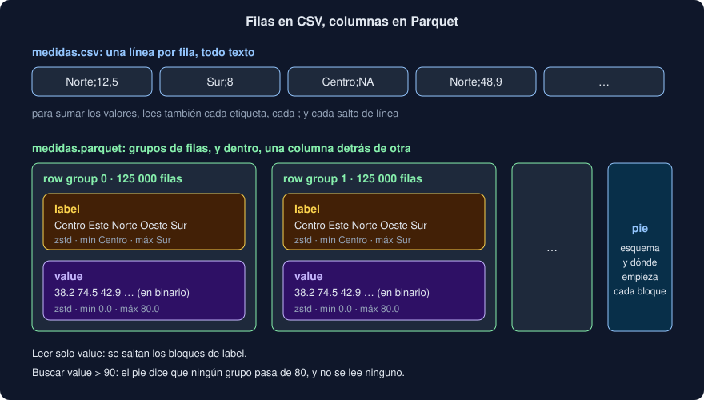

# 03 · Parquet: un formato por columnas

⏱️ 45 min

## 🎯 Objetivos

- Explicar la diferencia entre guardar una tabla por filas (CSV) y por columnas (Parquet).
- Describir cómo es un archivo Parquet por dentro: grupos de filas, bloques de columna, estadísticas y pie.
- Elegir compresión, y saber qué conserva Parquet que CSV pierde.
- Particionar una tabla en carpetas, y saber cuándo compensa.
- Decidir cuándo usar Parquet, CSV o una base de datos.

---

## 1. Filas o columnas

Un CSV guarda la tabla **fila a fila**, como texto:

```
etiqueta;valor
Norte;12,5
Sur;8
```

Es perfecto para leerlo tú, abrirlo en una hoja de cálculo o añadir una línea al final. Pero para calcular la media de `valor` hay que leer **todo**: cada etiqueta, cada `;`, cada salto de línea, y convertir cada texto en número.

Las preguntas de análisis casi nunca necesitan todas las columnas: una media, un filtro por estación, un máximo por día. Un formato **por columnas** guarda juntos todos los valores de una columna, y deja leer solo las que hacen falta. Parquet es el formato por columnas de referencia: lo leen y escriben Polars, DuckDB, pandas (con `pyarrow`), Spark, R, y los almacenes de datos en la nube.

---

## 2. Por dentro



Un archivo Parquet tiene tres niveles:

| Nivel | Qué es | En un millón de medidas escrito con Polars |
|---|---|---|
| ***Row group*** (grupo de filas) | Un trozo de la tabla, de muchas filas | 8 grupos de 125 000 filas |
| ***Column chunk*** (bloque de columna) | Los valores de una columna dentro de un grupo, juntos y comprimidos | 2 o 3 bloques por grupo, uno por columna |
| **Pie** (*footer*) | El esquema, dónde empieza cada bloque y sus **estadísticas**: mínimo, máximo, cuántos `null` | Al final del archivo |

Quien lee un Parquet empieza por el pie. Con él sabe:

- **qué tipo** tiene cada columna, sin adivinarlo;
- **dónde** está cada bloque, para leer solo los de las columnas que pide (el *projection pushdown* de la teoría 02);
- **qué valores** hay en cada grupo. Si buscas `value > 90` y el pie dice que el máximo de cada grupo es 80, no lee ningún grupo. Es el *predicate pushdown*.

DuckDB te deja mirar el pie con `parquet_metadata`:

```sql
SELECT path_in_schema, num_values, stats_min_value, stats_max_value,
       total_compressed_size, total_uncompressed_size
FROM parquet_metadata('medidas.parquet') WHERE row_group_id = 0
```

```
('station', 125000, 'Centro', 'Sur', 41895, 47012)
('value', 125000, '-0.0', '80.0', 277450, 1000110)
```

`value` ocupa 1 MB sin comprimir en el primer grupo (125 000 números de 8 bytes) y 277 kB comprimido. `station` ya ocupa poco antes de comprimir: Parquet guarda los cinco nombres una vez, en un **diccionario**, y en cada fila solo un número pequeño que apunta a uno de ellos.

---

## 3. Compresión

Cada bloque se comprime por separado. Una columna tiene datos parecidos (fechas que suben de minuto en minuto, cinco nombres que se repiten) y se comprime mucho mejor que una fila con datos de todo tipo.

| Compresión | Tamaño | Velocidad | Cuándo |
|---|---|---|---|
| `uncompressed` | El mayor | La más rápida de escribir | Casi nunca |
| `snappy` | Medio | Muy rápida | La más compatible con otras herramientas |
| `zstd` | El menor | Rápida | La de Polars por defecto; buena opción casi siempre |

En el ejercicio 02, el mismo millón de medidas ocupa 37,3 MB en CSV, 16,1 MB en Parquet sin comprimir, 9,8 MB con `snappy` y 5,6 MB con `zstd`. Leer el Parquet fue tres veces más rápido que leer el CSV.

---

## 4. Qué conserva Parquet

| | CSV | Parquet |
|---|---|---|
| Tipos | Todo es texto: quien lee adivina | El esquema va dentro del archivo |
| Fechas y horas | Texto: `2026-11-01 08:00:00` o `01/11/2026`, según quién lo escribió | `Datetime` con su unidad (y su zona horaria, si la tiene) |
| Lo que falta | `NA`, `""`, `null`, `-`... cada uno el suyo | `null`, siempre |
| Decimales | Punto o coma, según el país | Binario: no hay coma que confundir |
| Leerlo una persona | Sí | No: hace falta una herramienta |
| Añadir una fila al final | Sí | No: se reescribe el archivo, o se añade otro archivo a la carpeta |

Es lo que viste en el paso 4 del ejercicio 02: del CSV, `time` volvió como texto; del Parquet, la tabla salió **igual** a la que escribiste. Y es lo que comprueba `test_parquet_keeps_the_rows_and_the_types` en tu proyecto.

---

## 5. Escribir y leer con Polars

```python
frame.write_parquet("medidas.parquet")                        # zstd por defecto
frame.write_parquet("medidas.parquet", compression="snappy")
pl.read_parquet("medidas.parquet")                            # todo, a memoria
pl.scan_parquet("medidas.parquet")                            # un plan (teoría 02)
pl.read_parquet_schema("medidas.parquet")                     # solo el esquema, del pie
```

`write_parquet` acepta también una ruta a un archivo que todavía no existe, pero no crea carpetas: si la carpeta no existe, lanza `FileNotFoundError` (un `OSError`), como `open` de Python. Es lo que atrapa `exportar` en tu proyecto.

---

## 6. Particionar

Con `partition_by`, Polars escribe una **carpeta por valor** de una columna:

```python
frame.write_parquet("por_estacion", partition_by="station")
```

```
por_estacion/
├── station=Centro/00000000.parquet
├── station=Este/00000000.parquet
├── station=Norte/00000000.parquet
...
```

El nombre `columna=valor` es el **particionado *hive***, que entienden casi todas las herramientas de datos. Al leer la carpeta con `pl.scan_parquet("por_estacion", hive_partitioning=True)`, la columna `station` sale de los nombres, y un filtro por estación abre solo su carpeta, sin mirar las demás.

Compensa cuando:

- filtras casi siempre por esa columna (la estación, el año, el mes);
- tiene pocos valores distintos (decenas, no millones);
- cada partición sigue siendo grande (megas, no kilobytes).

Particionar por una columna con miles de valores crea miles de archivos diminutos, y leerlos todos es más lento que leer uno grande.

---

## 7. ¿Parquet, CSV o una base de datos?

| Necesitas | Usa |
|---|---|
| Que una persona lo lea o lo edite, o intercambiar con una hoja de cálculo | CSV |
| Guardar una tabla para analizarla después, con sus tipos, ocupando poco | Parquet |
| Añadir filas una a una, desde varios programas a la vez, con transacciones | Una base de datos (PostgreSQL, semana 19) |
| Que otra herramienta de datos (Spark, R, la nube) lea tus tablas | Parquet |

Tu Observatorio usa los tres: lee CSV y texto de quien mide, guarda cargas en PostgreSQL, y desde esta semana exporta a Parquet para preguntar.

---

## 8. Errores frecuentes

| Error | Por qué está mal | Qué hacer |
|---|---|---|
| Abrir un `.parquet` con un editor de texto | Es binario | `pl.read_parquet(...).head()` o `duckdb.sql("FROM 'archivo.parquet'")` |
| Añadir filas a un Parquet existente | El formato no lo permite: el pie está al final | Escribe otro archivo en la misma carpeta y lee la carpeta |
| Particionar por una columna con miles de valores | Miles de archivos diminutos | Particiona por algo con pocos valores, o no particiones |
| `pd.read_parquet` sin `pyarrow` | pandas no lee Parquet por sí solo | DuckDB con `.df()`, o añadir `pyarrow` |
| Guardar fechas como texto antes de escribir el Parquet | Pierdes la ventaja de los tipos | Convierte a `Datetime` y después escribe |

---

## ✅ Qué debes saber al terminar

- [ ] Por qué un formato por columnas lee menos que uno por filas.
- [ ] Qué son un *row group*, un *column chunk* y el pie, y qué estadísticas guarda.
- [ ] Qué compresión usa Polars por defecto, y cuál es la más compatible.
- [ ] Qué conserva Parquet que CSV pierde, y qué no se puede hacer con Parquet.
- [ ] Qué es el particionado *hive*, y cuándo compensa.

---

## 🔗 Navegación

| Anterior | Actual | Siguiente |
| -------- | ------ | --------- |
| [02 · Evaluación perezosa](02-evaluacion-perezosa.md) | **03 · Parquet: un formato por columnas** | [04 · DuckDB: SQL sin servidor](04-duckdb-sql-sin-servidor.md) |
