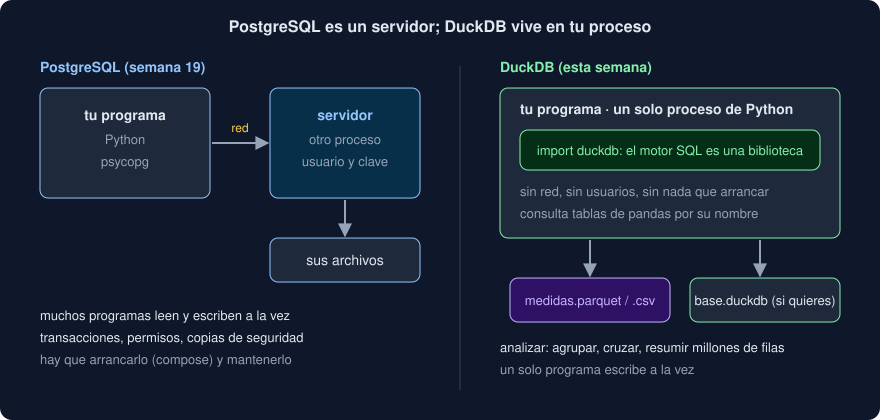

# 04 · DuckDB: SQL sin servidor

⏱️ 45 min

## 🎯 Objetivos

- Explicar qué es DuckDB y en qué se diferencia de PostgreSQL.
- Consultar con SQL archivos Parquet y CSV, y tablas de pandas, sin cargarlos antes.
- Usar las conexiones, las relaciones y los resultados de la API de Python.
- Pasar valores con parámetros `?` y no pegados en el texto.
- Guardar una base de datos en un archivo, y cerrar el acceso al disco a un SQL que no escribes tú.

---

## 1. Una base de datos dentro de tu programa

En la semana 19 usaste PostgreSQL: un **servidor**, otro proceso al que tu programa habla por la red, con usuarios, contraseñas y un contenedor que arrancar. DuckDB es una base de datos SQL que es una **biblioteca**: `import duckdb` y ya está, dentro de tu proceso de Python, como SQLite.



| | PostgreSQL | DuckDB |
|---|---|---|
| Dónde corre | Un servidor aparte | Dentro de tu programa |
| Pensado para | Muchas escrituras pequeñas a la vez (OLTP: pedidos, usuarios, cargas) | Pocas consultas grandes de análisis (OLAP: agrupar, resumir, cruzar millones de filas) |
| Guarda los datos | Por filas | Por columnas, como Parquet |
| Lee archivos | Con extensiones y permisos | Parquet, CSV y JSON directamente, con `FROM 'archivo'` |
| Varios programas escribiendo | Sí, es su trabajo | No: un solo programa escribe a la vez |

No compiten: tu Observatorio guarda las cargas en PostgreSQL, que sabe repartir el trabajo entre muchos usuarios, y analiza con DuckDB los archivos que exporta.

---

## 2. SQL sobre archivos

```python
import duckdb

duckdb.sql("SELECT station, avg(value) FROM 'medidas.parquet' GROUP BY station").fetchall()
```

El nombre de un archivo entre comillas simples hace de tabla. DuckDB mira la extensión y elige el lector; con las funciones de lectura, eliges tú y das opciones:

```sql
FROM 'medidas.parquet'                                    -- por la extensión
FROM read_parquet('carpeta/*.parquet')                    -- varios archivos a la vez
FROM read_parquet('por_estacion/**/*.parquet', hive_partitioning = true)
FROM read_csv('medidas.csv', delim = ';', decimal_separator = ',', nullstr = 'NA')
```

Sin opciones, `read_csv` **adivina** el separador, la cabecera y los tipos mirando las primeras filas. Adivina bien el `;`, pero no la coma decimal: `12,5` se queda como texto (ejercicio 03, paso 2).

DuckDB también lee **variables de Python** por su nombre: un `DataFrame` de pandas o una relación anterior.

```python
stations = pd.DataFrame({"station": ["Norte", "Sur"], "region": ["Andina", "Pacífica"]})
duckdb.sql("SELECT * FROM 'medidas.parquet' JOIN stations USING (station)")
```

Con un `DataFrame` de Polars, también, pero a través de Arrow: necesita `pyarrow` instalado. Sin él, `InvalidInputException: ... No module named 'pyarrow'`. El puente sin `pyarrow` entre Polars y DuckDB es un archivo Parquet.

---

## 3. El SQL de DuckDB

Es SQL estándar, el de la semana 19, con algunas comodidades:

| Escribes | Significa |
|---|---|
| `GROUP BY ALL` | Agrupa por todas las columnas del `SELECT` que no son agregaciones |
| `ORDER BY ALL` | Ordena por todas las columnas, de izquierda a derecha |
| `FROM 'medidas.parquet'` sin `SELECT` | `SELECT * FROM 'medidas.parquet'` |
| `SELECT * EXCLUDE (time)` | Todas las columnas menos `time` |
| `count(value)` / `count(*)` | Los valores / las filas, como `count` y `len` |
| `avg(value) OVER (PARTITION BY station)` | Función de ventana: la media del grupo en cada fila, como `over` de Polars |
| `ORDER BY value DESC NULLS LAST` | Los que faltan, al final |
| `DESCRIBE SELECT ...` | Las columnas y los tipos del resultado, sin calcularlo |
| `EXPLAIN SELECT ...` | El plan, con el *pushdown* dentro de `Parquet Scan` |

Como Polars, DuckDB planea la consulta entera antes de ejecutarla, usa todos tus núcleos y lee de un Parquet solo las columnas y los grupos de filas que hacen falta.

---

## 4. La API de Python

| Llamada | Qué devuelve |
|---|---|
| `duckdb.sql(sql)` | Una **relación**: la consulta preparada, sin ejecutar. Al imprimirla, se ejecuta y dibuja las primeras filas |
| `duckdb.execute(sql, [valores])` | Una conexión con el resultado listo para leer |
| `duckdb.connect()` | Una conexión nueva a una base **en memoria** |
| `duckdb.connect("base.duckdb")` | Una conexión a una base **en un archivo**; si no existe, la crea |

Y para sacar el resultado:

| Método | Da |
|---|---|
| `.fetchall()` | Una lista de tuplas de Python, con `None` por cada `NULL` |
| `.description` | Una tupla por columna: el nombre, el tipo... (en una conexión, después de `execute`) |
| `.columns` y `.types` | Los nombres y los tipos (en una relación) |
| `.df()` | Un `DataFrame` de pandas |
| `.pl()` | Un `DataFrame` de Polars (necesita `pyarrow`) |

En DuckDB 2.0, una relación no guarda su resultado: cada `fetchall()` la vuelve a ejecutar. Si quieres el resultado dos veces, guárdalo en una variable.

### Parámetros

Un valor que llega de fuera **nunca** se pega en el texto de la consulta:

```python
station = "Norte' OR '1' = '1"
duckdb.sql(f"SELECT count(*) FROM 'm.parquet' WHERE station = '{station}'")   # inyección: cuenta todo
duckdb.execute("SELECT count(*) FROM 'm.parquet' WHERE station = ?", [station])  # un valor: cuenta 0
```

Es la inyección de SQL de la semana 19: la comilla del valor cierra la de la consulta, y el resto se ejecuta como SQL. Con `?`, el valor viaja aparte. `duckdb.sql` acepta parámetros en `params=`. Los parámetros son para **valores**; los nombres de tablas y columnas no se pueden pasar así, y solo deben salir de constantes tuyas.

### Conexiones

`duckdb.sql` y `duckdb.execute` usan una conexión **por defecto**, en memoria, compartida por todo el programa. Para una base con su propia configuración, abre la tuya con `with`, que la cierra al salir:

```python
with duckdb.connect() as connection:
    connection.execute("CREATE TABLE medidas AS SELECT * FROM read_parquet(?)", [str(path)])
    connection.execute("SELECT count(*) FROM medidas").fetchall()
```

---

## 5. Guardar una base

`CREATE TABLE ... AS SELECT` copia el resultado de una consulta a una tabla de DuckDB. En una conexión a un archivo, la tabla queda guardada:

```python
with duckdb.connect("observatorio.duckdb") as connection:
    connection.execute("CREATE TABLE readings AS SELECT * FROM 'medidas.parquet'")
with duckdb.connect("observatorio.duckdb", read_only=True) as connection:
    connection.execute("SELECT count(*) FROM readings").fetchall()
```

Varios programas pueden abrir el archivo con `read_only=True` a la vez; para escribir, solo uno. Si otro lo tiene abierto, `IO Error: Could not set lock on file`.

¿Archivo `.duckdb` o Parquet? Un Parquet lo lee cualquier herramienta y no cambia; una base `.duckdb` admite `INSERT`, `UPDATE`, varias tablas e índices, pero solo la lee DuckDB. Tu proyecto exporta Parquet y crea la base en memoria cada vez.

---

## 6. SQL de otros, sin disco

El comando `sql` de tu proyecto ejecuta el SQL que escribe quien usa la terminal. Ese SQL puede hacer mucho más que leer `medidas`:

```sql
SELECT * FROM read_csv('/etc/passwd')
COPY (SELECT 'lo que quiera') TO 'cualquier/archivo/tuyo.txt'
```

En tu máquina, quien escribe el SQL eres tú, y ya puedes leer tus archivos. Pero el mismo código detrás de la API de la semana 20 dejaría a **cualquiera** leer y escribir los archivos del servidor. La defensa:

```python
connection.execute("CREATE TABLE medidas AS SELECT * FROM read_parquet(?)", [str(path)])
connection.execute("SET enable_external_access = false")
```

- Primero, la tabla se **copia** a memoria. Después, `enable_external_access = false` corta el acceso a archivos, a la red y a instalar extensiones.
- Desde ese momento, cualquier `read_csv`, `COPY ... TO`, `ATTACH` o `INSTALL` da `PermissionException`, y la tabla `medidas` sigue disponible.
- DuckDB no deja volver a activarlo con la conexión abierta: `SET enable_external_access = true` da `InvalidInputException`. Lo comprueba `test_query_cannot_turn_the_files_back_on`.
- El orden importa: si cierras el disco antes de copiar, tampoco puedes leer tu propio Parquet.

Es el **mínimo privilegio** de la semana 21 aplicado al SQL: el código que no controlas solo ve lo que necesita.

---

## 7. Errores

Todas las excepciones de DuckDB heredan de `duckdb.Error`. Las que más verás:

| Excepción | Hereda de | Cuándo |
|---|---|---|
| `ParserException` | `ProgrammingError` | SQL mal escrito: `SELEC 1` |
| `BinderException` | `ProgrammingError` | Una columna que no existe; el mensaje sugiere otra |
| `CatalogException` | `ProgrammingError` | Una tabla o función que no existe |
| `IOException` | `OperationalError` | Un archivo que no existe o que otro programa bloquea |
| `PermissionException` | `DatabaseError` | Un archivo prohibido por `enable_external_access` |
| `InvalidInputException` | `ProgrammingError` | Un archivo que no es Parquet, o una opción que no se puede cambiar |

Si atrapas solo `ProgrammingError`, el archivo que no existe y el prohibido se escapan. Tu proyecto atrapa `duckdb.Error` y escribe el mensaje entero: los de DuckDB dicen qué pasó y dónde.

---

## 8. Errores frecuentes

| Error | Por qué está mal | Qué hacer |
|---|---|---|
| Pegar valores en la consulta con una *f-string* | Inyección de SQL | `?` y una lista de valores |
| `.pl()` o consultar una tabla de Polars sin `pyarrow` | DuckDB pasa por Arrow | Un Parquet entre los dos, o añadir `pyarrow` |
| Usar DuckDB como base de una API con muchas escrituras | Un solo programa escribe a la vez | PostgreSQL |
| Ejecutar SQL ajeno con acceso al disco | Puede leer y escribir cualquier archivo tuyo | Copia la tabla y `SET enable_external_access = false` |
| Atrapar solo `ProgrammingError` | `IOException` y `PermissionException` no lo son | `duckdb.Error` |
| Llamar dos veces a `fetchall()` de una relación cara | Se ejecuta dos veces | Guarda el resultado en una variable |

---

## ✅ Qué debes saber al terminar

- [ ] En qué se diferencian DuckDB y PostgreSQL, y para qué es bueno cada uno.
- [ ] Cómo se consultan un Parquet, un CSV con opciones y una tabla de pandas.
- [ ] Qué devuelven `duckdb.sql`, `execute`, `fetchall` y `description`.
- [ ] Por qué los valores van con `?`, y qué no se puede pasar como parámetro.
- [ ] Qué corta `enable_external_access = false`, y por qué la tabla se copia antes.
- [ ] De qué clase heredan los errores de DuckDB, y cuál atrapar.

---

## 🔗 Navegación

| Anterior | Actual | Siguiente |
| -------- | ------ | --------- |
| [03 · Parquet: un formato por columnas](03-parquet-un-formato-por-columnas.md) | **04 · DuckDB: SQL sin servidor** | [05 · Polars, Parquet y DuckDB en un proyecto](05-polars-parquet-y-duckdb-en-un-proyecto.md) |
