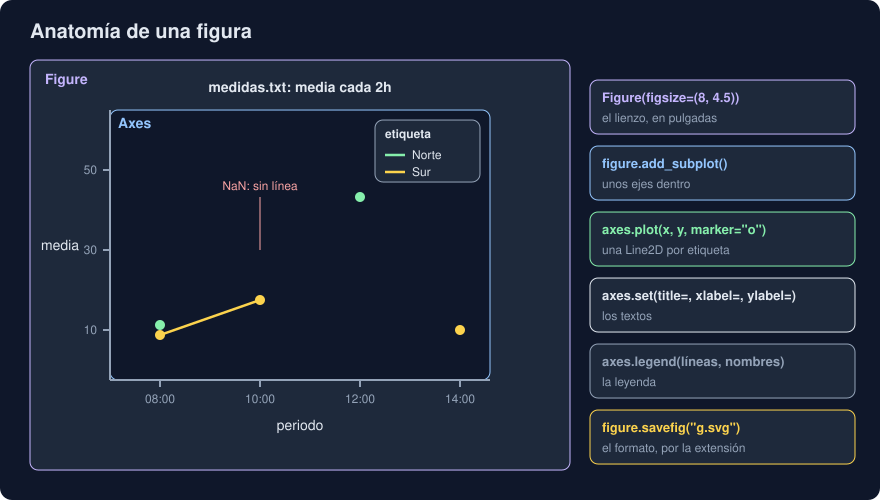

# 01 · matplotlib: figuras, ejes y artistas

⏱️ 50 min

## 🎯 Objetivos

- Explicar para qué sirve un gráfico que una tabla no puede dar.
- Nombrar las piezas de un gráfico de matplotlib: `Figure`, `Axes` y artistas.
- Dibujar líneas, barras, histogramas y puntos, y ponerles títulos, ejes y leyenda.
- Distinguir la interfaz orientada a objetos de `pyplot`, y saber cuándo usar cada una.
- Guardar un gráfico en PNG, SVG o PDF, y elegir el formato.

---

## 1. Por qué dibujar

En la semana 25, `evolucion` escribía una tabla con la media de cada etiqueta en cada periodo. Para saber qué etiqueta sube y cuál baja, hay que leer los números uno a uno y compararlos de memoria. Con cinco etiquetas y treinta periodos son 150 números.

Un gráfico pasa ese trabajo a la vista: una línea que sube se ve antes de leer ningún número, igual que un hueco, un valor que se escapa o dos grupos que se cruzan. No sustituye a la tabla (los números exactos siguen ahí), pero te dice **dónde mirar**.

matplotlib es la biblioteca de gráficos de Python desde 2003. Casi todas las demás (seaborn, la función `plot` de pandas, muchas de ciencia) dibujan con ella por debajo. Esta semana la usas tú directamente, y después dos que se apoyan en ella o hacen otra cosa: seaborn y plotly.

---

## 2. Las piezas



| Pieza | Qué es | Cómo se crea |
|---|---|---|
| `Figure` | El lienzo: el archivo o la ventana entera | `Figure(figsize=(8, 4.5))`, en pulgadas |
| `Axes` | Un gráfico dentro de la figura: zona de dibujo, eje x, eje y, título y leyenda | `figure.add_subplot()` o `figure.subplots(2, 2)` |
| Artista | Todo lo que se ve: cada línea, barra, punto, texto o marca | Lo crean los métodos de `Axes`: `plot`, `bar`, `set_title`... |

Una figura puede tener varios `Axes` (una rejilla de gráficos), y cada `Axes` muchos artistas. Lo que dibujas **se guarda** en ellos: una `Line2D` recuerda sus datos (`get_xdata()`, `get_ydata()`), su color, su marcador. Por eso un test puede comprobar un gráfico sin mirar ni un píxel (teoría 05).

```python
from matplotlib.figure import Figure

figure = Figure(figsize=(8, 4))
axes = figure.add_subplot()
(line,) = axes.plot(times, values, marker="o")
axes.set(title="Norte", xlabel="hora", ylabel="temperatura (°C)")
figure.savefig("norte.png")
```

`plot` devuelve una **lista** de líneas, porque puede dibujar varias de una vez; `(line,) = ...` saca la única.

> Ojo con el nombre: `Axes` (los ejes, el gráfico entero) no es `Axis` (un eje, el x o el y). `axes.xaxis` es el `Axis` x de unos `Axes`.

---

## 3. Los tipos de gráfico básicos

| Método de `Axes` | Dibuja | Para |
|---|---|---|
| `plot(x, y)` | Líneas (y marcadores con `marker=`) | Lo que cambia de forma continua, sobre todo con el tiempo |
| `scatter(x, y)` | Puntos sueltos | La relación entre dos variables |
| `bar(categorías, alturas)` / `barh` | Barras verticales u horizontales | Comparar una cantidad entre grupos |
| `hist(valores, bins=30)` | Un histograma | Cómo se reparten los valores |
| `boxplot(grupos)` | Una caja por grupo | Comparar repartos entre grupos |
| `imshow(matriz)` | Una cuadrícula de colores | Una cantidad que depende de dos cosas (día y hora) |
| `axhline(y)` / `axvline(x)` | Una línea de lado a lado | Un umbral o una fecha de referencia |
| `annotate(texto, xy=...)` | Un texto que señala un punto | Explicar un valor concreto |

La teoría 02 dice cuál elegir para cada pregunta.

### Lo que falta

Un `NaN` en `plot` **corta la línea**: matplotlib no une los puntos de antes y de después como si hubiera dato en medio. `scatter` simplemente no dibuja ese punto. Es lo correcto: un gráfico que inventa los datos que faltan miente. Pero tiene un efecto: un valor solo, entre dos `NaN`, es una línea de longitud cero, y no se ve. Con `marker="o"`, cada valor tiene su punto.

`hist` y `boxplot` no quieren `NaN`: quítalos antes con `dropna()`.

---

## 4. Textos, ejes y leyenda

```python
axes.set(title="Norte, noviembre", xlabel="día", ylabel="temperatura (°C)")
axes.set_ylim(0, 40)
axes.axhline(25, color="tab:red", linestyle="--", label="umbral")
axes.annotate("máximo", xy=(peak_time, peak), xytext=(10, -20), textcoords="offset points")
axes.legend(title="estación")
```

- `set` pone varias propiedades de una vez: `set(title=...)` es `set_title(...)`.
- matplotlib elige los **límites** a partir de los datos, con un 5 % de margen. `set_xlim` y `set_ylim` los fijan.
- `legend()` busca los artistas con `label=`, y **se salta los que empiezan por `_`**: matplotlib usa ese prefijo para lo que no quiere en la leyenda. Si una de tus etiquetas empieza por `_`, desaparece sin avisar. Para evitarlo, pásale las líneas y los nombres: `axes.legend(lines, names)`.
- `figure.legend(loc="outside right upper")` pone la leyenda fuera de los ejes, sin tapar datos (con `layout="constrained"`).

### Fechas

Si el eje x son fechas (`datetime` o `datetime64`), matplotlib lo detecta y pone marcas de fecha. Para que no se pisen:

```python
from matplotlib.dates import ConciseDateFormatter, DayLocator

axes.xaxis.set_major_locator(DayLocator())
axes.xaxis.set_major_formatter(ConciseDateFormatter(axes.xaxis.get_major_locator()))
```

### Varios gráficos en una figura

```python
figure = Figure(figsize=(10, 7), layout="constrained")
(top_left, top_right), (bottom_left, bottom_right) = figure.subplots(2, 2)
grid = figure.subplots(5, 1, sharex=True, sharey=True)   # cinco, con los mismos ejes
```

`layout="constrained"` recoloca los `Axes` para que títulos y etiquetas no se pisen. `sharey=True` hace que todos usen la misma escala y, así, se puedan comparar.

---

## 5. Dos interfaces: objetos y `pyplot`

Casi todos los tutoriales empiezan así:

```python
import matplotlib.pyplot as plt

plt.plot(times, values)
plt.title("Norte")
plt.savefig("norte.png")
plt.show()
```

`pyplot` es una interfaz **con estado**: guarda una lista global de figuras y una figura y unos ejes "actuales". `plt.plot` dibuja en los ejes actuales, sean cuales sean. Viene de MATLAB, y es cómoda para probar algo rápido en una consola o un *notebook*.

| | Orientada a objetos (`Figure`, `Axes`) | `pyplot` |
|---|---|---|
| Dónde dibuja | En los ejes que tú le dices | En "los actuales" |
| Vida de la figura | Python la borra cuando ya no la usas | Vive hasta `plt.close`; con más de 20 abiertas, avisa |
| Ventanas | Ninguna | `plt.show()` abre una, si hay pantalla |
| Hilos | Una figura por hilo, sin problemas | Su estado global no es seguro entre hilos |
| Para | Programas, tests, servidores, tu proyecto | Explorar en una consola o un *notebook* |

Las dos dibujan igual; los métodos de `Axes` son los mismos (`plt.title` llama a `axes.set_title`). En un programa, crea la figura con `Figure` o, si usas `pyplot`, con `fig, ax = plt.subplots()` y después solo `ax.` y `fig.`, y `plt.close(fig)` al terminar.

### Los *backends*

Quien convierte una figura en píxeles o en un archivo es el ***backend***. **Agg** dibuja PNG en memoria, sin pantalla; otros abren ventanas (TkAgg, QtAgg) o dibujan en un *notebook*. `Figure().savefig(...)` usa siempre el que toca para el formato, sin abrir nada. Con `pyplot`, `matplotlib.use("Agg")` antes del `import` asegura que nunca intentará abrir una ventana, por ejemplo en Docker o en la CI.

---

## 6. Guardar

```python
figure.savefig("evolucion.png")             # el formato sale de la extensión
figure.savefig("evolucion.png", dpi=200)    # más píxeles
figure.savefig("evolucion.svg")
figure.savefig(buffer, format="png")        # a un io.BytesIO, sin archivo
```

| Formato | Qué guarda | Úsalo para |
|---|---|---|
| PNG | Píxeles. `figsize` × `dpi` = tamaño en píxeles: 8 × 100 = 800 | Mensajes, diapositivas, una web sencilla |
| SVG | Líneas y textos, vectorial: nítido a cualquier tamaño | Webs, informes, versionar en git |
| PDF | Vectorial, listo para imprimir | Informes y artículos |

Una extensión que matplotlib no conoce da `ValueError: Format 'txt' is not supported`, y una carpeta que no existe, `FileNotFoundError`, como `open`.

En SVG, por defecto, cada letra se guarda como una forma: el texto no se puede buscar ni copiar, ni lo lee un lector de pantalla. Con `svg.fonttype: "none"`, el texto queda como `<text>`: el archivo ocupa un tercio menos (ejercicio 01, paso 5), y quien lo abre usa una fuente parecida si no tiene DejaVu Sans, la de matplotlib.

### La configuración: `rcParams`

`matplotlib.rcParams` es un diccionario **global** con los valores por defecto de todo: fuentes, colores, tamaños, `svg.fonttype`... Cambiarlo cambia todos los gráficos del programa. Para cambiarlo solo un rato:

```python
with matplotlib.rc_context({"svg.fonttype": "none"}):
    figure.savefig("evolucion.svg")
```

---

## 7. Errores frecuentes

| Error | Por qué está mal | Qué hacer |
|---|---|---|
| Mezclar `plt.` y `ax.` en el mismo programa | `plt` dibuja en "los actuales", que pueden ser otros | Una figura con `Figure` o `plt.subplots`, y después solo sus métodos |
| Crear figuras con `pyplot` en un bucle sin `plt.close` | Se acumulan en memoria | `Figure` directamente, o `plt.close(fig)` |
| Quitar los `NaN` antes de `plot` | La línea une puntos que no son vecinos | Deja los `NaN`: la línea se corta donde falta el dato |
| Una línea sin marcadores con datos dispersos | Un valor solo no se ve | `marker="o"` |
| Etiquetas que empiezan por `_` | `legend()` las salta sin avisar | `axes.legend(lines, names)` |
| `plt.show()` en un script que corre en Docker | No hay pantalla | `savefig` |
| Confundir `Axes` y `Axis` | Son cosas distintas | `Axes`, el gráfico; `Axis`, un eje |

---

## ✅ Qué debes saber al terminar

- [ ] Qué es una `Figure`, unos `Axes` y un artista, y qué guarda una `Line2D`.
- [ ] Qué método usar para una línea, unos puntos, unas barras, un histograma y una caja.
- [ ] Qué hace un `NaN` en `plot`, y para qué sirve `marker`.
- [ ] Por qué `legend()` puede perder una etiqueta, y cómo evitarlo.
- [ ] Qué diferencia hay entre la interfaz de objetos y `pyplot`, y cuál usar en un programa.
- [ ] Qué formato elegir al guardar, y qué cambia `svg.fonttype`.

---

## 🔗 Navegación

| Anterior | Actual | Siguiente |
| -------- | ------ | --------- |
| [Semana 27](../README.md) | **01 · matplotlib: figuras, ejes y artistas** | [02 · Elegir el gráfico y contarlo bien](02-elegir-el-grafico-y-contarlo-bien.md) |
