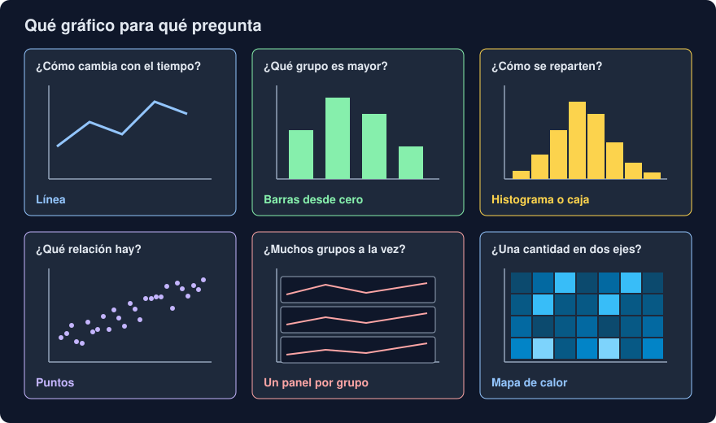

# 02 · Elegir el gráfico y contarlo bien

⏱️ 45 min

## 🎯 Objetivos

- Elegir el tipo de gráfico a partir de la pregunta que quieres responder.
- Reconocer los gráficos que engañan: barras recortadas, escalas distintas, demasiadas líneas.
- Usar el color para lo que sirve, con paletas que se leen con daltonismo.
- Decidir cuándo una escala logarítmica ayuda y cuándo confunde.
- Escribir títulos, ejes y leyendas que hagan innecesario explicar el gráfico.

---

## 1. Primero la pregunta

Un gráfico responde a **una** pregunta. Si no sabes cuál, no sabes qué dibujar:

| Pregunta | Gráfico | Por qué |
|---|---|---|
| ¿Cómo cambia con el tiempo? | Línea | La pendiente se ve sola; el tiempo va en el eje x, de izquierda a derecha |
| ¿Qué grupo es mayor? | Barras desde cero, o puntos | La longitud de una barra se compara muy bien |
| ¿Cómo se reparten los valores? | Histograma; cajas o violines si son varios grupos | Enseñan la forma, no solo la media |
| ¿Qué relación hay entre dos variables? | Puntos | Cada medida es un punto; la nube enseña la tendencia y lo que se escapa |
| ¿Cómo se comparan muchos grupos? | Un panel por grupo, con la misma escala | Cinco líneas cruzadas no se leen |
| ¿Cómo depende una cantidad de dos cosas? | Mapa de calor | Día × hora, estación × mes |

Hay gráficos que casi nunca son la mejor respuesta: el de **tarta** compara ángulos, que el ojo lee peor que longitudes; los de **3D** deforman los tamaños por la perspectiva; los de **dos ejes y** dejan elegir las escalas para que dos líneas parezcan relacionadas.

---

## 2. Cómo leemos un gráfico

No leemos igual de bien todas las formas de codificar un número. De mejor a peor, más o menos:

1. **Posición** sobre una escala común: puntos o líneas en el mismo eje.
2. **Longitud**: barras que empiezan en el mismo sitio.
3. **Ángulo** y **área**: tartas, burbujas.
4. **Color**: tono o intensidad.

Por eso un número importante va en una posición o una longitud, y el color se queda para distinguir grupos o para una tercera variable que no cabe en los ejes.

---

## 3. Las barras empiezan en cero

Una barra se lee por su longitud. Si el eje empieza en 14, una barra de 24 mide 10 y una de 15 mide 1: parecen diez veces distintas, cuando la diferencia real es 1,6 veces (ejercicio 02, paso 1).

- **Barras**: el eje y empieza en cero. Siempre.
- **Líneas y puntos**: se leen por su posición, no por su longitud. El eje puede empezar donde estén los datos, y debe, si no la variación no se ve. matplotlib ya lo hace así.

Si lo que importa es la diferencia entre dos grupos, dibuja la diferencia.

---

## 4. Una escala para comparar

Dos gráficos se comparan solo si comparten escala. Con un panel por estación y cada uno con su eje y, todas las estaciones parecen variar lo mismo, aunque una tenga el doble de rango. `sharey=True` en `subplots` (o `relplot` de seaborn, que lo hace por defecto) lo evita.

Los ***small multiples*** (muchos gráficos pequeños iguales, uno por grupo, con los mismos ejes) son la respuesta a "tengo demasiadas líneas". Cada grupo se ve solo, sin cruces, y la comparación sigue siendo justa.

### Escala logarítmica

En una escala logarítmica, cada marca **multiplica** por lo mismo: 0,1, 1, 10, 100. Ayuda cuando:

- los datos van de muy pequeños a muy grandes (lluvias, ingresos, tiempos de respuesta) y en escala lineal casi todo se amontona junto al cero;
- importan las proporciones: en un crecimiento exponencial, una línea recta significa "crece al mismo ritmo".

No tiene ceros ni negativos (no tienen logaritmo), y quien no se fija en el eje lo lee mal. Si la usas, dilo en el título o en el eje.

---

## 5. Color

| Paleta | Para | Ejemplos |
|---|---|---|
| **Categórica** | Grupos sin orden: estaciones, etiquetas | `tab10` (la de matplotlib), `colorblind` de seaborn |
| **Secuencial** | Una cantidad de menos a más | `viridis`, `cividis`, `Blues` |
| **Divergente** | Una cantidad con un centro: por encima y por debajo de la media | `RdBu`, `coolwarm` |

- Alrededor del 8 % de los hombres y menos del 1 % de las mujeres tienen algún tipo de daltonismo, casi siempre rojo-verde. `viridis` y `cividis` se leen igual con daltonismo y en blanco y negro; las paletas arcoíris, como `jet`, no, y además crean fronteras donde no las hay.
- La paleta categórica de matplotlib tiene 10 colores. Con más grupos, los colores se repiten y la leyenda ya no sirve: usa paneles, o agrupa.
- Un mapa de calor sin barra de color (`figure.colorbar`) no dice ningún número.

---

## 6. Que se entienda solo

Un buen gráfico lo entiende quien no estaba cuando lo hiciste:

- **título** que diga qué se ve: "Norte, temperatura media por día", mejor que "Gráfico 1";
- **ejes con nombre y unidad**: "temperatura (°C)", no `value`;
- **leyenda** si hay más de un grupo, sin tapar datos;
- una **referencia** cuando hay un valor que importa: un umbral con `axhline`, una fecha con `axvline`;
- **anotaciones** para lo que quieres que vean: el máximo, un cambio, un hueco;
- nada más: sin sombras, sin 3D, sin fondos de colores. Cada cosa que no es dato compite con los datos.

### Lo que falta, a la vista

Un hueco en una línea dice "aquí no hay dato". Rellenarlo (con la media, con el valor anterior, uniendo los puntos) dibuja datos que nadie midió. Si los rellenas porque el análisis lo necesita, que se note: otro color, una línea discontinua, una nota.

seaborn y `hist` dejan fuera los `NaN` sin avisar. Antes de dibujar, cuenta lo que falta; si es mucho, dilo en el gráfico.

---

## 7. Errores frecuentes

| Error | Por qué está mal | Qué hacer |
|---|---|---|
| Barras con el eje y recortado | Exagera las diferencias | Las barras empiezan en cero; si importa la diferencia, dibújala |
| Paneles con escalas distintas | Grupos distintos parecen iguales | `sharey=True` |
| Diez líneas en unos ejes | Nadie las sigue | Un panel por grupo, o destaca una y deja las demás en gris |
| Tartas para comparar grupos | Los ángulos se leen mal | Barras |
| Paleta arcoíris para una cantidad | Inventa fronteras y no se lee con daltonismo | `viridis` o `cividis` |
| Escala logarítmica sin avisar | Se lee como lineal | Dilo en el eje o en el título |
| Rellenar los huecos sin decirlo | Dibuja datos que no existen | Deja el hueco, o márcalo |
| Ejes sin unidad | No se sabe qué se mide | "temperatura (°C)" |

---

## ✅ Qué debes saber al terminar

- [ ] Qué gráfico responde a cada pregunta de la tabla de la sección 1.
- [ ] Por qué las barras empiezan en cero y las líneas no tienen por qué.
- [ ] Qué son los *small multiples* y por qué comparten escala.
- [ ] Cuándo usar una escala logarítmica, y qué no puede dibujar.
- [ ] Qué paleta usar para grupos, para una cantidad y para una cantidad con centro.
- [ ] Qué debe tener un gráfico para entenderse sin explicarlo.

---

## 🔗 Navegación

| Anterior | Actual | Siguiente |
| -------- | ------ | --------- |
| [01 · matplotlib: figuras, ejes y artistas](01-matplotlib-figuras-ejes-y-artistas.md) | **02 · Elegir el gráfico y contarlo bien** | [03 · seaborn: gráficos estadísticos](03-seaborn-graficos-estadisticos.md) |
