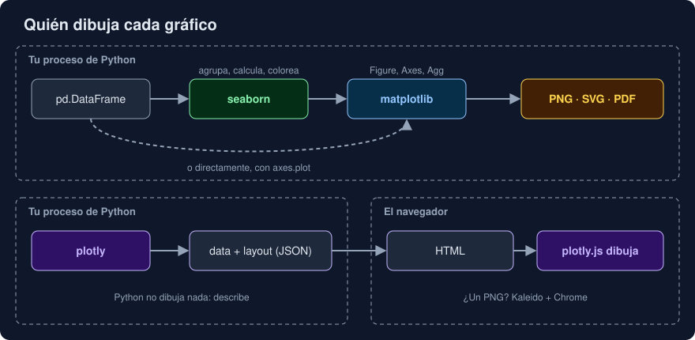

# 04 · plotly: gráficos interactivos

⏱️ 45 min

## 🎯 Objetivos

- Explicar en qué se diferencia plotly de matplotlib: quién dibuja y dónde.
- Hacer gráficos con plotly express a partir de una tabla larga.
- Leer y cambiar una figura como lo que es: un diccionario de `data` y `layout`.
- Guardar un HTML y elegir entre llevar plotly.js dentro o bajarlo de internet.
- Decidir cuándo compensa un gráfico interactivo.

---

## 1. Quién dibuja



matplotlib (y seaborn encima) dibuja **en tu proceso de Python**: convierte la figura en píxeles o en un SVG, y el resultado es un archivo que ya no cambia.

plotly hace otra cosa: en Python solo **describe** la figura, como un diccionario que se convierte en JSON. Quien dibuja es **plotly.js**, una biblioteca de JavaScript, en el navegador. Por eso el gráfico responde al ratón: al pasar por encima sale el valor exacto, puedes ampliar una zona, esconder una serie pulsando en la leyenda o descargar un PNG desde la barra de botones.

El mismo plotly.js se usa desde R y JavaScript, y es la base de Dash, un *framework* para hacer paneles web en Python.

---

## 2. plotly express

`plotly.express` (siempre `px`) es la interfaz rápida, con la misma idea que seaborn: una tabla larga y nombres de columna.

```python
import plotly.express as px

figure = px.line(daily, x="time", y="value", color="station", title="Media diaria")
figure.write_html("media-diaria.html")
```

| Función | Gráfico |
|---|---|
| `px.line`, `px.scatter`, `px.bar` | Líneas, puntos, barras |
| `px.histogram`, `px.box`, `px.violin` | Distribuciones |
| `px.imshow` | Mapa de calor |
| `px.scatter_map`, `px.choropleth` | Mapas |

| Argumento | Qué decide |
|---|---|
| `color`, `symbol`, `line_dash` | Un color, un símbolo o un tipo de línea por valor (como `hue` de seaborn) |
| `facet_col`, `facet_row`, `facet_col_wrap` | Un panel por valor (como `col` de seaborn) |
| `hover_data` | Qué columnas salen al pasar el ratón, y con qué formato: `{"value": ":.1f"}` |
| `labels` | Los nombres de las columnas en el gráfico: `{"value": "temperatura (°C)"}` |

plotly express acepta tablas de pandas y de Polars, a través de **narwhals**, una biblioteca pequeña que traduce entre las dos. A diferencia de DuckDB (semana 26), no necesita `pyarrow`.

---

## 3. Una figura es un diccionario

```python
figure.to_dict().keys()     # dict_keys(['data', 'layout'])
```

- `data`: una lista de **trazas**, cada una una serie de datos con su tipo y su estilo. Una línea es una traza `scatter` con `mode="lines"`; `px.line` con `color="station"` crea una traza por estación.
- `layout`: todo lo demás: título, ejes, leyenda, márgenes, formas, anotaciones.

Todo se cambia con métodos que reciben nombres separados por `_`:

```python
figure.update_layout(xaxis_title="día", yaxis_title="temperatura (°C)", legend_title="estación")
figure.update_traces(line_width=3)
figure.add_hline(y=25, line_dash="dash", annotation_text="umbral")
figure.for_each_annotation(lambda a: a.update(text=a.text.removeprefix("station=")))
```

`xaxis_title` es `layout.xaxis.title`. Si un nombre no existe, plotly lanza un `ValueError` con la lista de los que sí: no se equivoca en silencio.

Para lo que plotly express no hace, existe `plotly.graph_objects` (`go`): construyes las trazas una a una (`go.Scatter`, `go.Bar`) y las añades a una `go.Figure`. Es más largo y casi nunca hace falta.

---

## 4. Guardar

| Método | Da | Necesita |
|---|---|---|
| `write_html("g.html")` | Un HTML con el gráfico y plotly.js dentro: unos 4,8 MB | Nada |
| `write_html("g.html", include_plotlyjs="cdn")` | Un HTML de pocos kB que baja plotly.js de `cdn.plot.ly` al abrirse | Internet al verlo |
| `to_json()` | El JSON de la figura, para mandarlo a una web que ya tenga plotly.js | Nada |
| `write_image("g.png")` | PNG, SVG o PDF | **Kaleido**, otro paquete, y un navegador Chrome |
| `show()` | Lo abre en el navegador o en el *notebook* | Una pantalla |

En el JSON, los números van en **binario codificado en base64** (`"dtype": "f8"`), no como texto: ocupan menos. Aun así, todos los datos viajan al navegador: un millón de puntos son decenas de megas, y el navegador va lento al dibujarlos. Para muchos datos, resume primero (medias por hora, por día) y dibuja el resumen.

La primera opción es la más segura para mandar un archivo a alguien: funciona sin conexión, años después. La segunda, para una web con muchos gráficos, que comparten la misma descarga.

---

## 5. ¿Interactivo o estático?

| Interactivo (plotly) | Estático (matplotlib) |
|---|---|
| Quien lo ve explora: amplía, filtra, lee valores exactos | Quien lo ve lee lo que tú decidiste enseñar |
| Necesita un navegador y JavaScript | Un PNG se ve en cualquier sitio: un correo, un PDF, un chat |
| El HTML lleva todos los datos | El PNG lleva píxeles; el SVG, solo lo dibujado |
| Para imágenes necesita Kaleido y Chrome | PNG, SVG y PDF sin nada más |
| Bueno para paneles, *notebooks* y webs | Bueno para informes, artículos, tests y servidores |

Un gráfico interactivo no sustituye a uno bien pensado: si para entenderlo hay que pasar el ratón por cada punto, la pregunta de la teoría 02 no está clara.

---

## 6. Errores frecuentes

| Error | Por qué está mal | Qué hacer |
|---|---|---|
| Mandar un HTML con `"cdn"` a alguien sin conexión | Sale en blanco | `include_plotlyjs=True` (por defecto) |
| Dibujar un millón de puntos | HTML enorme y navegador lento | Resume antes de dibujar |
| Esperar que `write_image` funcione tras instalar plotly | Necesita Kaleido y Chrome | `write_html`, o matplotlib para imágenes |
| Pasar una tabla ancha con `color=` | No encuentra la columna | Tabla larga |
| Dejar los nombres de columna en el gráfico | `value` y `station=Norte` no dicen nada | `labels=` y `for_each_annotation` |
| Usar plotly en un servidor sin navegador para generar PNG | Instalar Chrome en la imagen la hace mucho más grande | matplotlib |

---

## ✅ Qué debes saber al terminar

- [ ] Dónde dibuja matplotlib y dónde plotly, y qué consecuencias tiene.
- [ ] Cómo hacer un gráfico con plotly express a partir de una tabla larga.
- [ ] Qué son `data`, `layout` y una traza, y cómo cambiar el título de un eje.
- [ ] Qué cambia `include_plotlyjs`, y qué necesita `write_image`.
- [ ] Cuándo compensa un gráfico interactivo, y cuándo uno estático.

---

## 🔗 Navegación

| Anterior | Actual | Siguiente |
| -------- | ------ | --------- |
| [03 · seaborn: gráficos estadísticos](03-seaborn-graficos-estadisticos.md) | **04 · plotly: gráficos interactivos** | [05 · Gráficos en un proyecto](05-graficos-en-un-proyecto.md) |
