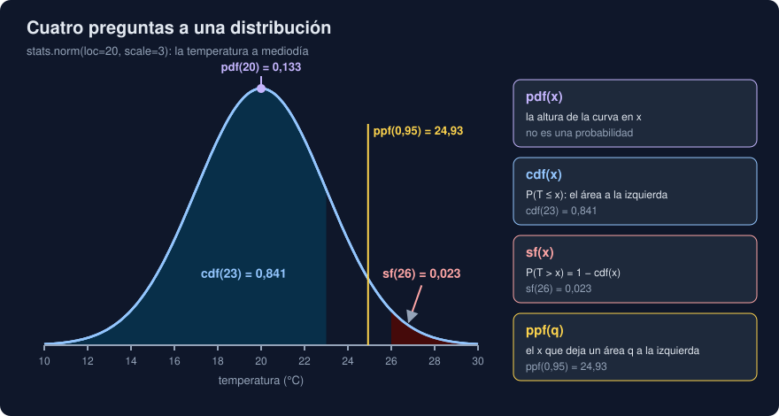

# 01 · Variables aleatorias y distribuciones

⏱️ 50 min

## 🎯 Objetivos

- Distinguir población y muestra, y explicar por qué casi nunca ves la población.
- Describir una variable aleatoria con su distribución: densidad, función de distribución y cuantiles.
- Usar las distribuciones de `scipy.stats` para responder preguntas de probabilidad.
- Elegir un modelo para medidas continuas (normal, exponencial) y para conteos (binomial, Poisson).
- Explicar la ley de los grandes números y el teorema central del límite, y por qué sostienen todo lo que viene después.

---

## 1. De describir a inferir

En la semana 23 calculaste con NumPy la media, la desviación y los cuartiles de tus medidas. Eso es **estadística descriptiva**: resume lo que tienes delante.

Esta semana das un paso más. Tus medidas son una **muestra**: unas pocas de todas las que se podrían haber tomado (la **población**). Las preguntas que importan son sobre la población:

- La media del Norte es 13,2 °C en tus tres días. ¿Cuánto vale la media de **todos** los días?
- El Sur sale 4,5 °C por encima. ¿Mide más de verdad, o ha sido la suerte de esos días?
- ¿Cuántos días al año pasará de 26 °C?

Responder a eso con una muestra es **estadística inferencial**, y necesita un **modelo**: una descripción de cómo se reparten los valores posibles. Ese modelo es una distribución de probabilidad.

---

## 2. Variables aleatorias

Una **variable aleatoria** es una cantidad cuyo valor no sabes antes de medirla: la temperatura de mañana a mediodía, cuántas lecturas fallarán en un lote, cuántos minutos pasarán hasta la próxima alerta.

| Tipo | Valores | Ejemplos |
|---|---|---|
| **Continua** | Cualquier número de un intervalo | Temperatura, tiempo de espera, concentración |
| **Discreta** | Valores sueltos, casi siempre conteos | Lecturas que fallan, alertas por hora |

Su **distribución** dice qué valores son probables y cuáles raros. Con ella respondes preguntas como "¿qué probabilidad hay de que pase de 26 °C?" sin haber medido todavía nada.

---

## 3. Cuatro preguntas a una distribución



En `scipy.stats`, una distribución con sus parámetros fijados es un objeto (*frozen distribution*):

```python
from scipy import stats

noon = stats.norm(loc=20, scale=3)  # normal: media 20 °C, desviación 3 °C
noon.cdf(23)     # 0.8413: P(T <= 23)
noon.sf(26)      # 0.0228: P(T > 26)
noon.ppf(0.95)   # 24.93: el valor que deja el 95 % por debajo
noon.pdf(20)     # 0.133: la altura de la curva en 20
```

| Método | Pregunta | Ejemplo |
|---|---|---|
| `cdf(x)` | ¿Qué probabilidad hay de un valor **menor o igual** que x? | El 84 % de los días, como mucho 23 °C |
| `sf(x)` | ¿Y de uno **mayor** que x? Es `1 - cdf(x)`, pero sin perder precisión en las colas | Un 2,3 % de los días pasan de 26 °C |
| `ppf(q)` | ¿Qué valor deja una probabilidad q por debajo? Es la inversa de `cdf` | El 95 % de los días, por debajo de 24,93 °C |
| `pdf(x)` | ¿Cómo de alta es la curva en x? | 0,133 en 20 °C |

- La **densidad** (`pdf`) no es una probabilidad: en una variable continua, la probabilidad de un valor exacto (20,000... °C) es cero. Lo que se mide es el **área** bajo la curva entre dos valores, y eso es lo que da `cdf`.
- `interval(0.95)` devuelve el intervalo central que contiene el 95 %: `[14.12, 25.88]`, la media ± 1,96 desviaciones.
- Una variable discreta no tiene `pdf`, sino `pmf` (*probability mass function*): la probabilidad de cada valor exacto, que aquí sí tiene sentido (la probabilidad de 0 fallos).

`scipy.stats` trae 110 distribuciones continuas y 21 discretas, todas con los mismos métodos. Aprendes la interfaz una vez.

---

## 4. Las distribuciones que vas a usar

| Distribución | En `scipy.stats` | Cuándo | Parámetros |
|---|---|---|---|
| **Normal** | `norm(loc, scale)` | Suma de muchos efectos pequeños: medidas físicas, errores de un sensor | Media y desviación |
| **Exponencial** | `expon(scale)` | Tiempo de espera hasta el siguiente suceso | Media (el `scale`) |
| **Uniforme** | `uniform(loc, scale)` | Todos los valores de un intervalo igual de probables | Inicio y ancho |
| **Binomial** | `binom(n, p)` | Cuántos de n intentos salen bien (o mal) | Intentos y probabilidad de cada uno |
| **Poisson** | `poisson(mu)` | Cuántos sucesos en un intervalo, si llegan cada uno por su lado | Media de sucesos |
| **t de Student** | `t(df)` | La media de una muestra pequeña, medida en errores estándar (teoría 02) | Grados de libertad |

Ejemplos del ejercicio 01:

- Un sensor falla en el 10 % de las lecturas. En un lote de 20, `binom(20, 0.1).pmf(0)` = 0,12: solo uno de cada ocho lotes sale sin fallos. Y `sf(4)` = 0,043: cinco fallos o más pasa en el 4 % de los lotes. Si ves eso tres lotes seguidos, sospecha del sensor.
- Llegan de media 3 alertas por hora. `poisson(3).pmf(0)` = 0,05: una hora de cada veinte, ninguna.

Un modelo es una **suposición**. La normal da probabilidad a temperaturas de -50 °C, aunque minúscula; la Poisson supone que las alertas no llegan en grupos. Antes de fiarte, mira tus datos (un histograma, semana 27) y comprueba que se parecen al modelo.

---

## 5. Muestras al azar y semillas

`rvs` (*random variates*) saca valores al azar de una distribución:

```python
import numpy as np

rng = np.random.default_rng(28)
days = noon.rvs(size=30, random_state=rng)
```

- Un generador con **semilla** (`default_rng(28)`) da siempre la misma secuencia: el ejercicio sale igual en tu máquina y en la del bootcamp, y un test con datos al azar no cambia de una ejecución a otra.
- Un mismo generador va dando valores nuevos cada vez que le pides: dos llamadas seguidas a `rvs` dan muestras distintas. Por eso los pasos de los ejercicios dependen de los anteriores.
- `random_state=rng` (o `rng=` en las funciones más nuevas de SciPy) es la forma moderna. Evita `np.random.seed`, que cambia un estado global que comparte todo el programa.

Simular es una herramienta de verdad, no un juego: cuando no sabes la fórmula de algo, lo repites diez mil veces y cuentas. Lo harás en los ejercicios 02 y 03.

---

## 6. La ley de los grandes números

La media de una muestra se acerca a la media de la población a medida que la muestra crece:

```
n =        10: media 19.530 · error 0.470
n =       100: media 19.820 · error 0.180
n =    10_000: media 20.030 · error 0.030
n = 1_000_000: media 19.999 · error 0.001
```

Es lo que justifica medir: con más datos, la media se equivoca menos. Pero fíjate en el ritmo: de 10 a 1 000 000 de medidas (cien mil veces más), el error baja unos cientos de veces, no cien mil. La teoría 02 da la regla exacta.

---

## 7. El teorema central del límite

Los tiempos de espera entre alertas son muy **asimétricos**: muchas esperas cortas y unas pocas muy largas (asimetría 1,96). Pero si tomas muestras de n esperas y calculas su **media**, esas medias se reparten de otra forma:

```
medias de  2: desviación 14.08 (20 / √2 = 14.14) · asimetría 1.39
medias de 10: desviación  6.27 (20 / √10 =  6.32) · asimetría 0.60
medias de 50: desviación  2.82 (20 / √50 =  2.83) · asimetría 0.28
```

El **teorema central del límite** dice dos cosas:

1. La media de n valores independientes se parece cada vez más a una **normal**, sea cual sea la distribución de partida (la asimetría baja hacia 0).
2. Su desviación es la de los datos dividida entre **√n**.

Por eso la normal aparece en todas partes, y por eso funcionan los intervalos y las pruebas de las teorías 02 y 03 aunque tus datos no sean una campana. Con una condición: "cada vez más" depende de lo asimétricos que sean. Con 15 esperas, todavía no basta (ejercicio 02, paso 5).

---

## 8. Ajustar un modelo

`stats.norm.fit(days)` busca la media y la desviación de la normal que mejor explica tus datos (por máxima verosimilitud):

```
normal ajustada a los 30 días: 20.29 3.12
```

- La desviación ajustada (3,12) divide entre n, no entre n - 1: es un poco menor que `days.std(ddof=1)` (3,18). Con muestras pequeñas, la diferencia importa.
- Con el modelo ajustado, saldrían 34 días de 1000 por encima de 26 °C; con el de verdad, 23. Un error de 0,3 °C en la media y 0,1 en la desviación multiplica por 1,5 una probabilidad de la cola. Las colas son lo más difícil de estimar, y a menudo lo que más importa (las alertas).

---

## 9. Errores frecuentes

| Error | Por qué está mal | Qué hacer |
|---|---|---|
| Leer `pdf(x)` como una probabilidad | En una continua, es una densidad: puede valer más de 1 | `cdf(b) - cdf(a)` para la probabilidad de un intervalo |
| `1 - cdf(x)` para colas muy pequeñas | Pierde precisión cuando `cdf(x)` es casi 1 | `sf(x)` |
| `np.random.seed(...)` | Estado global que cualquier otra parte del programa cambia | `rng = np.random.default_rng(semilla)` |
| `stats.norm(20, 3)` pensando que 3 es la varianza | `scale` es la desviación | `norm(loc=media, scale=desviación)` |
| Suponer una normal sin mirar | Unos datos asimétricos o con colas largas dan probabilidades falsas | Un histograma y `stats.skew` antes de elegir el modelo |
| Fiarse de la cola de un modelo ajustado con pocos datos | Un error pequeño en los parámetros mueve mucho la cola | Más datos, o el *bootstrap* de la teoría 02 |

---

## ✅ Qué debes saber al terminar

- [ ] Qué es una muestra, qué es la población, y cuál de las dos describen tus medidas.
- [ ] Qué responden `cdf`, `sf`, `ppf` y `pdf`, y por qué `pdf` no es una probabilidad.
- [ ] Qué distribución usarías para una temperatura, una espera y un conteo de fallos.
- [ ] Para qué sirve una semilla, y por qué `default_rng` y no `np.random.seed`.
- [ ] Qué dicen la ley de los grandes números y el teorema central del límite.

---

## 🔗 Navegación

| Anterior | Actual | Siguiente |
| -------- | ------ | --------- |
| [Semana 28](../README.md) | **01 · Variables aleatorias y distribuciones** | [02 · Estimar con incertidumbre](02-estimar-con-incertidumbre.md) |
