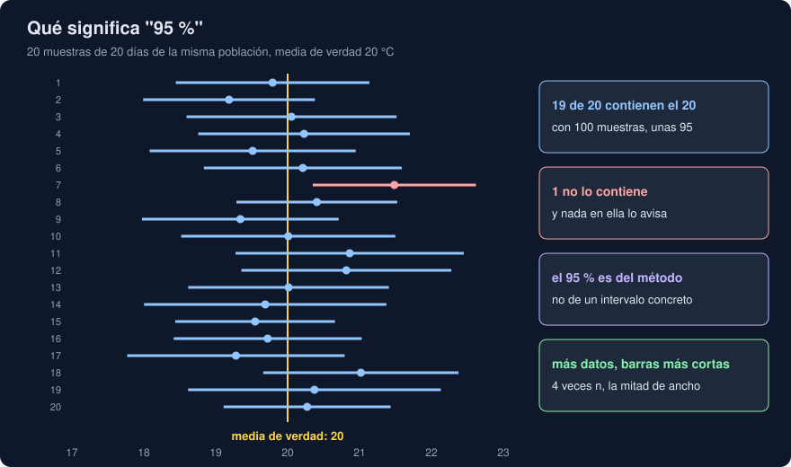

# 02 · Estimar con incertidumbre

⏱️ 45 min

## 🎯 Objetivos

- Explicar qué es el error estándar y de qué depende.
- Construir un intervalo de confianza con la distribución t, a mano y con SciPy.
- Interpretar un intervalo del 95 % sin caer en la lectura equivocada.
- Predecir cómo cambia el ancho de un intervalo con el tamaño de la muestra y con el nivel.
- Usar el *bootstrap* para lo que no tiene fórmula, y conocer sus límites.

---

## 1. Una media no basta

Tienes 25 días de la estación Norte, y su media es 20,07 °C. Si mañana repitieras las medidas con otros 25 días, saldría otra media: 19,8, 20,4... La media de una muestra es una **estimación**, y cada muestra da una distinta.

Dar solo "20,07" esconde cuánto puede equivocarse. Lo honrado es dar la estimación **y** su incertidumbre: "20,07, y la media de verdad está probablemente entre 18,85 y 21,29". Eso es un **intervalo de confianza**.

---

## 2. El error estándar

¿Cuánto varía la media de una muestra a otra? El teorema central del límite (teoría 01) lo dice: la media de n valores tiene una desviación igual a la de los datos dividida entre √n. Esa desviación de la media se llama **error estándar**:

```
error estándar = s / √n
```

donde `s` es la desviación de la muestra, con `ddof=1`:

```python
n, mean, std = days.size, days.mean(), days.std(ddof=1)
se = std / np.sqrt(n)  # 2.96 / 5 = 0.59
```

- **`ddof=1`**: divides entre n - 1, no entre n. Al calcular la desviación respecto a la media de la propia muestra, los datos parecen menos dispersos de lo que son; restar 1 lo corrige. Para describir unos datos (semana 23) daba igual; para estimar, no.
- **√n**: para que el error estándar baje a la mitad, hacen falta **cuatro veces** más datos. Para dividirlo entre 10, cien veces más. Medir mejor sale caro.
- No confundas la **desviación** (cuánto varían los datos: 2,96 °C) con el **error estándar** (cuánto varía la media: 0,59 °C). Con más datos, la desviación se queda igual; el error estándar baja.

---

## 3. El intervalo t

Si conocieras la desviación de la población, el intervalo del 95 % sería la media ± 1,96 errores estándar (1,96 es `norm.ppf(0.975)`). Pero solo tienes `s`, que también varía de muestra a muestra. La **distribución t de Student** tiene en cuenta esa incertidumbre extra: es como la normal, pero con las colas más gruesas, tanto más cuanto menos datos.

```python
t_crit = stats.t.ppf(0.975, df=n - 1)       # 2.064 con 24 grados de libertad
low, high = mean - t_crit * se, mean + t_crit * se
```

```
IC 95 % a mano: [18.85, 21.29]
IC 95 % con SciPy: [18.85, 21.29]
```

SciPy lo calcula con `stats.ttest_1samp(days, popmean=...).confidence_interval(0.95)`. Los **grados de libertad** (`df`) son n - 1: lo que queda de información tras usar los datos para calcular su media.

¿Importa usar t y no la normal? Con muchos datos, apenas: con 100, el valor crítico es 1,98 frente a 1,96. Con pocos, mucho (paso 2 del ejercicio 02).

---

## 4. Qué significa "95 %"



La lectura correcta es sobre el **método**: si repites el experimento muchas veces y cada vez calculas el intervalo así, el 95 % de esos intervalos contienen la media de verdad. El ejercicio 02 lo comprueba con 10 000 muestras:

```
n =   5: con t 95.0 % · con la normal 87.9 %
n =  25: con t 95.2 % · con la normal 94.1 %
n = 100: con t 95.3 % · con la normal 95.2 %
```

Con t, la cobertura es la prometida. Con la normal y 5 datos, el "95 %" es en realidad un 88 %.

Lo que **no** significa:

| Lectura | Por qué no |
|---|---|
| "La media de verdad tiene un 95 % de probabilidad de estar en [18,85, 21,29]" | La media de verdad es un número fijo: está dentro o no. El 95 % es del procedimiento, no de este intervalo |
| "El 95 % de los días estarán entre 18,85 y 21,29" | El intervalo es para la **media**. Los días varían mucho más (con desviación 2,96, entre unos 14 y 26) |
| "Si otro intervalo no se solapa con este, las medias son distintas" | Para comparar dos medias, el intervalo de su **diferencia** (teoría 03). Dos intervalos que se solapan un poco pueden venir de medias claramente distintas |

---

## 5. Ancho, datos y nivel

El ancho del intervalo es 2 × t × s / √n. Tres palancas:

```
n =   25: ancho 2.593
n =  100: ancho 1.200
n =  400: ancho 0.573
n = 1600: ancho 0.290
```

- **Más datos**: cada vez que multiplicas n por 4, el ancho se divide entre 2 (aproximadamente: cada muestra trae su propia `s`).
- **Menos dispersión**: un sensor más preciso da intervalos más estrechos con los mismos datos.
- **Nivel**: más confianza, intervalo más ancho. Con los mismos 25 días: 80 % → 1,56 de ancho, 95 % → 2,44, 99 % → 3,31. No hay intervalo estrecho y seguro a la vez sin más datos.

El 95 % es una convención, no una ley. Elige el nivel según lo que cueste equivocarse.

---

## 6. Bootstrap

Para la media hay fórmula. ¿Y para la **mediana**, un percentil, o el cociente de dos medias? La idea del *bootstrap* (Efron, 1979): tu muestra es lo mejor que sabes de la población, así que **remuestréala**. Saca muchas muestras del mismo tamaño, con reemplazo, de tus propios datos, y mira cuánto varía el estadístico:

```python
resampled = rng.choice(days, size=(10_000, days.size), replace=True)
medians = np.median(resampled, axis=1)
np.percentile(medians, [2.5, 97.5])  # [18.6, 21.2]
```

Eso es el intervalo **percentil**. SciPy lo hace con `stats.bootstrap`, que por defecto usa el método **BCa** (*bias-corrected and accelerated*), que corrige el sesgo y la asimetría:

```python
boot = stats.bootstrap((days,), np.median, confidence_level=0.95, rng=28)
boot.confidence_interval  # [18.60, 21.20]
boot.standard_error       # 0.71
```

- Los datos van en una **tupla** (`(days,)`): `bootstrap` acepta varias muestras a la vez.
- `rng=28` hace el resultado reproducible.
- No supone ninguna distribución: sirve para cualquier estadístico que puedas calcular.

---

## 7. Lo que el bootstrap no arregla

El bootstrap no inventa información. Con 15 esperas exponenciales (muy asimétricas), el ejercicio 02 compara 2000 veces los dos métodos:

```
cobertura con 15 esperas · t: 90.6 % · bootstrap: 89.7 %
```

Ninguno llega al 95 %. Con pocos datos asimétricos, la muestra no contiene las esperas largas que a veces ocurren, y ningún remuestreo puede sacarlas de donde no están. El remedio es el de siempre: **más datos**. El bootstrap brilla con estadísticos sin fórmula y muestras razonables, no con muestras pequeñas.

---

## 8. Errores frecuentes

| Error | Por qué está mal | Qué hacer |
|---|---|---|
| Dar una media sin intervalo | No dice cuánto puede equivocarse | Media y su IC 95 % |
| `std()` sin `ddof=1` para estimar | Subestima la dispersión, sobre todo con pocos datos | `std(ddof=1)` |
| Usar 1,96 con pocos datos | La cobertura real queda por debajo de lo prometido | `stats.t.ppf(0.975, df=n - 1)` o `confidence_interval` |
| "Hay un 95 % de probabilidad de que la media esté aquí" | El 95 % es del método | "El 95 % de los intervalos así construidos la contienen" |
| Comparar dos medias por si sus intervalos se solapan | Pierde diferencias reales | El intervalo de la diferencia (teoría 03) |
| Fiarse del bootstrap con 10 datos asimétricos | No puede ver lo que la muestra no tiene | Más datos; dilo en el informe |

---

## ✅ Qué debes saber al terminar

- [ ] La diferencia entre desviación y error estándar, y por qué el segundo baja con √n.
- [ ] Construir un IC 95 % con t a mano y con `confidence_interval`.
- [ ] Qué significa el 95 %, y tres lecturas equivocadas.
- [ ] Cuántos datos más hacen falta para un intervalo la mitad de ancho.
- [ ] Cómo funciona el bootstrap, y cuándo no basta.

---

## 🔗 Navegación

| Anterior | Actual | Siguiente |
| -------- | ------ | --------- |
| [01 · Variables aleatorias y distribuciones](01-variables-aleatorias-y-distribuciones.md) | **02 · Estimar con incertidumbre** | [03 · Pruebas de hipótesis](03-pruebas-de-hipotesis.md) |
