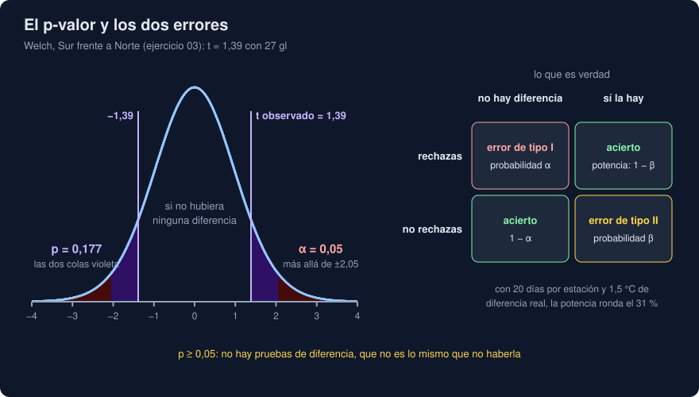

# 03 · Pruebas de hipótesis

⏱️ 50 min

## 🎯 Objetivos

- Plantear una prueba: hipótesis nula, estadístico y p-valor.
- Leer un p-valor por lo que es, y no por lo que parece.
- Distinguir los errores de tipo I y II, y calcular la potencia de una prueba.
- Elegir entre Welch, Student, Mann-Whitney, permutación y chi cuadrado.
- Evitar las trampas de las muchas comparaciones y de "significativo" frente a "importante".

---

## 1. La pregunta

Veinte días en cada estación: el Norte da 20,14 °C de media y el Sur 21,52. El Sur sale 1,38 °C por encima. ¿Mide más de verdad, o con otros veinte días podría salir al revés?

Una **prueba de hipótesis** lo plantea al revés de lo que esperas:

1. **Hipótesis nula (H₀)**: no hay diferencia; las medias de las dos estaciones son iguales.
2. **Estadístico**: un número que mide cuánto se alejan los datos de H₀. Aquí, la diferencia de medias dividida entre su error estándar: t = 1,39.
3. **p-valor**: si H₀ fuera cierta, ¿qué probabilidad habría de ver un estadístico tan extremo como el tuyo, o más?

Si el p-valor es pequeño, los datos serían raros bajo H₀, y eso es un argumento contra ella. Si es grande, los datos son compatibles con H₀... y quizá también con otras cosas.

---

## 2. El p-valor, sin fórmulas

El ejercicio 03 calcula el p-valor de dos formas. La primera no necesita ninguna teoría: si no hubiera diferencia entre estaciones, las etiquetas "Norte" y "Sur" serían intercambiables. Así que las **barajas** 20 000 veces, repartiendo los 40 valores al azar en dos grupos de 20, y cuentas cuántas veces sale una diferencia tan grande como 1,38:

```
diferencia observada: 1.38
repartos al azar con una diferencia igual o mayor: 0.1714
p de la permutación: 0.1698 · p de Welch: 0.1771
```

En el 17 % de los repartos al azar sale una diferencia así o mayor. Eso es el p-valor, y Welch llega a casi el mismo número con una fórmula. `stats.permutation_test` hace el barajado por ti, con cualquier estadístico.

---

## 3. Decidir y equivocarse



Antes de mirar los datos, eliges un **nivel de significación** α (casi siempre 0,05). Si p < α, rechazas H₀. Con eso puedes equivocarte de dos formas:

| | H₀ cierta (no hay diferencia) | H₀ falsa (la hay) |
|---|---|---|
| **Rechazas H₀** | Error de **tipo I** (falso positivo), probabilidad α | Acierto: la **potencia**, 1 − β |
| **No rechazas** | Acierto | Error de **tipo II** (falso negativo), probabilidad β |

En el ejercicio 03, los datos los generaste tú: el Sur mide **de verdad** 1,5 °C más. Y aun así p = 0,177. No es un fallo de la prueba: es un error de tipo II. Con 20 días por estación y tanto ruido, la prueba no tiene **potencia** para verlo.

Por eso, **p ≥ 0,05 no significa "no hay diferencia"**. Significa "con estos datos no puedo distinguirla del azar". Ausencia de pruebas no es prueba de ausencia.

---

## 4. Potencia: cuántos datos hacen falta

La potencia es la probabilidad de detectar una diferencia que existe. Depende del tamaño de la diferencia, del ruido y de n. El ejercicio 03 la calcula simulando 2000 experimentos con 1,5 °C de diferencia y desviación 3 en los dos grupos:

```
potencia con  10 por grupo y 1,5 °C de diferencia: 18 %
potencia con  30 por grupo y 1,5 °C de diferencia: 50 %
potencia con 100 por grupo y 1,5 °C de diferencia: 94 %
```

Con 10 días por grupo, cuatro de cada cinco experimentos no verían una diferencia real. La convención es buscar un 80 % de potencia **antes** de medir: decide cuánta diferencia te importa, estima el ruido, y simula (o usa una fórmula) para saber cuántos datos necesitas.

---

## 5. Welch y Student

Las dos pruebas t comparan dos medias. La de **Student** supone que los dos grupos tienen la misma dispersión; la de **Welch**, no:

```python
stats.ttest_ind(sur, norte, equal_var=False)  # Welch
stats.ttest_ind(sur, norte, equal_var=True)   # Student (el valor por defecto de SciPy)
```

```
Welch:   t = 1.386, gl = 26.9, p = 0.1771
Student: t = 1.386, gl = 38.0, p = 0.1738
```

Aquí se parecen porque los dos grupos tienen el mismo tamaño. Con tamaños **y** dispersiones distintos, Student se equivoca, y no siempre a favor. Welch pierde casi nada cuando las dispersiones sí son iguales. Usa Welch siempre; por eso `equal_var=False` va explícito en tu proyecto, contra el valor por defecto.

El intervalo de confianza de la diferencia cuenta lo mismo que la prueba, y más:

```
Sur - Norte: 1.38, IC 95 %: [-0.66, 3.42]
¿cero dentro del intervalo? True · ¿p < 0,05? False
```

Si el 0 está dentro del IC 95 %, p ≥ 0,05, y al revés. Pero el intervalo, además, dice **cuánto**: la diferencia de verdad puede ir de -0,66 a 3,42 °C. Da siempre el intervalo, no solo el p-valor.

---

## 6. Cuando la media no sirve: Mann-Whitney

La prueba t compara medias, y una media se mueve con un solo valor extremo. Si el sensor del Norte se vuelve loco un día y marca 95 °C:

```
sin el extremo: media Norte 20.14 · p Welch 0.1771 · p Mann-Whitney 0.1166
con el extremo: media Norte 24.01 · p Welch 0.5263 · p Mann-Whitney 0.2673
```

Un solo valor sube la media del Norte en casi 4 °C y lleva el p de Welch de 0,18 a 0,53. **Mann-Whitney** (`stats.mannwhitneyu`) no mira los valores, sino su **orden** (sus rangos): para ella, 95 °C es solo "el más alto", como lo habría sido 30 °C. Se mueve menos.

- No supone ninguna distribución: sirve con datos asimétricos o con valores extremos.
- No compara medias: compara si los valores de un grupo tienden a ser mayores que los del otro.
- Con muy pocos datos tiene un suelo: con 3 y 3 solo hay 20 formas de repartir los rangos, y el p-valor más pequeño posible es 2/20 = 0,1. Nunca dará p < 0,05, haya la diferencia que haya.

Tu proyecto da las dos. Si dicen cosas distintas, mira los datos: casi siempre hay un valor extremo o una distribución muy asimétrica.

---

## 7. Variables con categorías: chi cuadrado

Cuando lo que cuentas son categorías (días de nivel bajo, medio y alto en cada estación), la pregunta es si las dos variables son **independientes**:

```python
table = np.array([[52, 28, 10], [35, 33, 22]])  # filas: estaciones; columnas: niveles
stats.chi2_contingency(table)
```

```
chi² = 8.23, gl = 2, p = 0.0163
```

La prueba compara lo que observas con lo que esperarías si el nivel no dependiera de la estación (`expected_freq`: 43,5, 30,5 y 16 en cada fila). Aquí, el Sur tiene más días altos de lo esperable. Necesita conteos (no porcentajes) y que lo esperado en cada casilla no sea muy pequeño (la regla habitual: al menos 5).

---

## 8. Muchas pruebas

Con α = 0,05, una prueba sobre datos **sin ninguna diferencia** da p < 0,05 una de cada veinte veces. Haz 100:

```
con p < 0,05 sin ninguna diferencia real: 5 de 100
tras Bonferroni (p < 0,05 / 100): 0
tras Benjamini-Hochberg: 0
```

Cinco "descubrimientos", todos falsos. Si comparas todas las parejas de tus etiquetas (con 10 etiquetas, 45 parejas), o pruebas muchas variables hasta que una sale, encontrarás algo seguro. Eso es ***p-hacking***, y casi nunca es mala fe: es probar "solo una cosa más".

- **Bonferroni**: divide α entre el número de pruebas. Simple y muy estricto.
- **Benjamini-Hochberg** (`stats.false_discovery_control`): controla la proporción de falsos entre lo que declaras positivo. Menos estricto, más potencia.
- Lo mejor: decidir **antes** qué vas a comparar, y decir cuántas pruebas hiciste.

---

## 9. Significativo no es importante

Con datos de sobra, cualquier diferencia diminuta sale "significativa":

```
200 000 por grupo y 0,05 °C: p = 1.2e-10, d de Cohen = 0.020
```

Un p-valor minúsculo para una diferencia de 0,05 °C, que ningún termómetro de tu dominio notaría. El p-valor mide si la diferencia se distingue del azar, no si **importa**. Para eso, el **tamaño del efecto**:

- La diferencia en las unidades de tu dominio (°C, euros, minutos) con su intervalo: lo más útil para decidir.
- La **d de Cohen**: la diferencia dividida entre la desviación, sin unidades. Como guía (Cohen, 1988): 0,2 pequeña, 0,5 mediana, 0,8 grande.

Qué dar en un informe: la diferencia, su intervalo, el tamaño del efecto, el p-valor, los tamaños de muestra y qué prueba usaste. Es exactamente lo que escribe `comparar` en tu proyecto.

---

## 10. Errores frecuentes

| Error | Por qué está mal | Qué hacer |
|---|---|---|
| "p = 0,18: no hay diferencia" | Puede ser falta de potencia | "Con estos datos no se distingue del azar", y el intervalo |
| "p = 0,03: hay un 3 % de probabilidad de que H₀ sea cierta" | El p-valor supone H₀ cierta; no mide su probabilidad | "Si no hubiera diferencia, vería algo así un 3 % de las veces" |
| `ttest_ind(a, b)` sin `equal_var=False` | SciPy usa Student por defecto | Welch, explícito |
| Probar hasta que algo sale | Falsos positivos garantizados | Decidir antes; corregir con Bonferroni o Benjamini-Hochberg |
| Dar solo el p-valor | No dice cuánto ni si importa | Diferencia, intervalo, tamaño del efecto |
| Mann-Whitney con 3 y 3 datos | Su p-valor no puede bajar de 0,1 | Más datos, o dilo |
| Elegir α después de ver p | Ajustas la regla a lo que querías ver | α antes de medir |

---

## ✅ Qué debes saber al terminar

- [ ] Qué es H₀, qué es un estadístico y qué mide un p-valor.
- [ ] Calcular un p-valor barajando etiquetas.
- [ ] Qué son los errores de tipo I y II y la potencia, y por qué p ≥ 0,05 no prueba nada.
- [ ] Por qué Welch y no Student, y cuándo añadir Mann-Whitney.
- [ ] Qué pasa al hacer muchas pruebas, y cómo corregirlo.
- [ ] Qué dar en un informe además del p-valor.

---

## 🔗 Navegación

| Anterior | Actual | Siguiente |
| -------- | ------ | --------- |
| [02 · Estimar con incertidumbre](02-estimar-con-incertidumbre.md) | **03 · Pruebas de hipótesis** | [04 · Regresión con statsmodels](04-regresion-con-statsmodels.md) |
