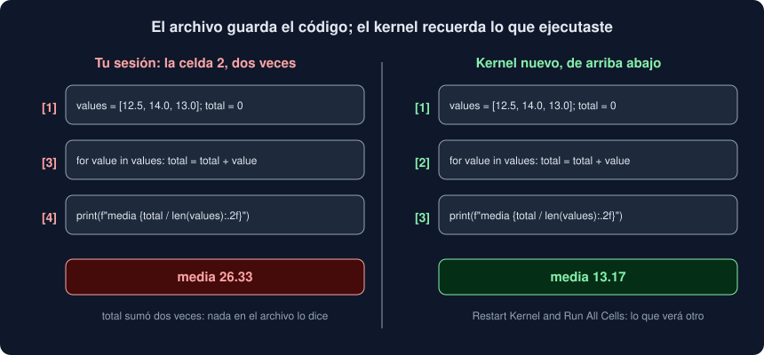

# 02 · Notebooks y JupyterLab

⏱️ 50 min

## 🎯 Objetivos

- Explicar qué es un notebook: celdas, un kernel y salidas guardadas en un JSON.
- Abrir y usar JupyterLab con las versiones de tu proyecto.
- Entender el estado oculto: por qué el orden en que ejecutas importa más que el orden en que escribes.
- Saber qué guarda un `.ipynb` y por qué las salidas no van a Git.
- Decidir qué va en un notebook y qué va en tu paquete.

---

## 1. Qué es un notebook

Un notebook mezcla tres cosas en un documento:

- **celdas de Markdown**, con el texto: preguntas, hallazgos, conclusiones;
- **celdas de código**, que ejecutas una a una, en el orden que quieras;
- **salidas** debajo de cada celda de código: lo que imprime, el valor de su última expresión, una tabla, un gráfico.

El código no lo ejecuta el editor: lo ejecuta un **kernel**, un proceso de Python aparte que vive mientras el notebook está abierto. Cada celda que ejecutas se envía al kernel, que la ejecuta y devuelve las salidas. Las variables viven en la memoria del kernel, no en el archivo.

Para explorar datos es la herramienta ideal: cargas la tabla una vez, y pruebas, miras y vuelves a probar sin repetir la carga. Para todo lo demás (un programa, una biblioteca, tests) es peor que un archivo `.py`, por razones que verás en esta teoría.

## 2. JupyterLab, VS Code y Colab

Tres sitios donde abrir el mismo `.ipynb`:

| Dónde | Cómo | Cuándo |
|---|---|---|
| **JupyterLab** | `uv run --group notebook jupyter lab`, o en Docker (teoría 05) | El entorno de referencia: lo que usa la mayoría de equipos de datos |
| **VS Code** | Extensión Jupyter (`ms-toolsai.jupyter`), con el `.venv` de tu proyecto como kernel | Si ya trabajas en VS Code y quieres notebooks junto a tu código |
| **Google Colab** | El botón "Abrir en Colab" del notebook | Sin instalar nada, o con GPU (semanas 34 a 36) |

En tu proyecto, JupyterLab va en un **grupo de dependencias** propio, `notebook`, que `uv sync` no instala:

```bash
uv add --group notebook jupyterlab==4.6.4
uv run --group notebook jupyter lab
```

`jupyter lab` abre el navegador en `http://localhost:8888/lab?token=...`. El kernel usa el mismo Python y los mismos paquetes que tu proyecto: lo que funciona en el notebook funciona en tus tests.

Los atajos que más vas a usar en JupyterLab:

| Atajo | Qué hace |
|---|---|
| `Shift + Enter` | Ejecuta la celda y pasa a la siguiente |
| `Esc`, después `A` / `B` | Celda nueva encima / debajo |
| `Esc`, después `M` / `Y` | La celda pasa a ser de Markdown / de código |
| `Esc`, después `D D` | Borra la celda |
| *Kernel → Restart Kernel and Run All Cells* | Kernel nuevo y todas las celdas, de arriba abajo |

## 3. Lo que se ve de una celda

Una celda de código muestra lo que imprime **y** el valor de su última línea, si es una expresión:

```python
missing = frame["valor"].isna().groupby(frame["etiqueta"]).agg(["sum", "mean"])
missing          # la última línea: JupyterLab dibuja la tabla
```

Por eso en un notebook escribes `frame.head()` al final de una celda, sin `print`: la tabla sale con formato. Solo la **última** expresión se muestra; si quieres ver dos cosas, usa dos celdas.

Una figura de matplotlib creada en una celda (`fig, ax = plt.subplots()`) se dibuja debajo, sin `plt.show()`.

## 4. El estado oculto

Este es el problema de los notebooks, y conviene entenderlo bien. El kernel recuerda **todo lo que ejecutaste, en el orden en que lo ejecutaste**. El archivo solo guarda el código de cada celda. Si los dos órdenes no coinciden, lo que ves en pantalla no es lo que saldrá la próxima vez.



En el ejercicio 02, tres celdas calculan una media:

```python
values = [12.5, 14.0, 13.0]       # celda 1
total = 0

for value in values:              # celda 2
    total = total + value

print(f"media {total / len(values):.2f}")    # celda 3
```

Ejecutas la celda 2 dos veces (te pasa a menudo: cambias algo, vuelves a ejecutar) y después la 3: **media 26.33**. En un kernel nuevo, de arriba abajo: **media 13.17**. El archivo es el mismo. La única pista son los contadores de ejecución, `[1]`, `[3]`, `[4]` en lugar de `[1]`, `[2]`, `[3]`, y casi nadie los mira.

Las formas más comunes de estado oculto:

- ejecutar una celda dos veces, o en otro orden;
- **borrar** una celda que definía algo: la variable sigue en la memoria del kernel, el notebook sigue "funcionando", y falla al día siguiente con `NameError: name 'values' is not defined`;
- cambiar una celda de arriba sin volver a ejecutar las de debajo: sus salidas son de la versión anterior.

La regla que lo evita: **antes de dar por bueno un notebook, *Restart Kernel and Run All Cells***. Si no funciona de arriba abajo en un kernel nuevo, no funciona. En tu proyecto, un test lo comprueba por ti (teoría 05).

## 5. Un `.ipynb` es un JSON

Abre un notebook con un editor de texto:

```json
{
 "cells": [
  {
   "cell_type": "code",
   "execution_count": 3,
   "metadata": {"execution": {"iopub.execute_input": "2026-11-11T01:39:26.304957Z"}},
   "outputs": [
    {"name": "stdout", "output_type": "stream", "text": ["media 13.17\n"]},
    {"data": {"text/plain": ["3"]}, "execution_count": 3, "output_type": "execute_result"}
   ],
   "source": ["print(f\"media {total / len(values):.2f}\")\n", "len(values)"]
  }
 ],
 "metadata": {"kernelspec": {"name": "python3", "display_name": "Python 3"}},
 "nbformat": 4,
 "nbformat_minor": 5
}
```

Cuatro claves arriba (`cells`, `metadata`, `nbformat`, `nbformat_minor`) y, en cada celda de código:

| Clave | Qué guarda |
|---|---|
| `source` | El código, como lista de líneas |
| `outputs` | Las salidas: `stream` (lo impreso), `execute_result` (la última expresión), `display_data` (imágenes, tablas HTML), `error` |
| `execution_count` | El contador `[3]`: cuántas celdas había ejecutado el kernel antes |
| `metadata` | Entre otras cosas, la hora a la que se ejecutó la celda |

Las bibliotecas `nbformat` (leer, escribir y validar) y `nbclient` (ejecutar con un kernel) trabajan con este formato desde Python. JupyterLab, `jupyter execute` y Colab las usan por debajo. El ejercicio 02 las usa directamente.

## 6. Las salidas no van a Git

Ejecutar un notebook lo cambia: salidas, contadores y horas. En el ejercicio 02, un notebook de cinco celdas pasa de 2 432 bytes sin salidas a 48 855 con ellas, solo por imprimir 2 000 líneas. Un gráfico añade decenas de kilobytes en base64; una tabla grande, cientos.

Con las salidas en Git:

- cada vez que ejecutas, cambia el archivo aunque no hayas tocado el código, y el diff es ilegible;
- el repositorio crece con cada gráfico;
- se cuelan datos: una salida puede mostrar filas de la base de datos, rutas de tu máquina o una variable de entorno.

Lo habitual es **quitar las salidas antes de cada commit**: en Git queda el código; las salidas se regeneran ejecutando. En tu proyecto lo hace un gancho de pre-commit (teoría 05). La excepción es un notebook pensado para leerse en GitHub sin ejecutarlo, como un informe; esta semana no es el caso.

## 7. Magias, `!` y `display`

IPython, el kernel de Jupyter, entiende cosas que Python no:

| Escribes | Qué hace | En un `.py` |
|---|---|---|
| `%timeit f()` | Mide cuánto tarda `f` | `SyntaxError` |
| `!ls` | Ejecuta una orden de la terminal | `SyntaxError` |
| `display(frame)` | Dibuja `frame` aunque no sea la última línea | `NameError` |

Son cómodas para explorar, pero atan el notebook a Jupyter. Tu proyecto ejecuta el notebook con Python normal, sin Jupyter (teoría 05), así que el notebook del proyecto no usa ninguna. Para medir tiempos, `time.perf_counter()`; para ver dos tablas, dos celdas.

## 8. Qué va en el notebook y qué en el paquete

Un notebook es bueno contando una historia con datos y malo como código: no se importa, no se prueba con pytest y no lo revisa mypy celda a celda. La división que usa tu proyecto:

| En el paquete (`src/observatorio/`) | En el notebook (`notebooks/`) |
|---|---|
| Leer, limpiar, transformar: `core/etl.py` | Las preguntas, en Markdown |
| Todo lo que reutilizas o necesita tests | Mirar: tablas, gráficos, pruebas |
| Lo que ejecutan la CLI, la API o la CI | Los hallazgos y las conclusiones |

Si una celda crece hasta ser una función que copias de un notebook a otro, es el momento de llevarla al paquete, con sus tests.

## 9. Un notebook ejecuta código

Abrir un notebook en JupyterLab no ejecuta nada; ejecutar sus celdas sí, con tus permisos: puede leer tus archivos, tus claves de `.env` y tu base de datos. Trata un `.ipynb` de otra persona como un script: léelo antes de ejecutarlo. Por eso los notebooks que no ejecutaste tú son "no confiables" para JupyterLab: limpia su HTML y no ejecuta su JavaScript hasta que tú lo confirmas (*Trust Notebook*).

Por la misma razón, el servidor de JupyterLab pide un **token**: quien llega al puerto 8888 sin él no puede ejecutar nada. No lo desactives (teoría 05).

## 10. Errores frecuentes

| Error | Consecuencia | Mejor |
|---|---|---|
| Ejecutar celdas sueltas y dar el notebook por bueno | Funciona solo con lo que tienes en memoria | *Restart Kernel and Run All Cells* antes de cada commit |
| Borrar una celda que definía algo | `NameError` en la siguiente ejecución limpia | Mira los contadores; reinicia y ejecuta todo |
| Subir las salidas a Git | Diffs ilegibles, repositorio enorme, datos filtrados | Un gancho que las quita |
| Copiar funciones de notebook en notebook | Código sin tests y en varias versiones | Llévalas al paquete |
| `%`, `!` o `display` en el notebook del proyecto | Solo funciona dentro de Jupyter | Python normal |
| Abrir y ejecutar un notebook de otra persona sin leerlo | Ejecuta código con tus permisos | Léelo como leerías un script |

## ✅ Qué debes saber al terminar

- Qué son el kernel, las celdas y las salidas, y dónde vive cada variable.
- Cómo abrir JupyterLab con las versiones de tu proyecto.
- Qué es el estado oculto, cómo aparece y cómo lo evitas.
- Qué guarda un `.ipynb` y por qué las salidas se quitan antes de cada commit.
- Qué va en el notebook y qué en el paquete.

---

## 🔗 Navegación

| Anterior | Actual | Siguiente |
| -------- | ------ | --------- |
| [01 · Análisis exploratorio](01-analisis-exploratorio.md) | **02 · Notebooks y JupyterLab** | [03 · Reproducibilidad](03-reproducibilidad.md) |
