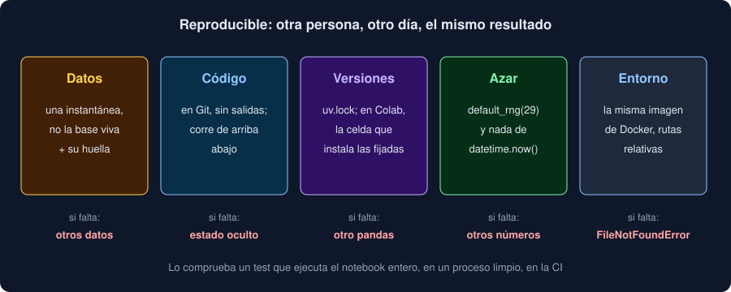

# 03 · Reproducibilidad

⏱️ 45 min

## 🎯 Objetivos

- Definir qué es un análisis reproducible y por qué no basta con "en mi máquina funciona".
- Reconocer los cinco ingredientes: datos, código, versiones, azar y entorno.
- Congelar los datos con una instantánea y su huella SHA-256.
- Fijar las versiones también en Colab, y el azar con semillas.
- Comprobar que un notebook es reproducible, en lugar de suponerlo.

---

## 1. Qué es reproducible

Un análisis es **reproducible** si otra persona, otro día, con tus datos y tu código, obtiene el mismo resultado. No es un lujo académico: es lo que permite que tu compañero revise tu *pull request*, que tú entiendas dentro de seis meses de dónde salió un número, y que un error se pueda encontrar.

La frase "en mi máquina funciona" describe justo lo contrario: un resultado que depende de algo que solo tienes tú. A veces es obvio (un archivo que no subiste); casi siempre es invisible (una celda que ejecutaste dos veces, una versión de pandas distinta, la hora a la que lo ejecutaste).

## 2. Cinco ingredientes



| Ingrediente | Cómo se fija | Si falta |
|---|---|---|
| **Datos** | Una instantánea con su huella, no la base de datos viva | Otros datos, otro resultado |
| **Código** | En Git, sin salidas, y que se ejecuta de arriba abajo | Estado oculto (teoría 02) |
| **Versiones** | `uv.lock`; en Colab, una celda que instala las fijadas | Otro pandas, otro redondeo, otro error |
| **Azar** | Una semilla en cada generador; nada que dependa de la hora | Otros números en cada ejecución |
| **Entorno** | La misma imagen de Docker; rutas relativas | `FileNotFoundError`, otra zona horaria |

Basta con que falte uno. El ejercicio 04 rompe cada uno a propósito.

## 3. Datos: una instantánea con su huella

La base de datos de tu Observatorio cambia: alguien guarda una carga, otro borra otra. Un notebook que la consulta directamente da hoy un resultado y mañana otro, y nadie puede saber cuál era el bueno. Por eso el análisis no lee la base: lee una **instantánea**, un archivo con los datos tal como estaban, escrito por el ETL (teoría 04):

```bash
uv run observatorio extraer notebooks/instantanea.csv --carga 1
```

```
instantanea.csv: 2000 medidas · cargas: 1
sha256: 3193779438eecdede9910a3cbc922f05a883e69a8a92fd4ef9a33e482d636c65
```

La segunda línea es la **huella** (*hash*) SHA-256 del archivo: 64 caracteres que dependen de cada byte. Cambia un solo valor, de 8,0 a 8,1, y sale una huella completamente distinta. La primera celda del notebook la comprueba:

```python
SNAPSHOT = Path("instantanea.csv")
EXPECTED = "3193779438eecdede9910a3cbc922f05a883e69a8a92fd4ef9a33e482d636c65"
assert hashlib.sha256(SNAPSHOT.read_bytes()).hexdigest() == EXPECTED, "no es la instantánea analizada"
```

Si alguien regenera la instantánea con otros datos, el notebook se para en la primera celda con `AssertionError`, en lugar de calcular con buena cara sobre datos distintos. Para analizar datos nuevos, generas otra instantánea, actualizas la huella y vuelves a escribir los hallazgos: un cambio visible en el *pull request*.

Para que la huella sea estable, el archivo tiene que salir **byte a byte igual** con los mismos datos: mismo orden de filas (de ahí el `ORDER BY` del ETL), mismo formato de números y `\n` como fin de línea en cualquier sistema. Una instantánea pequeña (la tuya, unos 45 KB) va en Git, junto al notebook; el gancho `check-added-large-files` para por encima de 500 KB. Una de varios gigas iría a otro almacenamiento, con su huella en el repositorio.

## 4. Código: de arriba abajo, sin salidas

La teoría 02 lo explicó: el notebook se guarda sin salidas, y solo vale si se ejecuta de arriba abajo en un kernel nuevo. Dos costumbres lo aseguran:

- *Restart Kernel and Run All Cells* antes de cada commit;
- un test que ejecuta todas las celdas en orden, en un proceso limpio, en tu máquina y en la CI (teoría 05). Si el notebook depende de algo que solo tienes en memoria, falla ahí y no en la máquina de otra persona.

## 5. Versiones

Tu proyecto ya fija cada versión en `uv.lock`, y `uv run` las usa: en tu máquina, en Docker y en la CI, el notebook ve el mismo pandas. Puedes comprobarlo desde el propio notebook:

```python
import importlib.metadata
importlib.metadata.version("pandas")      # '3.1.0'
```

Colab es otra historia: trae sus propias versiones de pandas, matplotlib y SciPy, distintas de las tuyas, y otro Python. Por eso la primera celda de código instala las fijadas, **solo** cuando el notebook corre en Colab:

```python
import sys

# Solo en Colab: instala las versiones de uv.lock. En tu máquina y en Docker ya las tienes.
if "google.colab" in sys.modules:
    import subprocess

    subprocess.run(
        ["uv", "pip", "install", "--system", "pandas==3.1.0", "matplotlib==3.11.2", "scipy==1.18.1"],
        check=True,
    )
```

Fíjate en tres decisiones:

- `"google.colab" in sys.modules`: el módulo `google.colab` solo está cargado dentro de Colab. En tu máquina, la celda no hace nada.
- `subprocess.run` y no una orden con `!` delante: es Python normal, y el notebook sigue ejecutándose sin Jupyter (teoría 02, sección 7).
- Las versiones, las de tu `pyproject.toml`. Un test del proyecto lo comprueba: si subes pandas y olvidas esta celda, falla.

Comprueba en tu primera sesión que Colab tiene `uv` (`uv --version` en una celda de prueba): si la celda falla con `FileNotFoundError: 'uv'`, instálalo con el instalador oficial de Astral (`curl -LsSf https://astral.sh/uv/install.sh | sh`) desde la terminal de Colab. Tras instalar, si Colab lo pide, reinicia la sesión (*Runtime → Restart session*) y ejecuta todo de nuevo: los módulos que ya estaban cargados no se cambian solos.

Aun así, Colab no es tu entorno: usa otra versión de Python y otro sistema. Sirve para explorar y para usar su GPU; lo que entregas se comprueba siempre en tu repositorio (ver `docs/setup.md`).

## 6. Azar y hora

Cada vez que algo es aleatorio, fija la semilla (semana 28, teoría 01):

```python
rng = np.random.default_rng(29)
sample = frame.sample(200, random_state=29)
```

En el ejercicio 04, el mismo notebook ejecutado dos veces da dos números distintos sin semilla (cambian en cada ejecución), y `18.824` las dos veces con `default_rng(29)`.

La hora es otra fuente de azar escondida. `datetime.now()`, `date.today()` o "los últimos 30 días" dan otro resultado cada día. Si el análisis necesita una fecha, escríbela como constante y di de dónde sale:

```python
TODAY = datetime(2026, 11, 10)     # la fecha de la instantánea
```

## 7. Entorno

**Rutas.** `/home/ana/proyecto/notebooks/medidas.csv` solo existe en la máquina de Ana. JupyterLab ejecuta cada notebook en **su propia carpeta**, así que una ruta relativa (`Path("instantanea.csv")`) funciona igual en tu máquina, en el contenedor y en la máquina de quien revise tu código.

**Sistema.** La zona horaria, el idioma del sistema y las bibliotecas que no son Python cambian de una máquina a otra. La imagen de Docker de tu proyecto los fija: JupyterLab en un contenedor (teoría 05) ejecuta el notebook con el mismo Python y los mismos paquetes que tus tests.

## 8. Comprobarlo

"Reproducible" se comprueba, no se declara. Tres pruebas, de menos a más exigente:

1. *Restart Kernel and Run All Cells* en tu máquina: todo funciona y los números son los mismos.
2. Ejecutarlo sin JupyterLab, en un proceso limpio: lo hace el test del proyecto, en tu máquina, en Docker y en la CI.
3. Otra persona lo ejecuta desde tu repositorio, con `git clone` y `uv sync`. Es lo que hace tu revisor en el *pull request*.

El ejercicio 04 automatiza la primera: ejecuta el mismo notebook dos veces, en dos kernels nuevos, y compara las salidas.

## 9. Lo que no es reproducible (y está bien)

Algunas cosas cambian siempre, y no pasa nada si no forman parte del resultado:

- los **tiempos** de ejecución (semana 22);
- las salidas que no subes a Git;
- la huella de un archivo que incluye la fecha en que se escribió. La instantánea del proyecto no la incluye por eso.

Lo importante es saber qué partes del resultado deberían ser idénticas, y comprobar esas.

## 10. Errores frecuentes

| Error | Consecuencia | Mejor |
|---|---|---|
| El notebook consulta la base de datos | Otro resultado cada día | Una instantánea con su huella |
| Instantánea sin huella | Nadie sabe si los datos cambiaron | `hashlib.sha256` en la primera celda |
| Instalar en Colab sin versión | Otro pandas, otro resultado | `uv` con las versiones de tu `pyproject.toml`, solo en Colab |
| `np.random.default_rng()` sin semilla | Otros números en cada ejecución | `default_rng(29)` |
| `datetime.now()` en el análisis | Otro resultado cada día | La fecha como constante |
| Rutas absolutas | `FileNotFoundError` en cualquier otra máquina | Rutas relativas a la carpeta del notebook |
| Datos personales en Colab | Quedan en Google Drive y en servidores de Google | Solo datos sintéticos o anonimizados |

## ✅ Qué debes saber al terminar

- Los cinco ingredientes de un análisis reproducible y qué pasa si falta cada uno.
- Para qué sirve la huella de la instantánea y por qué el archivo tiene que salir byte a byte igual.
- Cómo se fijan las versiones en tu máquina, en Docker y en Colab.
- Por qué la hora es una fuente de azar.
- Cómo se comprueba que un notebook es reproducible.

---

## 🔗 Navegación

| Anterior | Actual | Siguiente |
| -------- | ------ | --------- |
| [02 · Notebooks y JupyterLab](02-notebooks-y-jupyterlab.md) | **03 · Reproducibilidad** | [04 · ETL desde PostgreSQL](04-etl-desde-postgresql.md) |
