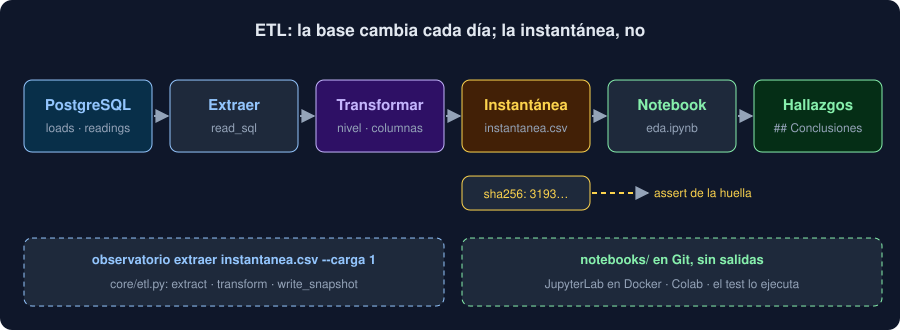

# 04 · ETL desde PostgreSQL

⏱️ 50 min

## 🎯 Objetivos

- Explicar qué es un ETL (extraer, transformar, cargar) y dónde empieza y acaba cada paso.
- Leer de PostgreSQL con `pd.read_sql` y una consulta de SQLAlchemy, con los tipos fijados.
- Dejar que PostgreSQL filtre, ordene y agrupe, en lugar de traer la tabla entera.
- Pasar valores a una consulta como parámetros, nunca pegados en el texto.
- Leer por partes lo que no cabe en memoria, y cargar resultados de vuelta sin duplicarlos.

---

## 1. Extraer, transformar, cargar

Un **ETL** mueve datos de donde se guardan a donde se analizan, en tres pasos:

| Paso | Qué hace | En tu proyecto |
|---|---|---|
| **Extraer** (*extract*) | Leer de la fuente: una base de datos, una API, archivos | `extract`: las medidas de PostgreSQL, en su orden |
| **Transformar** (*transform*) | Limpiar, convertir, calcular, renombrar | `transform`: el nivel de cada medida, las columnas en español |
| **Cargar** (*load*) | Escribir el resultado en su destino | `write_snapshot`: `instantanea.csv`, con su huella |



El destino de un ETL puede ser otra tabla de la misma base, un almacén de datos o, como en tu proyecto, un archivo que lee un notebook. Lo importante es que cada paso es una función que se puede probar por separado: `core/etl.py` tiene tres, con sus tests.

Separar el ETL del análisis tiene una ventaja más: el análisis no necesita la base de datos. Tu notebook se ejecuta en Colab o en la CI sin PostgreSQL, porque lee la instantánea.

## 2. `pd.read_sql`

En la semana 19 leías filas con SQLAlchemy, una a una. pandas lo hace en una línea y devuelve un `DataFrame`:

```python
north = select(readings.c.measured_at, readings.c.value).where(readings.c.station == "Norte")
with engine.connect() as connection:
    frame = pd.read_sql(north, connection)
```

```
Norte: (40000, 2) · 0.6 MB en memoria
{'measured_at': dtype('<M8[us]'), 'value': dtype('float64')}
```

`read_sql` acepta una consulta de SQLAlchemy (`select(...)`), un `text("...")` o un texto SQL, y una **conexión** de SQLAlchemy. Pásale siempre la conexión de un `with`, no el motor: así sabes cuándo se abre y se cierra, y puede ir dentro de una transacción. En tu proyecto, la CLI abre la sesión y le pasa `session.connection()` a `extract`.

Los tipos llegan de PostgreSQL: un `timestamp` es un `datetime64`, un `double precision` es un `float64`, un texto es `str`.

## 3. Fija los tipos

Los tipos que deduce `read_sql` dependen de las **filas que llegan**, no de la tabla. Una columna de números sin ningún valor llega como `object`, llena de `None`:

```python
empty = select(readings.c.station, readings.c.value).where(readings.c.value.is_(None)).limit(3)
pd.read_sql(empty, connection).dtypes["value"]                                     # object
pd.read_sql(empty, connection, dtype={"station": "str", "value": "float64"}).dtypes["value"]   # float64
```

```
valores: [None, None, None] → [nan, nan, nan]
```

Con `object`, una media falla o da algo raro; con `float64`, es `NaN` como cualquier hueco. Una carga de tu Observatorio con todas las medidas "sin dato" llegaría así. Por eso `extract` pasa siempre los tipos:

```python
TYPES = {"load_id": "int64", "position": "int64", "label": "str", "value": "float64"}
return pd.read_sql(query, connection, dtype=TYPES)
```

Sin filas en absoluto, con `dtype` sigue saliendo un `DataFrame` vacío con las cuatro columnas y sus tipos.

## 4. Que trabaje PostgreSQL

La tentación es traerlo todo y hacer el resto con pandas. En el ejercicio 03, la media de cada estación sobre 200 000 medidas:

```
pandas: 200000 filas traídas · 0.16 s
SQL:    5 filas traídas · 0.030 s
¿las mismas medias? True
```

Las mismas medias, pero en un caso viajan 200 000 filas por la red y se convierten en objetos de Python, y en el otro viajan 5. En tu máquina la diferencia es de décimas de segundo; con una base remota y 50 millones de filas, es la diferencia entre segundos y no terminar nunca. La regla:

- **`WHERE`** en la consulta, no `frame[frame[...] == ...]` después: PostgreSQL envía solo esas filas, y puede usar un índice (`extract` filtra la carga así);
- **`GROUP BY`** en la consulta cuando solo necesitas el resumen (`label_stats`, semana 19);
- **solo las columnas que usas** en el `select`;
- trae filas a pandas cuando de verdad necesitas cada fila, como un EDA o una instantánea.

## 5. `ORDER BY`, siempre

Una tabla de SQL no tiene orden. Sin `ORDER BY`, PostgreSQL devuelve las filas como le resulte más rápido, que suele ser el orden en que están guardadas en disco, y ese orden cambia. Un `UPDATE` no modifica la fila en su sitio: escribe una copia nueva, a menudo al final. En los tests de tu proyecto, tras cambiar el valor de la primera medida, una consulta sin `ORDER BY` la devuelve **la última**.

Para una instantánea con huella, el orden es parte de los datos: las mismas filas en otro orden dan otro archivo y otra huella. Por eso `extract` ordena por carga y posición:

```python
query = select(Reading.load_id, Reading.position, Reading.label, Reading.value).order_by(
    Reading.load_id, Reading.position
)
```

## 6. Parámetros, nunca texto pegado

Para filtrar por un valor que viene de fuera (un argumento, un formulario), la tentación es pegarlo en el texto del SQL. El ejercicio 03 lo hace con una estación llamada `Norte' OR '1'='1`:

```python
pasted = text(f"SELECT count(*) FROM readings WHERE station = '{station}'")
bound = text("SELECT count(*) FROM readings WHERE station = :station")
```

```
pegado:    200000 filas
parámetro: 0 filas
```

Pegado, el valor se convierte en SQL: `WHERE station = 'Norte' OR '1'='1'`, que es verdad para todas las filas. Es una **inyección de SQL**, y con otro texto podría borrar tablas. Como parámetro (`:station`), el driver lo envía aparte y PostgreSQL lo trata como un dato: ninguna estación se llama así. Con `read_sql`, los parámetros van en `params`:

```python
pd.read_sql(bound, connection, params={"station": "Sur"})
```

Con las consultas de SQLAlchemy (`select(...).where(Reading.load_id == load_id)`) no tienes que pensarlo: los valores ya viajan como parámetros.

## 7. Por partes

Si la consulta devuelve más filas de las que caben en memoria, `chunksize` las trae en trozos:

```python
with engine.connect().execution_options(stream_results=True) as connection:
    for chunk in pd.read_sql(select(readings.c.value), connection, chunksize=50_000):
        count += int(chunk["value"].count())
        total += float(chunk["value"].sum())
```

```
4 partes · 193907 valores · media 20.0014 · PostgreSQL 20.0014
```

Cada `chunk` es un `DataFrame` de hasta 50 000 filas. `stream_results=True` hace que psycopg use un cursor en el servidor: sin él, el driver trae todas las filas de golpe y `chunksize` solo trocea lo que ya está en memoria.

Por partes solo puedes calcular lo que se puede acumular: sumas y recuentos (y con ellos la media), mínimos y máximos. Una mediana no: necesita ver todos los valores a la vez. Si puedes, pide el resultado a PostgreSQL (sección 4).

## 8. Cargar de vuelta

A veces el destino del ETL es otra tabla: un resumen diario que otros programas consultan. `to_sql` escribe un `DataFrame` como tabla:

```python
daily.to_sql("daily", connection, if_exists="replace", index=False)
```

```
to_sql(if_exists='replace'): daily tiene 8335 filas
to_sql(if_exists='replace'): daily tiene 8335 filas
to_sql(if_exists='append'): daily tiene 16670 filas
```

Un ETL se ejecuta muchas veces: cada día, tras cada fallo. Tiene que ser **idempotente**: ejecutarlo dos veces deja lo mismo que una. `replace` lo es (borra la tabla y la vuelve a crear); `append` no (duplica las filas). Para añadir sin duplicar, borra antes lo que vas a reescribir, en la misma transacción, o usa una restricción `UNIQUE` y `INSERT ... ON CONFLICT` (semana 19).

`to_sql` crea la tabla con los tipos que deduce de pandas, sin claves ni índices. Para una tabla que importa, créala con una migración de Alembic (semana 19) y usa `to_sql` con `if_exists="append"` sobre ella.

La instantánea de tu proyecto es idempotente por construcción: `write_snapshot` reescribe el archivo entero, y con los mismos datos sale byte a byte igual.

## 9. Credenciales

La URL de la base lleva usuario y contraseña. No la escribas en un notebook: acabaría en Git, en Colab y en cada captura de pantalla. Tu proyecto la lee de `OBSERVATORIO_DATABASE_URL` (semanas 18 y 19), solo en la CLI. El notebook no la necesita: lee la instantánea.

## 10. Errores frecuentes

| Error | Consecuencia | Mejor |
|---|---|---|
| `read_sql` sin `dtype` | Una columna vacía llega como `object` | Los tipos fijados |
| Traer la tabla y filtrar en pandas | Millones de filas por la red para quedarte con unas pocas | `WHERE` y `GROUP BY` en la consulta |
| Consultas sin `ORDER BY` | Otro orden, otra huella; a veces, otro resultado | `ORDER BY` por la clave |
| Valores pegados con f-strings | Inyección de SQL | Parámetros: `:nombre` y `params` |
| `chunksize` sin `stream_results` | Todo en memoria igualmente | `execution_options(stream_results=True)` |
| `to_sql(if_exists="append")` en cada ejecución | Filas duplicadas | `replace`, o borrar antes en la misma transacción |
| La URL de la base en el notebook | La contraseña en Git y en Colab | Variables de entorno, y el notebook sin base |

## ✅ Qué debes saber al terminar

- Qué es cada paso de un ETL y dónde está cada uno en `core/etl.py`.
- Cómo leer con `pd.read_sql` y por qué se fijan los tipos.
- Qué trabajo le dejas a PostgreSQL, y por qué `ORDER BY` es parte de los datos.
- Por qué los valores van como parámetros.
- Cuándo leer por partes, y qué hace idempotente una carga.

---

## 🔗 Navegación

| Anterior | Actual | Siguiente |
| -------- | ------ | --------- |
| [03 · Reproducibilidad](03-reproducibilidad.md) | **04 · ETL desde PostgreSQL** | [05 · Notebooks en un proyecto](05-notebooks-en-un-proyecto.md) |
