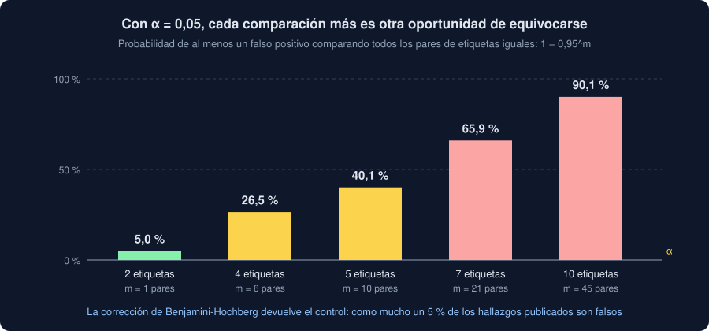

# 03 · Muchas comparaciones

⏱️ 50 min

## 🎯 Objetivos

- Calcular cuántos falsos positivos esperas al hacer muchas pruebas a la vez.
- Distinguir dos promesas: no publicar ningún falso positivo (FWER) o controlar qué parte lo son (FDR).
- Aplicar Bonferroni, Holm y Benjamini-Hochberg, y saber cuándo usar cada una.
- Usar `scipy.stats.false_discovery_control`, la corrección de tu Observatorio.

---

## 1. Veinte pruebas, un "hallazgo"

Con α = 0,05, una prueba sobre dos grupos **iguales** sale "significativa" una vez de cada veinte. Es lo que significa α: el riesgo que aceptas de ver una diferencia que no existe, un **falso positivo**.

Con una prueba, ese riesgo es pequeño. Con muchas, se acumula. Si haces m pruebas independientes sobre grupos iguales, la probabilidad de que **al menos una** salga significativa es:

```
1 − (1 − α)^m
```



| Etiquetas | Pares (m) | Al menos un falso positivo |
|---|---|---|
| 2 | 1 | 5,0 % |
| 4 | 6 | 26,5 % |
| 5 | 10 | 40,1 % |
| 7 | 21 | 65,9 % |
| 10 | 45 | 90,1 % |

Con k etiquetas hay k·(k−1)/2 pares. Tu Observatorio, con cinco zonas, compara diez: sin corregir, cuatro de cada diez análisis de datos **sin ninguna diferencia** encontrarían alguna.

Compruébalo simulando mil análisis, cada uno con diez comparaciones de grupos iguales:

```python
import numpy as np
from scipy import stats

rng = np.random.default_rng(30)
experiments = 1000
with_false_positive = 0
for _ in range(experiments):
    # Diez comparaciones en las que NO hay diferencia: las dos muestras, de la misma campana.
    p_values = [
        stats.ttest_ind(rng.normal(0, 1, 30), rng.normal(0, 1, 30)).pvalue for _ in range(10)
    ]
    with_false_positive += min(p_values) < 0.05
print(f"con algún 'hallazgo': {with_false_positive / experiments:.1%}")
print(f"la fórmula: {1 - 0.95**10:.1%}")
```

```
con algún 'hallazgo': 38.9%
la fórmula: 40.1%
```

La simulación se acerca a la fórmula; con más experimentos, se acercaría más. El ejercicio 02 lo repite con tus propias manos.

## 2. Dos promesas distintas

Una **corrección por comparaciones múltiples** ajusta los p-valores para que α vuelva a significar algo con todas las pruebas juntas. Hay dos promesas posibles:

| Promesa | Siglas | Qué controla | Cuándo |
|---|---|---|---|
| "Probablemente **ningún** hallazgo es falso" | FWER (*family-wise error rate*) | La probabilidad de al menos un falso positivo | Pocas pruebas, y un solo error es caro: un medicamento, una alarma que para una planta |
| "Como mucho un 5 % de mis hallazgos son falsos" | FDR (*false discovery rate*) | La proporción de falsos entre los que publicas | Muchas pruebas para encontrar qué mirar después: un informe exploratorio, genes, etiquetas |

FWER es más estricta: para no fallar nunca, deja escapar diferencias reales. FDR acepta algún falso positivo a cambio de encontrar más diferencias reales. Tu Observatorio usa **FDR**: el informe dice qué pares merece la pena investigar, no qué decisión tomar sin mirar más.

## 3. Tres correcciones

Diez p-valores, de menor a mayor. Sin corregir, cinco están por debajo de 0,05:

```python
import numpy as np
from scipy import stats

p = np.array([0.001, 0.008, 0.039, 0.041, 0.042, 0.06, 0.074, 0.205, 0.212, 0.216])
print("bonferroni:", np.minimum(p * len(p), 1).round(3))
print("bh:        ", stats.false_discovery_control(p, method="bh").round(3))
```

```
bonferroni: [0.01 0.08 0.39 0.41 0.42 0.6  0.74 1.   1.   1.  ]
bh:         [0.01  0.04  0.084 0.084 0.084 0.1   0.106 0.216 0.216 0.216]
```

| Corrección | Promesa | Cómo | Pares bajo 0,05 |
|---|---|---|---|
| Ninguna | — | — | 5 |
| **Bonferroni** | FWER | Multiplica cada p por m | 1 |
| **Holm** | FWER | Ordena; multiplica el primero por m, el segundo por m−1... y no deja bajar | 1 |
| **Benjamini-Hochberg** (BH) | FDR | Ordena; multiplica el de puesto k por m/k, y no deja subir desde abajo | 2 |

- **Bonferroni** es la más sencilla y la más estricta. Con diez pruebas, cada una tiene que bajar de 0,005.
- **Holm** promete lo mismo que Bonferroni, pero nunca es peor y a veces es mejor. Si necesitas FWER, usa Holm.
- **BH**, a mano: el p de puesto k se multiplica por m/k (el segundo, 0,008 · 10/2 = 0,04), y después, de abajo arriba, cada uno se queda con el menor de los que tiene debajo (por eso 0,039 · 10/3 = 0,13 queda en 0,084). Un p corregido nunca es menor que el original.

`scipy.stats.false_discovery_control(p, method="bh")` devuelve los p corregidos en el mismo orden en que los diste: no hace falta ordenar. `method="by"` es la variante de Benjamini-Yekutieli, más estricta, para pruebas que dependen mucho unas de otras.

## 4. Qué se corrige

Se corrigen **todas las pruebas que hiciste para responder una pregunta**, no solo las que publicas. Si comparas diez pares y publicas los tres más bajos, la corrección es sobre diez.

En tu Observatorio, `compare_all` compara todos los pares de etiquetas comparables y corrige el p de Welch de los diez juntos. El de Mann-Whitney no se corrige: no es otra pregunta, es una comprobación de robustez del mismo par (teoría 02, sección 5).

Si en tu notebook hiciste otras pruebas para tener ideas, esas no entran: eran exploración, y no se publican como hallazgos (teoría 01).

## 5. Corregir no lo arregla todo

- Corregir reduce falsos positivos **a costa de potencia**: con muchas etiquetas y pocas medidas, una diferencia real puede no sobrevivir. Si te pasa, dilo en **Limitaciones**: "con 40 medidas por zona, solo se distinguen diferencias de más de 8 unidades".
- No corrige el jardín de los senderos que se bifurcan (teoría 01): si repites el análisis con otras decisiones hasta que algo sale, la corrección no sabe cuántas veces lo intentaste.
- Un p corregido sigue sin decir cuánto: el intervalo y la d siguen siendo el hallazgo.

## ⚠️ Errores comunes

| Error | Consecuencia | Mejor |
|---|---|---|
| Diez pruebas con α = 0,05 cada una | Un 40 % de probabilidad de un "hallazgo" falso | Corregir |
| Corregir solo los pares que publicas | La corrección es más suave de lo que debe | Todos los que comparaste |
| Bonferroni para un informe exploratorio | Se pierden diferencias reales | BH (FDR) |
| BH cuando un solo error es grave | Algún falso positivo publicado | Holm (FWER) |
| Ordenar los p antes de `false_discovery_control` y olvidar el orden | Cada p corregido, en el par equivocado | Pasarlos en el orden de los pares |

## ✅ Qué debes saber al terminar

- La fórmula 1 − (1 − α)^m y cuántos pares hay con k etiquetas.
- La diferencia entre FWER y FDR, y cuándo usar cada una.
- Cómo corrigen Bonferroni, Holm y BH, y calcular BH a mano para dos o tres p-valores.
- Qué hace `false_discovery_control` y por qué no hace falta ordenar.
- Qué pruebas se corrigen juntas, y qué no arregla ninguna corrección.

---

## 🔗 Navegación

| Anterior | Actual | Siguiente |
| -------- | ------ | --------- |
| [02 · Hallazgos defendibles](02-hallazgos-defendibles.md) | **03 · Muchas comparaciones** | [04 · El informe, desde el código](04-el-informe-desde-el-codigo.md) |
