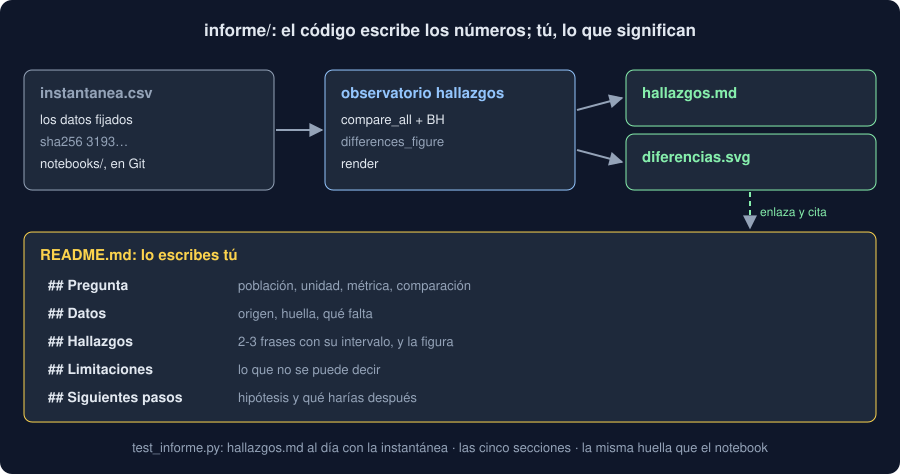

# 04 · El informe, desde el código

⏱️ 50 min

## 🎯 Objetivos

- Estructurar un informe de datos: pregunta, datos, hallazgos, limitaciones y siguientes pasos.
- Dibujar un gráfico por afirmación, con un título que dice la conclusión.
- Generar un informe en Markdown desde Python, sin plantillas ni dependencias.
- Hacer que el informe salga igual byte a byte, y que un test avise si se queda viejo.

---

## 1. Dos partes: los números y la lectura

El informe de tu Observatorio tiene dos archivos, en `informe/`:

| Archivo | Quién lo escribe | Qué tiene |
|---|---|---|
| `hallazgos.md` y `diferencias.svg` | `observatorio hallazgos` | Todos los números, con su método y sus datos |
| `README.md` | Tú | La pregunta, lo que significan los números en tu dominio, lo que no se puede decir |

Los números los escribe el código porque así no hay errores al copiarlos, y porque cuando cambian los datos basta con volver a ejecutar el comando. La lectura la escribes tú porque nadie más sabe qué significa en tu dominio que dos etiquetas difieran 4 unidades.



`README.md` es lo que GitHub muestra al abrir la carpeta `informe/`: es la portada.

## 2. Las secciones del README

| Sección | Qué responde | Ejemplo |
|---|---|---|
| **Pregunta** | Qué querías saber, con sus cuatro piezas (teoría 01) | "En la carga 3, ¿difiere la media entre zonas?" |
| **Datos** | De dónde salen, cuántos son, su huella, qué falta | "2000 medidas, huella 3193…, faltan un 5 %" |
| **Hallazgos** | Dos o tres frases defendibles (teoría 02), con la figura | "El Sur mide 4,2 más que el Norte [2,1; 6,3]" |
| **Limitaciones** | Lo que los datos no permiten decir | "Una sola carga; sin datos de la hora" |
| **Siguientes pasos** | Qué harías después, y qué hipótesis quedan | "Repetir con tres meses; ¿son sensores distintos?" |

Lo primero que lee alguien con prisa son los hallazgos: empieza cada uno con la conclusión en negrita, y después el número que la sostiene. Las limitaciones no son una disculpa: son lo que evita que otro use tu informe para algo que no responde.

## 3. Un gráfico por afirmación

Un gráfico de un informe no es para explorar: es la prueba de una frase. Por eso:

- **El título es la conclusión**, no la descripción. "Difieren 0 de 10 pares de etiquetas", no "Diferencias entre etiquetas".
- **Una cosa que mirar**. Para comparar pares, un punto por par con su intervalo, y una línea en el cero: el lector solo tiene que ver qué intervalos la cruzan.
- **Las unidades en el eje**: `diferencia de medias (µg/m³)`.

`differences_figure` dibuja eso con `errorbar`:

```python
axes.errorbar(centers, rows, xerr=[below, above], fmt="o", capsize=4)
axes.axvline(0, color="grey", linestyle="--")
axes.set_yticks(rows, [f"{finding.first} - {finding.second}" for finding in findings])
axes.invert_yaxis()
```

- `xerr=[below, above]`: cuánto se extiende la barra a la izquierda y a la derecha de cada punto, es decir, `difference - low` y `high - difference`. El intervalo de Welch es simétrico y las dos listas salen iguales; con un intervalo de *bootstrap* no lo serían, y el orden importa.
- `invert_yaxis()`: las filas se dibujan de abajo arriba; invertido, el primer par queda arriba, como en la tabla.

Este tipo de gráfico se llama *forest plot*, y es el que verás en cualquier comparación de muchos grupos.

## 4. Markdown con Python, sin plantillas

Un informe en Markdown es texto. Para escribirlo no hace falta un motor de plantillas como Jinja2: una lista de líneas y `"\n".join`:

```python
lines = [
    "# Hallazgos: diferencias entre etiquetas",
    "",
    f"{headline(findings, alpha)}.",
    "",
    "| Par | Medidas | Diferencia | ... |",
    "|---|---|---|---|",
]
for finding in findings:
    lines.append(f"| {cell(finding.first)} - {cell(finding.second)} | ... |")
return "\n".join(lines) + "\n"
```

Tres detalles que importan:

| Detalle | Por qué |
|---|---|
| `cell()` cambia `\|` por `\\|` | Una etiqueta con una barra partiría la fila en dos columnas: los datos son una frontera de confianza |
| Los números con formato fijo (`:.2f`, `:.3g`) | `repr` de un float puede dar `0.30000000000000004` |
| Termina en `"\n"` | Un archivo de texto acaba en salto de línea; si no, Git avisa en cada diff |

`headline` se usa dos veces, en el título de la figura y en el resumen: escrita una vez, no pueden contradecirse.

## 5. Los mismos datos, los mismos bytes

Un informe es reproducible (semana 29, teoría 03) si los mismos datos dan **el mismo archivo**. Lo que lo impide:

| Fuente de diferencias | En el Observatorio |
|---|---|
| La fecha de generación | `render` no la escribe; Git ya sabe cuándo cambió |
| Rutas absolutas | Solo el nombre: `instantanea.csv`, no `/home/ana/...` |
| La fecha y los identificadores al azar del SVG | `charts.save` (semana 27): `metadata={"Date": None}` y `svg.hashsalt` |
| El orden de un `set` o de un `groupby` | Los pares, en orden alfabético con `combinations` sobre una lista ordenada |

Con eso, `git diff informe/` después de volver a ejecutar `hallazgos` solo muestra algo si cambió algo de verdad.

## 6. Un test que avisa si el informe se queda viejo

Como el informe sale de un comando, un test puede generarlo de nuevo y compararlo con el del repositorio:

```python
def test_report_is_up_to_date() -> None:
    frame, digest = read_snapshot(SNAPSHOT)
    expected = render(frame, compare_all(frame), name=SNAPSHOT.name, digest=digest)
    assert (FOLDER / REPORT).read_text(encoding="utf-8") == expected
```

Si cambias la instantánea o el código de `findings.py` y olvidas volver a ejecutar `hallazgos`, la CI falla. Es la misma idea que `uv lock --check` (semana 21): un archivo generado que se versiona tiene que estar al día.

Otros tests de `test_informe.py` comprueban tu `README.md`: que tiene las cinco secciones en orden, que enlaza el informe, la figura y el notebook, que cita la misma huella que `EXPECTED` en tu notebook, y que no quedan huecos de la plantilla como `<tu pregunta>`. No pueden comprobar que tus conclusiones son buenas: eso lo hace quien revisa tu *pull request*.

## ⚠️ Errores comunes

| Error | Consecuencia | Mejor |
|---|---|---|
| Copiar los números a mano al README | Un número que ya no sale de los datos | Citar `hallazgos.md`, regenerado |
| Título descriptivo en la figura | El lector tiene que adivinar la conclusión | El título es la conclusión |
| La fecha de hoy en el informe | Un diff cada vez que lo generas | Git guarda la fecha |
| Una etiqueta con `\|` sin escapar | Una tabla rota | `cell()` |
| Jinja2 para un archivo de 30 líneas | Una dependencia más que revisar | Una lista y `join` |
| Ejecutar `hallazgos` con otras opciones que el test | El test falla aunque el informe esté bien | Opciones por defecto, o cambiar también el test |

## ✅ Qué debes saber al terminar

- Qué parte del informe escribe el código y qué parte escribes tú, y por qué.
- Las cinco secciones del README y qué responde cada una.
- Cómo es un gráfico que prueba una afirmación, y cómo se dibuja un *forest plot* con `errorbar`.
- Cómo escribir Markdown desde Python sin plantillas, y qué tres detalles cuidar.
- Qué impide que un informe salga igual byte a byte, y cómo lo evita el Observatorio.
- Qué comprueba `test_report_is_up_to_date`.

---

## 🔗 Navegación

| Anterior | Actual | Siguiente |
| -------- | ------ | --------- |
| [03 · Muchas comparaciones](03-muchas-comparaciones.md) | **04 · El informe, desde el código** | [05 · Cerrar la fase 4](05-cerrar-la-fase-4.md) |
