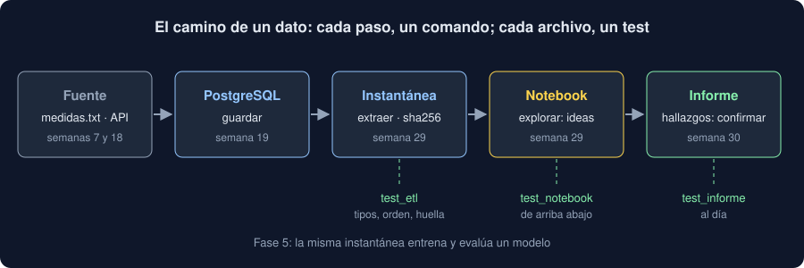

# 05 · Cerrar la fase 4

⏱️ 45 min

## 🎯 Objetivos

- Recorrer el camino completo de un dato en tu Observatorio, de la fuente al informe.
- Repasar qué aportó cada semana de la fase 4 y dónde vive en tu proyecto.
- Comprobar con mutantes que tus tests protegen el informe.
- Saber qué de esta fase usarás en la fase 5.

---

## 1. Del dato al informe

Al terminar esta semana, un dato de tu dominio recorre tu Observatorio entero sin que copies nada a mano:



```bash
uv run observatorio guardar medidas.txt                      # semana 19: a PostgreSQL
uv run observatorio extraer notebooks/instantanea.csv -c 3   # semana 29: instantánea con huella
uv run --group notebook jupyter lab notebooks/               # semana 29: explorar, tener ideas
uv run observatorio hallazgos notebooks/instantanea.csv informe   # semana 30: confirmar
```

Cada paso deja un archivo que va a Git, y cada archivo tiene un test que lo comprueba: la instantánea, por su huella; el notebook, ejecutándolo; el informe, regenerándolo. Si alguien cambia algo en medio, la CI lo dice.

## 2. La fase 4, semana a semana

| Semana | Qué aprendiste | Dónde vive en tu Observatorio |
|---|---|---|
| 23 | NumPy: arrays, *broadcasting*, estadística | `core/arrays.py`, `estadisticas` |
| 24 | pandas: Series, DataFrame, selección | `core/frames.py`, `filtrar` |
| 25 | `groupby`, `merge`, series de tiempo | `core/summaries.py`, `resumir`, `evolucion` |
| 26 | Polars, Parquet, DuckDB | `core/columnar.py`, `exportar`, `sql` |
| 27 | matplotlib, seaborn, plotly | `core/charts.py`, `graficar` |
| 28 | Estadística inferencial: intervalos, pruebas, tamaño del efecto | `core/inference.py`, `comparar` |
| 29 | EDA, notebooks reproducibles, ETL | `core/etl.py`, `extraer`, `notebooks/` |
| 30 | Preguntas, hallazgos defendibles, comparaciones múltiples, informe | `core/findings.py`, `hallazgos`, `informe/` |

Tres ideas atraviesan la fase entera:

- **Vectorizar** (semanas 22-26): la operación sobre la columna, no un bucle sobre filas.
- **No cargar lo que no usas**: pandas, SciPy y matplotlib se importan dentro de cada comando; `test_importing_the_cli_does_not_load_*` lo vigila.
- **Reproducibilidad**: tipos fijados, instantáneas con huella, figuras sin fecha, informes regenerables.

## 3. ¿Tus tests protegen el informe?

En la semana 15 aprendiste la prueba de mutación: cambiar el código a propósito para ver si algún test lo nota. Con un informe es aún más importante, porque un error no rompe nada visible: el informe sigue pareciendo serio con números falsos.

Ejemplos de mutantes de `findings.py` que el paso 9 del proyecto te pide probar:

| Mutante | Lo que pasaría sin un test que lo detecte |
|---|---|
| `method="bh"` por `method="by"` | Una corrección más estricta de la que dice el informe |
| `p_adjusted < alpha` por `p_adjusted <= alpha` | Un par con p = 0,05 "difiere" |
| Quitar `.dropna()` | Un hueco en los datos hace que todas las medias salgan `nan` |
| `xerr=[above, below]` | Los intervalos, al revés |
| Quitar el escape de `\|` | Una etiqueta rompe la tabla |

Los tests del bootcamp matan todos los de la tabla del paso 9. Un mutante que sobrevive no significa que el código esté mal: significa que nadie se enteraría si lo estuviera.

## 4. Lo que llevas a la fase 5

La fase 5 (semanas 31-42) es aprendizaje automático e IA. Tu Observatorio pasa de describir a **predecir**. Lo que hiciste en esta fase es la base:

| De la fase 4 | En la fase 5 |
|---|---|
| La instantánea con huella | Los datos con los que entrenas un modelo, fijados |
| Explorar y confirmar con datos distintos (teoría 01) | Separar entrenamiento y prueba: un modelo evaluado con sus propios datos de entrenamiento siempre parece bueno |
| El jardín de los senderos (teoría 01) | Ajustar hiperparámetros mirando la prueba: el mismo error, con otro nombre |
| Intervalos y tamaño del efecto | Métricas con su incertidumbre: validación cruzada |
| Comparaciones múltiples | Comparar veinte modelos y quedarte con el mejor también es buscar un "hallazgo" |
| Informe generado y test que lo vigila | Un modelo entrenado, versionado y evaluado por la CI |

La semana 31 empieza con scikit-learn sobre la instantánea de tu dominio.

## ⚠️ Errores comunes

| Error | Consecuencia | Mejor |
|---|---|---|
| Un paso del camino hecho a mano | Nadie puede repetirlo | Un comando por paso |
| Un archivo generado sin test | Se queda viejo sin que nadie lo note | Regenerarlo en un test |
| Dar por buenos los tests porque pasan | Un error en el informe que nadie ve | Mutantes |
| Empezar la fase 5 sin cerrar el informe | Un modelo de datos que no entiendes | El README de `informe/` completo |

## ✅ Qué debes saber al terminar

- El camino de un dato de tu dominio, con el comando y el archivo de cada paso.
- Qué aportó cada semana de la fase 4 y en qué módulo vive.
- Por qué la prueba de mutación es más importante en un informe que en otro código.
- Qué ideas de esta fase reaparecen en la fase 5, y con qué nombre.

---

## 🔗 Navegación

| Anterior | Actual | Siguiente |
| -------- | ------ | --------- |
| [04 · El informe, desde el código](04-el-informe-desde-el-codigo.md) | **05 · Cerrar la fase 4** | [Ejercicio 01 · De la pregunta a la métrica](../2-practicas/ejercicio-01-de-la-pregunta-a-la-metrica/README.md) |
