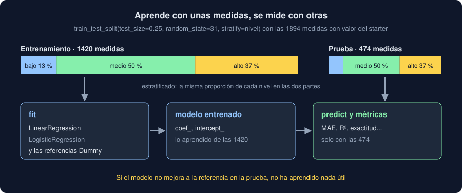

# 02 · Entrenar y probar

⏱️ 50 min

## 🎯 Objetivos

- Explicar por qué un modelo no se evalúa con los datos con los que aprendió.
- Reconocer el sobreajuste y el infraajuste comparando el error en entrenamiento y en prueba.
- Separar los datos con `train_test_split`, con `random_state` y `stratify`.
- Comparar cada modelo con una referencia que no sabe nada: `DummyRegressor` y `DummyClassifier`.

---

## 1. El examen con las respuestas

Si estudias con las preguntas del examen y luego te examinan con esas mismas preguntas, sacarás buena nota aunque no hayas entendido nada: te las sabes de memoria. Con un modelo pasa lo mismo. Lo que importa es cómo predice medidas **nuevas**, y la única forma de saberlo antes de que lleguen es fingir que algunas ya lo son.

Por eso se apartan los datos en dos partes:

- **Entrenamiento**: las que ve `fit`.
- **Prueba**: las que el modelo no ve nunca hasta el final, y con las que se mide.



El error en prueba es una estimación de cómo se comportará el modelo con datos nuevos. El error en entrenamiento solo dice cuánto se ha aprendido los ejemplos.

## 2. Sobreajuste e infraajuste

Cuarenta puntos alrededor de una recta, `y = 2x + 5` más ruido, ajustados con polinomios de distinto grado:

```python
import numpy as np
from sklearn.metrics import root_mean_squared_error
from sklearn.model_selection import train_test_split

rng = np.random.default_rng(31)
x = rng.uniform(0, 10, 40)
y = 2 * x + 5 + rng.normal(0, 3, 40)
x_train, x_test, y_train, y_test = train_test_split(x, y, test_size=0.25, random_state=31)

for degree in [0, 1, 3, 12]:
    coefficients = np.polyfit(x_train, y_train, degree)
    train = root_mean_squared_error(y_train, np.polyval(coefficients, x_train))
    test = root_mean_squared_error(y_test, np.polyval(coefficients, x_test))
    print(f"grado {degree:>2}: entrenamiento {train:5.2f} · prueba {test:6.2f}")
```

```
grado  0: entrenamiento  6.73 · prueba   8.15
grado  1: entrenamiento  2.41 · prueba   3.37
grado  3: entrenamiento  2.36 · prueba   3.54
grado 12: entrenamiento  1.71 · prueba  10.77
```

| Grado | Qué pasa | Nombre |
|---|---|---|
| 0 (una constante) | Se equivoca mucho en las dos partes: no puede seguir la subida | **Infraajuste** |
| 1 (una recta) | Error parecido en las dos, cerca del ruido (3) | Bien |
| 3 | Casi igual que la recta: la curva extra no aporta | Bien, más complejo sin motivo |
| 12 | El menor error en entrenamiento y el mayor en prueba: ha memorizado el ruido | **Sobreajuste** |

La señal de sobreajuste es la **distancia** entre los dos errores. Mirando solo el de entrenamiento, el grado 12 parecería el mejor modelo, y es el peor. Un error de 3 es lo mejor que se puede conseguir aquí: es el ruido que pusimos, y ningún modelo predice el azar.

## 3. `train_test_split`

```python
from sklearn.model_selection import train_test_split

train, test = train_test_split(frame, test_size=0.25, random_state=31, stratify=frame["nivel"])
```

| Argumento | Para qué |
|---|---|
| `test_size=0.25` | Una de cada cuatro filas, a prueba. Entre 0,2 y 0,3 es lo habitual |
| `random_state=31` | El reparto es al azar, pero con semilla: el mismo en cada ejecución y en cada máquina |
| `stratify=frame["nivel"]` | La misma proporción de cada nivel en las dos partes |

Acepta varias tablas a la vez y las reparte igual: `train_test_split(X, y, ...)` devuelve cuatro cosas, `X_train, X_test, y_train, y_test`, en ese orden. Con una sola tabla, dos. Mezcla las filas antes de repartir (`shuffle=True` por defecto).

Sin `random_state`, cada ejecución usa otro reparto y da otros números: un test que compruebe una métrica fallaría a veces, y no sabrías si un cambio mejoró el modelo o tuviste suerte.

**Estratificar** importa con clases poco frecuentes. Con 246 medidas de nivel bajo entre 1894, un reparto al azar puede dejar en prueba un 10 % de bajas o un 16 %; estratificado, las dos partes tienen el 13 %. Con muy pocas medidas de una clase, sin estratificar puede quedar alguna parte sin ninguna.

Ojo con los datos que tienen orden: si tus medidas son una serie temporal y quieres predecir el futuro, mezclar pone medidas de mañana en entrenamiento y de ayer en prueba. Ahí se reparte por fecha. Lo verás en la semana 32.

## 4. La referencia: un modelo que no sabe nada

Un error de 20 unidades, ¿es mucho o poco? Depende de lo que costaría acertar sin modelo. La **referencia** (*baseline*) es el modelo más tonto posible, que ignora las entradas:

| Problema | Referencia | En scikit-learn |
|---|---|---|
| Regresión | Predecir siempre la media del entrenamiento | `DummyRegressor(strategy="mean")` |
| Clasificación | Predecir siempre la clase más frecuente | `DummyClassifier(strategy="most_frequent")` |

Se usan como cualquier estimador: `fit` en entrenamiento, `predict` en prueba, y la misma métrica. **Un modelo que no mejora su referencia en prueba no ha aprendido nada útil**, por bonita que sea su métrica. Es la regla del comando `modelo` de tu Observatorio: cada métrica, al lado de la de su referencia.

La referencia también protege de métricas engañosas. Si el 90 % de tus medidas son de nivel medio, la referencia acierta el 90 %: un modelo con un 88 % de aciertos es **peor** que no hacer nada, aunque 88 % suene bien (teoría 04).

## 5. La prueba se usa una vez

Si pruebas diez modelos con la misma parte de prueba y te quedas con el mejor, la prueba deja de ser "datos nuevos": la has usado para elegir, y el error del ganador es optimista. Es el jardín de los senderos de la semana 30, con modelos.

Esta semana comparas un modelo con su referencia, y una prueba basta. Cuando la semana 32 compare muchos modelos y opciones, usará **validación cruzada** dentro del entrenamiento para elegir, y la prueba solo al final.

## ⚠️ Errores comunes

| Error | Consecuencia | Mejor |
|---|---|---|
| Medir con los datos de entrenamiento | El modelo que más memoriza parece el mejor | Medir en prueba |
| Sin `random_state` | Otros números en cada ejecución | Fijar la semilla |
| Sin `stratify` con clases raras | Una clase casi ausente en prueba | `stratify=y` |
| Mezclar una serie temporal | Predecir el pasado con el futuro | Repartir por fecha (semana 32) |
| Sin referencia | Un 88 % que es peor que no hacer nada | `DummyRegressor`, `DummyClassifier` |
| Elegir entre muchos modelos con la prueba | Un error optimista | Validación cruzada (semana 32) |

## ✅ Qué debes saber al terminar

- Por qué se aparta una parte de prueba, y qué estima su error.
- Cómo se ven el infraajuste y el sobreajuste en los dos errores.
- Qué hacen `test_size`, `random_state` y `stratify`, y en qué orden devuelve `train_test_split`.
- Qué es una referencia, cuál usar en regresión y en clasificación, y por qué todo modelo se compara con ella.

---

## 🔗 Navegación

| Anterior | Actual | Siguiente |
| -------- | ------ | --------- |
| [01 · Aprender de los datos](01-aprender-de-los-datos.md) | **02 · Entrenar y probar** | [03 · Regresión y sus métricas](03-regresion-y-sus-metricas.md) |
