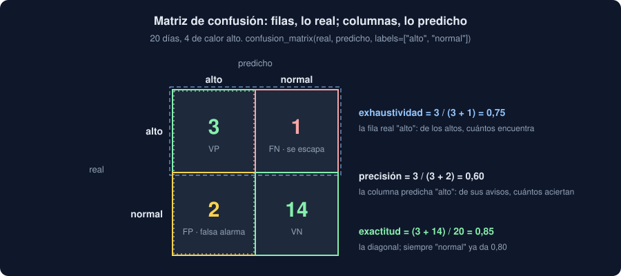

# 04 · Clasificación y sus métricas

⏱️ 50 min

## 🎯 Objetivos

- Ajustar una regresión logística y leer sus probabilidades con `predict_proba`.
- Cambiar el umbral de decisión y prever qué pasa con los aciertos de cada clase.
- Leer una matriz de confusión y calcular con ella exactitud, precisión, exhaustividad y F1.
- Elegir entre exactitud y exactitud equilibrada cuando una clase es mucho más frecuente.

---

## 1. Regresión logística: una probabilidad por clase

A pesar del nombre, la regresión logística **clasifica**. Ajusta una recta, como la lineal, pero la pasa por una curva en forma de S que la deja entre 0 y 1: la probabilidad de cada clase.

```python
import numpy as np
from sklearn.linear_model import LogisticRegression

hours = np.array([[1.0], [2.0], [3.0], [4.0], [5.0], [6.0], [7.0], [8.0]])
hot = np.array(["no", "no", "no", "sí", "no", "sí", "sí", "sí"])
model = LogisticRegression().fit(hours, hot)
new = np.array([[3.0], [4.0], [6.0]])
print(model.classes_)
print(model.predict_proba(new).round(2))
print(model.predict(new))
```

```
['no' 'sí']
[[0.79 0.21]
 [0.61 0.39]
 [0.21 0.79]]
['no' 'no' 'sí']
```

- `classes_` dice el orden de las columnas de `predict_proba`: alfabético. Cada fila suma 1.
- `predict` elige la clase más probable. Con dos clases, es lo mismo que decir "sí" cuando su probabilidad llega a 0,5.
- Con tres o más clases (bajo, medio, alto) funciona igual: una columna por clase.

## 2. El umbral es una decisión tuya

0,5 no es sagrado. Si avisar de un día caluroso que no lo es cuesta poco, y no avisar de uno que sí lo es cuesta mucho, conviene avisar antes:

```python
print(np.where(model.predict_proba(new)[:, 1] >= 0.3, "sí", "no"))
```

```
['no' 'sí' 'sí']
```

Con el umbral en 0,3, las 4 horas pasan a "sí". Bajar el umbral encuentra más casos de verdad de la clase (menos se escapan) a cambio de más falsas alarmas; subirlo, al revés. Qué umbral es el bueno no lo dicen los datos: lo dice el coste de cada error en tu dominio.

## 3. La matriz de confusión

Veinte días, cuatro de calor "alto" y dieciséis "normal". Un modelo acierta tres de los altos y se equivoca en dos normales:

```python
from sklearn.metrics import confusion_matrix

real = np.array(["alto"] * 4 + ["normal"] * 16)
predicted = np.array(["alto", "alto", "alto", "normal"] + ["alto", "alto"] + ["normal"] * 14)
print(confusion_matrix(real, predicted, labels=["alto", "normal"]))
```

```
[[ 3  1]
 [ 2 14]]
```



Las **filas son lo real** y las **columnas lo predicho**, en el orden de `labels`. La diagonal son los aciertos. Si miras "alto" como la clase que importa (la **positiva**):

| Casilla | Nombre | Aquí |
|---|---|---|
| Real alto, predicho alto | Verdadero positivo (VP) | 3 |
| Real alto, predicho normal | Falso negativo (FN): se escapa | 1 |
| Real normal, predicho alto | Falso positivo (FP): falsa alarma | 2 |
| Real normal, predicho normal | Verdadero negativo (VN) | 14 |

## 4. Una métrica por pregunta

| Métrica | Pregunta | Cálculo | Aquí |
|---|---|---|---|
| **Exactitud** (*accuracy*) | ¿Qué parte acierta? | (VP + VN) / total | 17 / 20 = 0,85 |
| **Precisión** (*precision*) | De los que dice "alto", ¿cuántos lo son? | VP / (VP + FP) | 3 / 5 = 0,60 |
| **Exhaustividad** (*recall*) | De los altos de verdad, ¿cuántos encuentra? | VP / (VP + FN) | 3 / 4 = 0,75 |
| **F1** | Las dos a la vez | 2 · P · R / (P + R) | 0,67 |

`precision_score(real, predicted, pos_label="alto")` y sus hermanas las calculan. `classification_report` da todas, por clase:

```
              precision    recall  f1-score   support

        alto       0.60      0.75      0.67         4
      normal       0.93      0.88      0.90        16

    accuracy                           0.85        20
   macro avg       0.77      0.81      0.78        20
weighted avg       0.87      0.85      0.86        20
```

- `support`: cuántos casos reales hay de cada clase.
- `macro avg`: la media de las clases, todas con el mismo peso. Es la que usa tu Observatorio (`F1 macro`).
- `weighted avg`: la media ponderada por `support`; la clase frecuente pesa más.

La precisión y la exhaustividad tiran en sentidos opuestos: bajar el umbral sube la exhaustividad y baja la precisión. F1 es alta solo si las dos lo son.

## 5. La trampa de la exactitud

Un modelo que diga siempre "normal" acierta 16 de 20: exactitud 0,80, sin haber aprendido nada. Es la referencia `most_frequent` de la teoría 02. Con clases **desequilibradas**, la exactitud premia ignorar la clase rara, que suele ser la que importa.

La **exactitud equilibrada** (*balanced accuracy*) es la media de la exhaustividad de cada clase: cada clase pesa lo mismo, tenga los casos que tenga.

| Modelo | Exactitud | Exactitud equilibrada |
|---|---|---|
| El de arriba | 0,85 | (0,75 + 0,875) / 2 = 0,81 |
| Siempre "normal" | 0,80 | (0 + 1) / 2 = 0,50 |

Con k clases, la referencia siempre da 1/k de exactitud equilibrada: 0,5 con dos, 0,33 con tres. Es la métrica que decide en el comando `modelo`: en los datos de ejemplo del starter, la mitad de las medidas son de nivel medio, y la exactitud de la referencia ya es 0,50.

## ⚠️ Errores comunes

| Error | Consecuencia | Mejor |
|---|---|---|
| Leer las columnas de `predict_proba` sin mirar `classes_` | La probabilidad de la clase equivocada | `model.classes_` |
| Dar por bueno el umbral 0,5 | Errores caros que se podían evitar | Elegirlo por el coste de cada error |
| Confundir filas y columnas de la matriz | Precisión y exhaustividad intercambiadas | Filas, lo real; columnas, lo predicho |
| Solo exactitud con clases desequilibradas | Un modelo inútil con buena nota | Exactitud equilibrada, F1 macro |
| Precisión sin exhaustividad | "Nunca se equivoca" porque casi nunca dice "sí" | Las dos, o F1 |
| `UndefinedMetricWarning` y un 0 en precisión | Una clase que el modelo nunca predice | `zero_division=0`, y mirar por qué |

## ✅ Qué debes saber al terminar

- Qué devuelve `predict_proba`, en qué orden, y cómo `predict` usa el umbral 0,5.
- Qué cambia al subir o bajar el umbral.
- Cómo se lee una matriz de confusión y cómo salen de ella exactitud, precisión, exhaustividad y F1.
- Qué es una media macro, y por qué con clases desequilibradas se mira la exactitud equilibrada.

---

## 🔗 Navegación

| Anterior | Actual | Siguiente |
| -------- | ------ | --------- |
| [03 · Regresión y sus métricas](03-regresion-y-sus-metricas.md) | **04 · Clasificación y sus métricas** | [05 · Fugas de datos y tu primer modelo](05-fugas-de-datos-y-tu-primer-modelo.md) |
