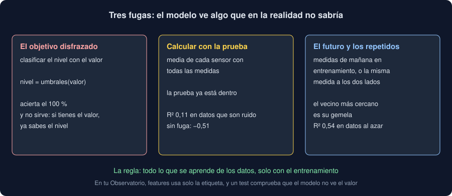

# 05 · Fugas de datos y tu primer modelo

⏱️ 45 min

## 🎯 Objetivos

- Reconocer una fuga de datos: información de la respuesta que se cuela en las entradas.
- Distinguir las tres fugas más comunes: el objetivo disfrazado, calcular con la prueba y el futuro.
- Seguir el camino del comando `modelo`, de la instantánea al veredicto.
- Leer un "no mejora la referencia" como un resultado, no como un fallo.

---

## 1. Un modelo demasiado bueno

Si tu primer modelo acierta el 100 %, no lo celebres: busca la fuga. Una **fuga de datos** (*data leakage*) es cualquier camino por el que el modelo ve, al entrenar o al predecir, algo que en la vida real no sabría. Da métricas espléndidas en prueba y un modelo que falla en cuanto llega una medida de verdad.

Es el error más caro del aprendizaje automático, porque no da ningún error: todo funciona, y los números son buenos.



## 2. El objetivo disfrazado

En tu instantánea, el nivel sale del valor con tus umbrales: menos de 10, bajo; desde 50, alto. Si clasificas el nivel con el valor entre las entradas, el modelo solo tiene que aprender los umbrales, y acierta siempre. Pero si ya tienes el valor, no necesitas predecir el nivel: el modelo no sirve para nada.

Pasa con cualquier columna que se calcula **a partir** del objetivo, o que solo se conoce **después** de él:

| Objetivo | Entrada que lo delata |
|---|---|
| El nivel | El valor |
| Si un cliente se dará de baja | La fecha de baja |
| El diagnóstico | El tratamiento que recibió |
| El precio de venta | El impuesto pagado en la venta |

Por eso `features` de tu Observatorio usa solo la etiqueta, y su docstring dice qué no usa y por qué. Y un test lo comprueba: con datos en los que el valor decide el nivel y la etiqueta no dice nada, el modelo **no** debe acertar.

## 3. Calcular con la prueba

La fuga sutil: calcular algo con **todas** las medidas antes de repartir. Un ejemplo: sesenta sensores, y como entrada la media del valor de cada sensor. Los datos son ruido; el sensor no dice nada del valor.

```python
import numpy as np
import pandas as pd
from sklearn.linear_model import LinearRegression
from sklearn.metrics import r2_score
from sklearn.model_selection import train_test_split

rng = np.random.default_rng(31)
frame = pd.DataFrame(
    {"sensor": rng.integers(0, 60, 300).astype(str), "valor": rng.uniform(0, 80, 300).round(1)}
)
train, test = train_test_split(frame, test_size=0.25, random_state=31)

# Con fuga: la media de cada sensor, calculada con todas las medidas, también las de prueba.
leaked = frame.groupby("sensor")["valor"].mean()
model = LinearRegression().fit(train[["sensor"]].map(leaked.get), train["valor"])
print(f"con fuga: R² = {r2_score(test['valor'], model.predict(test[['sensor']].map(leaked.get))):.2f}")

# Sin fuga: la media de cada sensor, solo con el entrenamiento.
honest = train.groupby("sensor")["valor"].mean()
x_test = test[["sensor"]].map(lambda s: honest.get(s, train["valor"].mean()))
model = LinearRegression().fit(train[["sensor"]].map(honest.get), train["valor"])
print(f"sin fuga: R² = {r2_score(test['valor'], model.predict(x_test)):.2f}")
```

```
con fuga: R² = 0.11
sin fuga: R² = -0.51
```

- **Con fuga**, la media de cada sensor incluye el valor de las medidas de prueba: el modelo "predice" cada medida con un número que se calculó usándola. Un R² positivo en datos que son ruido.
- **Sin fuga**, la media solo usa el entrenamiento, y el resultado honesto aparece: peor que la media, porque con cinco medidas por sensor las medias son casi todo ruido.

La regla: **todo lo que se aprende de los datos se aprende solo con el entrenamiento**. Medias, desviaciones para escalar, categorías, umbrales. La semana 32 lo hace automático con *pipelines*: `fit` solo ve el entrenamiento, y la prueba solo pasa por `transform`.

Las columnas one-hot de tu Observatorio se crean con todas las medidas, y no es una fuga: solo deciden **qué** columnas hay, no usan el valor ni el nivel. Si una etiqueta solo apareciera en la prueba, tendría su columna de ceros en entrenamiento, y el modelo no aprendería nada de ella.

## 4. El futuro

Si tus medidas tienen fecha y quieres predecir las de mañana, un reparto al azar pone medidas de mañana en entrenamiento: el modelo aprende de lo que todavía no ha pasado. También cuentan como futuro las medidas repetidas (la misma medida cargada dos veces, una en cada parte) y las del mismo sensor el mismo minuto: casi iguales, una enseña la respuesta de la otra.

La semana 32 reparte por tiempo y por grupos. Esta semana, la instantánea es una carga sin fecha por medida, y el reparto al azar es correcto.

## 5. Tu primer modelo, de la instantánea al veredicto

El comando `modelo` encadena todo lo de esta semana:

| Paso | Función | Teoría |
|---|---|---|
| Leer la instantánea con su huella | `findings.read_snapshot` | Semana 30 |
| Quedarse con las medidas con valor | `learning.known` | 01 |
| Las entradas: one-hot de la etiqueta, sin el valor ni el nivel | `learning.features` | 03 y 05 |
| Repartir, con semilla y estratificado por nivel | `learning.split` | 02 |
| Regresión lineal del valor contra `DummyRegressor` | `learning.regress` | 03 |
| Regresión logística del nivel contra `DummyClassifier` | `learning.classify` | 04 |
| Cada métrica, al lado de la de su referencia | `cli.evaluation_table` | 02 |

Las dos tareas usan el **mismo** reparto: las mismas medidas de prueba. Y cada una decide con su primera métrica: MAE en la regresión, exactitud equilibrada en la clasificación.

## 6. "No mejora la referencia"

Con los datos de ejemplo del starter, el veredicto es "no mejora" en las dos tareas: MAE 20,10 frente a 20,07, y exactitud equilibrada 0,333 frente a 0,333. Tiene sentido: el informe de la semana 30 concluyó que **ninguna zona difiere** de otra, y si las medias son iguales, saber la zona no ayuda a predecir.

Ese "no" es la conclusión correcta, y la misma por dos caminos distintos: la estadística de la fase 4 y el modelo de la fase 5. Con los datos de tu dominio puede salir otra cosa. Si sale "mejora", mira cuánto: una MAE de 19,9 frente a 20,1 es una mejora, pero quizá no compensa el modelo. Y si sale casi perfecto, vuelve a la sección 1.

Para predecir de verdad hacen falta entradas que lleven información: la hora, el sensor, la medida anterior, el tiempo. Añadirlas sin fugas, y elegir entre modelos sin engañarte con la prueba, es la semana 32.

## ⚠️ Errores comunes

| Error | Consecuencia | Mejor |
|---|---|---|
| Celebrar un 100 % | Un modelo con fuga, inútil en la realidad | Buscar qué entrada delata el objetivo |
| Una columna calculada del objetivo entre las entradas | Métricas perfectas, predicciones imposibles | Usar solo lo que se sabe antes |
| Medias, escalas o categorías con todas las medidas | Una prueba que ya no es nueva | Aprenderlas solo del entrenamiento |
| Reparto al azar con fechas | Predecir con el futuro | Repartir por tiempo (semana 32) |
| Esconder un "no mejora" | Un modelo en producción que no aporta | Publicarlo, como el "no difieren" de la semana 30 |

## ✅ Qué debes saber al terminar

- Qué es una fuga de datos y por qué no da ningún error.
- Las tres fugas comunes: el objetivo disfrazado, calcular con la prueba y el futuro.
- La regla: todo lo que se aprende, solo con el entrenamiento.
- Qué hace cada paso del comando `modelo`, y cómo leer su veredicto en los datos de ejemplo y en los tuyos.

---

## 🔗 Navegación

| Anterior | Actual | Siguiente |
| -------- | ------ | --------- |
| [04 · Clasificación y sus métricas](04-clasificacion-y-sus-metricas.md) | **05 · Fugas de datos y tu primer modelo** | [Ejercicio 01 · Tu primer modelo](../2-practicas/ejercicio-01-tu-primer-modelo/README.md) |
