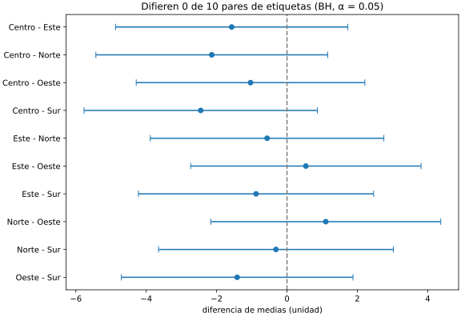

# Informe: ¿difieren las zonas?

[Hallazgos con todos los números](hallazgos.md) · [Notebook del análisis exploratorio](../notebooks/eda.ipynb)

## Pregunta

¿Mide alguna zona (Norte, Sur, Centro, Este, Oeste) valores distintos de las demás, o las diferencias que se ven entre sus medias son azar?

## Datos

`notebooks/instantanea.csv`: 2000 medidas de una carga, extraídas de PostgreSQL con `observatorio extraer`, huella `3193779438eecdede9910a3cbc922f05a883e69a8a92fd4ef9a33e482d636c65`. Faltan 106 valores (un 5 %), repartidos por igual entre las zonas. Los datos son sintéticos: los genera `scripts/generar_medidas.py`, con la misma distribución para todas las zonas.

## Hallazgos

1. **Ninguna zona difiere de otra.** Los diez intervalos del 95 % cruzan el cero, y ningún p corregido baja de 0,83.
2. **Las diferencias son pequeñas aunque fueran reales.** La mayor, Centro - Sur, es de -2,45 unidades en una escala de 0 a 80; su d de Cohen, -0,11, queda por debajo de lo que se considera un efecto pequeño (0,2).
3. **Welch y Mann-Whitney coinciden** en cada par: la conclusión no depende de suponer una campana.

## Limitaciones

- Una sola carga: no dice si las zonas difieren en otros días.
- Los valores que faltan se dejan fuera. Si faltaran más en una zona y por un motivo (por ejemplo, un sensor que falla con valores altos), las medias estarían sesgadas; aquí faltan por igual.
- Con unas 380 medidas por zona, una diferencia de menos de 3 unidades no se distingue del azar.

## Siguientes pasos

- Repetir el análisis con varias cargas, y comparar por fecha además de por zona.
- En la fase 5, predecir el nivel de una medida: si las zonas no difieren, la zona no ayudará al modelo.
