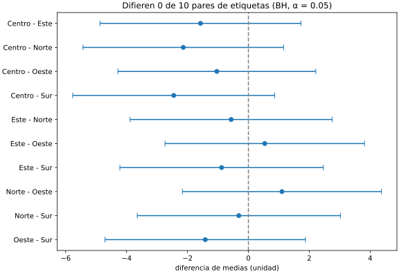

# Hallazgos: diferencias entre etiquetas

**Datos**: `instantanea.csv`, sha256 `3193779438eecdede9910a3cbc922f05a883e69a8a92fd4ef9a33e482d636c65`: 2000 medidas, 1894 con valor.

**Método**: para cada par de etiquetas (10 pares), la diferencia de medias con su intervalo del 95 % (Welch) y el tamaño del efecto (d de Cohen). Los p-valores de Welch se corrigen con Benjamini-Hochberg; un par difiere si su p corregido es menor que 0.05. Mann-Whitney, que no supone una campana, sirve de contraste.

## Resumen

Difieren 0 de 10 pares de etiquetas (BH, α = 0.05).

## Pares

| Par | Medidas | Diferencia | IC 95 % | d | p Welch | p corregido | p Mann-Whitney | ¿Difiere? |
|---|---|---|---|---|---|---|---|---|
| Centro - Este | 385 / 387 | -1.57 | [-4.87, 1.73] | -0.07 | 0.35 | 0.831 | 0.352 | no |
| Centro - Norte | 385 / 379 | -2.14 | [-5.43, 1.16] | -0.09 | 0.203 | 0.831 | 0.219 | no |
| Centro - Oeste | 385 / 387 | -1.04 | [-4.28, 2.21] | -0.05 | 0.531 | 0.831 | 0.526 | no |
| Centro - Sur | 385 / 356 | -2.45 | [-5.77, 0.86] | -0.11 | 0.147 | 0.831 | 0.15 | no |
| Este - Norte | 387 / 379 | -0.57 | [-3.88, 2.75] | -0.02 | 0.738 | 0.831 | 0.746 | no |
| Este - Oeste | 387 / 387 | 0.54 | [-2.74, 3.81] | 0.02 | 0.748 | 0.831 | 0.771 | no |
| Este - Sur | 387 / 356 | -0.88 | [-4.22, 2.46] | -0.04 | 0.605 | 0.831 | 0.61 | no |
| Norte - Oeste | 379 / 387 | 1.10 | [-2.17, 4.37] | 0.05 | 0.508 | 0.831 | 0.491 | no |
| Norte - Sur | 379 / 356 | -0.31 | [-3.65, 3.02] | -0.01 | 0.853 | 0.853 | 0.824 | no |
| Oeste - Sur | 387 / 356 | -1.42 | [-4.71, 1.88] | -0.06 | 0.399 | 0.831 | 0.385 | no |
