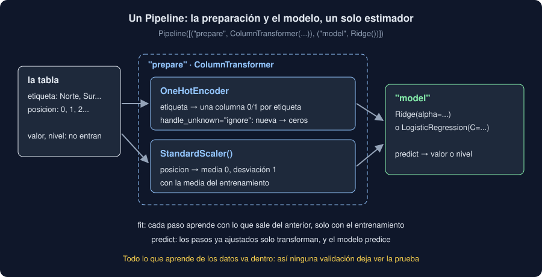

# 02 · Pipelines

⏱️ 50 min

## 🎯 Objetivos

- Unir la preparación y el modelo en un solo estimador con `Pipeline`.
- Preparar cada columna a su manera con `ColumnTransformer`.
- Leer y cambiar los pasos de un pipeline: `named_steps`, `set_params` y el doble guion bajo.
- Explicar por qué un pipeline evita las fugas de la preparación.

---

## 1. Muchos pasos, un estimador

Con la teoría 01, entrenar un modelo es: ajustar el codificador con el entrenamiento, transformar el entrenamiento, ajustar el escalador, transformar, entrenar el modelo; y para predecir, transformar la prueba con los dos, en el mismo orden. Cada paso es una ocasión de equivocarse: ajustar con la prueba, olvidar un paso al predecir, cambiar el orden.

Un **`Pipeline`** encadena los pasos y se comporta como **un** modelo:

- `fit(X, y)` ajusta cada transformador con lo que sale del anterior, y al final el modelo;
- `predict(X)` pasa `X` por los transformadores ya ajustados (solo `transform`) y predice.



## 2. Cada columna a su manera: `ColumnTransformer`

Las zonas se codifican y los números se escalan. `ColumnTransformer` aplica a cada grupo de columnas su transformador y pega los resultados:

```python
import numpy as np
import pandas as pd
from sklearn.compose import ColumnTransformer
from sklearn.linear_model import Ridge
from sklearn.model_selection import train_test_split
from sklearn.pipeline import Pipeline
from sklearn.preprocessing import OneHotEncoder, StandardScaler

rng = np.random.default_rng(32)
n = 200
frame = pd.DataFrame(
    {
        "zona": rng.choice(["Norte", "Sur", "Centro"], n),
        "hora": rng.integers(0, 24, n),
        "humedad": rng.uniform(20, 90, n).round(1),
    }
)
effect = frame["zona"].map({"Norte": -5.0, "Sur": 0.0, "Centro": 5.0})
frame["temperatura"] = (15 + effect + 0.4 * frame["hora"] + rng.normal(0, 2, n)).round(1)
x, y = frame[["zona", "hora", "humedad"]], frame["temperatura"]
x_train, x_test, y_train, y_test = train_test_split(x, y, test_size=0.25, random_state=32)

prepare = ColumnTransformer(
    [
        ("zona", OneHotEncoder(handle_unknown="ignore"), ["zona"]),
        ("numeros", StandardScaler(), ["hora", "humedad"]),
    ]
)
model = Pipeline([("prepare", prepare), ("model", Ridge(alpha=1.0))])
model.fit(x_train, y_train)
print(round(model.score(x_test, y_test), 3))
new = pd.DataFrame({"zona": ["Centro", "Oeste"], "hora": [12, 12], "humedad": [50.0, 50.0]})
print(model.predict(new).round(1))
```

```
0.899
[24.6 19.9]
```

- Cada paso tiene un **nombre** (`"prepare"`, `"model"`) y cada grupo de columnas también (`"zona"`, `"numeros"`).
- `fit` y `predict` reciben la tabla **original**, con textos: la preparación va dentro.
- Oeste no estaba en el entrenamiento: su fila de ceros predice como "ninguna zona", entre las tres.
- Las columnas que el `ColumnTransformer` no nombra **se descartan** (`remainder="drop"`, por defecto). Si `x` trajera el objetivo por error, no entraría en el modelo; aun así, no lo metas en `x`.

`make_pipeline(prepare, Ridge())` hace lo mismo y pone los nombres solo (`"columntransformer"`, `"ridge"`). Con nombres tuyos, el código se lee mejor.

## 3. Mirar dentro y cambiar un paso

```python
print(model.named_steps["prepare"].get_feature_names_out())
print(model.named_steps["model"].coef_.round(2))
model.set_params(model__alpha=100.0).fit(x_train, y_train)
print(round(model.score(x_test, y_test), 3))
```

```
['zona__zona_Centro' 'zona__zona_Norte' 'zona__zona_Sur' 'numeros__hora'
 'numeros__humedad']
[ 4.66 -4.84  0.18  2.79 -0.01]
0.506
```

- `named_steps` da cada paso ya ajustado. Los coeficientes cuentan la historia de los datos: Centro +5 y Norte −5 respecto a la media, la hora pesa (2,79 por cada desviación de hora, unas 7 h: unos 0,4 °C por hora) y la humedad nada.
- `set_params(model__alpha=100.0)`: el **doble guion bajo** separa el nombre del paso y el del parámetro. `prepare__numeros__with_mean=False` llegaría hasta dentro del `ColumnTransformer`. Es la forma en que `GridSearchCV` cambiará los hiperparámetros (teoría 04).
- Con `alpha=100` el modelo empeora de 0,899 a 0,506: la regularización encoge los coeficientes (teoría 04).

## 4. El pipeline evita la fuga

En la semana 31 (teoría 05) viste que calcular algo con todas las medidas antes de repartir es una fuga. Con un escalador, la fuga es pequeña: la media de todo se parece a la del entrenamiento. Con otros pasos es enorme. Elegir las 20 mejores columnas de 5000 columnas **de puro ruido**, mirando todas las filas, y validar después:

```python
from sklearn.feature_selection import SelectKBest, f_classif
from sklearn.linear_model import LogisticRegression
from sklearn.model_selection import cross_val_score

noise_x = rng.normal(size=(60, 5000))
noise_y = rng.choice([0, 1], 60)
chosen = SelectKBest(f_classif, k=20).fit_transform(noise_x, noise_y)
print(cross_val_score(LogisticRegression(), chosen, noise_y, cv=5).mean().round(2))
honest = Pipeline([("select", SelectKBest(f_classif, k=20)), ("model", LogisticRegression())])
print(cross_val_score(honest, noise_x, noise_y, cv=5).mean().round(2))
```

```
1.0
0.53
```

`cross_val_score` (teoría 03) mide en cinco partes que el modelo no vio. Primero, una exactitud perfecta con datos al azar: `SelectKBest` eligió las columnas que, **por casualidad**, más se parecían a `y` en las 60 filas, también las de prueba. Con la selección dentro del pipeline, cada parte la elige con su entrenamiento, y sale lo que hay: 0,53, azar.

La regla: **todo lo que aprende de los datos va dentro del pipeline**. Así, cualquier forma de validar (un reparto, cinco pliegues, una búsqueda) ajusta la preparación solo con el entrenamiento de cada vez, sin que tengas que acordarte.

## 5. Tu Observatorio

En tu proyecto, `prepare()` es un `ColumnTransformer` con la etiqueta en one-hot y la posición escalada, y cada modelo es un `Pipeline` de dos pasos: `"prepare"` y `"model"`. `prepare()` devuelve uno **nuevo, sin ajustar**: quien lo ajusta es cada pliegue (teoría 05).

## ⚠️ Errores comunes

| Error | Consecuencia | Mejor |
|---|---|---|
| Preparar antes de repartir o validar | Una fuga: pequeña con un escalador, enorme seleccionando columnas | Todo dentro del pipeline |
| `model__alpha` con un solo guion bajo | `ValueError: Invalid parameter` | Doble: `paso__parametro` |
| Pasar a `predict` la tabla ya preparada | Se prepara dos veces, o falla | La tabla original: el pipeline prepara |
| Olvidar una columna en el `ColumnTransformer` | Se descarta sin aviso | Nombrar todas las que el modelo usa |
| Leer `coef_` del pipeline | `AttributeError` | `named_steps["model"].coef_` |

## ✅ Qué debes saber al terminar

- Qué hace un `Pipeline` en `fit` y en `predict`.
- Cómo se monta un `ColumnTransformer` y qué pasa con las columnas que no nombra.
- Cómo se llega a un paso y a un parámetro: `named_steps`, `set_params` y `paso__parametro`.
- Por qué la selección de columnas fuera del pipeline da un 1,0 con datos al azar.

---

## 🔗 Navegación

| Anterior | Actual | Siguiente |
| -------- | ------ | --------- |
| [01 · Preparar las entradas](01-preparar-las-entradas.md) | **02 · Pipelines** | [03 · Validación cruzada](03-validacion-cruzada.md) |
