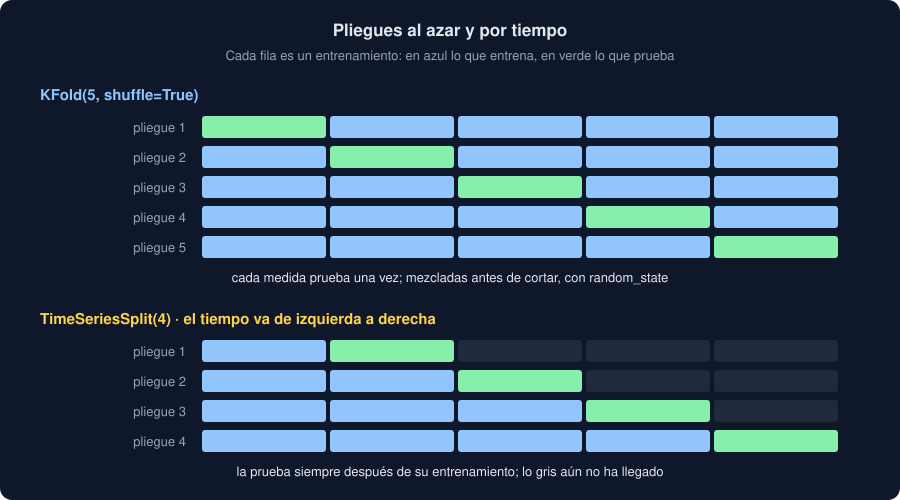

# 03 · Validación cruzada

⏱️ 50 min

## 🎯 Objetivos

- Explicar por qué un solo reparto da una medida que depende de la suerte.
- Validar con k pliegues: `KFold`, `cross_val_score` y `cross_validate`.
- Leer la media y la desviación de los pliegues, y comparar con la referencia pliegue a pliegue.
- Elegir cómo repartir: al azar, estratificado, por grupos (`GroupKFold`) o por tiempo (`TimeSeriesSplit`).

---

## 1. Un reparto, una tirada

Con los datos y el pipeline de la teoría 02, otra vez con `alpha=1`, el mismo modelo con diez semillas de reparto distintas:

```python
model.set_params(model__alpha=1.0)
scores = []
for seed in range(10):
    a_train, a_test, b_train, b_test = train_test_split(x, y, test_size=0.25, random_state=seed)
    scores.append(model.fit(a_train, b_train).score(a_test, b_test))
print(round(min(scores), 3), round(max(scores), 3))
```

```
0.79 0.906
```

Mismo modelo, mismos datos: R² entre 0,79 y 0,906 según qué 50 medidas caigan en prueba. Con un reparto ves **un** número de ese abanico, y no sabes cuál. En la semana 31, el comando `modelo` daba otro veredicto con otra semilla si la diferencia con la referencia era pequeña: era esto.

## 2. k pliegues

La **validación cruzada** reparte los datos en k partes iguales, los **pliegues** (*folds*). Entrena k veces: cada vez prueba con un pliegue y entrena con los demás. Cada medida está en prueba **una** vez, y todas se usan para entrenar k − 1 veces.



```python
from sklearn.model_selection import KFold, cross_val_score

folds = KFold(n_splits=5, shuffle=True, random_state=32)
r2 = cross_val_score(model, x, y, cv=folds)
print(r2.round(3))
print(f"{r2.mean():.3f} ± {r2.std():.3f}")
```

```
[0.879 0.909 0.87  0.869 0.786]
0.863 ± 0.041
```

- Cinco medidas en vez de una: la **media** estima cómo predice el modelo, y la **desviación** cuánto cambia de un pliegue a otro.
- `cross_val_score` clona el modelo en cada pliegue: lo entrena desde cero, sin recordar el anterior. El pipeline prepara con el entrenamiento de cada pliegue (teoría 02, sección 4).
- `shuffle=True` mezcla antes de cortar. Sin él, los pliegues son trozos seguidos, y si los datos vienen ordenados (por zona, por fecha), cada pliegue es distinto de los demás. `random_state` fija la mezcla.
- Con `cv=5`, scikit-learn usa `KFold` **sin** mezclar en regresión, y `StratifiedKFold` (misma proporción de cada clase en cada pliegue) en clasificación.

¿Cuántos pliegues? 5 o 10 es lo habitual. Más pliegues: más datos para entrenar en cada uno, más tiempo, y medidas más parecidas entre sí.

## 3. Varias métricas, y el entrenamiento

`cross_validate` devuelve más cosas:

```python
from sklearn.model_selection import cross_validate

result = cross_validate(
    model, x, y, cv=folds, scoring=["neg_mean_absolute_error", "r2"], return_train_score=True
)
print(sorted(result))
print((-result["test_neg_mean_absolute_error"]).round(2))
print((-result["train_neg_mean_absolute_error"]).round(2))
```

```
['fit_time', 'score_time', 'test_neg_mean_absolute_error', 'test_r2', 'train_neg_mean_absolute_error', 'train_r2']
[1.61 1.63 1.27 1.34 1.52]
[1.42 1.42 1.48 1.48 1.42]
```

- **`neg_`**: en scikit-learn, para cualquier `scoring`, **más es mejor**. Los errores van en negativo para cumplirlo: −1,61 es mejor que −1,63. Cámbiales el signo para leerlos.
- Con `return_train_score=True` ves el error en entrenamiento de cada pliegue. Si fuera mucho menor que el de prueba, sobreajuste (semana 31, teoría 02). Aquí son parecidos: el modelo no memoriza.

## 4. Comparar con la referencia, pliegue a pliegue

Una media de 0,863 no dice nada sin la de la referencia. Y comparar solo medias esconde cómo de seguido gana el modelo. Con los **mismos pliegues** para los dos, se comparan en cada uno:

- si el modelo gana en los cinco, la mejora se repite: no es la suerte de un reparto;
- si gana en tres de cinco, la diferencia es del tamaño del ruido entre pliegues.

Para que los pliegues sean los mismos, se pasa el **mismo** `KFold` con `random_state` a los dos `cross_val_score`. Tu comando `ajustar` lo hace así y decide con una regla simple: mejora si gana en **todos** los pliegues.

## 5. Al azar no siempre vale: grupos

Diez medidas de cada uno de veinte sensores. El valor depende sobre todo del sensor. Un modelo que aprende "el sensor 7 mide unos 23" con la columna del sensor en one-hot:

```python
from sklearn.model_selection import GroupKFold

sensors = np.repeat(np.arange(20), 10)
gx = pd.DataFrame({"sensor": sensors})
gy = rng.normal(20, 5, 20)[sensors] + rng.normal(0, 0.5, 200)
by_sensor = Pipeline(
    [
        ("prepare", ColumnTransformer([("sensor", OneHotEncoder(handle_unknown="ignore"), ["sensor"])])),
        ("model", Ridge()),
    ]
)
print(cross_val_score(by_sensor, gx, gy, cv=KFold(5, shuffle=True, random_state=32)).mean().round(2))
print(cross_val_score(by_sensor, gx, gy, cv=GroupKFold(5), groups=sensors).mean().round(2))
```

```
0.97
-0.08
```

- Al azar, cada sensor tiene medidas en entrenamiento y en prueba: R² 0,97. El modelo "predice" sensores que ya conoce.
- Con **`GroupKFold`**, todas las medidas de un sensor van al mismo pliegue: en prueba solo hay sensores que no vio. R² −0,08: para un sensor nuevo, el modelo no sabe nada; predice peor que la media.

¿Cuál es la buena? La que se parece al uso. Si vas a predecir medidas nuevas de sensores que ya tienes, la primera. Si vas a instalar sensores nuevos, la segunda. Es la fuga de "las medidas repetidas" de la semana 31 (teoría 05), con nombre: los grupos.

## 6. Al azar no siempre vale: el tiempo

Si las medidas tienen orden y quieres predecir **las siguientes**, entrenar con el futuro para probar con el pasado es hacer trampa. **`TimeSeriesSplit`** prueba siempre con lo que viene **después** de su entrenamiento:

```python
from sklearn.model_selection import TimeSeriesSplit

for train, test in TimeSeriesSplit(n_splits=4).split(np.zeros(20)):
    print(train.min(), train.max(), "|", test.min(), test.max())
```

```
0 3 | 4 7
0 7 | 8 11
0 11 | 12 15
0 15 | 16 19
```

- Las filas tienen que estar **ordenadas** por tiempo: `TimeSeriesSplit` solo mira la posición.
- El entrenamiento crece: el primer pliegue entrena con poco, y suele salir peor. Es honrado: al principio, también tendrías poco.
- No mezcla: `shuffle` no existe aquí.

En tu Observatorio, las medidas llegan en orden: carga y posición. `ajustar --tiempo` usa `TimeSeriesSplit` después de ordenar por las dos.

## ⚠️ Errores comunes

| Error | Consecuencia | Mejor |
|---|---|---|
| Un solo reparto para decidir | Un veredicto que cambia con la semilla | k pliegues |
| Comparar con la referencia en otros pliegues | Una diferencia que es solo el reparto | El mismo `KFold` con `random_state` |
| Leer `neg_mean_absolute_error` como error | Un error negativo, "más bajo es peor" | Cambiar el signo |
| `KFold` sin `shuffle` con datos ordenados | Pliegues muy distintos entre sí | `shuffle=True`, o el orden a propósito |
| Al azar con medidas del mismo sensor | Un R² de 0,97 que es −0,08 con sensores nuevos | `GroupKFold` |
| Al azar con una serie temporal | Predecir el pasado con el futuro | `TimeSeriesSplit`, con las filas ordenadas |

## ✅ Qué debes saber al terminar

- Por qué un reparto no basta, y qué estiman la media y la desviación de los pliegues.
- Qué hacen `KFold`, `cross_val_score` y `cross_validate`, y por qué los errores salen en negativo.
- Cómo comparar un modelo con su referencia en los mismos pliegues.
- Cuándo repartir por grupos o por tiempo, y qué cambia en el resultado.

---

## 🔗 Navegación

| Anterior | Actual | Siguiente |
| -------- | ------ | --------- |
| [02 · Pipelines](02-pipelines.md) | **03 · Validación cruzada** | [04 · Ajuste de hiperparámetros](04-ajuste-de-hiperparametros.md) |
