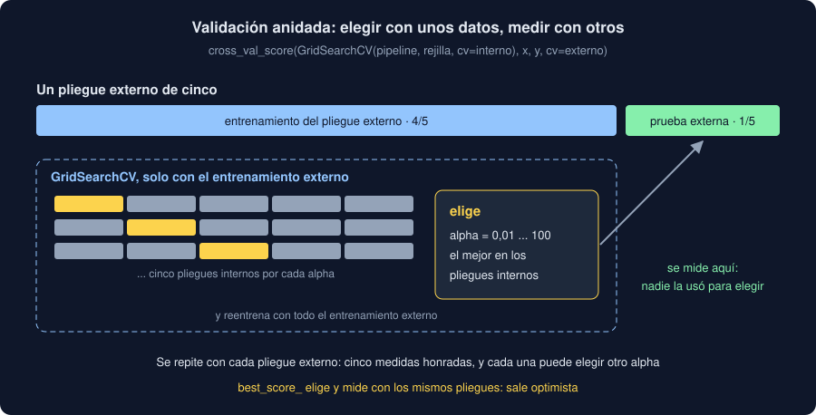

# 05 · Validación anidada y tu modelo ajustado

⏱️ 45 min

## 🎯 Objetivos

- Medir cuánto engaña `best_score_` cuando no hay nada que aprender.
- Montar una validación anidada: `GridSearchCV` dentro de `cross_val_score`.
- Leer la salida del comando `ajustar`: los pliegues, la media, el hiperparámetro elegido y el veredicto.
- Explicar por qué "gana en 3 de 5 pliegues" no es una mejora.

---

## 1. Elegir y medir con los mismos pliegues

Ochenta casos con diez entradas al azar y un "sí" o "no" también al azar: no hay nada que aprender, y la exactitud equilibrada de cualquier modelo debería rondar 0,5. Treinta valores de `n_neighbors` para un modelo de vecinos:

```python
import numpy as np
from sklearn.model_selection import GridSearchCV, StratifiedKFold, cross_val_score
from sklearn.neighbors import KNeighborsClassifier
from sklearn.pipeline import Pipeline
from sklearn.preprocessing import StandardScaler

rng = np.random.default_rng(5)
x = rng.normal(size=(80, 10))
y = rng.choice(["sí", "no"], 80)
model = Pipeline([("scale", StandardScaler()), ("model", KNeighborsClassifier())])
grid = {"model__n_neighbors": list(range(1, 31))}
inner = StratifiedKFold(5, shuffle=True, random_state=5)
search = GridSearchCV(model, grid, cv=inner, scoring="balanced_accuracy")
search.fit(x, y)
print(search.best_params_, round(search.best_score_, 3))
```

```
{'model__n_neighbors': 17} 0.574
```

0,574 con datos al azar. Treinta modelos medidos en los mismos pliegues, y el ganador es el que **por casualidad** mejor encajó con ellos. Si dieras ese número como "lo que acierta mi modelo", prometerías un 57 % que no existe.

## 2. Validación anidada

La solución es la misma de siempre: medir con datos que **no** se usaron para decidir. Aquí, decidir es elegir el hiperparámetro. La **validación anidada** mete la búsqueda entera dentro de otra validación cruzada:

- el bucle **externo** reparte en pliegues, y cada uno se aparta para medir;
- dentro, `GridSearchCV` hace su propia validación cruzada **solo con el entrenamiento** de ese pliegue, y elige;
- el modelo elegido se mide con el pliegue apartado, que nadie usó para elegir.



En código, una línea: `GridSearchCV` es un estimador, así que `cross_val_score` lo acepta como cualquier otro.

```python
outer = StratifiedKFold(5, shuffle=True, random_state=55)
nested = cross_val_score(search, x, y, cv=outer, scoring="balanced_accuracy")
print(nested.round(2), round(nested.mean(), 3))
```

```
[0.25 0.62 0.56 0.56 0.31] 0.462
```

0,462: azar, que es lo que hay. Y fíjate en cada pliegue: de 0,25 a 0,62. Con un reparto, cualquiera de esos cinco números podría haber sido "tu resultado".

- La anidada mide el **procedimiento** (buscar `n_neighbors` con validación cruzada y quedarse con el mejor), no un modelo concreto: cada pliegue externo puede elegir un valor distinto.
- Para el modelo que vas a usar, ajustas la búsqueda con **todos** los datos (`search.fit(x, y)`) y te quedas con su `best_params_`. La anidada te dice cuánto esperar de él.
- Cuesta: 5 pliegues externos × 5 internos × 30 valores son 750 entrenamientos. Con modelos lineales y unos miles de medidas, segundos.

## 3. Tu comando `ajustar`

`validate` en `core/validation.py` es exactamente esto, para cada modelo:

1. `ordered` toma las medidas con valor, ordenadas por carga y posición.
2. Las entradas son la etiqueta (one-hot) y la posición (escalada), en un `Pipeline` con el modelo: Ridge para el valor, logística para el nivel.
3. `GridSearchCV` busca `alpha` o `C` entre 0,01 y 100, con los pliegues de `folds`.
4. `cross_val_score` mide la búsqueda en los pliegues externos, y la referencia en **los mismos**.
5. `search.fit` con todo da el valor elegido, que el comando muestra.

```
$ uv run observatorio ajustar notebooks/instantanea.csv
instantanea.csv: 2000 medidas · sha256: 3193779438eecdede9910a3cbc922f05a883e69a8a92fd4ef9a33e482d636c65 · pliegues al azar
regresión del valor · MAE en cada pliegue
┏━━━━━━━━━┳━━━━━━━━┳━━━━━━━━━━━━┳━━━━━━━━━━┓
┃ Pliegue ┃ Modelo ┃ Referencia ┃ ¿Mejora? ┃
┡━━━━━━━━━╇━━━━━━━━╇━━━━━━━━━━━━╇━━━━━━━━━━┩
│       1 │ 20.342 │     20.275 │ no       │
│       2 │ 19.581 │     19.598 │ sí       │
│       3 │ 19.807 │     19.820 │ sí       │
│       4 │ 19.854 │     19.873 │ sí       │
│       5 │ 20.220 │     20.209 │ no       │
│   media │ 19.961 │     19.955 │          │
└─────────┴────────┴────────────┴──────────┘
regresión del valor: con alpha=100, gana en 3 de 5 pliegues: el modelo no mejora la referencia
...
clasificación del nivel: con C=0.01, gana en 0 de 5 pliegues: el modelo no mejora la referencia
```

## 4. Leer el resultado

- **Gana en 3 de 5**, por dos centésimas o menos, y pierde en los otros dos, en el primero por siete centésimas. La media del modelo es incluso un poco peor. Si solo hubieras mirado el pliegue 2, habrías dicho "mejora". La regla de `ajustar` (ganar en **todos**) pide que la mejora se repita.
- **`alpha=100`**, el más alto: la búsqueda elige regularizar al máximo, acercarse todo lo posible a la media. Es lo que hace la mejor búsqueda cuando las entradas no dicen nada (teoría 04, sección 2): el modelo ajustado **se convierte en la referencia**.
- **`C=0.01`**, el más bajo, en la clasificación: lo mismo, por el otro lado (`C` va al revés).
- **0,333 en todos los pliegues**, modelo y referencia: los dos dicen siempre el nivel más frecuente.

Es la tercera vez que tus datos de ejemplo dicen lo mismo: ninguna zona difiere (semana 30), un modelo con la etiqueta no mejora la referencia (semana 31), y ni con la posición, ni regularizando, ni con cinco pliegues (semana 32). Con tus datos, puede salir otra cosa.

## 5. Al azar o por tiempo

`ajustar --tiempo` usa `TimeSeriesSplit` (teoría 03, sección 6): cada pliegue prueba con medidas que llegaron **después** de su entrenamiento. Si tu dominio cambia con el tiempo (las estaciones, un sensor que se degrada, una tarifa nueva), los pliegues al azar mezclan el antes y el después, y el resultado sale mejor de lo que será. Si con `--tiempo` empeora mucho, tu modelo no sabe predecir el futuro, que es lo que le vas a pedir.

## ⚠️ Errores comunes

| Error | Consecuencia | Mejor |
|---|---|---|
| Dar `best_score_` como el resultado | Un 0,574 con datos al azar | Validación anidada |
| Buscar el hiperparámetro con la prueba final | La prueba deja de ser nueva | La búsqueda dentro del entrenamiento |
| Esperar el mismo hiperparámetro en cada pliegue externo | Confusión: la anidada mide el procedimiento | `search.fit` con todo para el modelo final |
| "Gana en la media, así que mejora" | Una media decidida por un pliegue | Mirar cada pliegue |
| El valor más alto o más bajo de la rejilla | Puede que el mejor esté fuera | Ampliar la rejilla en esa dirección, o sospechar que no hay nada que aprender |

## ✅ Qué debes saber al terminar

- Por qué `best_score_` es optimista, y cuánto con datos al azar.
- Cómo se escribe una validación anidada y qué mide.
- Qué hace cada paso de `validate` y cómo leer la salida de `ajustar`.
- Qué dice que la búsqueda elija la regularización más fuerte.
- Cuándo usar `--tiempo`.

---

## 🔗 Navegación

| Anterior | Actual | Siguiente |
| -------- | ------ | --------- |
| [04 · Ajuste de hiperparámetros](04-ajuste-de-hiperparametros.md) | **05 · Validación anidada y tu modelo ajustado** | [Ejercicio 01 · Preparar las entradas](../2-practicas/ejercicio-01-preparar-las-entradas/README.md) |
