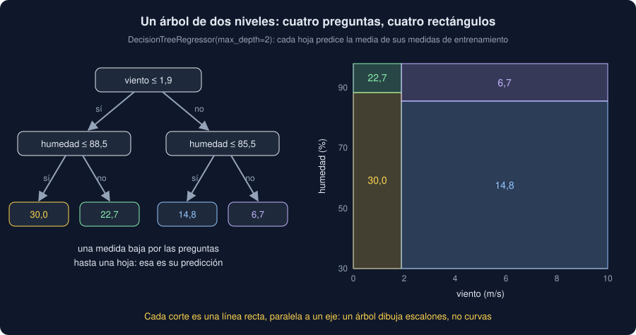

# 01 · Árboles de decisión

⏱️ 45 min

## 🎯 Objetivos

- Explicar cómo predice un árbol de decisión: preguntas de sí o no, y la media de cada hoja.
- Explicar cómo elige cada pregunta: la que más reduce el error.
- Controlar su tamaño con `max_depth` y `min_samples_leaf`, y reconocer cuándo memoriza.
- Saber qué hace bien un árbol (umbrales, cruces, sin escalar) y qué no (extrapolar, curvas suaves).

---

## 1. Preguntas de sí o no

Ocho horas de medidas: el viento y el PM2.5. Con poco viento, el aire no se renueva y las partículas se acumulan:

```python
import numpy as np
import pandas as pd
from sklearn.tree import DecisionTreeRegressor, export_text

wind = pd.DataFrame({"viento": [0.5, 1.0, 1.5, 3.0, 4.0, 5.5, 6.0, 8.0]})
pm25 = [38.0, 35.0, 33.0, 18.0, 20.0, 15.0, 17.0, 14.0]
stump = DecisionTreeRegressor(max_depth=1).fit(wind, pm25)
print(export_text(stump, feature_names=["viento"]))
```

```
|--- viento <= 2.25
|   |--- value: [35.33]
|--- viento >  2.25
|   |--- value: [16.80]
```

Un **árbol de decisión** predice haciendo preguntas de sí o no sobre las entradas. Este tiene una sola: ¿el viento es de 2,25 m/s o menos? Si sí, predice 35,33; si no, 16,80. Esos números son la **media** de las medidas de entrenamiento que llegan a cada lado: (38 + 35 + 33) / 3 y la media de las otras cinco.

- Cada pregunta es un **nodo**; cada final, una **hoja**.
- Una medida nueva baja por las preguntas hasta una hoja, y la predicción es el valor de esa hoja.
- Para clasificar, `DecisionTreeClassifier` hace lo mismo, y cada hoja predice la clase más frecuente de sus medidas (sección 5).

## 2. Cómo elige cada pregunta

¿Por qué 2,25? El árbol prueba cada columna y cada corte posible (el punto medio entre dos valores seguidos), y se queda con el que deja el **menor error** en los dos lados. Para la regresión, el error es la suma de los cuadrados de la distancia de cada medida a la media de su lado:

```python
values = np.array(pm25)


def error(threshold):
    left = values[wind["viento"] <= threshold]
    right = values[wind["viento"] > threshold]
    return ((left - left.mean()) ** 2).sum() + ((right - right.mean()) ** 2).sum()


print(f"sin cortar: {((values - values.mean()) ** 2).sum():.1f}")
for threshold in [1.25, 2.25, 4.75]:
    print(f"viento <= {threshold}: {error(threshold):.1f}")
```

```
sin cortar: 679.5
viento <= 1.25: 246.0
viento <= 2.25: 35.5
viento <= 4.75: 339.5
```

Cortar en 2,25 deja los tres valores altos a un lado y los cinco bajos al otro: el error pasa de 679,5 a 35,5. Ningún otro corte se acerca. A eso se le llama reducir la **impureza**: dejar en cada lado medidas que se parecen.

Después, el árbol repite lo mismo **dentro** de cada lado, con las medidas que le tocan, y así hasta que lo pares. Cada corte es el mejor en ese momento, sin mirar los siguientes: un algoritmo **voraz**.

## 3. Profundidad y sobreajuste

Si no lo paras, el árbol sigue preguntando hasta que cada hoja tiene una sola medida, o medidas iguales. Trescientas horas con un umbral de calma, otro de lluvia y ruido:

```python
rng = np.random.default_rng(33)
x = pd.DataFrame(
    {"viento": rng.uniform(0, 10, 300).round(1), "humedad": rng.uniform(30, 98, 300).round()}
)
y = 15 + 15 * (x["viento"] < 2) - 8 * (x["humedad"] > 85) + rng.normal(0, 3, 300)
for depth in [2, None]:
    tree = DecisionTreeRegressor(max_depth=depth, random_state=33).fit(x, y)
    print(f"max_depth={depth}: {tree.get_depth()} niveles · {tree.get_n_leaves()} hojas")
leafy = DecisionTreeRegressor(min_samples_leaf=20, random_state=33).fit(x, y)
print(f"min_samples_leaf=20: {leafy.get_depth()} niveles · {leafy.get_n_leaves()} hojas")
```

```
max_depth=2: 2 niveles · 4 hojas
max_depth=None: 22 niveles · 294 hojas
min_samples_leaf=20: 8 niveles · 12 hojas
```

- **Sin límite**: 22 niveles y 294 hojas para 300 medidas. Casi una hoja por medida: el árbol ha **memorizado** el entrenamiento, ruido incluido. Error 0 en entrenamiento, y mucho en prueba.
- **`max_depth`** limita los niveles: con 2, cuatro hojas como mucho.
- **`min_samples_leaf`** no deja crear hojas con menos de esas medidas: cada predicción es la media de al menos 20, y el ruido se promedia.

Los dos son **hiperparámetros**: se eligen con validación cruzada, como `alpha` en la semana 32. El ejercicio 01 dibuja su curva: con `max_depth` 1 no aprende, con 6 acierta más, y sin límite memoriza.

## 4. Lo que un árbol hace bien

El árbol de dos niveles con los mismos datos:

```python
tree = DecisionTreeRegressor(max_depth=2, random_state=33).fit(x, y)
print(export_text(tree, feature_names=["viento", "humedad"], decimals=1))
```

```
|--- viento <= 1.9
|   |--- humedad <= 88.5
|   |   |--- value: [30.0]
|   |--- humedad >  88.5
|   |   |--- value: [22.7]
|--- viento >  1.9
|   |--- humedad <= 85.5
|   |   |--- value: [14.8]
|   |--- humedad >  85.5
|   |   |--- value: [6.7]
```



Ha encontrado solo los dos umbrales: el viento en 1,9 (en los datos, 2) y la humedad en 88,5 y 85,5 (en los datos, 85). Cada hoja es un **rectángulo** en el plano de las entradas, y dentro de él la predicción es constante.

- **Umbrales**: "por debajo de 2 m/s" es una sola pregunta. Una recta tendría que dar un peso al viento y equivocarse a los dos lados del umbral.
- **Cruces**: la segunda pregunta depende de la primera. Si la hora punta solo sube el PM2.5 en el Centro, un árbol pregunta "¿Centro?" y después "¿hora punta?". Una regresión lineal suma efectos: el cruce lo tendrías que crear tú como una columna nueva.
- **Sin escalar**: una pregunta "¿viento ≤ 1,9?" separa las mismas medidas si el viento está en m/s, en km/h o en logaritmo. Solo importa el **orden** de los valores. Al árbol, el `StandardScaler` no le cambia nada.
- **Se lee**: `export_text` (o `plot_tree`, con matplotlib) dice por qué predice lo que predice. Con dos o tres niveles, se lo puedes enseñar a alguien que no programa.

## 5. Lo que no

- **No extrapola.** Fuera de lo que vio, cae en la hoja del borde y repite su media. Con una tendencia que sube cada día, el árbol entrenado hasta el día 39 predice el mismo valor para el 45 y para el 59 (ejercicio 01, paso 6).
- **Escalones, no curvas.** Una relación suave (más temperatura, un poco más de ozono) se aproxima con muchos escalones pequeños, y cada uno necesita medidas.
- **Es inestable.** Cambia unas pocas medidas, y la primera pregunta puede ser otra; con ella, todo el árbol. Un árbol solo tiene mucha **varianza**: la teoría 02 lo arregla con muchos árboles.

Para clasificar, cada hoja guarda cuántas medidas de cada clase le llegan:

```python
from sklearn.tree import DecisionTreeClassifier

high = (y > 25).map({True: "alto", False: "normal"})
clf = DecisionTreeClassifier(max_depth=1, random_state=33).fit(x, high)
print(export_text(clf, feature_names=["viento", "humedad"], decimals=1, show_weights=True))
calm_and_windy = pd.DataFrame({"viento": [1.0, 5.0], "humedad": [50, 50]})
print(clf.classes_, clf.predict_proba(calm_and_windy).round(2).tolist())
```

```
|--- viento <= 1.9
|   |--- weights: [49.0, 8.0] class: alto
|--- viento >  1.9
|   |--- weights: [0.0, 243.0] class: normal

['alto' 'normal'] [[0.86, 0.14], [0.0, 1.0]]
```

La hoja de la calma tiene 49 horas "alto" y 8 "normal": predice "alto", con probabilidad 49 / 57 = 0,86. Con viento, las 243 son "normal". Para clasificar, la impureza se mide con el **índice de Gini** (`criterion="gini"`, por defecto): 0 si en la hoja todas las medidas son de la misma clase.

## ⚠️ Errores comunes

| Error | Consecuencia | Mejor |
|---|---|---|
| Un árbol sin `max_depth` ni `min_samples_leaf` | Memoriza: error 0 en entrenamiento | Limitarlo, y elegir el límite con validación cruzada |
| Escalar antes de un árbol "por si acaso" | No cambia nada; tampoco estropea | Escalar solo para modelos lineales, KMeans y distancias |
| Predecir fuera del rango de entrenamiento | Repite el valor de la hoja del borde | Un modelo lineal, o entradas que no crezcan sin fin |
| Fiarse de la primera pregunta | Con otras medidas, puede ser otra | Validación cruzada, o un bosque (teoría 02) |
| Pasar texto (`"Centro"`) a un árbol de scikit-learn | `ValueError: could not convert string to float` | `OneHotEncoder` en el pipeline |

## ✅ Qué debes saber al terminar

- Cómo predice un árbol: preguntas de sí o no, y la media (o la clase más frecuente) de la hoja.
- Cómo elige cada corte: el que más reduce el error de los dos lados.
- Qué hacen `max_depth` y `min_samples_leaf`, y cómo se ve un árbol que memoriza.
- Por qué un árbol encuentra umbrales y cruces, y no necesita escalar.
- Por qué no extrapola, y por qué un árbol solo es inestable.

---

## 🔗 Navegación

| Anterior | Actual | Siguiente |
| -------- | ------ | --------- |
| [Semana 33](../README.md) | **01 · Árboles de decisión** | [02 · Bosques aleatorios](02-bosques-aleatorios.md) |
