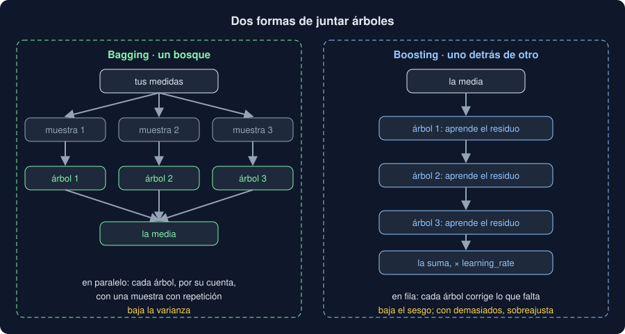

# 02 · Bosques aleatorios

⏱️ 50 min

## 🎯 Objetivos

- Explicar por qué un árbol solo cambia mucho con los datos, y por qué eso es un problema.
- Explicar el *bagging*: muchas muestras con repetición, un árbol por muestra, la media.
- Usar `RandomForestRegressor` y `RandomForestClassifier`, y leer su nota *out-of-bag*.
- Leer las importancias de un bosque, y saber cuándo engañan.
- Reconocer que un bosque no encuentra lo que no está en los datos.

---

## 1. Un árbol cambia con cada muestra

Los datos de la teoría 01: trescientas horas, con la calma y la lluvia. Cinco equipos miden en sitios parecidos y cada uno se queda con 150 de esas horas. Cada uno entrena un árbol sin límite y predice cinco horas nuevas:

```python
import numpy as np
import pandas as pd
from sklearn.ensemble import RandomForestClassifier, RandomForestRegressor
from sklearn.tree import DecisionTreeRegressor

rng = np.random.default_rng(33)
x = pd.DataFrame(
    {"viento": rng.uniform(0, 10, 300).round(1), "humedad": rng.uniform(30, 98, 300).round()}
)
y = 15 + 15 * (x["viento"] < 2) - 8 * (x["humedad"] > 85) + rng.normal(0, 3, 300)
new = pd.DataFrame(
    {"viento": [0.5, 1.0, 1.5, 3.0, 6.0], "humedad": [60.0, 90.0, 50.0, 70.0, 95.0]}
)
truth = 15 + 15 * (new["viento"] < 2) - 8 * (new["humedad"] > 85)


def predictions(make):
    """Cinco modelos, cada uno con 150 horas distintas, y sus predicciones de new."""
    draws = np.random.default_rng(1)
    samples = [draws.choice(300, 150, replace=False) for _ in range(5)]
    return np.array([make().fit(x.iloc[rows], y.iloc[rows]).predict(new) for rows in samples])


trees = predictions(lambda: DecisionTreeRegressor(random_state=33))
print("de verdad:", truth.to_numpy())
print(trees.round(1))
print(f"cuánto cambia cada predicción: {trees.std(axis=0).mean():.2f}")
```

```
de verdad: [30 22 30 15  7]
[[34.8 22.3 33.6 18.3  6.3]
 [31.1 22.3 33.7 16.5  7.5]
 [26.4 23.8 33.6 15.7  7.6]
 [30.5 32.1 26.  16.5  6.3]
 [31.2 32.1 33.6 14.2  2.9]]
cuánto cambia cada predicción: 2.68
```

Cada fila es un árbol; cada columna, una hora nueva. La primera hora (calma, sin lluvia, 30 de verdad) recibe de 26,4 a 34,8. La segunda (calma y lluvia, 22), de 22,3 a 32,1: en dos de las muestras, el árbol la trata como una hora de calma sin lluvia.

Un árbol sin límite memoriza su muestra, y con ella **su ruido**: cambia la muestra y cambia el árbol. Eso es **varianza** alta. En prueba, ese ruido aprendido es error. Es lo que pasa con los árboles de tu proyecto con los datos de ejemplo: no hay señal que aprender, y lo único que aprenden es el ruido de cada entrenamiento.

## 2. Bagging: la media de muchos árboles

Si cada árbol se equivoca hacia un lado distinto, la **media** de muchos árboles se equivoca menos que cada uno. Pero solo tienes una muestra. El truco: sacar de ella muchas muestras **con repetición** (*bootstrap*, semana 28), del mismo tamaño:

```python
draws = np.random.default_rng(1)
rows = draws.choice(300, 300, replace=True)
print(f"{len(np.unique(rows))} medidas distintas de 300 · {1 - len(np.unique(rows)) / 300:.0%} fuera")
```

```
195 medidas distintas de 300 · 35% fuera
```

Cada muestra tiene unas dos terceras partes de las medidas, algunas repetidas; el otro tercio se queda fuera. Cada muestra da un árbol distinto, y la predicción es la media de todos. Eso es ***bagging*** (*bootstrap aggregating*).



## 3. El bosque aleatorio

Un **bosque aleatorio** es *bagging* de árboles con una vuelta más: en cada corte, cada árbol solo mira **algunas columnas al azar**. Así los árboles se parecen menos entre sí, y la media gana más:

```python
forests = predictions(lambda: RandomForestRegressor(100, random_state=33))
print(forests.round(1))
print(f"cuánto cambia cada predicción: {forests.std(axis=0).mean():.2f}")
print(RandomForestRegressor().max_features, RandomForestClassifier().max_features)
```

```
[[30.7 22.3 32.4 16.2  5.1]
 [30.8 23.2 31.8 16.1  6.5]
 [32.  22.5 32.2 14.4  6.4]
 [30.9 31.8 28.5 14.7  4.6]
 [30.5 30.9 31.5 16.2  5.7]]
cuánto cambia cada predicción: 1.55
1.0 sqrt
```

Con las mismas cinco muestras, cada bosque cambia algo menos que un árbol: 1,55 frente a 2,68. La segunda hora sigue costando: si una muestra casi no tiene horas de calma con lluvia, ningún árbol de ese bosque las ve.

Los hiperparámetros que más importan:

- **`n_estimators`**, cuántos árboles (100 por defecto). Más árboles nunca empeoran el bosque; llega un punto en que solo lo hacen más lento (ejercicio 02, paso 3).
- **`max_features`**, cuántas columnas mira cada corte. Por defecto, **todas** en la regresión (`1.0`: solo *bagging*), y la raíz cuadrada del total en la clasificación (`"sqrt"`).
- **`max_depth`** y **`min_samples_leaf`**, como en un árbol. Por defecto, sin límite: cada árbol memoriza, y la media lo arregla.
- **`random_state`**: sin él, cada `fit` da otro bosque, y tus números no se repiten.

Y uno gratis: **`oob_score=True`**. Cada medida se queda fuera de un tercio de los árboles, más o menos. El bosque la predice solo con esos árboles, que no la vieron, y calcula el R² con todas: una validación sin repartir (*out-of-bag*). En el ejercicio 02, 0,825 frente a 0,820 con cinco pliegues.

## 4. Qué columnas usa

Un bosque de cien árboles ya no se lee como uno de dos niveles. Lo que sí da es cuánto usa cada columna:

- **`feature_importances_`**, por impureza: cuánto baja el error cada corte con esa columna, sumado en todos los árboles. Gratis, pero **se mide con el entrenamiento**: premia las columnas con muchos valores distintos, porque un árbol sin límite siempre encuentra en ellas algún corte que separa unas pocas medidas. En el ejercicio 02, una columna de ruido saca el doble que el día de la semana.
- **`permutation_importance`**: baraja una columna en datos de **prueba** y mide cuánto empeora el modelo. Si el modelo no la necesita, barajarla no cambia nada: el ruido da 0.

Las dos dicen qué usa el **modelo**, no qué causa el PM2.5. Dos columnas que van juntas (la hora y el tráfico) se reparten la importancia, y barajar una sola puede no cambiar nada porque la otra la sustituye.

## 5. Un bosque no inventa señal

Un bosque reduce la varianza: no crea información. Con valores al azar, que no tienen nada que ver con el viento ni con la humedad:

```python
from sklearn.dummy import DummyRegressor
from sklearn.model_selection import KFold, cross_val_score

noise = rng.uniform(0, 80, 300)
folds = KFold(5, shuffle=True, random_state=33)
for name, model in [
    ("referencia", DummyRegressor()),
    ("árbol", DecisionTreeRegressor(random_state=33)),
    ("bosque", RandomForestRegressor(100, random_state=33)),
    ("bosque, min_samples_leaf=20", RandomForestRegressor(100, min_samples_leaf=20, random_state=33)),
]:
    mae = -cross_val_score(model, x, noise, cv=folds, scoring="neg_mean_absolute_error")
    print(f"{name:<27} MAE {mae.mean():.2f}")
```

```
referencia                  MAE 19.90
árbol                       MAE 26.02
bosque                      MAE 20.45
bosque, min_samples_leaf=20 MAE 19.51
```

- El **árbol** sin límite, mucho peor que la media: predice el ruido de su entrenamiento.
- El **bosque** casi lo arregla: la media de cien ruidos se parece a la media. Pero no gana a la referencia.
- Con **`min_samples_leaf=20`**, cada hoja promedia veinte medidas: queda un poco por debajo de la referencia, por azar. Un modelo flexible bien limitado, sin nada que aprender, se parece todo lo que puede a la media.

Es lo que dice `competir` con los datos de ejemplo de tu Observatorio: los árboles, el bosque y el boosting no ganan a la referencia, porque las zonas no se diferencian (semana 30).

## ⚠️ Errores comunes

| Error | Consecuencia | Mejor |
|---|---|---|
| Un bosque sin `random_state` | Otro resultado en cada ejecución | `random_state=SEED` |
| Podar mucho los árboles del bosque "para no sobreajustar" | Árboles parecidos y simples: la media gana poco | Árboles profundos; podar solo si los datos son ruido |
| Fiarse de `feature_importances_` | Premia las columnas con muchos valores, aunque sean ruido | `permutation_importance` con datos de prueba |
| Leer las importancias como causas | Dicen qué usa el modelo, no qué provoca el PM2.5 | Un experimento, o al menos un "parece" |
| Usar `oob_score_` sin `oob_score=True` | `AttributeError` | Pasarlo al crear el bosque |
| Esperar que un bosque mejore datos sin señal | No mejora: reduce la varianza, no crea información | Mirar antes si hay algo que aprender |

## ✅ Qué debes saber al terminar

- Por qué un árbol solo tiene mucha varianza, y qué significa aprender el ruido.
- Qué es una muestra con repetición, y qué hace el *bagging* con ellas.
- Qué añade un bosque aleatorio al *bagging*, y qué hacen `n_estimators`, `max_features` y `oob_score`.
- La diferencia entre las importancias por impureza y por permutación.
- Por qué un bosque no gana a la referencia cuando no hay nada que aprender.

---

## 🔗 Navegación

| Anterior | Actual | Siguiente |
| -------- | ------ | --------- |
| [01 · Árboles de decisión](01-arboles-de-decision.md) | **02 · Bosques aleatorios** | [03 · Gradient boosting](03-gradient-boosting.md) |
