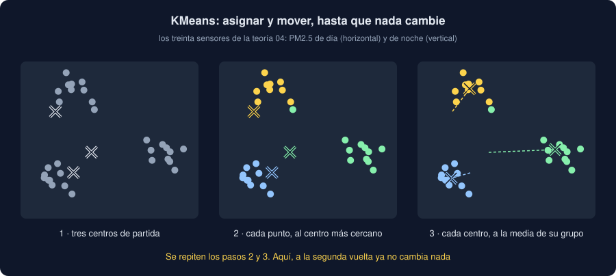

# 04 · Agrupar con KMeans

⏱️ 50 min

## 🎯 Objetivos

- Distinguir el aprendizaje **supervisado** (hay una respuesta que acertar) del **no supervisado** (no la hay).
- Explicar cómo agrupa KMeans: asignar a cada fila el centro más cercano y mover los centros, hasta que no cambie nada.
- Escalar antes de KMeans, y explicar por qué.
- Elegir cuántos grupos con la inercia y la silueta.
- Reconocer que KMeans siempre encuentra grupos, también donde no los hay.

---

## 1. Aprender sin respuesta

Hasta ahora, cada modelo tenía una `y`: el valor, el nivel. Medías si acertaba. En el aprendizaje **no supervisado** no hay `y`: solo filas, y la pregunta de qué estructura tienen. La más común: **¿qué filas se parecen?** Eso es **agrupar** (*clustering*).

Treinta sensores, cada uno con dos números: su PM2.5 medio de día y de noche. Los hay de tres tipos de sitio, pero los datos no lo dicen:

```python
import numpy as np
import pandas as pd
from sklearn.cluster import KMeans

rng = np.random.default_rng(33)
centers = {"avenida": (45, 20), "barrio": (20, 35), "parque": (15, 12)}
kinds = pd.Series(np.repeat(list(centers), 10), name="sitio")
sensors = pd.DataFrame(
    [rng.normal(centers[kind], 3) for kind in kinds], columns=["dia", "noche"]
).round(1)
model = KMeans(3, n_init=10, random_state=33).fit(sensors)
print(pd.crosstab(kinds, pd.Series(model.labels_, name="grupo")).to_string())
print(model.cluster_centers_.round(1))
```

```
grupo     0   1   2
sitio              
avenida  10   0   0
barrio    0  10   0
parque    0   0  10
[[45.2 19.7]
 [20.4 35.1]
 [14.7 13.6]]
```

`KMeans(3)` reparte los treinta en tres grupos. `kinds` no entra en `fit`: solo sirve después, para comprobar. Cada tipo de sitio ha caído entero en un grupo, y `cluster_centers_` da el centro de cada uno: la avenida, alta de día; el barrio, alto de noche; el parque, bajo siempre.

Los números de grupo (0, 1, 2) no significan nada por sí mismos: son nombres. Con otra semilla, el parque podría ser el 0.

## 2. Cómo agrupa, y por qué hay que escalar

KMeans repite dos pasos:

1. **Asignar**: cada fila va al grupo del centro más cercano.
2. **Mover**: cada centro se va a la media de las filas de su grupo.

Hasta que ninguna fila cambia de grupo. Empezando por tres centros mal puestos:

```python
start = np.array([[15.0, 30.0], [20.0, 15.0], [25.0, 20.0]])
for steps in [1, 2, 10]:
    moved = KMeans(3, init=start, n_init=1, max_iter=steps).fit(sensors)
    print(f"{steps:>2} vueltas: centros {moved.cluster_centers_.round(1).tolist()}")
```

```
 1 vueltas: centros [[19.8, 35.6], [14.7, 13.6], [43.5, 20.7]]
 2 vueltas: centros [[20.4, 35.1], [14.7, 13.6], [45.2, 19.7]]
10 vueltas: centros [[20.4, 35.1], [14.7, 13.6], [45.2, 19.7]]
```

Con una vuelta, los centros ya se han ido cerca de los tres tipos de sitio; con dos, han llegado, y de ahí no se mueven.



"Más cercano" es la distancia en línea recta, con **todas** las columnas. Si una columna está en otra escala, decide ella sola. Con la altitud de cada sensor, en metros, al azar:

```python
from sklearn.pipeline import make_pipeline
from sklearn.preprocessing import StandardScaler

meters = sensors.assign(altitud=rng.uniform(0, 2500, 30).round())
for name, grouping in [
    ("sin escalar", KMeans(3, n_init=10, random_state=33)),
    ("escalando", make_pipeline(StandardScaler(), KMeans(3, n_init=10, random_state=33))),
]:
    found = pd.Series(grouping.fit_predict(meters), name="grupo")
    print(f"{name}:\n{pd.crosstab(kinds, found).to_string()}")
```

```
sin escalar:
grupo    0  1  2
sitio           
avenida  5  0  5
barrio   1  6  3
parque   3  2  5
escalando:
grupo     0   1   2
sitio              
avenida  10   0   0
barrio    0  10   0
parque    0   0  10
```

- **Sin escalar**, cien metros de altitud pesan más que todo el PM2.5: KMeans agrupa por altitud, y los tipos de sitio se mezclan.
- **Escalando**, cada columna pesa igual: la altitud es una de tres, y no basta para estropear los grupos.

Lo mismo que con la regularización (semana 32): todo lo que mide **distancias** necesita las columnas en la misma escala. Los árboles no (teoría 01).

## 3. ¿Cuántos grupos?

KMeans necesita que le digas `k`. Aquí sabes que son tres; con tus datos, no. La **inercia** (`inertia_`) es la suma de las distancias al cuadrado de cada fila a su centro: cuánto se apartan las filas de su grupo.

```python
from sklearn.metrics import silhouette_score

for k in range(2, 7):
    grouped = KMeans(k, n_init=10, random_state=33).fit(sensors)
    silhouette = silhouette_score(sensors, grouped.labels_)
    print(f"k={k} · inercia {grouped.inertia_:5.0f} · silueta {silhouette:.2f}")
```

```
k=2 · inercia  2904 · silueta 0.63
k=3 · inercia   419 · silueta 0.79
k=4 · inercia   317 · silueta 0.68
k=5 · inercia   244 · silueta 0.53
k=6 · inercia   182 · silueta 0.44
```

La inercia baja **siempre** con más grupos: con treinta grupos, cada sensor sería el suyo, y la inercia, 0. No sirve para elegir el más bajo. Lo que se mira es el **codo**: de 2 a 3 cae a la séptima parte; de 3 a 4, mucho menos. A partir del codo, cada grupo nuevo parte uno que ya estaba bien.

## 4. La silueta, y grupos que no existen

La **silueta** de una fila compara dos distancias:

- *a*: la distancia media a las filas de **su** grupo;
- *b*: la distancia media a las filas del grupo **más cercano** que no es el suyo.

Su silueta es (*b* − *a*) / máx(*a*, *b*). Cerca de 1, la fila está bien metida en su grupo y lejos del siguiente; cerca de 0, está en la frontera; negativa, estaría mejor en el otro grupo. `silhouette_score` da la media de todas. En la tabla de la sección 3, la más alta es la de 3 grupos, 0,79: lo que ya sabías.

Ahora, treinta sensores sin ningún tipo de sitio: los dos números, al azar entre 10 y 40.

```python
flat = pd.DataFrame(rng.uniform(10, 40, (30, 2)), columns=["dia", "noche"])
for k in range(2, 5):
    labels = KMeans(k, n_init=10, random_state=33).fit_predict(flat)
    sizes = np.bincount(labels).tolist()
    print(f"k={k} · grupos de {sizes} sensores · silueta {silhouette_score(flat, labels):.2f}")
```

```
k=2 · grupos de [11, 19] sensores · silueta 0.39
k=3 · grupos de [8, 10, 12] sensores · silueta 0.40
k=4 · grupos de [6, 9, 5, 10] sensores · silueta 0.44
```

KMeans devuelve los grupos que le pidas, siempre. Con datos sin estructura, corta el espacio en trozos, y cada trozo tiene su centro. La silueta baja de 0,79 a 0,4. No llega a 0: con dos columnas y pocas filas, un reparto en trozos ya da algo de silueta. En el ejercicio 04, con veinticuatro columnas de ruido, da 0,04.

Por eso tu Observatorio usa un **umbral**, 0,5: por debajo, dice que los grupos se solapan. Es una regla práctica, no una ley: si dudas, compara tu silueta con la de unos datos al azar del mismo tamaño.

Con los datos de ejemplo, `agrupar` da 0,28: las cinco zonas se parecen demasiado para separarlas. Cuadra con la semana 30, en la que ninguna zona difería de las demás.

## 5. Lo que KMeans supone

- **Grupos redondos y de tamaño parecido.** Cada fila va al centro más cercano: un grupo alargado, o uno dentro de otro, se parte mal. Para esas formas hay otros métodos, como `DBSCAN` (grupos por densidad, y filas que no son de ningún grupo) o `AgglomerativeClustering` (une los grupos más cercanos, de dos en dos).
- **Un buen comienzo.** El resultado depende de los centros iniciales. scikit-learn los elige separados entre sí (`init="k-means++"`) y repite con `n_init` comienzos distintos, quedándose con el de menor inercia. Con `random_state`, siempre igual.
- **Columnas numéricas y escaladas.** Una media de categorías no existe: para agrupar por zona, antes hay que resumir cada zona con números. Es lo que hace `profiles` en tu proyecto: media, mediana y desviación de cada etiqueta.

## ⚠️ Errores comunes

| Error | Consecuencia | Mejor |
|---|---|---|
| KMeans sin escalar | La columna con números más grandes decide sola | `make_pipeline(StandardScaler(), KMeans(...))` |
| Elegir `k` con la inercia más baja | Siempre gana el `k` más alto | El codo, y la silueta |
| Creerse los grupos porque existen | KMeans los encuentra también en el ruido | Mirar la silueta, y comparar con datos al azar |
| Leer el número de grupo como algo | Es un nombre: con otra semilla, cambia | Renumerar, o describir cada grupo por su centro |
| KMeans sin `random_state` | Otros grupos en cada ejecución | `random_state=SEED` y `n_init=10` |
| Calcular la silueta con las columnas sin escalar, después de agrupar escaladas | Mides otra cosa que la que agrupó | La silueta con los mismos datos que vio KMeans |

## ✅ Qué debes saber al terminar

- Qué diferencia el aprendizaje supervisado del no supervisado.
- Los dos pasos de KMeans, y qué guardan `labels_`, `cluster_centers_` e `inertia_`.
- Por qué hay que escalar antes de agrupar.
- Cómo se leen el codo de la inercia y la silueta, y qué es una silueta alta o baja.
- Por qué KMeans siempre encuentra `k` grupos, y cómo saber si existen.

---

## 🔗 Navegación

| Anterior | Actual | Siguiente |
| -------- | ------ | --------- |
| [03 · Gradient boosting](03-gradient-boosting.md) | **04 · Agrupar con KMeans** | [05 · PCA, y tus modelos y grupos](05-pca-y-tus-modelos-y-grupos.md) |
