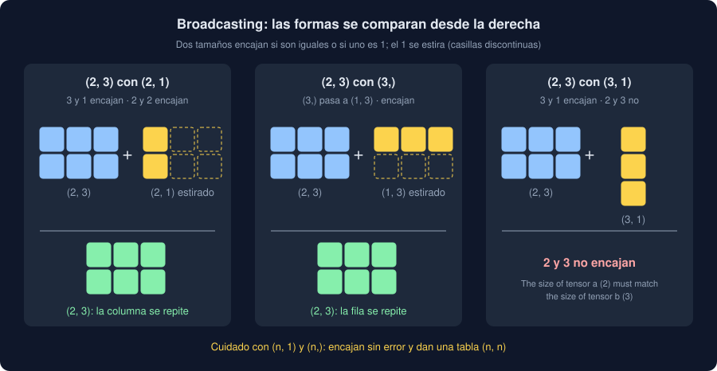

# 01 · Tensores

⏱️ 45 min

## 🎯 Objetivos

- Explicar qué es un tensor y en qué se parece y se diferencia de un array de NumPy.
- Crear tensores y leer su forma (`shape`), su tipo (`dtype`) y su dispositivo (`device`).
- Cambiar la forma de un tensor, seleccionar partes y reducir a lo largo de una dimensión.
- Predecir el resultado del *broadcasting* y de una multiplicación de matrices.

---

## 1. Un array que sabe derivar

Hasta ahora, scikit-learn entrenaba por ti: `fit` y listo. Esta semana y la siguiente entrenas redes neuronales con **PyTorch**, y el bucle de entrenamiento lo escribes tú. Todo empieza con un **tensor**: una tabla de números de cualquier número de dimensiones, como un array de NumPy.

```python
import numpy as np
import torch

pm25 = torch.tensor([12.0, 35.5, 18.2, 40.1])
print(pm25)
print(pm25.shape, pm25.dtype, pm25.device)
print(pm25.mean(), pm25.max().item())
```

```
tensor([12.0000, 35.5000, 18.2000, 40.1000])
torch.Size([4]) torch.float32 cpu
tensor(26.4500) 40.099998474121094
```

- `shape` es la forma: 4 números en una dimensión. `torch.Size` se comporta como una tupla.
- `dtype` es el tipo de cada número. `float32`: cuatro bytes por número, la mitad que el `float64` de NumPy y pandas.
- `device` es dónde vive el tensor: aquí, en la memoria de la CPU. Con una tarjeta gráfica, `"cuda"`.
- `mean()` devuelve **otro tensor**, de cero dimensiones. `.item()` lo convierte en un `float` de Python.

¿Por qué no NumPy? Por dos cosas que NumPy no tiene: un tensor puede vivir en una tarjeta gráfica, que multiplica matrices cientos de veces más rápido, y puede **recordar** las operaciones que se le hacen para calcular derivadas solo. Eso es *autograd*, la teoría 02. El resto se parece tanto a NumPy que casi todo lo que sabes de la semana 23 sirve.

## 2. Crear tensores

```python
print(torch.zeros(2, 3))
print(torch.ones(3, dtype=torch.int64))
print(torch.arange(0, 1, 0.25))
print(torch.linspace(-1, 1, 5))
torch.manual_seed(34)
print(torch.rand(2, 2))
print(torch.randn(3))
```

```
tensor([[0., 0., 0.],
        [0., 0., 0.]])
tensor([1, 1, 1])
tensor([0.0000, 0.2500, 0.5000, 0.7500])
tensor([-1.0000, -0.5000,  0.0000,  0.5000,  1.0000])
tensor([[0.8718, 0.1155],
        [0.7057, 0.3841]])
tensor([ 0.3739, -0.4679, -0.7236])
```

- `zeros`, `ones`, `arange` y `linspace` son los de NumPy, con el mismo nombre.
- `rand` da números al azar entre 0 y 1; `randn`, de una normal de media 0 y desviación 1.
- `torch.manual_seed(34)` fija el generador de números al azar de PyTorch: con la misma semilla, los mismos números. PyTorch tiene **su propio** generador, distinto del de NumPy: `np.random.default_rng(34)` no le afecta.

### Desde NumPy, y de vuelta

```python
values = np.array([1.5, 2.5, 3.5])
shared = torch.from_numpy(values)
copied = torch.tensor(values)
values[0] = 100.0
print(shared, copied)
print(shared.dtype, torch.tensor([1.5, 2.5]).dtype)
print(copied.numpy())
```

```
tensor([100.0000,   2.5000,   3.5000], dtype=torch.float64) tensor([1.5000, 2.5000, 3.5000], dtype=torch.float64)
torch.float64 torch.float32
[1.5 2.5 3.5]
```

- `torch.from_numpy` **comparte** la memoria con el array: si cambias uno, cambia el otro. Es instantáneo, porque no copia.
- `torch.tensor` **copia**. Más lento con tablas grandes, pero independiente.
- Los dos conservan el tipo del array: `float64`. Una lista de Python, en cambio, da `float32`, el tipo por defecto de PyTorch. Las capas de una red esperan `float32`: con `float64`, `nn.Linear` falla (teoría 04). Por eso, al pasar de pandas a PyTorch, conviene convertir: `np.asarray(tabla, dtype=np.float32)`.
- `.numpy()` hace el camino de vuelta, también compartiendo memoria.

## 3. La forma

En una red neuronal, casi todos los errores son de forma. Una tabla de medidas es un tensor de **dos** dimensiones: una fila por medida, una columna por entrada.

```python
x = torch.arange(12.0)
table = x.reshape(4, 3)
print(table)
print(table.shape, table.ndim, table.numel())
print(table.reshape(-1, 6).shape, table.reshape(12, 1).shape)
print(table[1], table[:, 0], table[1, 2].item())
```

```
tensor([[ 0.,  1.,  2.],
        [ 3.,  4.,  5.],
        [ 6.,  7.,  8.],
        [ 9., 10., 11.]])
torch.Size([4, 3]) 2 12
torch.Size([2, 6]) torch.Size([12, 1])
tensor([3., 4., 5.]) tensor([0., 3., 6., 9.]) 5.0
```

- `reshape(4, 3)` reparte los 12 números en 4 filas de 3. El número de elementos (`numel`) no cambia: 4 × 3 = 12.
- `-1` en `reshape` significa "lo que haga falta": `reshape(-1, 6)` da 2 filas de 6.
- `reshape(12, 1)` da una **columna**: 12 filas de 1. No es lo mismo que `(12,)`: la diferencia te va a importar en la teoría 03.
- Seleccionar es como en NumPy: `table[1]` es la segunda fila; `table[:, 0]`, la primera columna.

`unsqueeze` y `squeeze` añaden y quitan dimensiones de tamaño 1:

```python
column = torch.tensor([10.0, 20.0, 30.0])
print(column.shape, column.unsqueeze(1).shape, column.unsqueeze(1).squeeze(1).shape)
```

```
torch.Size([3]) torch.Size([3, 1]) torch.Size([3])
```

## 4. Operaciones y reducciones

Las operaciones van **elemento a elemento**, como en NumPy:

```python
hours = torch.tensor([[12.0, 35.0, 18.0], [40.0, 22.0, 9.0]])
print(hours * 2 + 1)
print(hours.sum(), hours.sum(dim=0), hours.sum(dim=1))
print(hours.mean(dim=1, keepdim=True))
```

```
tensor([[25., 71., 37.],
        [81., 45., 19.]])
tensor(136.) tensor([52., 57., 27.]) tensor([65., 71.])
tensor([[21.6667],
        [23.6667]])
```

- Sin `dim`, una reducción (`sum`, `mean`, `max`) usa todos los números y da un tensor de cero dimensiones.
- Con `dim=0`, reduce **a lo largo de las filas**: un número por columna. Con `dim=1`, a lo largo de las columnas: un número por fila. `dim` es la dimensión que **desaparece**.
- `keepdim=True` la deja con tamaño 1: la media de cada fila sale como una columna `(2, 1)`, lista para restarla a la tabla.

## 5. Broadcasting

Restar a cada fila su media: una tabla `(2, 3)` menos una columna `(2, 1)`.

```python
centered = hours - hours.mean(dim=1, keepdim=True)
print(centered)
scale = torch.tensor([1.0, 10.0, 100.0])
print((hours * scale).shape)
```

```
tensor([[ -9.6667,  13.3333,  -3.6667],
        [ 16.3333,  -1.6667, -14.6667]])
torch.Size([2, 3])
```



Cuando dos tensores tienen formas distintas, PyTorch compara las formas **desde la derecha**, dimensión a dimensión. Dos tamaños encajan si son iguales o si uno de ellos es 1; el 1 se estira para igualar al otro. Si a uno le faltan dimensiones por la izquierda, se le añaden de tamaño 1:

- `(2, 3)` con `(2, 1)`: 3 y 1 encajan, 2 y 2 encajan. La columna se repite en las 3 columnas.
- `(2, 3)` con `(3,)`: `(3,)` pasa a `(1, 3)`, y la fila se repite en las 2 filas.
- `(2, 3)` con `(3, 1)`: 3 y 1 encajan, pero 2 y 3 no. Error.

```python
try:
    hours + torch.ones(3, 1)
except RuntimeError as error:
    print(error)
```

```
The size of tensor a (2) must match the size of tensor b (3) at non-singleton dimension 0
```

El broadcasting es cómodo y peligroso a la vez: una forma que no esperabas puede **no** dar error y dar un resultado sin sentido. Una predicción `(100, 1)` menos un objetivo `(100,)` da una tabla `(100, 100)`, no 100 diferencias. Lo verás en la teoría 03.

## 6. Multiplicar matrices

Una capa de una red neuronal multiplica las entradas por una matriz de **pesos** y suma un **sesgo**. Con `@`:

```python
inputs = torch.tensor([[1.0, 2.0], [3.0, 4.0], [5.0, 6.0]])
weights = torch.tensor([[0.5, -1.0, 0.0], [0.25, 0.0, 1.0]])
bias = torch.tensor([1.0, 0.0, -1.0])
outputs = inputs @ weights + bias
print(inputs.shape, weights.shape, outputs.shape)
print(outputs)
```

```
torch.Size([3, 2]) torch.Size([2, 3]) torch.Size([3, 3])
tensor([[ 2.0000, -1.0000,  1.0000],
        [ 3.5000, -3.0000,  3.0000],
        [ 5.0000, -5.0000,  5.0000]])
```

- `(3, 2) @ (2, 3)` da `(3, 3)`: las dimensiones de dentro (2 y 2) tienen que coincidir y desaparecen; las de fuera quedan. Tres medidas con dos entradas cada una pasan a tres medidas con tres salidas cada una.
- Cada salida es una suma de entradas por pesos: la primera, 1 × 0,5 + 2 × 0,25 + 1 = 2.
- El sesgo `(3,)` se suma a cada fila por broadcasting.

Eso es exactamente lo que hace `nn.Linear(2, 3)` (teoría 04). Una red neuronal es, en su mayor parte, multiplicaciones de matrices: por eso las tarjetas gráficas, que hacen miles a la vez, la aceleran tanto.

### ¿Y la tarjeta gráfica?

```python
device = "cuda" if torch.cuda.is_available() else "cpu"
print(device, torch.ones(2, device=device).device)
```

```
cpu cpu
```

En el bootcamp todo va en la CPU: tus redes son pequeñas y entrenan en segundos. Si algún día tienes una tarjeta gráfica, el código es el mismo, moviendo la red y los tensores con `.to(device)`. Dos tensores en dispositivos distintos no se pueden sumar: el error dice `Expected all tensors to be on the same device`.

## ⚠️ Errores comunes

| Error | Consecuencia | Mejor |
|---|---|---|
| Pasar un array `float64` a una capa | `RuntimeError: mat1 and mat2 must have the same dtype` | `np.asarray(x, dtype=np.float32)` o `tensor.float()` |
| Cambiar un array de NumPy después de `from_numpy` | El tensor cambia también | `torch.tensor(array)` si necesitas una copia |
| Confundir `(n,)` con `(n, 1)` | Broadcasting a `(n, n)` sin error | Comprobar `shape` antes de operar |
| `sum(dim=0)` creyendo que suma cada fila | Un número por columna, no por fila | `dim` es la dimensión que desaparece |
| `tensor.mean()` usado como número de Python | Un tensor de cero dimensiones | `.item()` |
| `np.random.seed` para fijar PyTorch | Los números de PyTorch siguen cambiando | `torch.manual_seed(semilla)` |

## ✅ Qué debes saber al terminar

- Qué es un tensor y qué tiene que NumPy no: dispositivo y *autograd*.
- Leer `shape`, `dtype` y `device`, y por qué las redes trabajan con `float32`.
- La diferencia entre `torch.from_numpy` y `torch.tensor`.
- Cambiar la forma con `reshape`, `unsqueeze` y `squeeze`, y reducir con `dim`.
- Las reglas del broadcasting y cuándo fallan, y la forma del resultado de `@`.

---

## 🔗 Navegación

| Anterior | Actual | Siguiente |
| -------- | ------ | --------- |
| [Semana 34](../README.md) | **01 · Tensores** | [02 · Autograd](02-autograd.md) |
