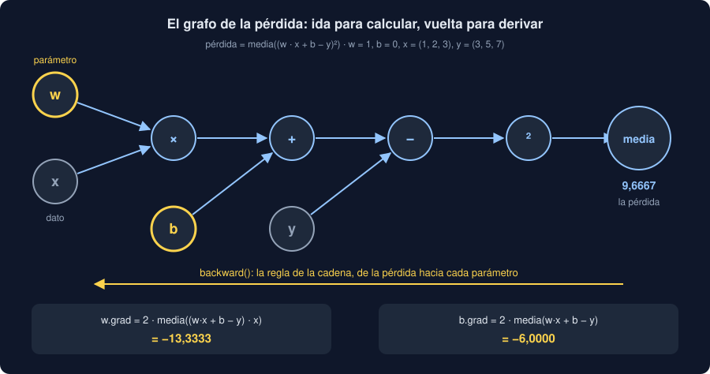

# 02 · Autograd

⏱️ 50 min

## 🎯 Objetivos

- Explicar qué es un gradiente y para qué sirve al entrenar un modelo.
- Pedir a PyTorch que calcule gradientes con `requires_grad` y `backward()`.
- Leer el grafo de operaciones que PyTorch construye al calcular.
- Evitar los tres tropiezos de autograd: gradientes que se acumulan, `no_grad` y `detach`.

---

## 1. Qué es un gradiente

Entrenar un modelo es buscar los números (sus **parámetros**) que hacen pequeña una **pérdida**: el error medio en las medidas de entrenamiento. Para saber hacia dónde mover cada parámetro, hace falta su **derivada**: cuánto cambia la pérdida si ese parámetro sube un poco.

Un ejemplo con un solo parámetro. Un sensor mide 30 µg/m³ y el modelo predice `w`. La pérdida es el cuadrado del error: `(w - 30)²`. Con `w = 20`:

```python
def loss(w):
    return (w - 30) ** 2


step = 0.001
print(f"pérdida en 20: {loss(20)}")
print(f"derivada aproximada: {(loss(20 + step) - loss(20)) / step:.3f}")
```

```
pérdida en 20: 100
derivada aproximada: -19.999
```

La derivada es -20: si `w` sube un poco, la pérdida **baja** unas 20 veces eso. El signo dice hacia dónde ir (subir `w`, al revés que la derivada) y el tamaño, cuánto se nota. Con la regla de la derivada, `2 × (w - 30) = 2 × (20 - 30) = -20`, exacto.

Con muchos parámetros, cada uno tiene su derivada (la **derivada parcial**), y todas juntas forman el **gradiente**. Una red pequeña tiene cientos de parámetros; un modelo de lenguaje, miles de millones. Calcular cada derivada moviendo un parámetro y volviendo a calcular la pérdida, como arriba, sería lentísimo e impreciso. PyTorch las calcula **todas** de una vez, exactas. Eso es *autograd*.

## 2. `requires_grad` y `backward`

```python
import torch

w = torch.tensor(20.0, requires_grad=True)
loss = (w - 30) ** 2
loss.backward()
print(loss, w.grad)
```

```
tensor(100., grad_fn=<PowBackward0>) tensor(-20.)
```

- `requires_grad=True` le dice a PyTorch: "de este tensor voy a querer derivadas". Desde ese momento, cada operación con `w` queda **anotada**.
- `loss` lo dice: `grad_fn=<PowBackward0>` es la última operación que lo creó, y por dónde empieza el camino de vuelta.
- `loss.backward()` recorre ese camino hacia atrás y guarda en `w.grad` la derivada de `loss` respecto de `w`: -20, exacta.

`backward()` solo se puede llamar sobre un tensor de **un solo número**: la pérdida. Por eso la pérdida de muchas medidas siempre se reduce con `mean()` o `sum()` antes.

## 3. El grafo de operaciones

Un modelo de verdad: una recta `w · x + b`, tres medidas, y la pérdida es el error cuadrático medio.

```python
x = torch.tensor([1.0, 2.0, 3.0])
y = torch.tensor([3.0, 5.0, 7.0])
w = torch.tensor(1.0, requires_grad=True)
b = torch.tensor(0.0, requires_grad=True)
predicted = w * x + b
loss = ((predicted - y) ** 2).mean()
loss.backward()
print(f"pérdida {loss.item():.4f} · w.grad {w.grad.item():.4f} · b.grad {b.grad.item():.4f}")
print(x.requires_grad, predicted.requires_grad, type(loss.grad_fn).__name__)
```

```
pérdida 9.6667 · w.grad -13.3333 · b.grad -6.0000
False True MeanBackward0
```



Al calcular `loss`, PyTorch construye un **grafo**: cada operación es un nodo que recuerda de qué tensores salió. La ida (*forward*) calcula la pérdida; `backward()` recorre el grafo de vuelta (*backward*) y aplica en cada nodo la **regla de la cadena**: la derivada de una composición es el producto de las derivadas de cada paso.

- Los dos gradientes son negativos: subir `w` o `b` baja la pérdida. Tiene sentido: las predicciones (1, 2, 3) se quedan cortas frente a (3, 5, 7).
- `w.grad` es mayor que `b.grad`: un cambio en `w` se multiplica por `x`, que llega a 3.
- `x` no pidió gradientes: es un dato, no un parámetro. `predicted` sí los arrastra, porque viene de `w` y `b`.

Puedes comprobarlo con la fórmula de la derivada del error cuadrático medio, `2 · media((w·x + b - y) · x)` para `w` y `2 · media(w·x + b - y)` para `b`:

```python
error = (w * x + b - y).detach()
print(f"{(2 * (error * x).mean()).item():.4f} {(2 * error.mean()).item():.4f}")
```

```
-13.3333 -6.0000
```

Los mismos números. Con una recta, la fórmula se escribe a mano; con una red de tres capas, no querrías hacerlo. Autograd hace lo mismo con **cualquier** cadena de operaciones de PyTorch.

## 4. Los gradientes se acumulan

Llama a `backward()` dos veces con la misma pérdida recalculada:

```python
w = torch.tensor(20.0, requires_grad=True)
for _ in range(3):
    loss = (w - 30) ** 2
    loss.backward()
    print(w.grad)
w.grad.zero_()
print(w.grad)
```

```
tensor(-20.)
tensor(-40.)
tensor(-60.)
tensor(0.)
```

`backward()` **suma** el gradiente nuevo al que ya había en `.grad`: -20, -40, -60. No es un error de PyTorch: hay casos en los que sumar es justo lo que quieres (por ejemplo, juntar los gradientes de varios lotes pequeños). Pero en un bucle de entrenamiento normal, cada paso necesita **solo** su gradiente. Por eso, antes de cada `backward()`, se ponen a cero: `w.grad.zero_()` o, con un optimizador, `optimizer.zero_grad()` (teoría 03).

Si lo olvidas, no hay ningún error: el modelo entrena con gradientes cada vez más grandes, que mezclan todos los pasos anteriores, y aprende peor o se vuelve loco. Es el tropiezo más frecuente de PyTorch. En el proyecto, un test lo detecta comparando con un bucle hecho a mano.

## 5. Cuándo no anotar: `no_grad` y `detach`

Anotar cada operación cuesta memoria y tiempo. Hay dos momentos en los que no quieres hacerlo:

- **al actualizar los parámetros**: `w = w - 0.1 * w.grad` sería una operación más en el grafo, y `w` dejaría de ser un parámetro para ser un resultado;
- **al predecir** con un modelo ya entrenado: no vas a llamar a `backward()`.

```python
w = torch.tensor(20.0, requires_grad=True)
loss = (w - 30) ** 2
loss.backward()
with torch.no_grad():
    w -= 0.1 * w.grad
print(w, w.requires_grad)
with torch.no_grad():
    predicted = w * 2
print(predicted.requires_grad)
```

```
tensor(22., requires_grad=True) True
False
```

- Dentro de `with torch.no_grad():`, nada se anota. `w -= ...` cambia `w` **en su sitio**, y `w` sigue siendo un parámetro con `requires_grad=True`. El paso: de 20 a 22, hacia el 30, porque se resta el gradiente (-20) por un ritmo (0,1). Eso es el descenso de gradiente de la teoría 03.
- `predicted` no arrastra gradientes: es solo un número.

`detach()` hace lo mismo con un tensor suelto: devuelve el mismo número **sin** la historia. Sirve para guardar o imprimir un resultado, o para pasarlo a NumPy:

```python
w = torch.tensor(2.0, requires_grad=True)
doubled = w * 2
try:
    doubled.numpy()
except RuntimeError as error:
    print(error)
print(doubled.detach().numpy(), doubled.item())
```

```
Can't call numpy() on Tensor that requires grad. Use tensor.detach().numpy() instead.
4.0 4.0
```

`.item()` también corta la historia: devuelve un `float` de Python. Por eso, al guardar la pérdida de cada época, se guarda `loss.item()` y no `loss`: una lista de tensores con historia mantendría vivo el grafo de **todas** las épocas en memoria.

## ⚠️ Errores comunes

| Error | Consecuencia | Mejor |
|---|---|---|
| No poner los gradientes a cero | Se suman los de todos los pasos: entrena mal, sin ningún error | `optimizer.zero_grad()` antes de `backward()` |
| `backward()` sobre un tensor de varios números | `RuntimeError: grad can be implicitly created only for scalar outputs` | Reducir la pérdida con `mean()` |
| Actualizar `w = w - rate * w.grad` sin `no_grad` | `w` deja de ser una hoja del grafo y su `.grad` vuelve `None` | `with torch.no_grad(): w -= rate * w.grad` |
| `.numpy()` sobre un tensor con historia | `RuntimeError: Can't call numpy() on Tensor that requires grad` | `.detach().numpy()` |
| Guardar `loss` en una lista | La memoria crece época a época | `losses.append(loss.item())` |
| `requires_grad=True` en las entradas | Gradientes que nadie usa | Solo en los parámetros |

## ✅ Qué debes saber al terminar

- Qué es un gradiente y qué dice su signo.
- Qué hacen `requires_grad`, `backward()` y `.grad`.
- Qué es el grafo de operaciones y cómo lo recorre `backward()` con la regla de la cadena.
- Por qué los gradientes se acumulan y cuándo hay que ponerlos a cero.
- Para qué sirven `torch.no_grad()`, `detach()` e `item()`.

---

## 🔗 Navegación

| Anterior | Actual | Siguiente |
| -------- | ------ | --------- |
| [01 · Tensores](01-tensores.md) | **02 · Autograd** | [03 · Descenso de gradiente](03-descenso-de-gradiente.md) |
