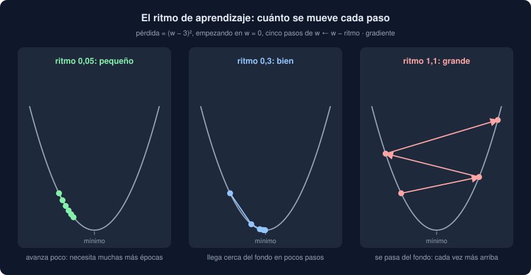

# 03 · Descenso de gradiente

⏱️ 50 min

## 🎯 Objetivos

- Entrenar un modelo con descenso de gradiente: calcular la pérdida, sus gradientes y dar un paso.
- Elegir el ritmo de aprendizaje y reconocer uno demasiado pequeño y uno demasiado grande.
- Escribir el bucle de entrenamiento de PyTorch con `nn.Linear`, una función de pérdida y un optimizador.
- Explicar por qué se escalan las entradas y qué cambia con Adam.

---

## 1. Bajar por la pendiente

El tráfico y las partículas finas: cincuenta horas con miles de vehículos por hora y el PM2.5. Detrás hay una recta, 8 + 4 · vehículos, con ruido:

```python
import torch

torch.manual_seed(34)
vehicles = torch.rand(50) * 5
pm25 = 8 + 4 * vehicles + torch.randn(50) * 2
print(vehicles[:4], pm25[:4])
```

```
tensor([4.3590, 0.5777, 3.5286, 1.9207]) tensor([24.3704,  7.9486, 21.4529, 15.6494])
```

Buscas `w` y `b` para que `w · vehículos + b` se acerque al PM2.5. La teoría 02 te dio los gradientes; el **descenso de gradiente** los usa: mueve cada parámetro un poco en contra de su gradiente, y repite.

```python
w = torch.tensor(0.0, requires_grad=True)
b = torch.tensor(0.0, requires_grad=True)
rate = 0.05
for epoch in range(301):
    loss = ((w * vehicles + b - pm25) ** 2).mean()
    loss.backward()
    with torch.no_grad():
        w -= rate * w.grad
        b -= rate * b.grad
    w.grad.zero_()
    b.grad.zero_()
    if epoch % 100 == 0:
        print(f"época {epoch:3}: pérdida {loss.item():7.3f} · w {w.item():.3f} · b {b.item():.3f}")
```

```
época   0: pérdida 363.097 · w 5.311 · b 1.800
época 100: pérdida   4.439 · w 4.313 · b 7.160
época 200: pérdida   4.353 · w 4.151 · b 7.678
época 300: pérdida   4.352 · w 4.135 · b 7.730
```

Cada vuelta del bucle es una **época**: una pasada por todas las medidas de entrenamiento. En cada una:

1. **Predecir y medir**: la pérdida, el error cuadrático medio de las 50 medidas.
2. **Gradientes**: `backward()` llena `w.grad` y `b.grad`.
3. **Paso**: cada parámetro se mueve `rate` veces su gradiente, hacia abajo. Dentro de `no_grad`, para que el paso no entre en el grafo.
4. **A cero**: los gradientes, para que no se sumen con los de la época siguiente (teoría 02, sección 4).

La pérdida baja de 363 a 4,35, y `w` y `b` se acercan a 4 y 8. No llegan del todo: el ruido no deja (y con 50 medidas, la mejor recta no es exactamente la de verdad). La regresión lineal de scikit-learn llegaba a la mejor recta con una fórmula, de una vez. El descenso de gradiente llega **poco a poco**, pero funciona igual con una recta que con una red de millones de parámetros, donde no hay fórmula.

## 2. El ritmo de aprendizaje

`rate`, el **ritmo de aprendizaje** (*learning rate*), es el hiperparámetro más importante del descenso de gradiente:

```python
def descend(rate, epochs=300):
    w = torch.tensor(0.0, requires_grad=True)
    b = torch.tensor(0.0, requires_grad=True)
    for _ in range(epochs):
        loss = ((w * vehicles + b - pm25) ** 2).mean()
        loss.backward()
        with torch.no_grad():
            w -= rate * w.grad
            b -= rate * b.grad
        w.grad.zero_()
        b.grad.zero_()
    return loss.item()


for rate in [0.001, 0.01, 0.05, 0.12]:
    print(f"ritmo {rate:<5}: pérdida tras 300 épocas {descend(rate):.3f}")
```

```
ritmo 0.001: pérdida tras 300 épocas 10.928
ritmo 0.01 : pérdida tras 300 épocas 4.916
ritmo 0.05 : pérdida tras 300 épocas 4.352
ritmo 0.12 : pérdida tras 300 épocas inf
```



- **Demasiado pequeño** (0,001): cada paso avanza tan poco que, en 300 épocas, no llega. Necesitaría muchas más.
- **Bien** (0,05): llega al fondo, 4,352, la misma pérdida que en la sección 1. Con 0,01 se acerca, pero aún le faltan épocas.
- **Demasiado grande** (0,12): cada paso se pasa del fondo y cae más arriba en la otra pared. La pérdida **crece** en vez de bajar, hasta `inf` o `nan`. Es la señal inequívoca: si la pérdida sube, baja el ritmo.

No hay un ritmo bueno para todo: depende del modelo, de los datos y de su escala. Se prueba en potencias de diez (0,1, 0,01, 0,001) y se mira la curva de la pérdida.

## 3. Con las piezas de PyTorch

Escribir `w`, `b` y los pasos a mano no escala a una red con cientos de parámetros. PyTorch trae las piezas:

```python
from torch import nn

torch.manual_seed(34)
model = nn.Linear(1, 1)
loss_function = nn.MSELoss()
optimizer = torch.optim.SGD(model.parameters(), lr=0.05)
x, y = vehicles.reshape(-1, 1), pm25.reshape(-1, 1)
for epoch in range(301):
    optimizer.zero_grad()
    loss = loss_function(model(x), y)
    loss.backward()
    optimizer.step()
    if epoch % 100 == 0:
        print(f"época {epoch:3}: pérdida {loss.item():7.3f}")
print(model.weight.item(), model.bias.item())
```

```
época   0: pérdida 314.073
época 100: pérdida   4.467
época 200: pérdida   4.353
época 300: pérdida   4.352
4.135420322418213 7.728721618652344
```

Las mismas cuatro líneas en cada época, ahora con nombre:

| A mano | Con PyTorch |
|---|---|
| `w`, `b` con `requires_grad=True` | `nn.Linear(1, 1)`: su `weight` y su `bias`, ya con gradientes |
| `((pred - y) ** 2).mean()` | `nn.MSELoss()` |
| `w.grad.zero_()`, `b.grad.zero_()` | `optimizer.zero_grad()` |
| `with no_grad(): w -= rate * w.grad` | `optimizer.step()` |

- `nn.Linear(1, 1)` empieza con pesos **al azar** (pequeños), no en 0. Por eso la semilla: sin ella, cada ejecución empieza en otro sitio.
- `model.parameters()` da al optimizador los tensores que tiene que mover. El optimizador **no** calcula gradientes: solo lee los `.grad` que dejó `backward()` y da el paso.
- Las entradas van en forma `(50, 1)`: 50 medidas de **una** entrada. `nn.Linear` siempre espera una tabla, aunque tenga una sola columna.

### La forma del objetivo

¿Por qué también `y` en `(50, 1)`? La salida del modelo es `(50, 1)`. Con un objetivo `(50,)`:

```python
import warnings

with warnings.catch_warnings(record=True) as caught:
    warnings.simplefilter("always")
    wrong = loss_function(model(x), pm25)
print(f"pérdida {wrong.item():.1f}")
print(str(caught[0].message).split(". ")[0])
```

```
pérdida 74.1
Using a target size (torch.Size([50])) that is different to the input size (torch.Size([50, 1]))
```

`(50, 1)` menos `(50,)` da, por broadcasting, una tabla `(50, 50)`: **cada** predicción menos **cada** objetivo (teoría 01, sección 5). La pérdida sale enorme y sin sentido, y el modelo aprende a predecir la media. PyTorch solo avisa: no es un error. Comprueba siempre que la salida y el objetivo tienen la misma forma.

## 4. Escalar las entradas

Los mismos datos con los vehículos en unidades, no en miles: de 0 a 5000.

```python
for name, inputs in [("miles", x), ("unidades", x * 1000)]:
    torch.manual_seed(34)
    model = nn.Linear(1, 1)
    optimizer = torch.optim.SGD(model.parameters(), lr=0.05)
    for _ in range(100):
        optimizer.zero_grad()
        loss = loss_function(model(inputs), y)
        loss.backward()
        optimizer.step()
    print(f"{name:8}: pérdida tras 100 épocas {loss.item():.3f}")
```

```
miles   : pérdida tras 100 épocas 4.473
unidades: pérdida tras 100 épocas nan
```

El gradiente de un peso se multiplica por su entrada (teoría 02, sección 3). Con entradas de miles, los gradientes son miles de veces más grandes, y el ritmo 0,05, que iba bien, ahora salta fuera: `nan`. Con varias entradas en escalas distintas es peor: no hay un ritmo que vaya bien a todas a la vez.

Por eso, antes de una red, las entradas se **escalan**: `StandardScaler`, como en la semana 32, ajustado con el entrenamiento. Y en regresión, también el **objetivo**: una red empieza prediciendo valores cerca de 0, y si el objetivo ronda 50, pierde cientos de épocas solo en llegar. El proyecto escala el valor, entrena y deshace el escalado al predecir (teoría 05).

## 5. Adam

`SGD` da a todos los parámetros el mismo ritmo. **Adam**, el optimizador más usado, ajusta un ritmo para cada parámetro con la historia de sus gradientes: avanza más con los que se mueven poco y frena con los que saltan.

```python
for name, optimizer_class in [("SGD", torch.optim.SGD), ("Adam", torch.optim.Adam)]:
    torch.manual_seed(34)
    model = nn.Linear(1, 1)
    optimizer = optimizer_class(model.parameters(), lr=0.5)
    for _ in range(100):
        optimizer.zero_grad()
        loss = loss_function(model(x), y)
        loss.backward()
        optimizer.step()
    print(f"{name:4} con ritmo 0.5: pérdida tras 100 épocas {loss.item():.3f}")
```

```
SGD  con ritmo 0.5: pérdida tras 100 épocas nan
Adam con ritmo 0.5: pérdida tras 100 épocas 4.400
```

Con un ritmo de 0,5, SGD se pasa y diverge; Adam llega. Adam no es mágico (con un ritmo absurdo también falla), pero tolera mucho mejor un ritmo mal elegido. Su ritmo por defecto, 0,001, es conservador; para redes pequeñas como las de esta semana, 0,01 va bien. El proyecto usa Adam con 0,01.

## ⚠️ Errores comunes

| Error | Consecuencia | Mejor |
|---|---|---|
| La pérdida sube o sale `nan` | Ritmo demasiado alto, o entradas sin escalar | Bajar el ritmo diez veces; escalar |
| La pérdida apenas baja | Ritmo demasiado bajo, o pocas épocas | Subir el ritmo diez veces; más épocas |
| Salida `(n, 1)` y objetivo `(n,)` | Broadcasting a `(n, n)`: aviso y pérdida sin sentido | `y.reshape(-1, 1)` |
| Olvidar `optimizer.zero_grad()` | Gradientes acumulados, sin error | Primera línea de cada época |
| Crear el optimizador antes que el modelo nuevo | Mueve los parámetros del modelo viejo | El optimizador, siempre después del modelo |
| Escalar con todas las medidas | Fuga de la prueba al entrenamiento | Ajustar el escalado solo con el entrenamiento |

## ✅ Qué debes saber al terminar

- Los cuatro pasos de cada época: predecir y medir, `backward()`, `step()`, gradientes a cero.
- Qué pasa con un ritmo de aprendizaje demasiado pequeño y uno demasiado grande.
- Qué hacen `nn.Linear`, `nn.MSELoss` y un optimizador, y que la salida y el objetivo deben tener la misma forma.
- Por qué se escalan las entradas (y el objetivo, en regresión) antes de entrenar.
- Qué cambia con Adam frente a SGD.

---

## 🔗 Navegación

| Anterior | Actual | Siguiente |
| -------- | ------ | --------- |
| [02 · Autograd](02-autograd.md) | **03 · Descenso de gradiente** | [04 · Redes neuronales: el MLP](04-redes-neuronales-mlp.md) |
