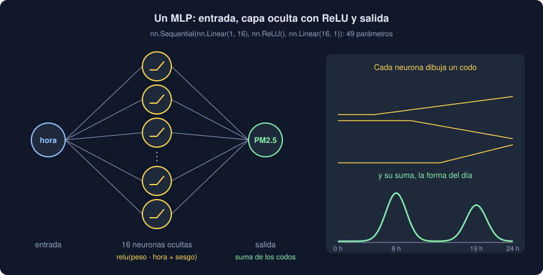

# 04 · Redes neuronales: el MLP

⏱️ 50 min

## 🎯 Objetivos

- Explicar qué es una red neuronal de capas (un MLP) y por qué necesita activaciones.
- Construir una red con `nn.Sequential` y con una clase `nn.Module`, y contar sus parámetros.
- Entrenarla con mini-lotes usando `TensorDataset` y `DataLoader`.
- Separar entrenamiento y validación, y reconocer el sobreajuste en las dos curvas de pérdida.

---

## 1. Una recta no basta

El PM2.5 a lo largo del día: sube con el tráfico de la mañana, baja a mediodía y vuelve a subir por la tarde. Cuatrocientas horas:

```python
import torch
from torch import nn

torch.manual_seed(34)
hours = torch.randint(0, 24, (400, 1)).float()
peaks = 20 * torch.exp(-((hours - 8) ** 2) / 4) + 15 * torch.exp(-((hours - 19) ** 2) / 4)
pm25 = 15 + peaks + torch.randn(400, 1) * 2
x = (hours - 11.5) / 7
y = (pm25 - pm25.mean()) / pm25.std()
print(x.shape, y.shape, f"{x.min().item():.2f} a {x.max().item():.2f}")
```

```
torch.Size([400, 1]) torch.Size([400, 1]) -1.64 a 1.64
```

La hora y el PM2.5 van escalados (teoría 03, sección 4): la hora, entre -1,6 y 1,6; el PM2.5, con media 0 y desviación 1. Una función para entrenar cualquier modelo con todas las medidas a la vez:

```python
def fit(model, x, y, epochs=500, rate=0.01):
    optimizer = torch.optim.Adam(model.parameters(), lr=rate)
    loss_function = nn.MSELoss()
    for _ in range(epochs):
        optimizer.zero_grad()
        loss = loss_function(model(x), y)
        loss.backward()
        optimizer.step()
    return loss.item()


torch.manual_seed(34)
print(f"recta: pérdida {fit(nn.Linear(1, 1), x, y):.3f}")
```

```
recta: pérdida 0.989
```

Una pérdida de casi 1: con el objetivo escalado, es lo que se equivoca **predecir siempre la media**. Una recta solo puede subir o bajar con la hora; dos picos, no.

## 2. Capas y activaciones

¿Y si apilas dos capas lineales? La primera pasa de 1 entrada a 16 números, y la segunda, de 16 a 1:

```python
torch.manual_seed(34)
stacked = nn.Sequential(nn.Linear(1, 16), nn.Linear(16, 1))
print(f"dos capas lineales: pérdida {fit(stacked, x, y):.3f}")
```

```
dos capas lineales: pérdida 0.989
```

Lo mismo que la recta. Una capa lineal de una capa lineal es otra capa lineal: `(x · W1 + b1) · W2 + b2 = x · (W1 · W2) + (b1 · W2 + b2)`. Apilar rectas da una recta, con más parámetros.

Para doblar, entre capa y capa va una **función de activación**, que no es una recta. La más usada, **ReLU**: deja los positivos como están y cambia los negativos por 0.

```python
print(torch.relu(torch.tensor([-2.0, -0.5, 0.0, 0.5, 2.0])))
torch.manual_seed(34)
network = nn.Sequential(nn.Linear(1, 16), nn.ReLU(), nn.Linear(16, 1))
print(f"red con ReLU: pérdida {fit(network, x, y):.3f}")
```

```
tensor([0.0000, 0.0000, 0.0000, 0.5000, 2.0000])
red con ReLU: pérdida 0.139
```



Esto es un **perceptrón multicapa** (MLP, *multilayer perceptron*), la red neuronal más sencilla:

- La **capa de entrada** no calcula nada: son tus columnas, ya escaladas.
- La **capa oculta**: 16 **neuronas**. Cada una suma las entradas por sus pesos, añade su sesgo y aplica ReLU. Cada neurona dibuja un "codo": plano hasta un punto y recto después.
- La **capa de salida** suma los 16 codos con sus pesos. Con suficientes codos, una suma dibuja cualquier curva: los dos picos del día.

La pérdida baja de 0,99 a 0,14: la red ha encontrado los picos sin que nadie le diga dónde están. Es lo que en la semana 32 hacías a mano creando columnas (`es_hora_punta`): aquí, la capa oculta las aprende.

## 3. `nn.Module`: la red como clase

`nn.Sequential` encadena capas en orden. Para algo que no sea una cadena (dos entradas, una salida que se reutiliza…), escribes una clase que hereda de `nn.Module`:

```python
class Daily(nn.Module):
    """La hora del día, una capa oculta con ReLU y el PM2.5."""

    def __init__(self, hidden: int = 16) -> None:
        super().__init__()
        self.hidden = nn.Linear(1, hidden)
        self.output = nn.Linear(hidden, 1)

    def forward(self, x: torch.Tensor) -> torch.Tensor:
        return self.output(torch.relu(self.hidden(x)))


model = Daily()
for name, parameter in model.named_parameters():
    print(f"{name:14} {tuple(parameter.shape)}")
print(sum(parameter.numel() for parameter in model.parameters()), "parámetros")
```

```
hidden.weight  (16, 1)
hidden.bias    (16,)
output.weight  (1, 16)
output.bias    (1,)
49 parámetros
```

- En `__init__` se crean las capas. Al guardarlas como atributos (`self.hidden`), `nn.Module` las **registra**: `parameters()` las encuentra solas, y el optimizador las mueve.
- `forward` dice cómo va la entrada hasta la salida. No se llama directamente: `model(x)` llama a `forward` y, de paso, a los ganchos de PyTorch.
- Los parámetros: la capa oculta tiene 16 pesos (uno por neurona) y 16 sesgos; la de salida, 16 pesos y 1 sesgo. 49 en total. Con `n` entradas y `h` neuronas: `(n + 1) · h + (h + 1)`.

Las dos formas dan la misma red. `nn.Sequential` para una cadena, que es lo que usa el proyecto; una clase cuando la red tiene algo más.

## 4. Mini-lotes

Hasta aquí, cada época calcula la pérdida con **todas** las medidas a la vez. Con millones de medidas no caben en memoria, y además es lento: un solo paso por época. La alternativa son los **mini-lotes**: cada época reparte las medidas en grupos pequeños al azar, y da un paso por grupo.

```python
from torch.utils.data import DataLoader, TensorDataset

batches = DataLoader(TensorDataset(x, y), batch_size=32, shuffle=True)
first_x, first_y = next(iter(batches))
print(len(batches), "lotes por época ·", first_x.shape, first_y.shape)

torch.manual_seed(34)
model = Daily()
optimizer = torch.optim.Adam(model.parameters(), lr=0.01)
loss_function = nn.MSELoss()
for epoch in range(1, 151):
    for batch_x, batch_y in batches:
        optimizer.zero_grad()
        loss = loss_function(model(batch_x), batch_y)
        loss.backward()
        optimizer.step()
    if epoch % 50 == 0:
        with torch.no_grad():
            print(f"época {epoch}: pérdida {loss_function(model(x), y).item():.3f}")
```

```
13 lotes por época · torch.Size([32, 1]) torch.Size([32, 1])
época 50: pérdida 0.300
época 100: pérdida 0.273
época 150: pérdida 0.246
```

- `TensorDataset(x, y)` junta entradas y objetivos: el elemento `i` es la pareja `(x[i], y[i])`.
- `DataLoader` los sirve en lotes de 32, **barajados** en cada época (`shuffle=True`). 400 medidas son 13 lotes: 12 de 32 y uno de 16.
- Un **paso** es una actualización; una **época**, una pasada por todos los lotes. Aquí, 13 pasos por época: 150 épocas son 1950 pasos. La pérdida baja, pero más despacio que con todas las medidas (0,25 frente a 0,14): cada paso mira solo 32, y el azar de cada lote lo desvía un poco. Con millones de medidas compensa: un paso con 32 cuesta miles de veces menos que uno con todas.
- La pérdida de un lote es ruidosa (son solo 32 medidas). Para seguir el entrenamiento, se mide al final de la época con todas, dentro de `no_grad`.

Con miles de medidas como las de tu Observatorio, todas caben de una vez: el proyecto entrena sin lotes, que es más sencillo y da siempre el mismo resultado. Los lotes los usarás en la semana 35, con imágenes.

## 5. Entrenamiento, validación y sobreajuste

Una red con muchas neuronas y pocas medidas puede **memorizar**, como un árbol sin límite. Para verlo, se aparta una parte de las medidas que la red no ve al entrenar, y se mide la pérdida en las dos:

```python
torch.manual_seed(34)
order = torch.randperm(400)
few, held = order[:40], order[40:]
model = nn.Sequential(nn.Linear(1, 256), nn.ReLU(), nn.Linear(256, 256), nn.ReLU(), nn.Linear(256, 1))
optimizer = torch.optim.Adam(model.parameters(), lr=0.01)
for epoch in range(1, 1501):
    model.train()
    optimizer.zero_grad()
    loss = loss_function(model(x[few]), y[few])
    loss.backward()
    optimizer.step()
    if epoch in (50, 100, 300, 1500):
        model.eval()
        with torch.no_grad():
            held_loss = loss_function(model(x[held]), y[held]).item()
        print(f"época {epoch:4}: entrenamiento {loss.item():.3f} · validación {held_loss:.3f}")
```

```
época   50: entrenamiento 0.758 · validación 0.800
época  100: entrenamiento 0.467 · validación 0.449
época  300: entrenamiento 0.024 · validación 0.169
época 1500: entrenamiento 0.019 · validación 0.183
```

Solo 40 medidas para entrenar, y una red de más de 66 000 parámetros. Hasta la época 100, las dos pérdidas bajan juntas: la red aprende la forma del día. Después, la de entrenamiento baja hasta 0,02, casi nada, y la de validación se queda en 0,17 y vuelve a **subir**: la red persigue el ruido de sus 40 medidas. Es el sobreajuste de la semana 31, con otra cara.

- **Más medidas** es el mejor remedio: con las 400, la misma red sobreajusta mucho menos.
- **Una red más pequeña**: menos parámetros, menos capacidad de memorizar.
- **Parar a tiempo** (*early stopping*): mirar la pérdida de validación en cada época y quedarse con la red de la mejor. Lo hacía `HistGradientBoosting` en la semana 33.
- **`model.train()` y `model.eval()`**: algunas capas (como `Dropout`, en la semana 35) se comportan distinto al entrenar y al predecir. Estas redes no tienen ninguna, pero la costumbre es la de siempre: `train()` antes de entrenar, `eval()` y `no_grad()` antes de medir.

## ⚠️ Errores comunes

| Error | Consecuencia | Mejor |
|---|---|---|
| Capas lineales sin activación entre ellas | Una recta con más parámetros | `nn.ReLU()` entre capa y capa |
| Crear las capas en `forward` | Pesos nuevos en cada llamada: no aprende | Crearlas en `__init__`, como atributos |
| Olvidar `super().__init__()` | `AttributeError: cannot assign module before Module.__init__() call` | Primera línea de `__init__` |
| Llamar a `model.forward(x)` | Se salta los ganchos de PyTorch | `model(x)` |
| Medir solo la pérdida de entrenamiento | No ves el sobreajuste | Una parte de validación, y las dos curvas |
| Predecir sin `model.eval()` ni `no_grad()` | Capas en modo entrenamiento y un grafo que nadie usa | `model.eval()` y `with torch.no_grad():` |

## ✅ Qué debes saber al terminar

- Qué es un MLP: capa de entrada, capa oculta con activación, capa de salida.
- Por qué dos capas lineales seguidas son una recta, y qué añade ReLU.
- Escribir una red con `nn.Sequential` y con `nn.Module`, y contar sus parámetros.
- Qué es un mini-lote, un paso y una época, y qué hacen `TensorDataset` y `DataLoader`.
- Reconocer el sobreajuste en las curvas de entrenamiento y validación, y tres formas de frenarlo.

---

## 🔗 Navegación

| Anterior | Actual | Siguiente |
| -------- | ------ | --------- |
| [03 · Descenso de gradiente](03-descenso-de-gradiente.md) | **04 · Redes neuronales: el MLP** | [05 · PyTorch en tu Observatorio](05-pytorch-en-tu-observatorio.md) |
