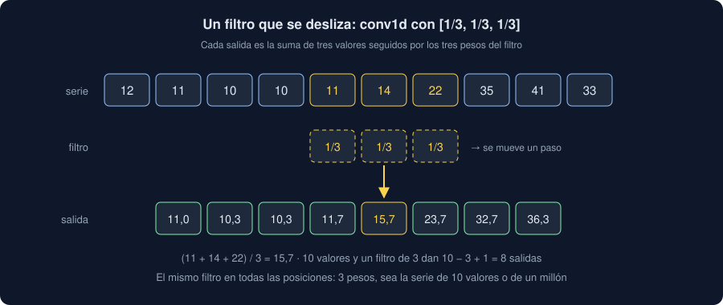

# 01 · La convolución

⏱️ 45 min

## 🎯 Objetivos

- Explicar por qué un MLP desperdicia parámetros con imágenes y series, y qué cambia una convolución.
- Calcular a mano la salida de un filtro que se desliza, y comprobarla con `F.conv1d`.
- Predecir el tamaño de la salida con el relleno (`padding`) y el paso (`stride`).
- Contar los parámetros de `nn.Conv1d` y `nn.Conv2d`, con varios canales de entrada y de salida.
- Explicar qué hace `MaxPool2d`.

---

## 1. Lo que un MLP no sabe

El MLP de la semana 34 recibe una fila de números. No sabe que la hora 8 va justo después de la 7, ni que en una imagen un píxel tiene vecinos arriba y abajo: si desordenas las columnas de todas las medidas igual, aprende lo mismo. Eso tiene dos costes:

- **Parámetros**: una capa `nn.Linear` une cada entrada con cada neurona. Con una foto de 224 × 224 píxeles y una salida por píxel, más de 2500 millones de pesos (ejercicio 01, paso 6).
- **Repetición**: si aprende a reconocer un pico a las 8, no sabe nada de un pico a las 19. Tiene que aprenderlo otra vez, con otros pesos.

Una **convolución** resuelve las dos cosas: mira un trozo pequeño cada vez, y usa los mismos pesos en todas las posiciones.

## 2. Un filtro que se desliza

Un **filtro** (o *kernel*) es una fila corta de pesos. Se coloca al principio de la serie, se multiplica valor a valor y se suma; se mueve una posición, y se repite. Cada suma es un valor de la salida:



A mano, con un día de PM2.5 hora a hora y el filtro `[1/3, 1/3, 1/3]`:

```python
import torch
import torch.nn.functional as F

day = torch.tensor([12, 11, 10, 10, 11, 14, 22, 35, 41, 33, 25, 20,
                    18, 17, 18, 21, 27, 36, 39, 31, 24, 19, 15, 13], dtype=torch.float32)
kernel = torch.tensor([1 / 3, 1 / 3, 1 / 3])
by_hand = torch.stack([(day[i : i + 3] * kernel).sum() for i in range(len(day) - 2)])
print(by_hand.shape, [round(v, 1) for v in by_hand[:6].tolist()])
```

```
torch.Size([22]) [11.0, 10.3, 10.3, 11.7, 15.7, 23.7]
```

Con PyTorch, `F.conv1d`. Pide la serie con forma **(lotes, canales, longitud)** y el filtro con forma **(canales de salida, canales de entrada, tamaño)**:

```python
out = F.conv1d(day.reshape(1, 1, -1), kernel.reshape(1, 1, -1))
print(out.shape, torch.allclose(out[0, 0], by_hand))
```

```
torch.Size([1, 1, 22]) True
```

Veinticuatro valores y un filtro de 3 dan 24 − 3 + 1 = 22 salidas: el filtro no puede empezar en las dos últimas horas, porque se saldría.

> En matemáticas, una convolución da la vuelta al filtro antes de deslizarlo. PyTorch no la da (lo que calcula se llama *correlación cruzada*), pero todo el mundo lo llama convolución: como los pesos se aprenden, da igual en qué orden estén.

## 3. Lo que detecta un filtro

Con pesos iguales, el filtro hace una media móvil, como `moving_average` de la semana 06. Con otros pesos, detecta otras cosas. `[-1, 0, 1]` resta la hora anterior de la siguiente: positivo si el PM2.5 sube, negativo si baja.

```python
rise = F.conv1d(day.reshape(1, 1, -1), torch.tensor([[[-1.0, 0.0, 1.0]]]))[0, 0]
print(rise[:10].tolist())
print(f"la mayor subida, centrada en la hora {rise.argmax().item() + 1}")
```

```
[-2.0, -1.0, 1.0, 4.0, 11.0, 21.0, 19.0, -2.0, -16.0, -13.0]
la mayor subida, centrada en la hora 6
```

Un filtro es un **detector de un patrón**: da valores grandes donde la serie se parece a sus pesos. En una red, nadie elige los pesos: empiezan al azar y el descenso de gradiente los ajusta, como los de `nn.Linear`. La red descubre qué patrones le sirven.

## 4. El tamaño de la salida

Dos opciones cambian cuántos valores salen:

- **`padding`** (relleno): añade ceros a cada lado. Con `padding=1` y un filtro de 3, la salida tiene la misma longitud que la entrada.
- **`stride`** (paso): cuántas posiciones avanza el filtro cada vez. Con `stride=2`, la mitad de salidas.

La fórmula, con `n` valores, filtro `k`, relleno `p` y paso `s`: `(n + 2p − k) // s + 1`.

```python
signal = day.reshape(1, 1, -1)
for padding, stride in [(0, 1), (1, 1), (0, 2), (1, 3)]:
    size = F.conv1d(signal, kernel.reshape(1, 1, -1), padding=padding, stride=stride).shape[-1]
    print(f"padding={padding} stride={stride}: {size} · fórmula {(24 + 2 * padding - 3) // stride + 1}")
```

```
padding=0 stride=1: 22 · fórmula 22
padding=1 stride=1: 24 · fórmula 24
padding=0 stride=2: 11 · fórmula 11
padding=1 stride=3: 8 · fórmula 8
```

## 5. Canales

Una serie puede tener varias columnas a la vez: PM2.5, temperatura y viento cada hora son **3 canales de entrada**. Y una capa no tiene un filtro, sino varios: cada uno da su propia serie de salida, un **canal de salida** (o *mapa*). `nn.Conv1d` crea los filtros como parámetros:

```python
from torch import nn

torch.manual_seed(35)
layer = nn.Conv1d(in_channels=3, out_channels=4, kernel_size=3)
hours = torch.randn(1, 3, 24)
print(layer.weight.shape, layer.bias.shape)
print(layer(hours).shape)
print(sum(p.numel() for p in layer.parameters()))
```

```
torch.Size([4, 3, 3]) torch.Size([4])
torch.Size([1, 4, 22])
40
```

Cada uno de los 4 filtros tiene 3 × 3 pesos (tres canales por tres posiciones) y un sesgo: 4 × (3 × 3) + 4 = 40 parámetros. Y no dependen de la longitud: los mismos 40 sirven para 24 horas o para un año.

## 6. En dos dimensiones

En una imagen, el filtro es un cuadrado pequeño que recorre filas y columnas. `nn.Conv2d` pide **(lotes, canales, alto, ancho)**: un dígito en gris tiene 1 canal; una foto en color, 3 (rojo, verde y azul).

```python
torch.manual_seed(35)
conv = nn.Conv2d(in_channels=1, out_channels=8, kernel_size=3, padding=1)
pool = nn.MaxPool2d(2)
digit = torch.rand(1, 1, 8, 8)
maps = conv(digit)
print(conv.weight.shape, sum(p.numel() for p in conv.parameters()))
print(maps.shape, pool(maps).shape)
```

```
torch.Size([8, 1, 3, 3]) 80
torch.Size([1, 8, 8, 8]) torch.Size([1, 8, 4, 4])
```

- 8 filtros de 3 × 3 sobre 1 canal: 8 × 9 + 8 = 80 parámetros. Con `padding=1`, los mapas miden lo mismo que la imagen.
- **`MaxPool2d(2)`** no tiene parámetros: parte cada mapa en cuadrados de 2 × 2 y se queda con el máximo de cada uno. Los mapas pasan de 8 × 8 a 4 × 4: menos números para las capas siguientes, y un patrón que se mueve un píxel da casi el mismo máximo.

En el ejercicio 01, paso 4, dos filtros escritos a mano encuentran los bordes verticales y horizontales de un dígito.

## ⚠️ Errores comunes

| Error | Consecuencia | Mejor |
|---|---|---|
| Pasar a `Conv1d` una serie con forma `(24,)` | `RuntimeError: Expected 2D (unbatched) or 3D (batched) input to conv1d` | `(lotes, canales, longitud)`: `serie.reshape(1, 1, -1)` |
| Pasar una serie con forma `(24, 1)` | `RuntimeError: ... expected input[1, 24, 1] to have 1 channels, but got 24 channels instead`: 24 canales de longitud 1 | `serie.reshape(1, 1, -1)` |
| Confundir canales con longitud en `Conv1d` | La red mezcla horas como si fueran variables distintas | Canales: qué se mide; longitud: cuándo |
| Olvidar que la salida encoge | Una `nn.Linear` posterior con el tamaño equivocado: `mat1 and mat2 shapes cannot be multiplied` | Calcula `(n + 2p − k) // s + 1`, o imprime la forma capa a capa |
| Un filtro más largo que la serie | `RuntimeError: ... Kernel size can't be greater than actual input size` | Series más largas, o un filtro más corto |
| Creer que `MaxPool2d` aprende algo | Contar parámetros de más | `MaxPool2d` no tiene parámetros |

## ✅ Qué debes saber al terminar

- Por qué una convolución usa menos parámetros que una capa lineal, y por qué reconoce un patrón en cualquier posición.
- Calcular a mano la salida de un filtro, y reproducirla con `F.conv1d`.
- La fórmula del tamaño de la salida con `padding` y `stride`.
- Qué son los canales de entrada y de salida, y contar los parámetros de una capa convolucional.
- Qué hace `MaxPool2d` y por qué no tiene parámetros.

---

## 🔗 Navegación

| Anterior | Actual | Siguiente |
| -------- | ------ | --------- |
| [Semana 35](../README.md) | **01 · La convolución** | [02 · Redes convolucionales](02-redes-convolucionales.md) |
