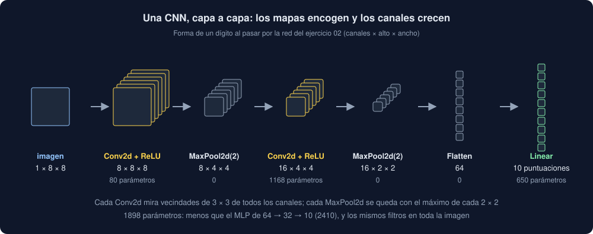

# 02 · Redes convolucionales

⏱️ 50 min

## 🎯 Objetivos

- Construir una red convolucional (CNN) con bloques de convolución, ReLU y *pooling*, y seguir la forma capa a capa.
- Clasificar con una CNN: puntuaciones, `CrossEntropyLoss`, `softmax`, `argmax` y acierto.
- Comparar una CNN con un MLP: parámetros, acierto y qué pasa al mover la imagen.
- Usar `Conv1d` sobre una serie para pronosticar el siguiente valor, como hará tu Observatorio.

---

## 1. Bloques que se repiten

Una CNN apila **bloques**: una convolución que busca patrones, ReLU que dobla (teoría 04 de la semana 34) y un `MaxPool2d` que encoge. Cada bloque tiene más canales que el anterior y mapas más pequeños. Al final, `Flatten` pone todo en fila y una capa lineal decide.



```python
import torch
from torch import nn

torch.manual_seed(35)
cnn = nn.Sequential(
    nn.Conv2d(1, 8, kernel_size=3, padding=1), nn.ReLU(), nn.MaxPool2d(2),
    nn.Conv2d(8, 16, kernel_size=3, padding=1), nn.ReLU(), nn.MaxPool2d(2),
    nn.Flatten(),
    nn.Linear(16 * 2 * 2, 10),
)
x = torch.rand(5, 1, 8, 8)
for layer in cnn:
    x = layer(x)
    print(f"{type(layer).__name__:<10} {tuple(x.shape)}")
print(sum(p.numel() for p in cnn.parameters()), "parámetros")
```

```
Conv2d     (5, 8, 8, 8)
ReLU       (5, 8, 8, 8)
MaxPool2d  (5, 8, 4, 4)
Conv2d     (5, 16, 4, 4)
ReLU       (5, 16, 4, 4)
MaxPool2d  (5, 16, 2, 2)
Flatten    (5, 64)
Linear     (5, 10)
1898 parámetros
```

- Cinco imágenes a la vez: la primera dimensión es el lote, y no cambia en toda la red.
- La segunda `Conv2d` tiene 16 filtros de 8 × 3 × 3: cada uno mira **los 8 canales** de la anterior a la vez. Son 16 × 72 + 16 = 1168 parámetros.
- Tras el primer `MaxPool2d`, cada número resume un cuadrado de 2 × 2 píxeles. Un filtro de 3 × 3 de la segunda capa ve, por tanto, unos 6 × 6 píxeles de la imagen: las primeras capas ven trazos; las siguientes, formas hechas de trazos.
- `nn.Linear(16 * 2 * 2, 10)`: el 64 sale de la forma tras `Flatten`. Si cambias el tamaño de la imagen o el número de bloques, cambia; imprime la forma capa a capa antes de escribirlo.

## 2. Clasificar: puntuaciones y probabilidades

Para regresión, la red de la semana 34 tenía una salida. Para clasificar entre 10 dígitos, tiene **10 salidas**, una puntuación por clase (en inglés, *logits*). Gana la más alta:

```python
scores = torch.tensor([[2.0, -1.0, 0.5], [0.1, 0.2, 3.0]])
print(scores.argmax(dim=1))
print(scores.softmax(dim=1).round(decimals=3))
```

```
tensor([0, 2])
tensor([[0.7860, 0.0390, 0.1750],
        [0.0490, 0.0540, 0.8960]])
```

`softmax` convierte las puntuaciones en probabilidades positivas que suman 1, pero no cambia cuál es la mayor. La pérdida es **`nn.CrossEntropyLoss`**: recibe las puntuaciones (sin `softmax`: lo aplica ella) y la clase correcta como un entero, no como una columna.

```python
loss_function = nn.CrossEntropyLoss()
labels = torch.tensor([0, 2])
print(f"acierta las dos: {loss_function(scores, labels).item():.3f}")
print(f"falla las dos:   {loss_function(scores, torch.tensor([1, 0])).item():.3f}")
```

```
acierta las dos: 0.175
falla las dos:   3.125
```

Cuanto más probable da la red la clase correcta, más baja la pérdida. Y en lugar del MAE, se mide el **acierto**: la parte de las imágenes cuya clase con la puntuación más alta es la correcta, `(scores.argmax(dim=1) == labels).float().mean()`.

## 3. ¿CNN o MLP?

En el ejercicio 02, con 1200 dígitos para entrenar y 597 de prueba:

| Red | Parámetros | Acierto en prueba | Con las imágenes movidas un píxel |
|---|---|---|---|
| MLP, 64 → 32 → 10 | 2410 | 0,983 | 0,451 |
| CNN, la de la sección 1 | 1898 | 0,973 | 0,685 |

Con dígitos de 8 × 8, centrados y limpios, el MLP acierta algo más: la imagen es tan pequeña que 64 entradas no son un problema. Pero aprende "este píxel encendido", no "este trazo": mueve el dígito un píxel a la derecha y pierde más de la mitad de los aciertos. La CNN busca el trazo en cualquier sitio, y aguanta mejor.

Con fotos de verdad, de cientos de píxeles por lado y el objeto en cualquier posición, una CNN gana por mucho. Y con series largas pasa lo mismo: un pico a las 8 o a las 19 es el mismo patrón para un filtro.

## 4. Una CNN para una serie

Tu Observatorio no tiene imágenes, tiene **series**: valores que llegan uno detrás de otro. Una pregunta natural: ¿los últimos valores dicen algo del siguiente? Para que una red lo aprenda, la serie se corta en **ventanas**: unos cuantos valores seguidos y el que viene después.

```python
import numpy as np

values = np.arange(10.0)
x = np.lib.stride_tricks.sliding_window_view(values[:-1], 4)
y = values[4:]
print(x[:3])
print(y[:3], x.shape, y.shape)
```

```
[[0. 1. 2. 3.]
 [1. 2. 3. 4.]
 [2. 3. 4. 5.]]
[4. 5. 6.] (6, 4) (6,)
```

`sliding_window_view` no copia: ve el mismo array por tramos. `values[:-1]`, porque el último valor no tiene siguiente; `values[4:]`, porque los cuatro primeros no tienen bastantes anteriores. Seis ventanas para diez valores.

La red de `core/convolution.py`, la del proyecto: una `Conv1d` con 4 filtros de 3 valores, ReLU, `Flatten` y una capa lineal que da el pronóstico.

```python
window = 8
net = nn.Sequential(
    nn.Conv1d(1, 4, kernel_size=3), nn.ReLU(), nn.Flatten(), nn.Linear(4 * (window - 3 + 1), 1)
)
batch = torch.rand(32, 1, window)
print(net(batch).shape, sum(p.numel() for p in net.parameters()), "parámetros")
```

```
torch.Size([32, 1]) 41 parámetros
```

- Entrada `(32, 1, 8)`: 32 ventanas, 1 canal (el valor), 8 posiciones.
- La convolución da 4 canales de 8 − 3 + 1 = 6 posiciones; `Flatten`, 24 números; la lineal, un pronóstico por ventana.
- 4 × 3 + 4 = 16 parámetros en los filtros y 24 + 1 = 25 en la salida: 41. Con una ventana de 24 valores, 4 × 22 + 1 = 89 en la salida y 105 en total.

Cada filtro busca un patrón corto (una subida, un pico, una meseta), y la capa lineal decide cuánto pesa cada patrón según dónde aparezca en la ventana.

## ⚠️ Errores comunes

| Error | Consecuencia | Mejor |
|---|---|---|
| Aplicar `softmax` antes de `CrossEntropyLoss` | La pérdida aplica otra vez la suya: entrena peor, sin ningún error | Dale las puntuaciones tal cual |
| La clase como columna `(n, 1)` o como `float` | `RuntimeError: 0D or 1D target tensor expected, multi-target not supported`, o `expected target dtype to be Long or Byte, but got Float` | Un tensor de enteros `(n,)`: `torch.tensor(digits.target)` |
| `Linear(64, …)` escrito a ojo | `mat1 and mat2 shapes cannot be multiplied` al cambiar la imagen o la ventana | Calcúlalo: canales × lo que queda tras cada capa |
| Comparar una CNN y un MLP con una sola cifra | Te quedas sin ver en qué falla cada uno | Mide también con lo que tus datos cambiarán: imágenes movidas, otras horas |
| Barajar la serie antes de cortar las ventanas | Cada ventana mezcla horas que no van juntas | Corta las ventanas en orden; se baraja después, ventana a ventana |

## ✅ Qué debes saber al terminar

- Cómo cambian los canales y el tamaño de los mapas al pasar por cada bloque de una CNN, y contar sus parámetros.
- Qué son las puntuaciones, qué hace `softmax` y por qué `CrossEntropyLoss` recibe las puntuaciones y no probabilidades.
- Por qué una CNN reconoce un patrón movido mejor que un MLP, y cuándo un MLP basta.
- Cortar una serie en ventanas con `sliding_window_view`, y la forma `(ventanas, 1, tamaño)` que espera `Conv1d`.

---

## 🔗 Navegación

| Anterior | Actual | Siguiente |
| -------- | ------ | --------- |
| [01 · La convolución](01-la-convolucion.md) | **02 · Redes convolucionales** | [03 · Entrenar de verdad](03-entrenar-de-verdad.md) |
